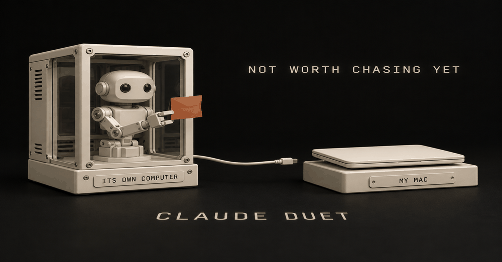
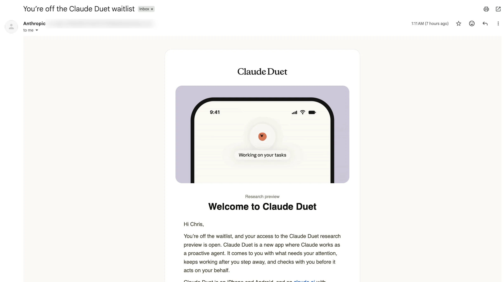
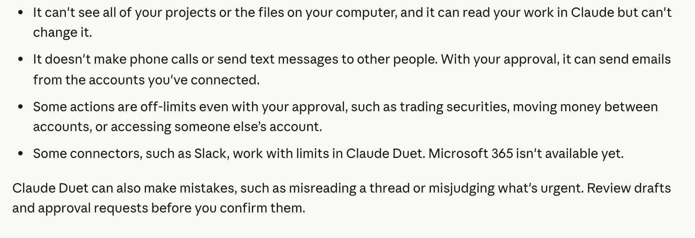
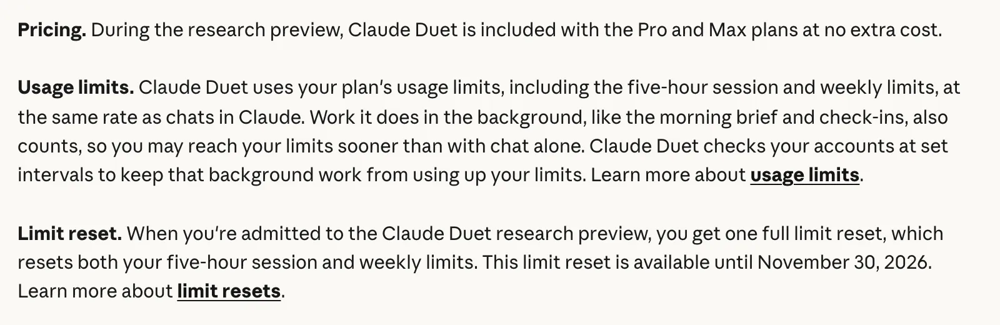
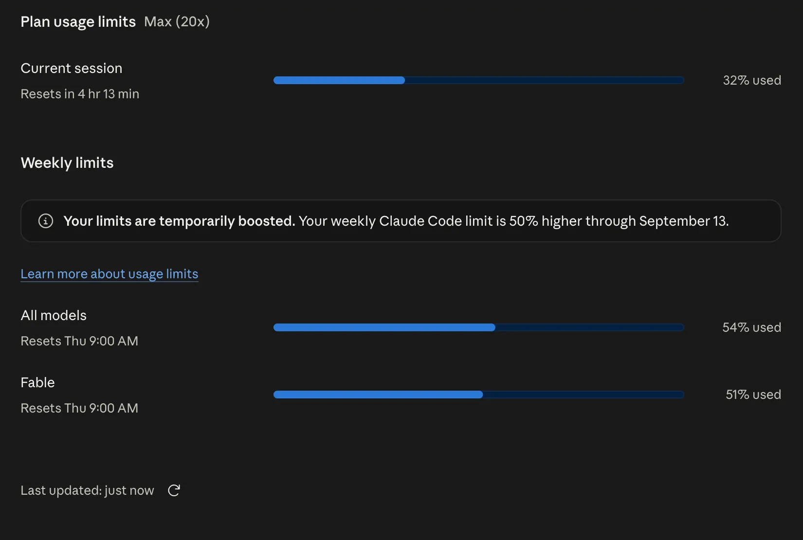
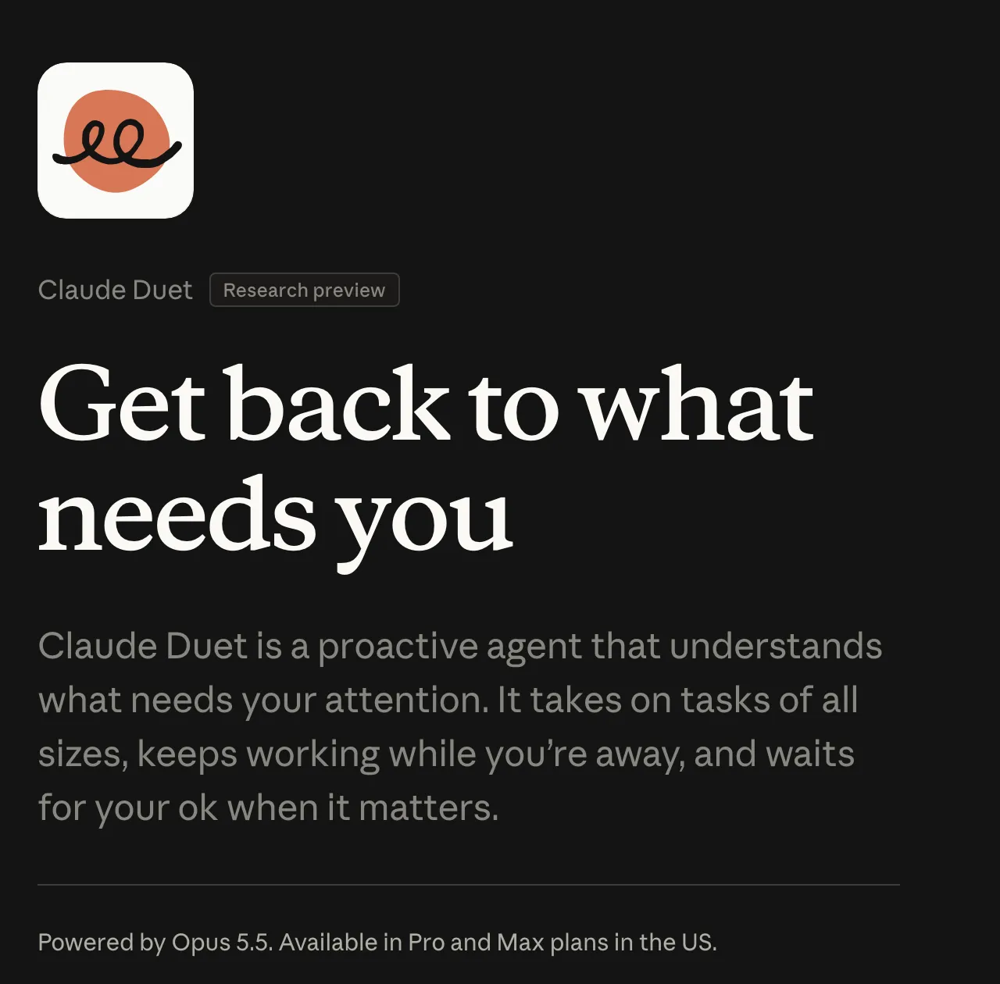



**收录说明**：直接下载，图片收入 images/；文末与正文 FAQ 重复的结构化 FAQ 和作者产品推广未收。原文有一处句子重复（「Here's my Settings > Usage page from September:」），照录。旧笔记 learning-ai-agent 引用过这一篇，2026-11-06 复核后收入。原文全文存于本目录的 original.md，网站上不显示，已翻译。

**内容摘要**：作者用 Max 套餐，排队 8 天后于 10-29 获得资格，只记录了第一天。他让 Claude Duet 接手一件家庭保险比价的跟进，它把进展清楚地总结了一遍，但因为没有待办，没有推进；它在自己的云端虚拟机上运行，接触不到作者的 MacBook 和 Mac mini。文章整理了用量规则：研究预览期不另收费，但与聊天共用 5 小时和每周额度，后台检查也计入。文首注明 10-30 起 Max 5x 改名为 Max（100 美元/月）、Max 20x 改名为 Ultra（200 美元/月）。作者把 Claude Duet 排在 Grok Bot 和 ChatGPT dot 之后，认为它目前的长处只有 Opus 5.5 模型。

**保留理由**：一手上手记录，篇幅短但写明了套餐、用量消耗和本地访问的限制，并记下了套餐改名这一背景。

---

> **套餐更新，2026 年 11 月 1 日核对：** Anthropic 于 10 月 30 日将 Max 5x 更名为 Max（100 美元/月），将 Max 20x 更名为 Ultra（200 美元/月）。现有订阅者自动迁移，价格不变。

> [当前定价](https://claude.com/pricing)列出 Max 为每五小时和每周 5 倍 Pro 用量；Ultra 为每周 10 倍 Pro，[已验证账号没有五小时限制](https://support.claude.com/en/articles/17728952)。

> 两者都包含 Fable，最高可达每周限额的一半，以及每月 API 额度：Max 为 100 美元，Ultra 为 200 美元。

> 我们正在开放 Claude Duet 的研究预览，这是一款让 Claude 作为主动型智能体（proactive agent）工作的新应用。它会主动带着需要你关注的事情来找你，完成你要求的任务，在你离开时继续工作，并在代表你行事之前先与你确认。
>
> Claude（@claudeai），[2026 年 10 月 21 日](https://twitter.com/claudeai/status/2112984664256241837)

我今早，也就是 10 月 29 日，用我的 Max 套餐获得了访问资格。第一天的结论：其中有些是炒作，有些带有偏见。到目前为止它不算差，但也算不上好。

如果你还在候补名单（waitlist）上，你并没有错过太多。以下是它做了什么、在哪里碰了壁，以及它如何消耗你的额度。

*我的收件箱，2026 年 10 月 29 日凌晨 1:11。我加入候补名单八天后。*

## 我的第一天：我向它要任务，它挑中了我跟进保险这件事

我交给它的第一件事是：先主动看看有什么我能做的，然后直接给我任务。

然后我把它指向了真实的事情。好，帮我处理我的保险费用，因为 Grok Bot 能帮我省钱。目前我们即将在房屋保险上每年省下一千美元。

Duet 问我是否想处理这件事。我点了它。

那次跟进本来就已经在进行中。我的 Grok Bot 已经联系了几家保险代理，只有一家回复了。于是 Duet 看了看，发现实际上没有待办事项，就替我把它收尾了。

它只是非常干净利落地总结了我已经知道的一切。我觉得那是一次愉快的体验。

这就是第一天的真实分量。它把整个跟进过程梳理到一起，并清楚地复述出来。它没有推动这条线往前走，因为没有什么在等我。

## 它在自己的计算机上工作，因此接触不到你的

墙很快就出现了。它无法访问我的本地代码仓库、我的 MacBook。那是我笔记本电脑上存放项目文件的文件夹。它也无法进入我的 Mac mini，那是我其他智能体所在的机器。

起初我不确定它是否拥有自己的机器。它确实有。Anthropic 的[发布文章](https://claude.com/resources/articles/claude-duet)说 Duet「有一台带自己浏览器的虚拟机（virtual machine），因此不需要你的笔记本电脑或手机开着」。这也正是它看不到你笔记本电脑的原因。

*Anthropic 的 Get started with Claude Duet 页面，「局限」部分，2026 年 10 月 29 日。*

[入门指南](https://support.claude.com/en/articles/17631495-get-started-with-claude-duet)列出了其余内容：

- **一个模型，没有选择器。** 它运行在 Claude Opus 5.5 上，并自行决定投入多少推理。
- **你无法观看或接管它的浏览器。**
- **不会给其他人打电话或发短信。** 经你批准，它可以从你已连接的账号发送电子邮件。
- **部分连接器有限制。** Slack 有使用限制，Microsoft 365 暂不可用。
- **有些操作即使你批准也会被阻止**，例如买卖证券或在账户之间转移资金。

它确实能获得的是你的 Claude 账号：指南说你的记忆、技能和连接器「从第一条消息起就已就位」。因此它通过 Gmail、Google Calendar 和 Drive 等应用工作，而不是通过你的文件。

## 它包含在你的套餐里，但每次检查都会消耗你的额度

问题就藏在 Anthropic 帮助页面中与价格相同的那一段里。

*Anthropic 的 Duet 帮助页面，「价格与用量限额」，2026 年 10 月 29 日。*

用直白的话说：

| 问题 | 答案，据 Anthropic（2026 年 10 月 29 日） |
| --- | --- |
| Pro 或 Max 需要额外付费吗？ | 研究预览期间不需要 |
| 它会用我的额度吗？ | 会，与聊天相同的套餐限额。Max 有五小时和每周限额；已验证的 Ultra 没有五小时限额 |
| 后台工作计入吗？ | 计入，晨报和例行检查都计入 |
| 它多久检查一次我的账号？ | 每隔几小时，「因为不停检查会更快耗尽你套餐的限额」 |
| 加入有回馈吗？ | 一次完整的限额重置，可用至 2026 年 11 月 30 日 |

下面这张旧的用量计量表显示的是九月的会话和每周限额。已验证的 Ultra 账号现在没有会话进度条。这是我九月的 Settings > Usage 页面：这是我九月的 Settings > Usage 页面：

*我 2026 年 9 月 5 日在 Max 20x 上的 Claude 用量进度条。Duet 消耗的正是这两项。*

在网页或桌面应用中领取那次重置：**Settings > Usage > Resets > Reset for free**。Anthropic 的[限额重置文章](https://support.claude.com/en/articles/17007452-what-is-a-limit-reset)说该按钮不在 Claude 移动端，因此 Duet 手机应用不会显示它。

早期用户感受到了这项成本。u/tx\_mn 在 [r/ClaudeAI](https://www.reddit.com/r/ClaudeAI/comments/1xg0tpz/full_reset_october_26_am/) 上写道：「我一直在测试 Duet，用量大得离谱。」我还没有看自己第一天的进度条，所以不给具体数字。

两项进度条如何计算、什么会消耗它们，见 [Claude 用量限额详解](/blog/claude-usage-limits-explained)。

## 谁能进入：Pro 或 Max、美国账号，以及邀请

Anthropic 的指南列出三项要求：

1. Pro 或 Max 套餐。
2. 美国的 Claude 账号。
3. 候补名单的邀请，你可以在 [Duet 产品页面](https://claude.com/product/claude-duet)加入。

*Anthropic 的 Duet 产品页面，2026 年 10 月 29 日。宣传语下方的小字就是全部的访问规则。*

Team 和 Enterprise 还没有。邀请「分批发出」，所以加入并不会给你一个日期。

如果你的邀请一直没到，陷阱在这里：Anthropic 说访问权限与你提供给候补名单的电子邮箱绑定。它必须与你的 Claude 账号以及你手机上的 Google 或 Apple 账号一致。

我在上线后一两个小时内就加入了，用的是 Max，也就是最高层级。它仍然花了八天。用 Max 并没有让我更快进入。

## Duet 是我的第三个智能体，排在 Grok Bot 和我的 ChatGPT dot 之后

我已经为两个常驻智能体付费，Duet 没有取代其中任何一个。

Grok Bot 是我最认真的一个。我要说得非常直白：它会一直留着。我的 ChatGPT dot 排第二。它也有自己的虚拟机，而且没有什么比直接用短信和你的智能体对话更好的了。Grok Bot 如何与 Claude 分工，见 [Grok Bot vs Claude Code](/blog/grok-bot-vs-claude-code)。

Duet 排第三，目前模型是它的优势。我认为 Opus 5.5 是唯一让它体验略好的东西。

现在下结论还为时过早。我的想法是，和它对话会是更好的体验，但 Grok Bot 也很强，老兄。

我很有兴趣看看他们会如何取胜。他们的竞争优势是什么？如果 OpenAI 推出更好的模型，而他们在打磨自己的东西，他们就会追上来。如果 Grok Bot 推出更好的模型——他们最终会的——说实话，这是一场精彩的竞赛，老兄。

那我还留着它吗？是的。我已经为 OpenAI 和 Anthropic 付费，所以我会用三个智能体。我还没给 Duet 定下工作。我会弄清楚它们的用例。

还有两条来自 r/ClaudeAI 的早期看法。u/Blizzxx 在 [r/ClaudeAI](https://www.reddit.com/r/ClaudeAI/comments/1xgu97b/whats_the_point_of_claude_duet/) 上说「你需要为你希望它帮忙的每一项任务都新建一个任务……导致任务膨胀」。

u/cogito-ergo-sum\_ 在 [r/ClaudeAI](https://www.reddit.com/r/ClaudeAI/comments/1xhlw2k/claude_duet_first_takeaways/) 上喜欢「它会自己主动带着晨报和一天中的例行检查来找你」，但仍然认为「自动化工作流的实际自主性非常少」。

## 连接所有东西之前先检查三项设置

1. **你的连接器。** 你在 Claude 中已经连接的任何东西从第一条消息起就在 Duet 中生效。在 Duet 开始每隔几小时检查它之前，先看看那份清单。
2. **搜索与引用对话。** Duet 使用与 Claude 相同的设置来搜索你的历史对话。如果你不想这样，在 **Settings > Your Claude** 中关闭它。
3. **记忆。** Anthropic 的[安全页面](https://claude.com/resources/articles/claude-duet-safety-privacy-and-security)说，断开某个应用会停止新的访问，但「Claude Duet 已经从中了解到的内容会一直保留，直到你重置其记忆」。在应用的设置中重置它。

如果你还在琢磨哪些连接器值得留下，可以先看[我会优先打开哪些连接器](/blog/best-claude-connectors)。

## 我不会去追这个邀请

老实说，在今早邀请出现之前，我已经放弃它了。

第一天是对我另一个智能体已经在做的一项工作的干净总结，以及我一把它指向自己的机器就撞上的墙。这不算一无是处。但也不是一个让你不断刷新收件箱、等 Anthropic 邮件的理由。

我对仍在等待的 Pro 用户的看法是：我不是在抱怨，我只是说我不会去追。当邀请到手时，在 11 月 30 日前领取重置，检查你的连接器，并交给它一项真实任务。在 Team、Enterprise 或美国以外，目前没有什么可追的。更多 Claude 配置见[我的 Claude 工作场景中心](/claude-at-work)。

## 常见问题

### 什么是 Claude Duet？

Claude Duet 是 Anthropic 的主动型智能体应用，于 2026 年 10 月 21 日以研究预览形式开放。它把需要你关注的事情带给你，完成你要求的任务，在你离开时在它自己的云端计算机上继续工作，并在代表你行事前先询问。它运行在 iOS、Android 和 claude.ai 上，与主 Claude 应用分开。

### Claude Duet 免费吗？

不额外收费：Anthropic 说在研究预览期间，Duet 包含在 Pro 和 Max 中，不另收费。但在用量上它不是免费的。它按与聊天相同的费率消耗你套餐的五小时和每周限额，它的后台工作（例如晨报和例行检查）也计入。

### Claude Duet 会使用我的用量限额吗？

会。Anthropic 说 Duet 按与聊天相同的费率使用你套餐的五小时会话和每周限额，它在后台做的工作也计入。它每隔几小时检查一次你的账号，而不是不停检查，以节省你的限额。当你获准加入时，你会获得一次完整的限额重置，有效期至 2026 年 11 月 30 日。

### 我如何获得 Claude Duet 的访问权限？

你需要 Pro 或 Max 套餐、美国的 Claude 账号，以及来自 Anthropic Duet 产品页面候补名单的邀请。邀请分批发出，没有固定日期。如果你的邀请一直没出现，请检查你的候补名单电子邮箱是否同时与你的 Claude 账号和你手机上的 Google 或 Apple 账号一致。

### Claude Duet 在 Team、Enterprise 或美国以外可用吗？

尚不可用。Anthropic 说 Duet 在研究预览期间不在 Team 或 Enterprise 套餐中提供，并计划稍后引入。预览还要求美国的 Claude 账号，因此欧洲和其他地区目前不在范围内。

### Claude Duet 使用什么模型？

Claude Opus 5.5，并且你无法更改。Anthropic 说 Duet 自行决定一项工作需要多少投入。应用中没有模型选择器。

## 本文来源

产品事实来自 Anthropic 的 Duet 发布文章、帮助指南、安全页面和发布说明，于 2026 年 10 月 29 日阅读。Reddit 引文在同一天核对。

第一天的测试是我自己的，在我的 Max 套餐上，也就是我获准进入的那天早晨。欢迎邮件是我自己收件箱的截图，Anthropic 的每用户发件地址已模糊处理。我还没有发布线程截图、查看第一天的用量进度条，也还没给 Duet 定下长期工作。

*发布于 2026 年 10 月 29 日。产品事实于当日对照 Anthropic 的帮助页面核对。*
