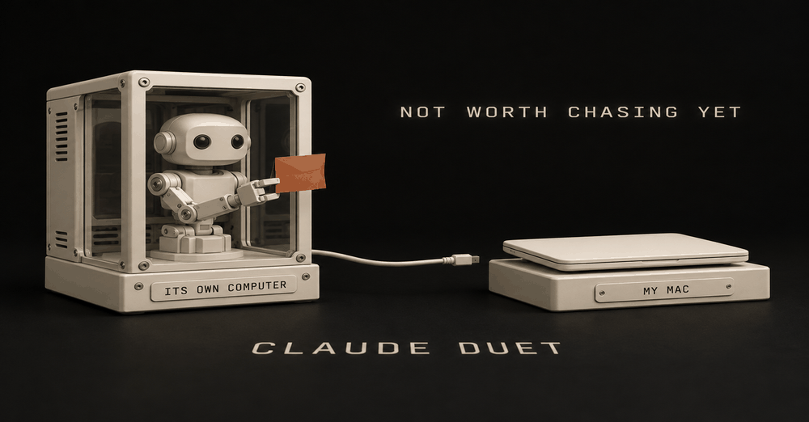
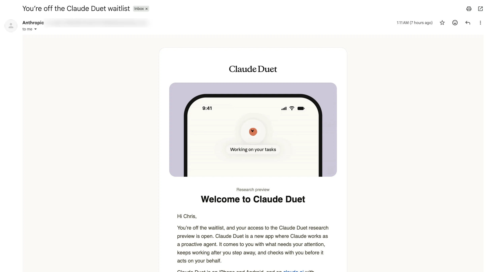
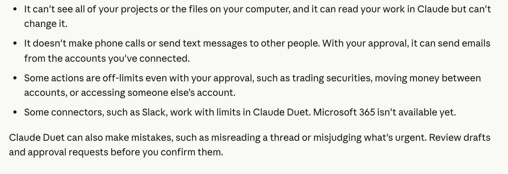
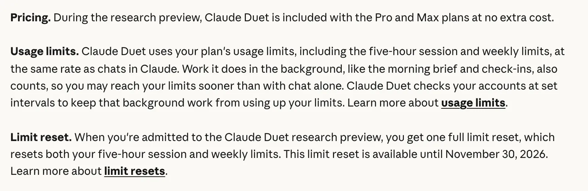
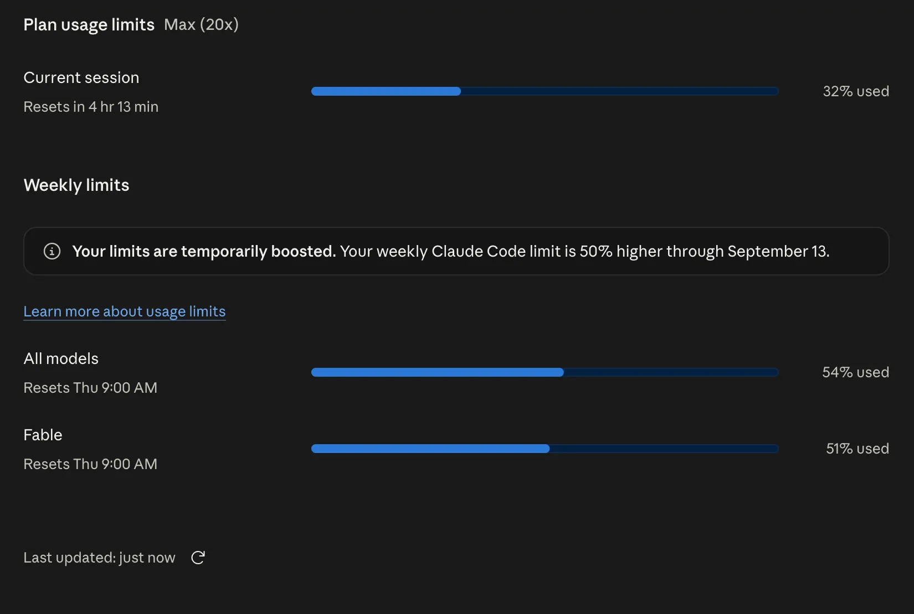
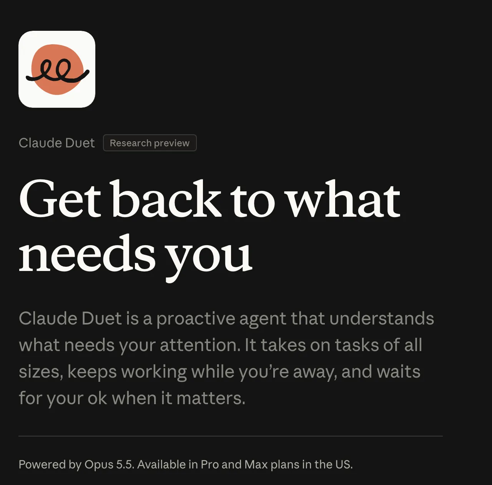

来源：https://christopheralarcon.com/blog/claude-duet
取文：2026-11-06，直接下载

 

> **Plan update, checked November 1, 2026:** Anthropic renamed Max 5x to Max ($100/month) and Max 20x to Ultra ($200/month) on October 30. Existing subscribers moved automatically, with prices unchanged.

> [Current pricing](https://claude.com/pricing) lists Max at 5x Pro usage every five hours and every week; Ultra at 10x Pro every week, with [no five-hour limit for verified accounts](https://support.claude.com/en/articles/17728952).

> Both include Fable up to half the weekly limit and monthly API credits: $100 on Max, $200 on Ultra.

> We’re opening a research preview of Claude Duet, a new app where Claude works as a proactive agent. It comes to you with what needs your attention, completes tasks you ask of it, keeps working when you step away, and checks with you before it acts on your behalf.
>
> Claude (@claudeai), [October 21, 2026](https://twitter.com/claudeai/status/2112984664256241837)

I got in on my Max plan this morning, October 29. My verdict after day one: some of it is hype, some of it is biased. So far it’s not bad, but it’s not great.

If you’re on the waitlist, you’re not missing much yet. Here’s what it did, where it hit a wall, and what it costs your limits.

*My inbox, 1:11 a.m., October 29, 2026. Eight days after I joined the waitlist.*

## My first day: I asked it for tasks, and it picked my insurance chase

The first thing I handed it is, just start being proactively looking at what can I do and just start giving me tasks.

Then I pointed it at something real. Okay, help me with my insurance money, because Grok Bot can help me save money. Right now we’re about to save a thousand dollars a year on home insurance.

Duet asked if I wanted to work on that. I clicked it.

That chase was already running. My Grok Bot had reached out to several insurance agents, and only one had answered. So Duet looked at it, found nothing actually pending, and wrapped it up for me.

It just summarized everything I already knew very cleanly. I think that was a pleasant experience.

That’s the honest size of day one. It pulled the whole chase together and said it back clearly. It didn’t move the thread forward, because nothing was waiting on me.

## It works on its own computer, so it can’t reach yours

The wall came fast. It can’t access my local repo, my MacBook. That’s the folder of project files on my laptop. It couldn’t get into my Mac mini either, the machine where my other agents live.

I wasn’t sure at first whether it had its own machine. It does. Anthropic’s [launch post](https://claude.com/resources/articles/claude-duet) says Duet “has a virtual machine with its own browser, so it doesn’t require your laptop or phone to be on.” That’s also exactly why it can’t see your laptop.

*Anthropic’s Get started with Claude Duet page, Limitations section, October 29, 2026.*

The [get started guide](https://support.claude.com/en/articles/17631495-get-started-with-claude-duet) spells out the rest:

- **One model, no picker.** It runs on Claude Opus 5.5 and decides the effort itself.
- **You can’t watch or take over its browser.**
- **No phone calls or texts to other people.** It can send email from your connected accounts, with your approval.
- **Some connectors are limited.** Slack works with limits, and Microsoft 365 isn’t available yet.
- **Some actions are blocked even if you approve,** like trading securities or moving money between accounts.

What it does get is your Claude account: the guide says your memory, skills and connectors “are there from your first message.” So it works through apps like Gmail, Google Calendar and Drive, not through your files.

## It’s included with your plan, but every check hits your limits

The catch sits in the same paragraph of Anthropic’s help page as the price.

*Anthropic’s Duet help page, Pricing and usage limits, October 29, 2026.*

In plain English:

| Question | Answer, per Anthropic (October 29, 2026) |
| --- | --- |
| Extra charge on Pro or Max? | None during the research preview |
| Does it use my limits? | Yes, the same plan limits as chat. Max has five-hour and weekly limits; verified Ultra has no five-hour limit |
| Does background work count? | Yes, the morning brief and check-ins count |
| How often does it check my accounts? | Every few hours, “because checking nonstop would use up your plan’s limits much faster” |
| Anything back for joining? | One full limit reset, usable until November 30, 2026 |

The old meter below shows September’s session and weekly limits. Verified Ultra accounts now have no session bar. Here’s my Settings > Usage page from September: Here’s my Settings > Usage page from September:

*My Claude usage meters on Max 20x, September 5, 2026. Duet bills these same two.*

Claim that reset on the web or the desktop app: **Settings > Usage > Resets > Reset for free.** Anthropic’s [limit reset article](https://support.claude.com/en/articles/17007452-what-is-a-limit-reset) says the button isn’t on Claude mobile, so the Duet phone app won’t show it.

Early users feel the cost. u/tx\_mn on [r/ClaudeAI](https://www.reddit.com/r/ClaudeAI/comments/1xg0tpz/full_reset_october_26_am/) wrote: “I have been testing Duet and had an insane amount of usage.” I haven’t read my own meter after day one yet, so I’m not putting a number on it.

How the two meters work, and what burns them, is in [Claude usage limits explained](/blog/claude-usage-limits-explained).

## Who gets in: Pro or Max, a US account, and an invite

Anthropic’s guide lists three requirements:

1. A Pro or Max plan.
2. A Claude account in the US.
3. An invitation from the waitlist, which you join on the [Duet product page](https://claude.com/product/claude-duet).

*Anthropic’s Duet product page, October 29, 2026. The fine print under the pitch is the whole access rule.*

Team and Enterprise don’t have it yet. Invitations “go out in waves,” so joining doesn’t get you a date.

The trap if your invite never arrives: Anthropic says access is tied to the email you gave the waitlist. It has to match your Claude account and the Google or Apple account on your phone.

I joined within an hour or two of launch, on Max, the highest tier. It still took eight days. Being on Max didn’t get me in fast.

## Duet is my third agent, behind Grok Bot and my ChatGPT dot

I already pay for two always-on agents, and Duet didn’t bump either one.

Grok Bot is my most serious one. I’m gonna say that very bluntly: it’s staying for good. My ChatGPT dot is second. It has its own virtual machine too, and nothing beats just talking to your agent via text message. How Grok Bot splits work with Claude is in [Grok Bot vs Claude Code](/blog/grok-bot-vs-claude-code).

Duet is third, and right now the model is its edge. I think Opus 5.5 is the only thing that keeps it a slightly better experience.

It’s too early to tell. My thought is it’s gonna be the better experience to talk with, but Grok Bot is up there, man.

I’d be interested to see how they win. What’s their competitive advantage? If OpenAI drops a better model and they’re tweaking their stuff, they’ll catch up. If Grok Bot drops a better model, which they will eventually, honestly, it’s a good race, man.

So am I keeping it? Yes. I already pay for OpenAI and Anthropic, so I’m gonna have three agents. I haven’t picked Duet’s job yet. I’ll figure out their use cases.

Two other early takes from r/ClaudeAI. u/Blizzxx on [r/ClaudeAI](https://www.reddit.com/r/ClaudeAI/comments/1xgu97b/whats_the_point_of_claude_duet/) says “it needs you to create a new task for every task you wanted it to help with…leading to task bloat”.

u/cogito-ergo-sum\_ on [r/ClaudeAI](https://www.reddit.com/r/ClaudeAI/comments/1xhlw2k/claude_duet_first_takeaways/) likes that “it reaches out on its own with a morning brief and check-ins through the day,” and still found “very little actual autonomy for automated workflows.”

## Check three settings before you connect everything

1. **Your connectors.** Whatever you already connected in Claude is live in Duet from the first message. Look at that list before Duet starts checking it every few hours.
2. **Search and reference chats.** Duet uses the same setting as Claude to search your past chats. Turn it off in **Settings > Your Claude** if you don’t want that.
3. **Memory.** Anthropic’s [safety page](https://claude.com/resources/articles/claude-duet-safety-privacy-and-security) says disconnecting an app stops new access, but “what Claude Duet already learned from it stays until you reset its memory.” Reset it from the app’s settings.

If you’re still sorting out which connectors earn a spot, start with [the connectors I’d turn on first](/blog/best-claude-connectors).

## I wouldn’t chase the invite

I’ll be honest, I had given up on it before the invite showed up this morning.

Day one was a clean summary of a job my other agent was already running, and a wall the moment I pointed it at my own machines. That’s not nothing. It’s also not a reason to refresh your inbox for an email from Anthropic.

My take for anyone on Pro still waiting: I’m not complaining, I’m just saying I wouldn’t chase it. When the invite lands, claim the reset before November 30, check your connectors, and give it one real job. On Team, Enterprise or outside the US, there’s nothing to chase yet. More Claude setups are on [my Claude at work hub](/claude-at-work).

## FAQ

### What is Claude Duet?

Claude Duet is Anthropic’s proactive agent app, opened as a research preview on October 21, 2026. It brings you what needs your attention, does tasks you ask for, keeps working on its own cloud computer when you step away, and asks before it acts for you. It runs on iOS, Android and claude.ai, separate from the main Claude app.

### Is Claude Duet free?

There’s no extra charge: Anthropic says Duet is included with Pro and Max at no extra cost during the research preview. But it isn’t free in usage. It draws on your plan’s five-hour and weekly limits at the same rate as chat, and its background work, like the morning brief and check-ins, counts too.

### Does Claude Duet use my usage limits?

Yes. Anthropic says Duet uses your plan’s five-hour session and weekly limits at the same rate as chats, and the work it does in the background counts. It checks your accounts every few hours instead of nonstop to save your limits. When you’re admitted you get one full limit reset, available until November 30, 2026.

### How do I get access to Claude Duet?

You need a Pro or Max plan, a Claude account in the US, and an invitation from the waitlist on Anthropic’s Duet product page. Invitations go out in waves with no set date. If your invite never shows up, check that your waitlist email matches both your Claude account and the Google or Apple account on your phone.

### Is Claude Duet available on Team, Enterprise or outside the US?

Not yet. Anthropic says Duet isn’t available on Team or Enterprise plans during the research preview and plans to bring it there later. The preview also requires a Claude account in the US, so Europe and other regions are out for now.

### What model does Claude Duet use?

Claude Opus 5.5, and you can’t change it. Anthropic says Duet decides on its own how much effort a job needs. There’s no model picker in the app.

## Where this comes from

Product facts come from Anthropic’s Duet launch post, help guide, safety page and release notes, read October 29, 2026. The Reddit quotes were checked the same day.

The first-day test is mine, on my Max plan, the morning I got in. The welcome email is a screenshot of my own inbox, with Anthropic’s per-user sender address blurred. I haven’t published a screenshot of the thread, read my usage meter after day one, or picked Duet’s long-term job yet.

*Published October 29, 2026. Product facts checked that day against Anthropic’s help pages.*

