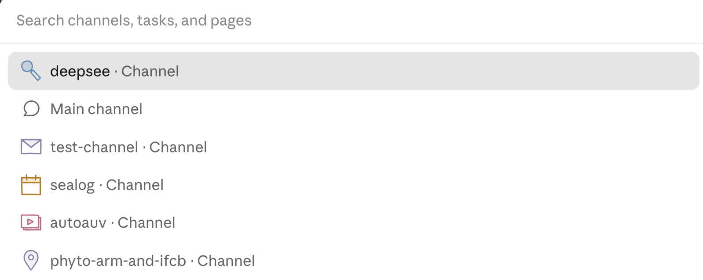



**收录说明**：个人博客，作者未署名，文首声明「Written by a human. Not affiliated with Anthropic.」。该文在 Hacker News 上以「Claude Duet is the first personal-assistant-type harness that feels useful」为题获得较多讨论（2026-11-05 查看时 126 分、142 条评论），讨论区未收。直接下载；去掉了文末「All posts」链接。原文全文存于本目录的 original.md，网站上不显示，已翻译。

**内容摘要**：作者称自己认真用过 Muse、Dot、NanoClaw 等个人助理类智能体，Claude Duet 是第一个让他觉得有用多于繁琐的。他列出四个优点：响应快，优先给用户简短回复、把工作放到后台；频道可以由 Claude Duet 自己创建和管理，用 Cmd-k 切换；访问策略有意义，GitHub 仓库的访问按频道限定，且它从不索要凭证、优先使用 Claude 已有的连接器（对比 Muse 的凭证库仍可能把凭证填进不可信的地方）；回复简短。不足包括：测试版有故障（线程运行中却不可见、委派的仓库访问挂接失败），语音交互仍只是语音转文字，不如 Dot。作者最看重的是「关注点分层」：顶层看到所有工作线但没有底层权限，频道权限更多但上下文更受限，频道派生的子线程更窄。

**保留理由**：来自同时用过 Muse 和 Dot 的用户的一手体会，具体描述了频道分层与按频道限定权限的设计，以及与 Muse 凭证处理方式的差异。

---

*由人类撰写。与 Anthropic 无关。*

你看，我真的很不想喜欢 Duet。我不想当 Anthropic 的死忠粉，而且当他们比竞争对手做得更好时，我会觉得恼火。但他们又做到了。

我认真试过 Muse、Dot、NanoClaw，以及许多其他个人助理类的运行框架（harness）。Duet 是第一个让我觉得有用多于繁琐的，而且它感觉像是聊天体验的一次严肃进化，而不是又一个「把你的所有凭证都交给我才能派上用场」的智能体。以下是我到目前为止喜欢它的原因。

### 1. 它很快

其他助理应用总是在后台干着天知道什么事，而我只能等着回复。Duet 显然优先考虑快速给用户一个干脆的回复，即使还需要后台工作。据说它由 Opus 5.5 驱动，但我在其他 Claude 界面里从没见过 Opus 跑得这么快。显然这里做了一些调优。这对成为一个有用的助理至关重要：如果你想成为我通向世界的外壳，我可不会在命令之间干坐着捻手指。

### 2. 频道（Channels）很妙

也许我只是脑子被 Slack 塑造了，但我真的很喜欢 Duet 的频道。尤其是：我喜欢 Duet 能为我创建和管理频道。与 LLM 打交道时一个繁琐的方面就是追踪聊天会话：工作线会丢失，上下文必须小心维护，会话会被起错名字，等等。

Duet 替我完成繁琐的会话整理。我的工作已经自然形成了一种层级，我猜用 Duet 会少丢一些线索。`Cmd-k` 对我来说已经是条件反射：它会调出频道列表，让我在频道之间快速切换。频道之间也可以互相看到和引用，因此 Duet 能帮我把工作留在正确的轨道上。

### 3. 访问策略有意义

对 Github 仓库的访问按频道受限。我可以把几个相关的仓库加到某个特定频道，而不必担心该频道会混入我其他项目的工作。

它也从不试图获取我的凭证。这是我对大多数助理应用最不满的地方：你不把钥匙交给它们，它们就做不了多少事。Muse 有一个凭证存储，至少能让智能体看不到具体值，但它仍然可能把这些值填进某个不可信的地方。

Duet 不存储任何凭证，并积极劝阻别人把凭证交给它。它最多可能让你通过一个 Chrome 会话来代表它登录。但它从没要求我这么做：它更喜欢使用 Claude 已有的连接器生态，除此之外似乎也乐于待在自己的轨道里。

### 4. 回复简短

这并非 Duet 独有，Dot 和 Muse 似乎也做到了这一点：没人想为了一个简单问题读一整页回复，而多年来这却是聊天机器人的事实体验。我总是得加上一堆指令，试图说服我的智能体给出简洁的回复。它们也都能给消息加表情符号「回应」，不过我觉得个性在这里会有差别：Muse 倾向于给什么都点个赞，而 Duet 用它来给我一个「好」，而不进一步展开，我觉得这很讨喜。

### 话虽如此

它还在测试阶段，肯定有些故障。有时线程正在运行却看不见。我见过委派的仓库访问没能正确挂接（智能体启动与访问挂接之间的竞态条件？）。

我也承认，我的使用场景可能让 Duet 特别适合我。Muse 可能更适合其他人。各人体验可能不同（YMMV）。

而 Dot 在语音交互上仍然称王。Anthropic 似乎根本不在乎有一个对话式语音模式，它仍然只是美化版的语音转文字。

### Duet 已经在取代我的大部分 AI 工作流

我并不真的喜欢管理智能体的管理层面：记住谁在哪里、带着什么上下文运行。总有某个地方的某个智能体在等我做决定，或跟进某项任务。我确信某个智能体曾在某台机器上为我做了出色的工作，而我忽略了它，它将被永远遗忘。

对我来说最重要的创新是关注点的层级：Duet 的顶层对我所有的工作线有鸟瞰式的视野，但没有底层访问权限。频道拥有更多访问权限，但上下文受到更多限制。由频道派生的子线程在特定的代码沙箱中工作时，权限可以进一步收窄。桌面应用可以访问我允许它访问的本地主机，而这通常只用于云端完成编码后的 QA 或部署环节。

这些大多是我本来就偏好的智能体组织方式，类似的流程也可以用一点胶带和 API 额度拼凑出来。Duet 只是让这种层级成为核心产品的自然组成部分，而且它运行得如此之好，我猜它将在不久后成为所有聊天机器人界面的默认体验。
