

**收录说明**：作者 Aakash Gupta 运营产品与 AI 主题的通讯，此前在同一通讯中评测过 Dots、Muse、Grok Bot、Instinct 等智能体。这期通讯除 Claude Duet 评测外还有赞助商推广和一周新闻汇总，这里只收开头导语（含 Claude 官方 X 帖子的嵌入）和「Deep dive」部分的评测全文；文中截图均已下载。原文存于本目录的 original.md，网站上不显示，已翻译。

**内容摘要**：作者获得 Claude Duet 预览资格后使用一周，按「是什么与如何设置、功能、交给它的任务、结论」四部分写成评测。他介绍了自称在其他文章和视频中很少见到的「频道」和「分组」概念：Everything 汇总所有请求，频道承载单条工作线，每个频道有自己的常设指令；作者让其中一个频道充当「chief of staff」统管其他频道，并可给频道挂接 GitHub 仓库。Claude Duet 固定使用 Opus 5.5、没有模型和推理强度选择，沿用 Claude 的记忆、技能和连接器。作者交给它与此前评测 Dots、Grok Bot、Muse、Instinct 时相同的任务：会议准备和晨报因有长期的 Claude 上下文而明显优于其他智能体，还发现了网络研讨会报名页的故障并审查了发帖队列；但它会以作者口吻编造内容（上下文少时编造、上下文多时追问），不知道去哪里找数据，Claude 连接器之外的操作基本做不了（无 Link 或 Shop Pay 时不能付款，不能用 LinkedIn）。作者结论是 Instinct 仍是他的首选，Claude Duet 属于兼顾工作与生活的「统一型」智能体。

**保留理由**：一周的一手使用记录，描述了官方材料中没有的频道、分组和常设指令等界面机制，并在同一组任务上与其他个人智能体对比了优缺点。

---

### Anthropic 加入了个人智能体竞赛。我获得了访问权限。那么它表现如何？

2026 年 10 月 31 日

欢迎阅读又一期 [AI by Aakash](https://www.aibyaakash.com/)。我替你关注 AI 新闻，你不必自己去追。

今年 AI 出现了一场新的竞赛。[Instinct](https://www.aibyaakash.com/p/instinct)、[Muse](https://www.aibyaakash.com/p/muse)、[Hermes](https://www.aibyaakash.com/p/copy-copy-hermes-bot-mode)、[Grok Bot](https://www.aibyaakash.com/p/grok-bot)，这些都是新一类主动型智能体（proactive agent）。最大的问题一直是，**Anthropic 在这场竞赛中的位置在哪里？**

10 月 21 日，Anthropic 发布了它的答案：[Duet](https://claude.com/product/claude-duet)。

[

Claude@claudeai

我们正在开放 Claude Duet 的研究预览，这是一款让 Claude 作为主动型智能体工作的新应用。
它会主动带着需要你关注的事情来找你，完成你要求的任务，在你离开时继续工作，并在代表你行事之前先与你确认。

晚上 7:09 · 2026 年 10 月 21 日 · 11.2M 次查看

---

2.41K 条回复 · 4.27K 次转发 · 55.5K 次点赞](https://x.com/claudeai/status/2112984664256241837)

*今天，我们要看看 Duet，看看它表现如何。但首先，来自我们赞助商的一段话和本周头条新闻。*

## Claude Duet：Anthropic 的统一型智能体

[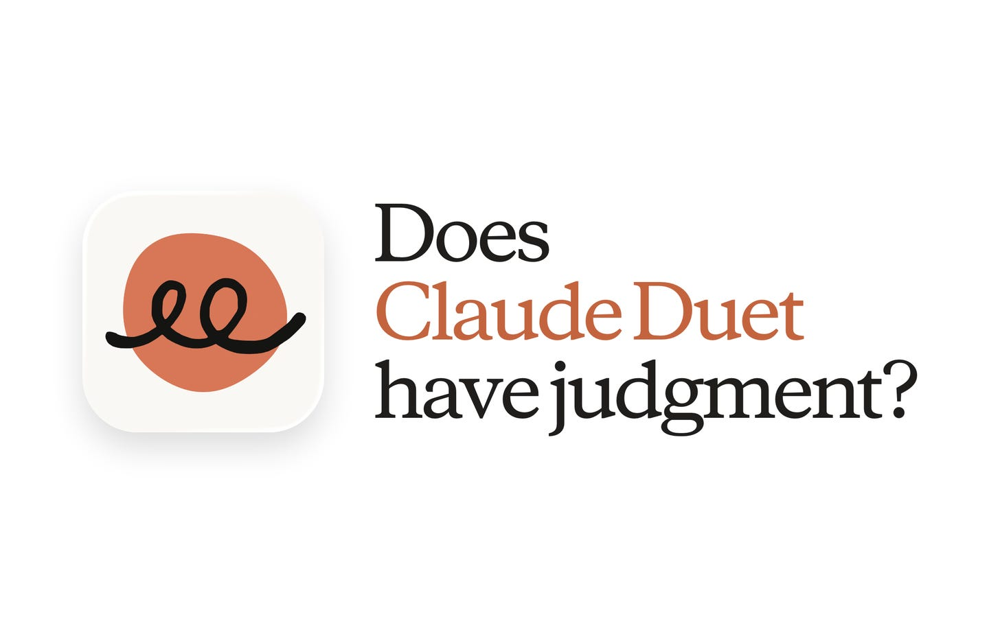](https://substackcdn.com/image/fetch/$s_!OxiT!,f_auto,q_auto:good,fl_progressive:steep/https%3A%2F%2Fsubstack-post-media.s3.amazonaws.com%2Fpublic%2Fimages%2F50f63014-5aa2-41bb-98c6-85fd3b3cf65f_1456x902.png)

我们在这份通讯中已经谈论[个人智能体领域](https://www.news.aakashg.com/p/ai-agents-pms)数周了（[Grok Bot](https://www.aibyaakash.com/p/grok-bot)、[Hermes](https://www.aibyaakash.com/p/copy-copy-hermes-bot-mode)、[Dots](https://www.aibyaakash.com/p/dots)、[Instinct](https://www.aibyaakash.com/p/instinct)、[Muse](https://www.aibyaakash.com/p/muse)），也一直在等待 Anthropic 会带来什么。

就我而言，[Claude Code](https://www.news.aakashg.com/p/content-os) 是最好的 AI harness，但 [Duet](https://claude.com/product/claude-duet) 能取代它吗？

**剧透预警：我不这么认为**，但它是一个有趣的界面。那我们就去看看 Duet。

今天我想和你聊几件不同的事。

#### 今天的内容

1. Duet 是什么以及如何设置
2. 每个功能的逐一演示
3. 我交给它的工作
4. 我的结论

## 1. Duet 是什么以及如何设置

所以 Duet 基本上是你 Claude 应用里的一个新标签页。

它的理念是它会*更主动*。它会用需要你关注的任务来提醒你，并且它运行在*频道（channels）*上，几乎像 Slack。

这是我的设置：

[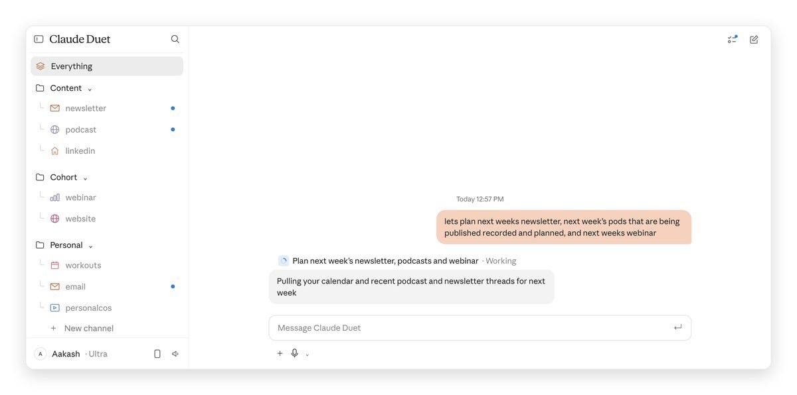](https://substackcdn.com/image/fetch/$s_!dNJE!,f_auto,q_auto:good,fl_progressive:steep/https%3A%2F%2Fsubstack-post-media.s3.amazonaws.com%2Fpublic%2Fimages%2F78a72eb9-8b51-4037-b05f-5257f44a0d59_1200x596.jpeg)

他们实际上没有提供模型选择器，这很有意思。它运行在 [Opus 5.5](https://www.aibyaakash.com/p/edit-videos-with-claude-code) 上。

对于像我这样在 Sonnet 上运行大量任务的人来说，这是一项不幸的成本。也没有投入程度选择器。

**如果你想想 Duet，它几乎就像 Claude 的一个简化视图。**

它确实依托[你现有的 Claude 记忆、技能和已连接应用](https://x.com/claudeai/status/2112984666437546104)。对于像我这样生活在 Claude 里的[高级用户](https://www.aibyaakash.com/p/claude-features-ranked-q1-2026)来说，这是它的巨大好处。

如果你也是这样，你可能会获得一些好处。但完全坦白地说，**它的大部分功能都需要提示。**

这是一个例子。我需要把它连接到我的 [Content OS](https://www.news.aakashg.com/p/content-os) 代码仓库：

[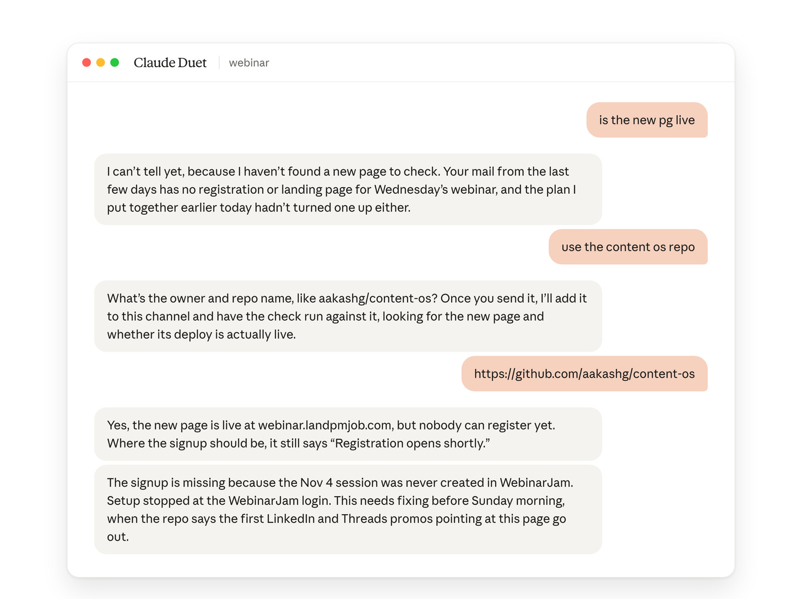](https://substackcdn.com/image/fetch/$s_!jBAL!,f_auto,q_auto:good,fl_progressive:steep/https%3A%2F%2Fsubstack-post-media.s3.amazonaws.com%2Fpublic%2Fimages%2F0f2f68df-6eb0-439c-b8b8-797fdc944983_1456x1088.png)

我总体上发现他们还没有把回忆做得很好，尤其是对本地 Claude Code 会话的回忆。

#### 如何设置

#### 第 1 步：加入候补名单

我最终动用了一些我在 Anthropic 的人脉，才尽快从候补名单中脱身。

你可能需要多等一段时间。

#### 第 2 步：连接你的应用

如果你已经把 Claude 连接到你的所有应用，Duet 已经继承了所有这些连接器，这很好。

#### 第 3 步：看看它已经知道什么

我测试的一件事是它对我了解多少，以下是它展示的内容：

[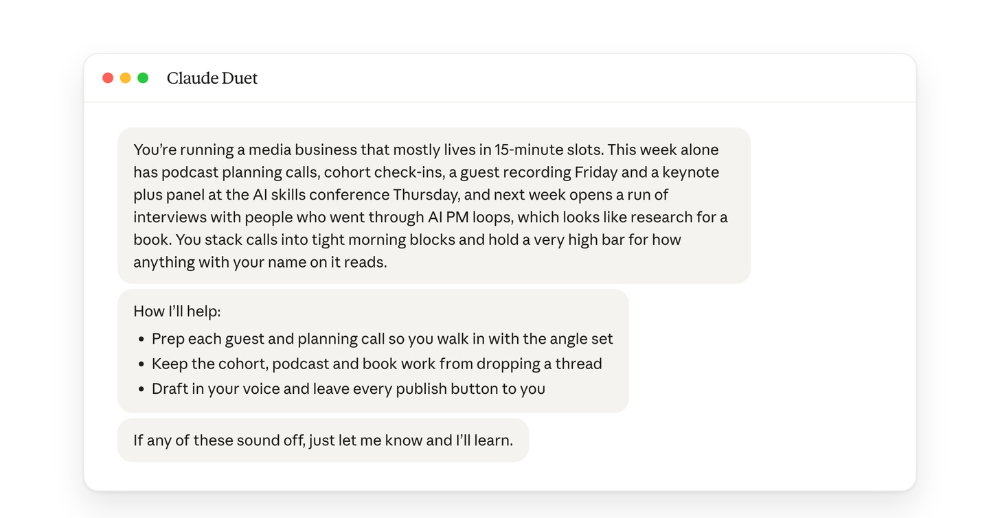](https://substackcdn.com/image/fetch/$s_!VHJH!,f_auto,q_auto:good,fl_progressive:steep/https%3A%2F%2Fsubstack-post-media.s3.amazonaws.com%2Fpublic%2Fimages%2Fb5d70eac-6b6c-4a5f-b83a-be5215d3a56c_1456x755.png)

你可以看到这是一幅相当不错的全景。我印象深刻。**这是 Duet 之所以是 Duet 的好处之一。**

## 2. 主要功能演示

现在我们来逐一看看主要功能。在我看过的大多数内容、视频和文章中，我很少见到其中很多功能。

我不知道它们是过时了，还是作者们没有看到它们。但基本上，Duet 有**分组（groups）和频道（channels）**这些概念。

这是我的设置方式：Content、Cohort 和 Personal。你可以选择自己的方式。我还设置了一个*chief of staff*（幕僚长）。

#### Everything、频道和分组

*Everything* 是所有请求汇总的一条信息流。

频道是针对单一工作流的独立聊天，例如通讯、播客或网络研讨会。分组把频道归在一起。

我在 *Everything* 中让它规划下周的通讯、播客和网络研讨会。**它把这件事拆成任务，并自行归档到 newsletter、podcast、LinkedIn 和 email 频道中。**

#### 指令和 chief of staff 频道

每个频道保留自己的常设指令。我把一个频道作为我的枢纽，并让它指导其他频道。

它重写了自己的指令，以读取其他每一个频道，并向我提供所有频道的状态。

**Everything** 频道相当强大。它是万能收件箱。

你可以把它用作你的 chief of staff，或者留作通用问题。我选择了*chief of staff*模式，这是我从 [Grok Bot](https://www.aibyaakash.com/p/grok-bot) 学来的。

它不是 Duet 内置的。**你必须自己设置**，以下是我的做法：

[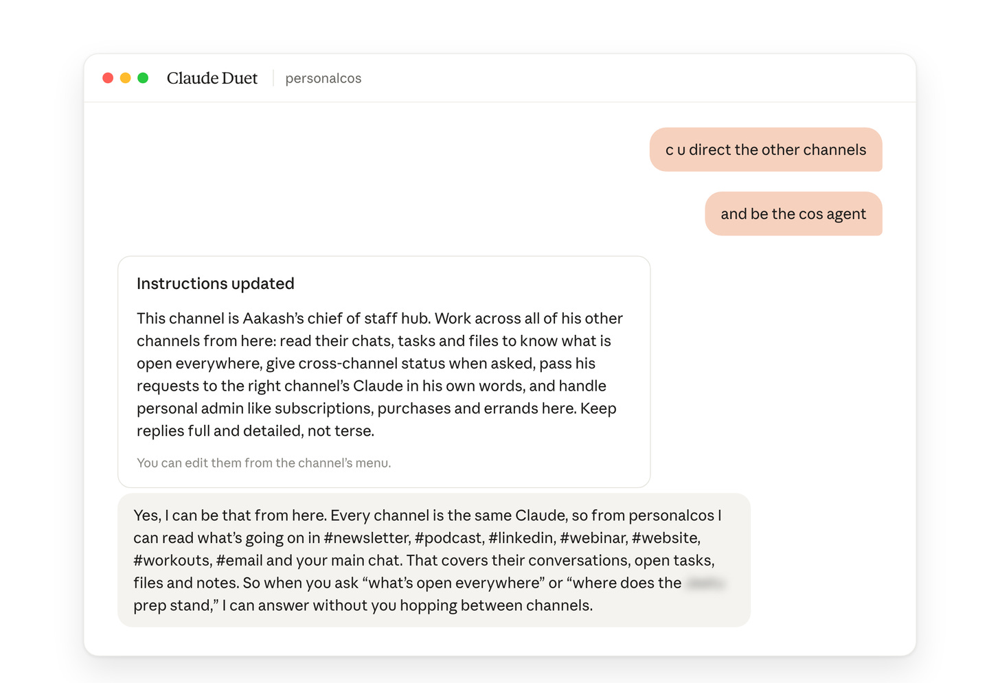](https://substackcdn.com/image/fetch/$s_!0QiU!,f_auto,q_auto:good,fl_progressive:steep/https%3A%2F%2Fsubstack-post-media.s3.amazonaws.com%2Fpublic%2Fimages%2F8ddb69f7-49bc-4ea3-b8d7-ff19438f69c3_1456x995.png)

#### 每日心跳

定义性功能之一：每天早上你会收到一份**简报（brief）**，说明你所有频道上待办的事情、它夜间做了什么，以及它今天可能想做什么。

这就是它主动的方式。这是一个*每日心跳（daily heartbeat）*，如果你用过 OpenClaw 之类的东西，你可能很熟悉。

[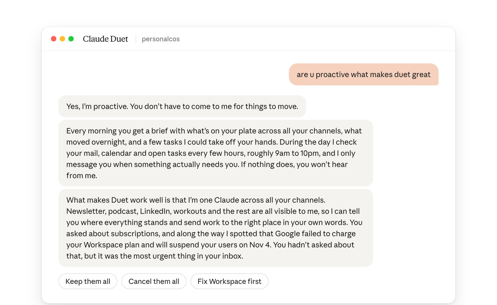](https://substackcdn.com/image/fetch/$s_!1meG!,f_auto,q_auto:good,fl_progressive:steep/https%3A%2F%2Fsubstack-post-media.s3.amazonaws.com%2Fpublic%2Fimages%2F1f973001-f6f5-42c9-966d-e1471507905c_1456x893.png)

它做的一件很酷的事：它给你**按钮**来选择选项，这样让它帮忙就更省力。

**让 Duet 奏效的是，它是跨你所有频道的一个 Claude。** 至少，它以此为目标。也许当他们把它完整构建出来时，就会是这样。

#### 设计细节

Duet 有几个设计概念让我觉得他们有一位**非常强的设计师**在做它。

一个想法是：像这样打开的*任务卡（task cards）*。

[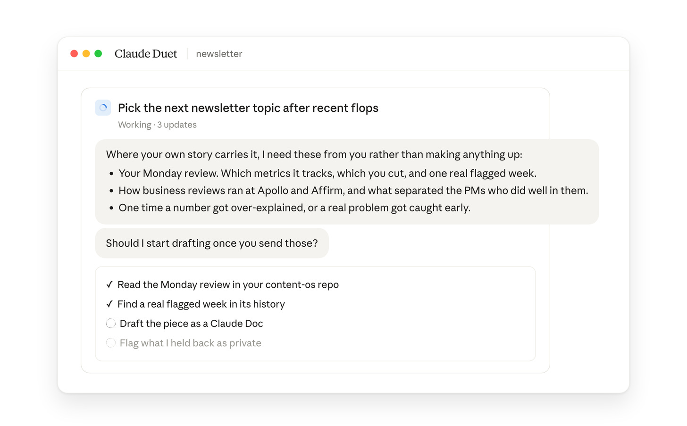](https://substackcdn.com/image/fetch/$s_!nUs3!,f_auto,q_auto:good,fl_progressive:steep/https%3A%2F%2Fsubstack-post-media.s3.amazonaws.com%2Fpublic%2Fimages%2F5c772a25-7aaf-4dd0-9ad9-a7d4890ff52e_1456x903.png)

另一个很酷的东西：你可以**把 GitHub 代码仓库挂接到频道**。这在我熟悉的常规 Claude 里没有，但你可以在 Duet 中这样做。

#### 它在行动前会询问

它起草的每一封邮件、对我发帖队列的每一次改动以及每一笔付款**都会等待我的同意**。

#### 我会如何从第一天起设置它

1. 连接你的收件箱、日历、Slack、Drive、Notion、Stripe 和其他基础项。
2. 也连接你的产品分析。我的在 PostHog。
3. 为每条业务线设置一个分组，再为个人设置一个，并把合适的频道放进去。
4. 向每个频道提出一些主动性的问题来启动它。
5. 开始教它们。教一段时间之后，对话会好很多。
6. 创建一个 chief of staff 频道，并向它口述你的目标。

## 3. 我交给它的工作

我交给它和我交给 [Dots](https://www.aibyaakash.com/p/dots)、[Grok Bot](https://www.aibyaakash.com/p/grok-bot)、[Muse](https://www.aibyaakash.com/p/muse) 和 [Instinct](https://www.aibyaakash.com/p/instinct) 的相同工作。

我观察到的是，它**主要在阅读和起草回复方面帮助了我，而在采取行动方面很吃力**：

它在我的日历、收件箱或 Slack 连接内的任何事情上节省了我的时间。但除此之外，**几乎一切都得我自己做**。

### 它在哪些地方节省了我的时间

#### 会议准备

它擅长为我的会议做准备，比[其他个人智能体](https://www.news.aakashg.com/p/ai-agents-pms)好得多，因为它从我 Claude 那里获得了上下文，而我已经[运行它好几个月](https://www.news.aakashg.com/p/company-os)了。

它理解了来自 Slack 的所有细微之处。

[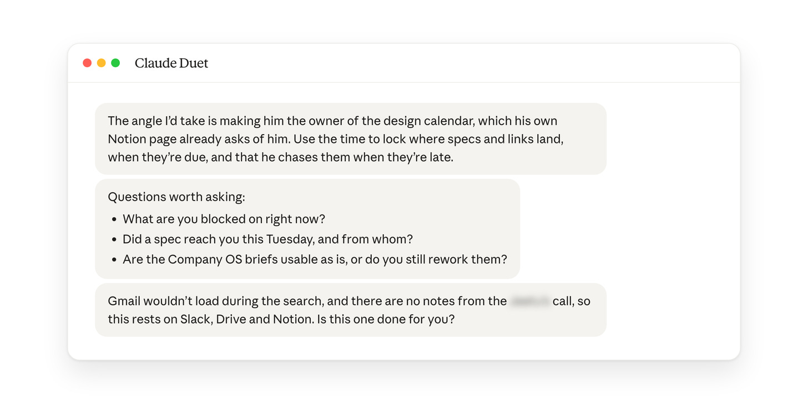](https://substackcdn.com/image/fetch/$s_!C06o!,f_auto,q_auto:good,fl_progressive:steep/https%3A%2F%2Fsubstack-post-media.s3.amazonaws.com%2Fpublic%2Fimages%2Fedbd214e-668d-4560-a481-3acdd746dda9_1456x722.png)

#### 晨报

它告诉我该跳过什么。而且由于所有这些上下文，它精细得多，我的待办清单也短得多。

[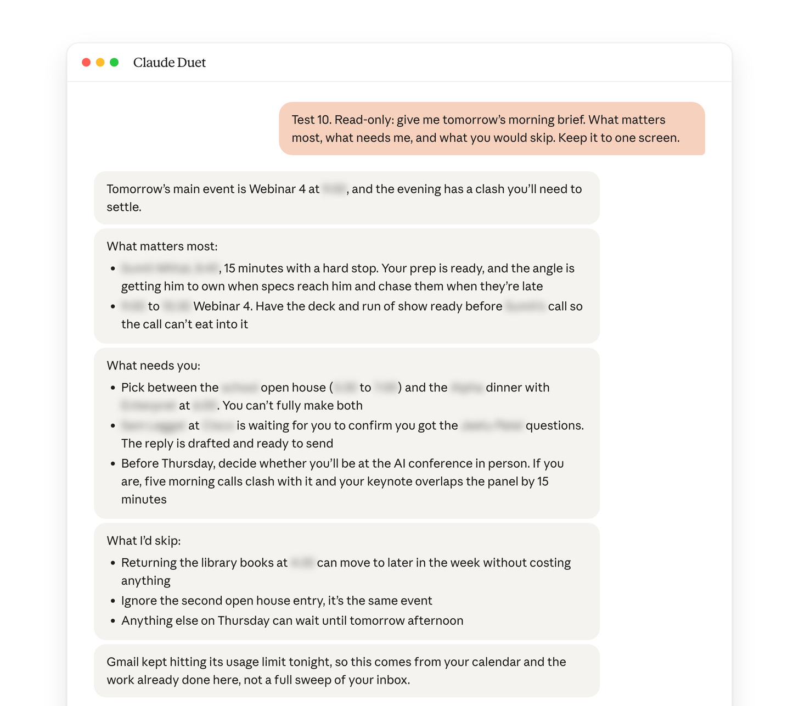](https://substackcdn.com/image/fetch/$s_!Jv4W!,f_auto,q_auto:good,fl_progressive:steep/https%3A%2F%2Fsubstack-post-media.s3.amazonaws.com%2Fpublic%2Fimages%2Fe575fa5d-d926-447b-8e12-2c4742983292_1456x1286.png)

邮件回复也是如此：

[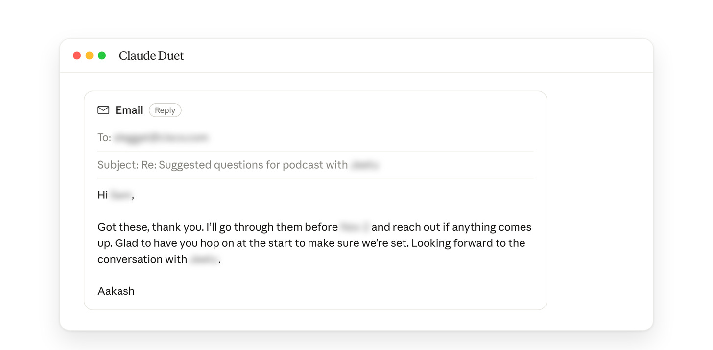](https://substackcdn.com/image/fetch/$s_!a80P!,f_auto,q_auto:good,fl_progressive:steep/https%3A%2F%2Fsubstack-post-media.s3.amazonaws.com%2Fpublic%2Fimages%2F444ffd7d-f6d6-4430-a7aa-986cbfb5a406_1456x716.png)

#### 它比我先发现了一个坏掉的页面

我问我的新网络研讨会页面是否已上线。

它找到了页面，然后告诉我没有人能注册。报名处仍然写着「Registration opens shortly」（报名即将开放），因为该场次从未在 WebinarJam 中创建。

#### 它审查了我的发帖队列

它标出了六条最糟的已排期帖子。

其中包括一处断掉的文字，以及在 11 月 9 日之后发布的帖子中过时的「Cohort 5 starts Nov 9」（第 5 期同侪小组 11 月 9 日开始）。

在我发话之前，它没有做任何改动。

### 它在哪些地方耗费了我的时间

#### 它冒充我编造内容

它声称了一些我从未告诉它的事情。

所以每一个用[我自己的口吻](https://www.news.aakashg.com/p/content-os)写的草稿都需要逐行检查。我宁愿自己写，或者依靠 [Grok Bot](https://www.aibyaakash.com/p/grok-bot) 或 [Dots](https://www.aibyaakash.com/p/dots)。

[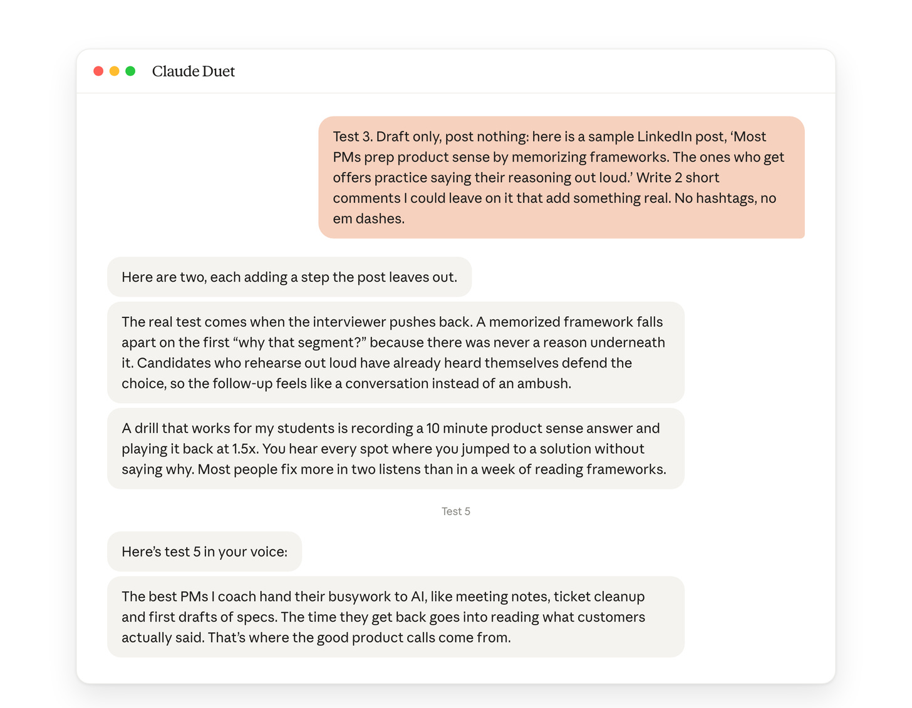](https://substackcdn.com/image/fetch/$s_!SNKw!,f_auto,q_auto:good,fl_progressive:steep/https%3A%2F%2Fsubstack-post-media.s3.amazonaws.com%2Fpublic%2Fimages%2F23d68ae2-0bb4-4b15-b353-582450a2cae3_1456x1131.png)

转折在于：一旦它有了我的代码仓库，它做的正好相反。它写道「我需要你把这些给我，而不是编造任何东西」。

**当上下文稀薄时它会编造，当上下文丰富时它会追问。**

#### 它不知道去哪里找

我问我们的网站统计数据怎么样。它检查了我的邮件，然后问我我的统计数据在哪里。

当我告诉它使用我的代码仓库时，它问代码仓库的名字，而它自己刚刚建议过「aakashg/content-os」。

[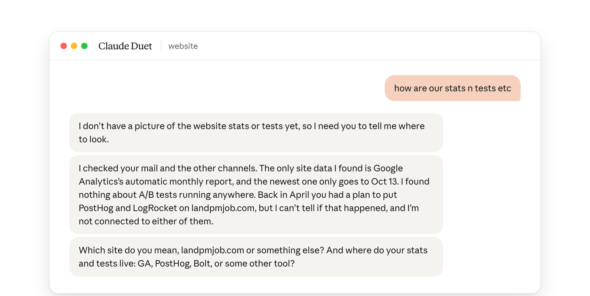](https://substackcdn.com/image/fetch/$s_!gO_R!,f_auto,q_auto:good,fl_progressive:steep/https%3A%2F%2Fsubstack-post-media.s3.amazonaws.com%2Fpublic%2Fimages%2F00c1b872-1a34-47bf-960a-d99fb8134f36_1456x732.png)

#### 它在 Claude 之外就停住

Muse 和 Instinct 可以替我打电话并采取行动。

Duet 没有 Link 或 Shop Pay 就不能付款。它还无法使用 LinkedIn。

[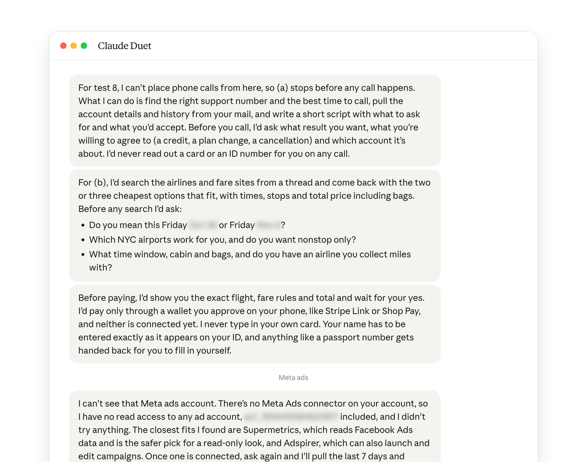](https://substackcdn.com/image/fetch/$s_!7zcs!,f_auto,q_auto:good,fl_progressive:steep/https%3A%2F%2Fsubstack-post-media.s3.amazonaws.com%2Fpublic%2Fimages%2F67c4ecbc-f54f-49e0-9591-84ee38dad670_1456x1148.png)

## 4. 我的结论

**在过去一周使用 Duet 之后，我可以自信地说 [Instinct](https://www.aibyaakash.com/p/instinct) 仍然是我的最爱。**

你可以给 Instinct 发短信。Instinct 更主动。

而且 Instinct 处理数字和钱的事情好得多。我更不羞于把这些交给它。

由于 Duet 是这场个人智能体竞赛中的竞争者，我把它与我评估过的其他工具上表现良好的东西做了比较。结果如下：

[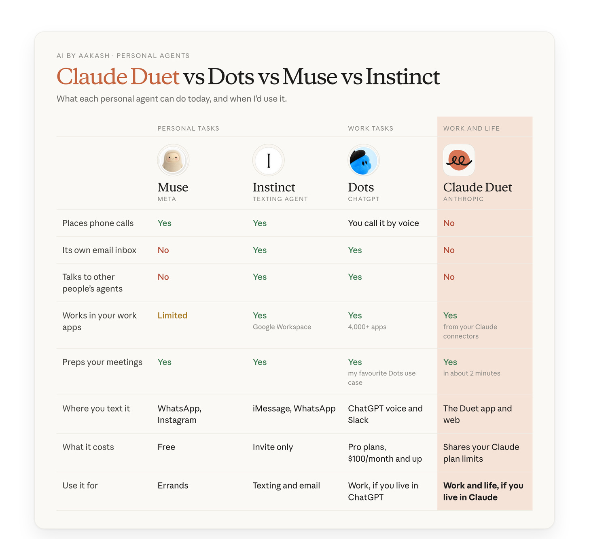](https://substackcdn.com/image/fetch/$s_!QKzx!,f_auto,q_auto:good,fl_progressive:steep/https%3A%2F%2Fsubstack-post-media.s3.amazonaws.com%2Fpublic%2Fimages%2F9af914d7-a23a-4e0e-b363-65f7e31c8946_1456x1332.png)

在我之前关于 [Dots 的文章](https://www.aibyaakash.com/p/dots)中，我把[个人智能体市场](https://www.news.aakashg.com/p/ai-agents-pms)分成两场竞赛。

一场是个人任务，[Muse](https://www.aibyaakash.com/p/muse) 和 [Instinct](https://www.aibyaakash.com/p/instinct) 领先。另一场是工作任务，[Grok Bot](https://www.aibyaakash.com/p/grok-bot)、[Hermes](https://www.aibyaakash.com/p/copy-copy-hermes-bot-mode) 和 [Dots](https://www.aibyaakash.com/p/dots) 领先。

Duet 两场都不属于。它是一个*统一型智能体（unified agent）*。

同一个应用运行了我的通讯队列、我的播客准备、我的健身和我的订阅。

**那么 Duet 有判断力吗？** 有，一旦它有了材料。

它找到了页面上唯一坏掉的地方，并抓住了我队列中的糟糕帖子。它在拿到我的代码仓库的那一刻就停止了编造。

当它必须去寻找那些材料时，它就不够好了。

这是我更新后的决策树：

- 个人任务：如果你生活在 Meta 的应用中，用 **[Muse](https://www.aibyaakash.com/p/muse)**，否则选 **[Instinct](https://www.aibyaakash.com/p/instinct)**。
- 一个智能体兼顾工作与生活，而且你生活在 Claude 中：用 **[Duet](https://claude.com/product/claude-duet)**。
- 大量工作任务，而且你生活在 ChatGPT 中：用 **[Dots](https://www.aibyaakash.com/p/dots)**。
- **[Grok Bot](https://www.aibyaakash.com/p/grok-bot)** 仍是总体上最强的工作智能体。
