来源：https://www.aibyaakash.com/p/claude-duet-review
取文：2026-11-05，直接下载；只取开头导语与「Deep dive」部分

### Anthropic entered the personal agent race. I got access. So how does it stack up?

Oct 31, 2026

Welcome to another [AI by Aakash](https://www.aibyaakash.com/). I follow the AI news so you don’t have to.

There’s been a new race in AI this year. [Instinct](https://www.aibyaakash.com/p/instinct), [Muse](https://www.aibyaakash.com/p/muse), [Hermes](https://www.aibyaakash.com/p/copy-copy-hermes-bot-mode), [Grok Bot](https://www.aibyaakash.com/p/grok-bot), all of these are a new sort of proactive agent. The big question has been, **where is Anthropic in this race?**

On Oct 21, Anthropic released its alternative: [Duet](https://claude.com/product/claude-duet).

[

Claude@claudeai

We’re opening a research preview of Claude Duet, a new app where Claude works as a proactive agent.
It comes to you with what needs your attention, completes tasks you ask of it, keeps working when you step away, and checks with you before it acts on your behalf.

7:09 PM · Oct 21, 2026 · 11.2M Views

---

2.41K Replies · 4.27K Reposts · 55.5K Likes](https://x.com/claudeai/status/2112984664256241837)

*Today, we’re gonna look into Duet and see how it stacks up. But first, a word from our sponsor and this week’s top news.*

## Claude Duet: Anthropic’s unified agent

[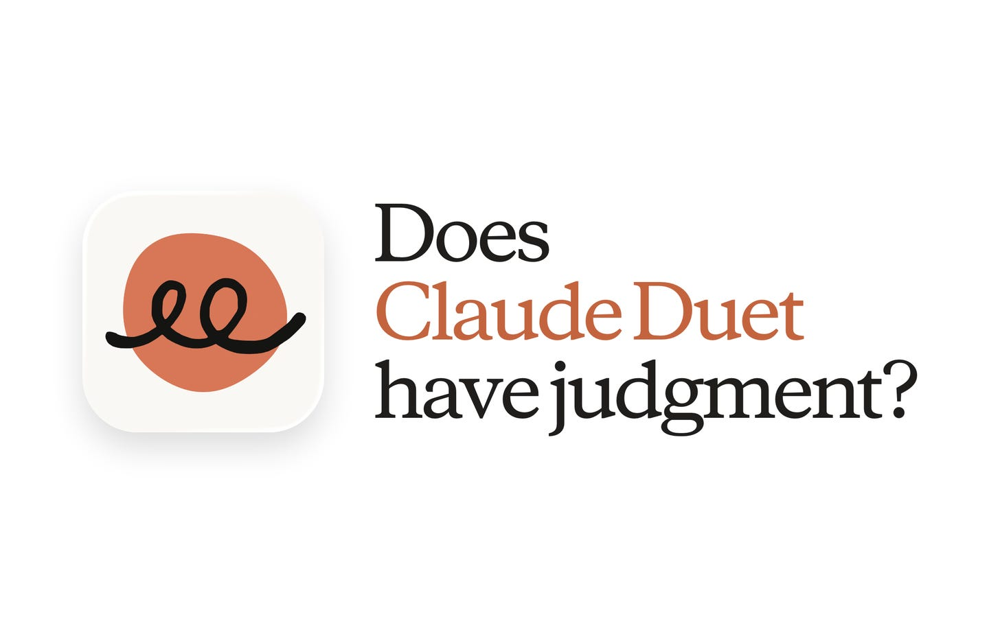](https://substackcdn.com/image/fetch/$s_!OxiT!,f_auto,q_auto:good,fl_progressive:steep/https%3A%2F%2Fsubstack-post-media.s3.amazonaws.com%2Fpublic%2Fimages%2F50f63014-5aa2-41bb-98c6-85fd3b3cf65f_1456x902.png)

We’ve been talking about the [personal agent space](https://www.news.aakashg.com/p/ai-agents-pms) for weeks in this newsletter now ([Grok Bot](https://www.aibyaakash.com/p/grok-bot), [Hermes](https://www.aibyaakash.com/p/copy-copy-hermes-bot-mode), [Dots](https://www.aibyaakash.com/p/dots), [Instinct](https://www.aibyaakash.com/p/instinct), [Muse](https://www.aibyaakash.com/p/muse)), and we have been waiting to see what Anthropic will bring to the table.

For my money, [Claude Code](https://www.news.aakashg.com/p/content-os) is the best AI harness, but can [Duet](https://claude.com/product/claude-duet) replace it?

**Spoiler alert, I don’t think so**, but it’s an interesting surface. So let’s go take a look at Duet.

I want to cover a few different things for you today.

#### Today’s post

1. What Duet is and how to set it up
2. A walkthrough of every feature
3. The jobs I gave it
4. My verdict

## 1. What Duet is and how to set it up

So Duet is basically a new tab inside your Claude app.

The idea is that it’s going to be *more proactive*. It’s going to nudge you with tasks that need your attention, and it runs on *channels*, almost like Slack.

Here’s my setup:

[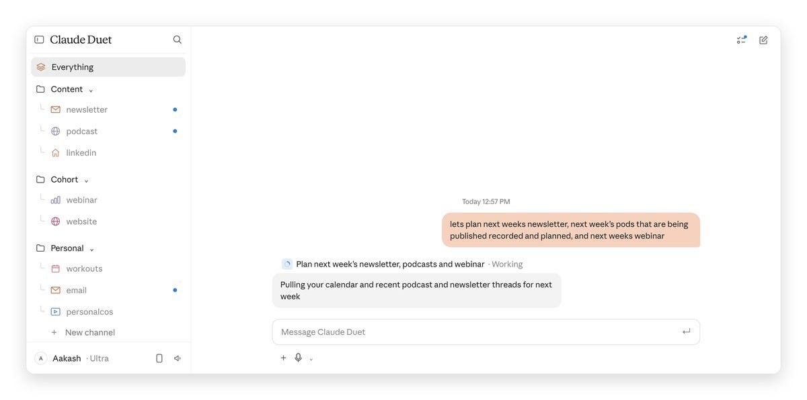](https://substackcdn.com/image/fetch/$s_!dNJE!,f_auto,q_auto:good,fl_progressive:steep/https%3A%2F%2Fsubstack-post-media.s3.amazonaws.com%2Fpublic%2Fimages%2F78a72eb9-8b51-4037-b05f-5257f44a0d59_1200x596.jpeg)

They don’t actually surface a model picker, which is interesting. It runs on [Opus 5.5](https://www.aibyaakash.com/p/edit-videos-with-claude-code).

For someone like me who runs a lot of tasks on Sonnet, that is an unfortunate cost. There’s also no effort picker.

**If you think about Duet, it’s almost like a simplified view into Claude.**

It does piggyback off [your existing Claude memory, skills and connected apps](https://x.com/claudeai/status/2112984666437546104). That’s its big benefit for a [power user](https://www.aibyaakash.com/p/claude-features-ranked-q1-2026) like me who lives inside Claude.

If you’re like that, you might get some benefits. But to be totally honest, **most of it needs to be prompted.**

Here’s an example. I needed to connect it to my [Content OS](https://www.news.aakashg.com/p/content-os) repo:

[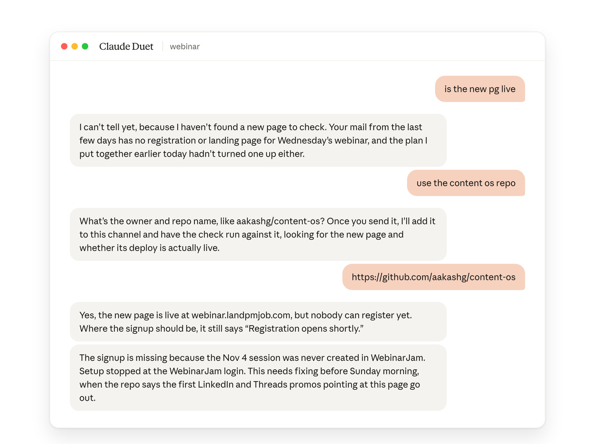](https://substackcdn.com/image/fetch/$s_!jBAL!,f_auto,q_auto:good,fl_progressive:steep/https%3A%2F%2Fsubstack-post-media.s3.amazonaws.com%2Fpublic%2Fimages%2F0f2f68df-6eb0-439c-b8b8-797fdc944983_1456x1088.png)

I’ve generally found that they haven’t made the recall very good yet, especially of local Claude Code sessions.

#### How to set it up

#### Step 1: join the waitlist

I ended up exercising some of my Anthropic connections to get off of it as soon as I did.

You may have to wait a little longer.

#### Step 2: connect your apps

If you’ve connected Claude to all your apps, Duet already inherits all those connectors, which is great.

#### Step 3: see what it already knows

One thing I tested was what it knows about me, and here’s what it showed:

[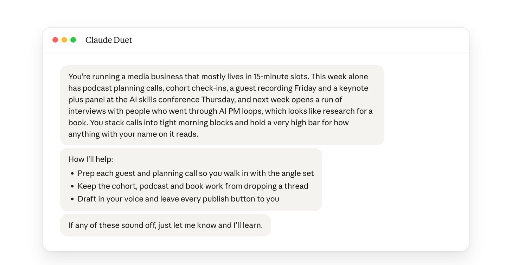](https://substackcdn.com/image/fetch/$s_!VHJH!,f_auto,q_auto:good,fl_progressive:steep/https%3A%2F%2Fsubstack-post-media.s3.amazonaws.com%2Fpublic%2Fimages%2Fb5d70eac-6b6c-4a5f-b83a-be5215d3a56c_1456x755.png)

You can see it’s a pretty good landscape. I was impressed. **This is one of the benefits of Duet being Duet.**

## 2. A walkthrough of the top features

Now let’s walk through the top features. I haven’t seen a lot of these in most of the content I looked at, videos and articles.

I don’t know if they’re out of date or if the authors didn’t see them. But basically, Duet has these concepts of **groups and channels**.

Here’s how I’ve set mine up: Content, Cohort and Personal. You can choose your own way. I also set up a *chief of staff*.

#### Everything, channels and groups

*Everything* is one feed for every ask.

Channels are separate chats for one stream of work, like newsletter, podcast or webinar. Groups hold channels together.

I asked it in *Everything* to plan next week’s newsletter, podcasts and webinar. **It split that into tasks and filed them into the newsletter, podcast, LinkedIn and email channels on its own.**

#### Instructions and a chief of staff channel

Each channel keeps its own standing instructions. I made one channel my hub and asked it to direct the others.

It rewrote its own instructions to read every other channel and give me status across all of them.

The **Everything** channel is pretty powerful. It’s the catch-all.

You can use it as your chief of staff, or keep it for blanket questions. I chose the *chief of staff* model, which I got from [Grok Bot](https://www.aibyaakash.com/p/grok-bot).

It’s not built into Duet. **You have to set it up yourself**, and here’s how I did it:

[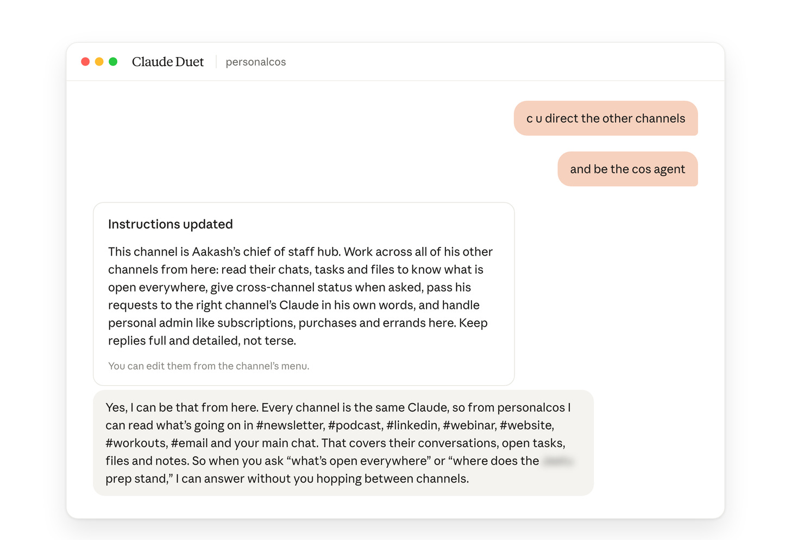](https://substackcdn.com/image/fetch/$s_!0QiU!,f_auto,q_auto:good,fl_progressive:steep/https%3A%2F%2Fsubstack-post-media.s3.amazonaws.com%2Fpublic%2Fimages%2F8ddb69f7-49bc-4ea3-b8d7-ff19438f69c3_1456x995.png)

#### The daily heartbeat

One of the defining features: every morning you get a **brief** on what’s on your plate across all your channels, what work it did overnight, and what it might want to do today.

That’s how it’s proactive. It’s a *daily heartbeat*, which you’re probably familiar with if you’ve used something like OpenClaw.

[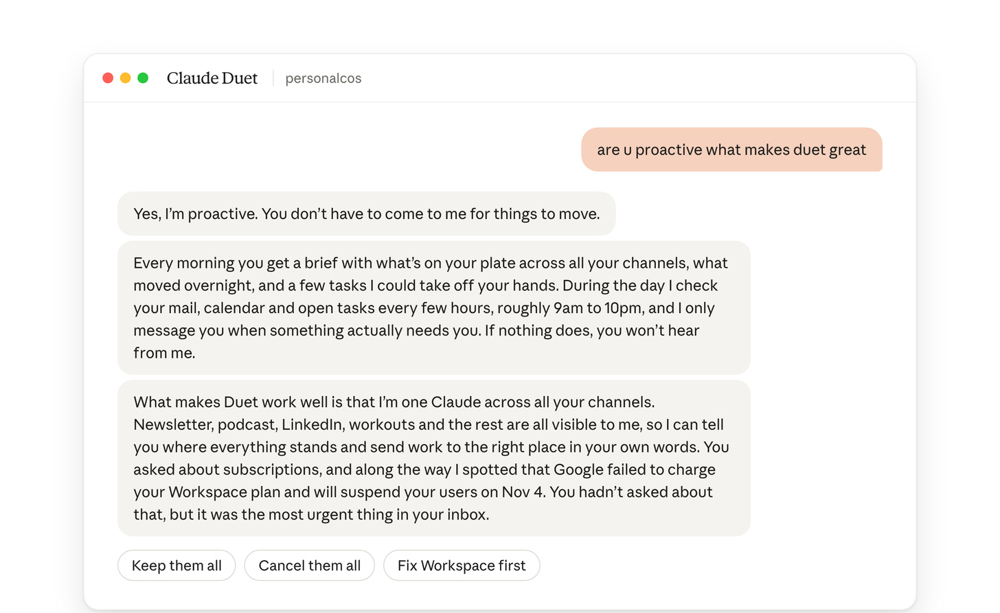](https://substackcdn.com/image/fetch/$s_!1meG!,f_auto,q_auto:good,fl_progressive:steep/https%3A%2F%2Fsubstack-post-media.s3.amazonaws.com%2Fpublic%2Fimages%2F1f973001-f6f5-42c9-966d-e1471507905c_1456x893.png)

One of the cool things it does: it gives you **buttons** to choose options, so letting it help you takes even less effort.

**What makes Duet work is that it’s one Claude across all your channels.** At least, it aspires to be. Perhaps when they build it fully, it will be.

#### The design touches

Duet has several design concepts that make me think they had a **really strong designer** working on it.

One idea: *task cards* that open like this.

[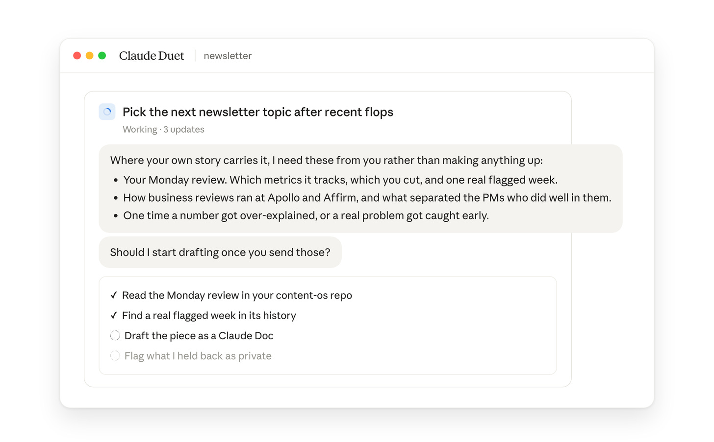](https://substackcdn.com/image/fetch/$s_!nUs3!,f_auto,q_auto:good,fl_progressive:steep/https%3A%2F%2Fsubstack-post-media.s3.amazonaws.com%2Fpublic%2Fimages%2F5c772a25-7aaf-4dd0-9ad9-a7d4890ff52e_1456x903.png)

Another cool thing: you can **attach a GitHub repo to a channel**. That’s not something I’m familiar with in regular Claude, but you can do it in Duet.

#### It asks before it acts

Every email it drafts, every change to my posting queue and every payment **waits for my yes**.

#### How I’d set it up from day one

1. Connect your inbox, calendar, Slack, Drive, Notion, Stripe and the other basics.
2. Connect your product analytics too. Mine is in PostHog.
3. Set up a group for each business line, plus one for personal, with the right channels inside.
4. Ask each channel something proactive to get it started.
5. Start teaching them. The conversations get a lot better once you’ve taught them for a while.
6. Create a chief of staff channel and dictate your goals to it.

## 3. The jobs I gave it

I gave it the same jobs I gave [Dots](https://www.aibyaakash.com/p/dots), [Grok Bot](https://www.aibyaakash.com/p/grok-bot), [Muse](https://www.aibyaakash.com/p/muse) and [Instinct](https://www.aibyaakash.com/p/instinct).

What I observed was it **mostly helped me in reading and drafting responses, and struggled with taking actions**:

[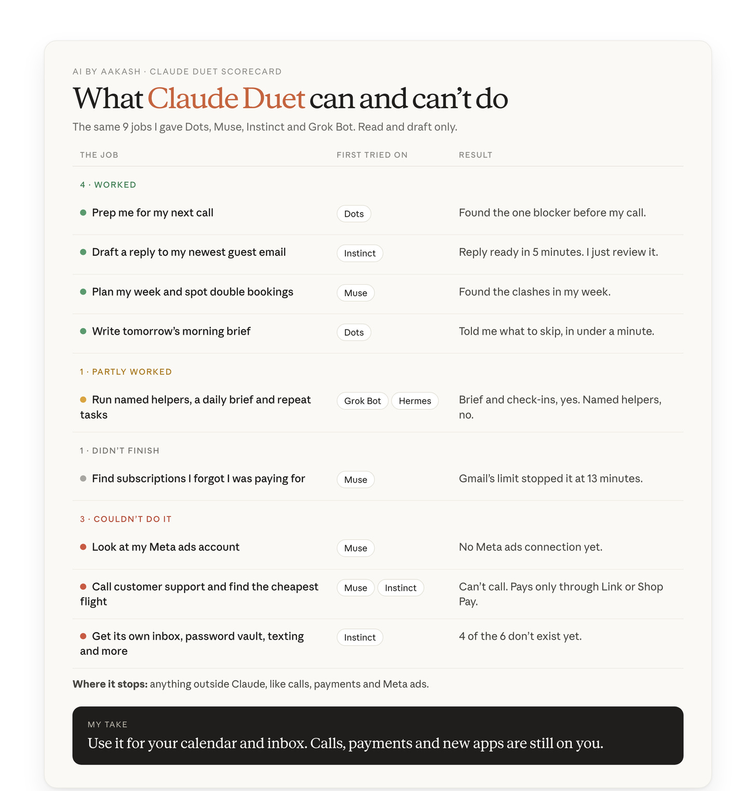](https://substackcdn.com/image/fetch/$s_!r1ax!,f_auto,q_auto:good,fl_progressive:steep/https%3A%2F%2Fsubstack-post-media.s3.amazonaws.com%2Fpublic%2Fimages%2Fd30460fc-39fe-49f7-88ea-8412d74f0a61_1456x1522.png)

It saved me time on anything inside my calendar, my inbox or my Slack connections. But outside of that, **I had to do almost everything by myself**.

### Where it saved me time

#### Meeting prep

It was good at preparing for my meetings, much better than [the other personal agents](https://www.news.aakashg.com/p/ai-agents-pms), because of the context it had from my Claude, as I’ve been [running it for months](https://www.news.aakashg.com/p/company-os).

It understood all the nuances from Slack.

[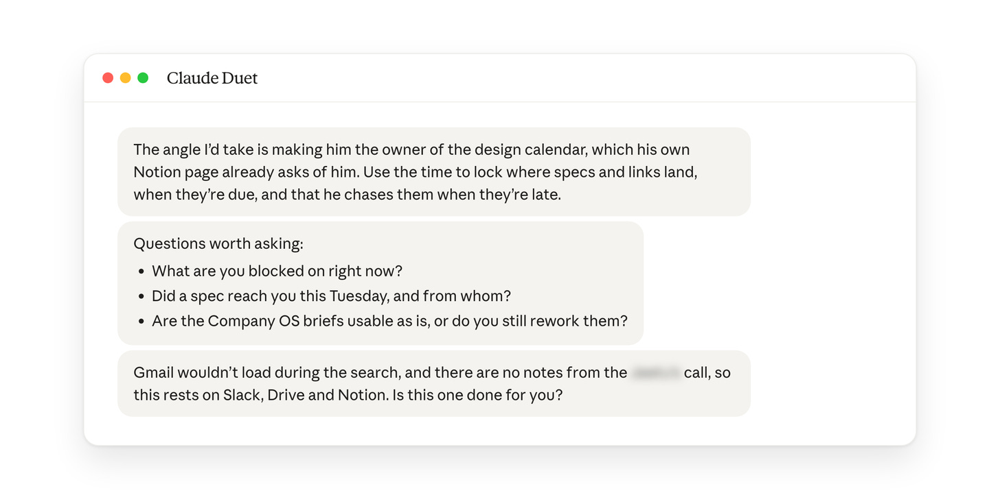](https://substackcdn.com/image/fetch/$s_!C06o!,f_auto,q_auto:good,fl_progressive:steep/https%3A%2F%2Fsubstack-post-media.s3.amazonaws.com%2Fpublic%2Fimages%2Fedbd214e-668d-4560-a481-3acdd746dda9_1456x722.png)

#### Morning brief

It told me what to skip. And because of all that context, it was much more refined, and my to-do list was much shorter.

[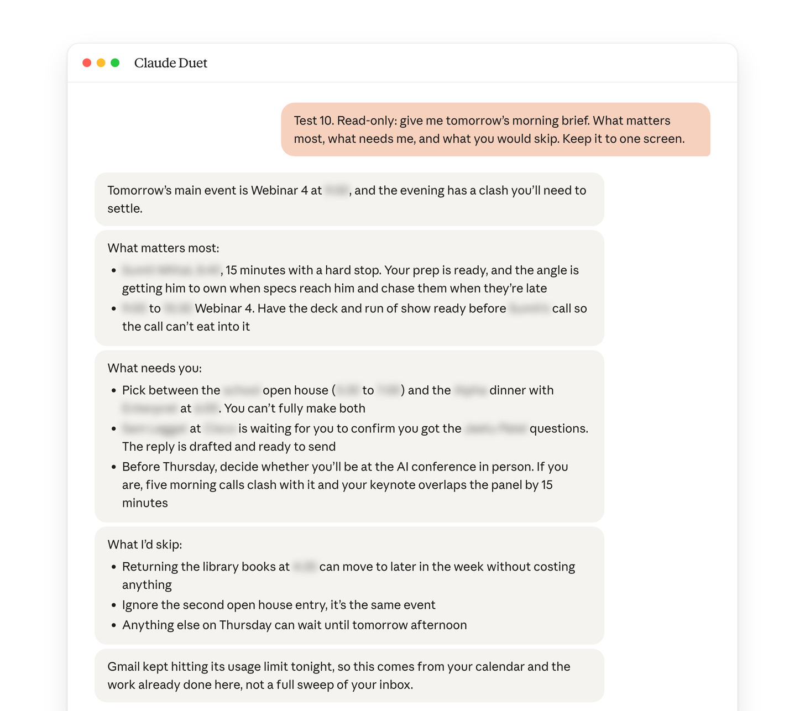](https://substackcdn.com/image/fetch/$s_!Jv4W!,f_auto,q_auto:good,fl_progressive:steep/https%3A%2F%2Fsubstack-post-media.s3.amazonaws.com%2Fpublic%2Fimages%2Fe575fa5d-d926-447b-8e12-2c4742983292_1456x1286.png)

Same was the case with the email replies:

[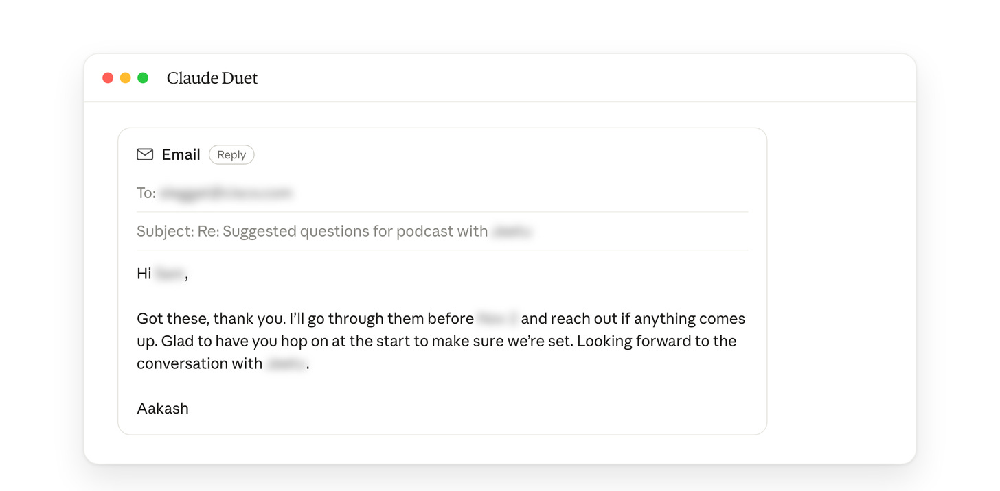](https://substackcdn.com/image/fetch/$s_!a80P!,f_auto,q_auto:good,fl_progressive:steep/https%3A%2F%2Fsubstack-post-media.s3.amazonaws.com%2Fpublic%2Fimages%2F444ffd7d-f6d6-4430-a7aa-986cbfb5a406_1456x716.png)

#### It caught a broken page before I did

I asked if my new webinar page was live.

It found the page, then told me nobody could register. The signup still said “Registration opens shortly” because the session was never created in WebinarJam.

#### It audited my posting queue

It flagged the six worst scheduled posts.

They included a broken line and a stale “Cohort 5 starts Nov 9” in posts going out after Nov 9.

It changed nothing until I said so.

### Where it cost me time

#### It made things up as me

It claimed things I had never told it.

So every draft in my [own voice](https://www.news.aakashg.com/p/content-os) needs a line-by-line check. I would rather write things on my own, or rely on [Grok Bot](https://www.aibyaakash.com/p/grok-bot) or [Dots](https://www.aibyaakash.com/p/dots).

[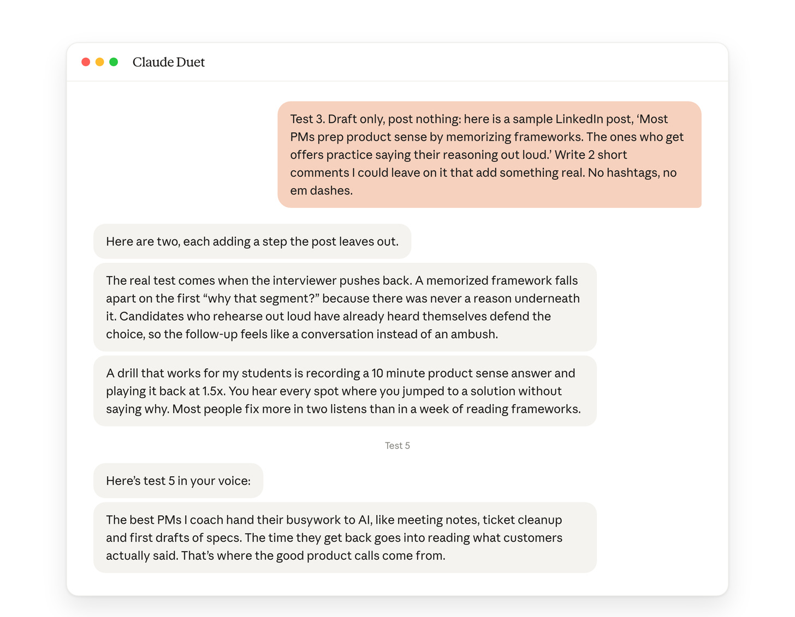](https://substackcdn.com/image/fetch/$s_!SNKw!,f_auto,q_auto:good,fl_progressive:steep/https%3A%2F%2Fsubstack-post-media.s3.amazonaws.com%2Fpublic%2Fimages%2F23d68ae2-0bb4-4b15-b353-582450a2cae3_1456x1131.png)

The twist: once it had my repo, it did the opposite. It wrote “I need these from you rather than making anything up.”

**It invents when context is thin and asks when context is rich.**

#### It doesn’t know where to look

I asked how our site stats were doing. It checked my mail and asked me where my stats live.

When I told it to use my repo, it asked for the repo name, after suggesting “aakashg/content-os” itself.

[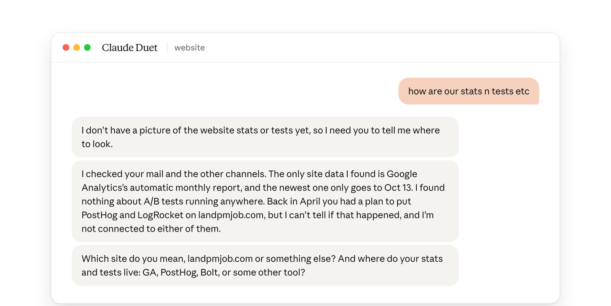](https://substackcdn.com/image/fetch/$s_!gO_R!,f_auto,q_auto:good,fl_progressive:steep/https%3A%2F%2Fsubstack-post-media.s3.amazonaws.com%2Fpublic%2Fimages%2F00c1b872-1a34-47bf-960a-d99fb8134f36_1456x732.png)

#### It stops outside Claude

Muse and Instinct can make calls and take actions for me.

Duet can’t pay without Link or Shop Pay. It can’t use LinkedIn yet.

[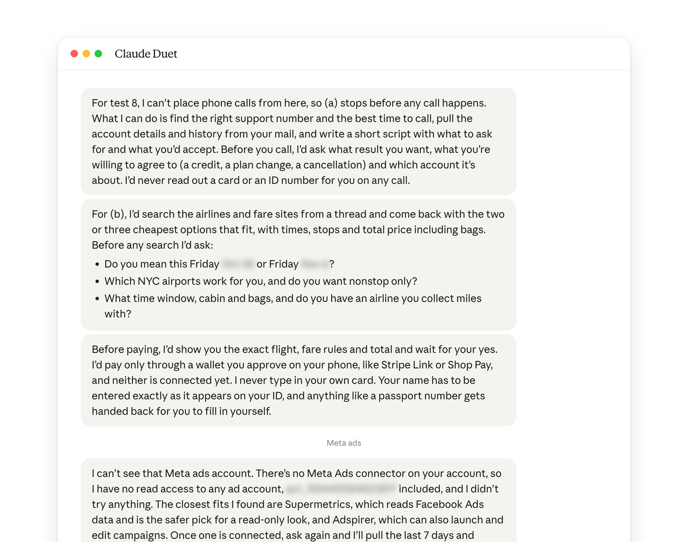](https://substackcdn.com/image/fetch/$s_!7zcs!,f_auto,q_auto:good,fl_progressive:steep/https%3A%2F%2Fsubstack-post-media.s3.amazonaws.com%2Fpublic%2Fimages%2F67c4ecbc-f54f-49e0-9591-84ee38dad670_1456x1148.png)

## 4. My verdict

**After using Duet for the last week, I can confidently say [Instinct](https://www.aibyaakash.com/p/instinct) is still my favorite.**

You can text Instinct. Instinct is more proactive.

And Instinct handles numbers and money stuff much better. I was less shy about handing that over.

Since Duet is a competitor in this personal agent race, I compared it against the things that worked well on the other tools I’ve evaluated. Here’s what came out:

[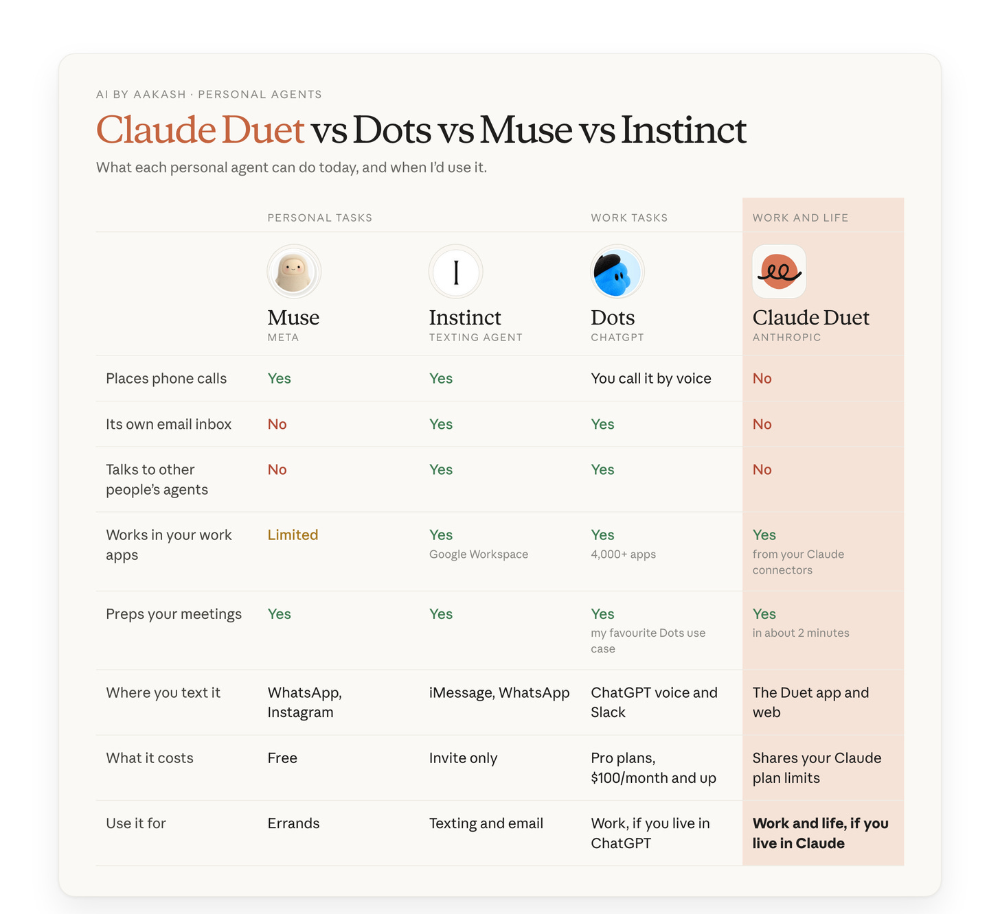](https://substackcdn.com/image/fetch/$s_!QKzx!,f_auto,q_auto:good,fl_progressive:steep/https%3A%2F%2Fsubstack-post-media.s3.amazonaws.com%2Fpublic%2Fimages%2F9af914d7-a23a-4e0e-b363-65f7e31c8946_1456x1332.png)

In my previous [Dots post](https://www.aibyaakash.com/p/dots), I split the [personal agent market](https://www.news.aakashg.com/p/ai-agents-pms) into two races.

One is personal tasks, where [Muse](https://www.aibyaakash.com/p/muse) and [Instinct](https://www.aibyaakash.com/p/instinct) lead. The other is work tasks, where [Grok Bot](https://www.aibyaakash.com/p/grok-bot), [Hermes](https://www.aibyaakash.com/p/copy-copy-hermes-bot-mode) and [Dots](https://www.aibyaakash.com/p/dots) lead.

Duet doesn’t fit either race. It’s a *unified agent*.

The same app ran my newsletter queue, my podcast prep, my workouts and my subscriptions.

**So does Duet have judgment?** Yes, once it has the material.

It found the one broken thing on a page and caught bad posts in my queue. It stopped inventing the moment it had my repo.

It falls short when it has to go find that material.

Here’s my updated decision tree:

- Personal tasks: use **[Muse](https://www.aibyaakash.com/p/muse)** if you live in Meta’s apps, else pick **[Instinct](https://www.aibyaakash.com/p/instinct)**.
- One agent for work and life, and you live inside Claude: use **[Duet](https://claude.com/product/claude-duet)**.
- Lots of work tasks and you live inside ChatGPT: use **[Dots](https://www.aibyaakash.com/p/dots)**.
- **[Grok Bot](https://www.aibyaakash.com/p/grok-bot)** is still the strongest work agent overall.
