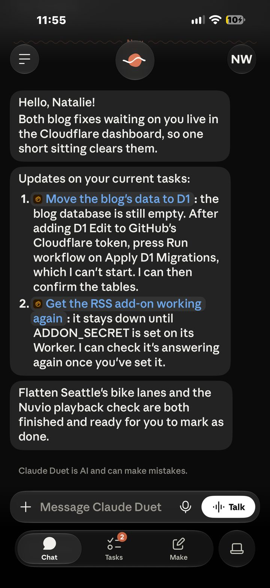
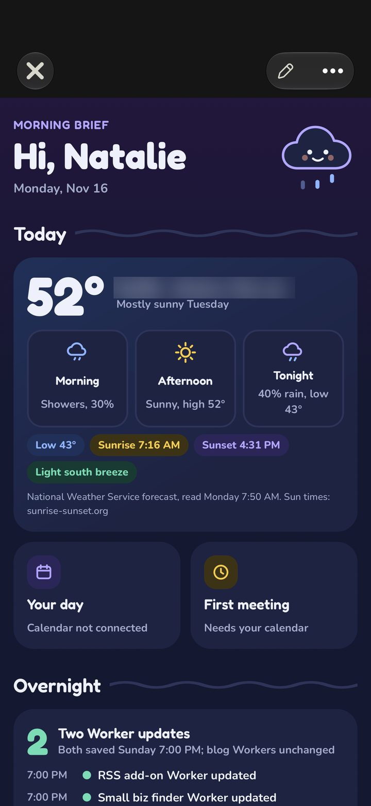
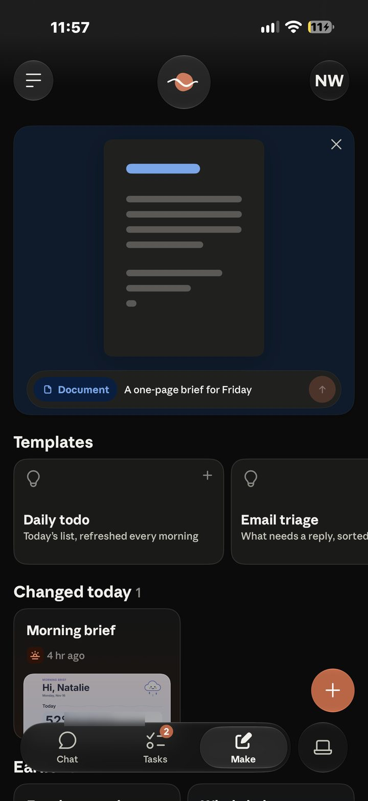
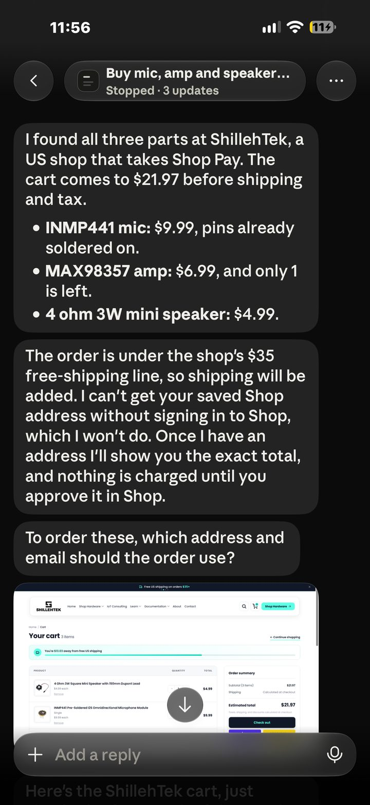



**收录说明**：直接下载，图片收入 images/；相对链接改为绝对地址。经 Hacker News 检索发现。文末作者声明这篇文章由 Claude 起草，作者阅读后合并发布，照录。原文全文存于本目录的 original.md，网站上不显示，已翻译。

**内容摘要**：作者在第一天把积压的事务都交给 Claude Duet：先给搁置约三个月的个人网站做健康检查，发现背后的 SurrealDB 数据库已无法访问，决定迁到 Cloudflare D1，Duet 把迁移拆成一系列小 PR 交付；连接 Slack 后，Duet 接上了作者原先 OpenClaw 智能体留下的工作。用法是在主聊天里用文字或语音提出请求，较大的请求成为 Tasks 中的独立任务，合并、发布、购买、发送前都先征得同意，另有晨报和日间 check-in。作者列出的缺口有：Proton Mail 没有连接器，只做了转发到 Cloudflare Email Worker 的替代方案；Exchange 日历连不上，晨报显示「Calendar not connected」；Cloudflare 控制台的步骤要自己点；看不到已部署的页面；购物只做到购物车，不登录账户结账。这些工作用掉了 $20 套餐每周额度的约 75%。

**保留理由**：一手的首日多任务记录，列出了邮件、日历、线上页面、结账等具体缺口，并给出一个额度消耗的数据点。

---

我本周开始使用 Claude Duet。它的卖点是：Claude 像你的幕僚长一样工作。你像给一个你信任的人发消息那样给它发消息，它去跑腿，回来给你答案，而不是给你更多工作。

我以前自己搭过助手工具链（[见：我的 OpenClaw 配置](https://nataliewalls.com/blog/my-openclaw-setup)），所以我知道要让 AI 真正有用得花多少时间。我带着怀疑上手，第一天基本上把整个积压清单都扔给了它。

这是我们做完的事。

## 一些背景：我已经放弃了这个网站

我找了一份全职工作，基本上离开这个网站大约三个月。我知道数据库挂了。我只是不确定这到底弄坏了什么。

这正是像 Duet 这类东西的真正卖点。不是「AI 写代码」，而是「你一直躲着的那堆事终于有人看了」。

它也不是从零开始。我原来的 OpenClaw 智能体以前在 Slack 里工作，所以我一连上 Slack，Claude 就把里面的内容读了一遍，从那个智能体停下的地方接着做：哪些做了一半，哪些还没开始。不用重新解释我的整套配置。这确实很有用。

## 数据库死了。我不知道它弄坏了什么。

第一个请求很无聊：给博客做一次健康检查，告诉我损失情况。我那套计数器和几个工具背后的 SurrealDB 数据库已经有好几个月连不上了，所以我们终于得到了一份「哪里悄悄坏了」的清单，而不是一种模糊的不妙感觉。

我们决定迁到 Cloudflare D1。我本来就生活在 Cloudflare 那一套里，所以这个决定很容易做。Claude 把迁移规划成一系列小 PR，创建了 D1 数据库，我们合并了最初几个，其中包括一个在任何东西落到 main 之前测试表结构的合并前检查。迁移的其余部分已经排好队。

## 它错的那一次

早些时候，Claude 告诉我旧数据库看起来是好的。并不是。当事实对不上时，它直说了，做了更正，我们改变了方向。

正是这一点让我更信任它，而不是更少。每个工具有时都会出错。重要的是它会不会去核实真实的东西，而不是凭记忆，以及它是否承认错误。对智能体和人类都适用的好规则：回答之前先核实。

## 我实际是怎么用的

流程最后相当简单：

1. **我在主聊天里提要求。** 通常打字，很多时候用语音。一句话就够：「修一下构建」「写一篇博客文章」「帮我找到这些零件」。
2. **较大的要求会变成任务。** 每一项都有自己的对话，并出现在 Tasks 标签页，这样主聊天保持可读，我也可以随时查看某一项而不必滚动。
3. **代码工作以 pull request 的形式回来。** 它开分支、做改动，等 GitHub 的检查通过之后才告诉我准备好了。
4. **没有我的同意，什么都不会发布。** 合并、发布、购买、发送：它都会先问。我说「合并吧」，它才做。
5. **它会主动来找我。** 聊天里的晨报、一个晨报页面、一个每晚重建的晚间汇总页面，以及白天在确实需要我时进行的 check-in。

晨报会出现在聊天里。大多数日子里，等着我的只有那些只有我能做的步骤。

晨报页面。注意那张日历卡片。下文会再讲。（位置已模糊处理。）

Make 标签页，晨报这类页面就放在这里。

## 顺手完成的小事

这一天里有些事只是被做完了：

- **我 iPhone 上的 Nuvio。** 已设置好，可以用了。
- **首页上的精选歌曲。** 手工挑选，目前是 Arca 的「Wound」。我们一开始用 Spotify 嵌入播放器，后来换成了 Tidal 播放器。
- **</dog> 上的狗狗画廊。** 当然。

## 邮件：一个半成品替代方案，不是集成

我用 Proton Mail，它在隐私方面很好，在自动化方面很烦。它没有连接器。通常的答案是 Proton Bridge，但我不想为了这个去照看一台服务器。

所以我们开始做一套替代方案：Proton 把我邮件的副本转发到一个 Cloudflare Email Worker，目标是给 Claude 一个只读的收件箱视图。不过，得说清楚这算什么。它只做了一半，而且即使做完，也只是一个替代方案，不是真正的邮件集成。它只能看到从此以后转发过来的副本，分不清我哪些已经读过，也无法回复。对于一个工作全部内容就是知道有什么需要我的助手来说，这是实实在在的缺口。

## 一天后完成

- **[图案设计器](https://nataliewalls.com/pattern-designer)的 Skyline 模式。** 我的页头图案生成器现在有城市天际线风格。
- **Flatten SF，但是西雅图版。** 西雅图分叉已在 </flatsea> 上线，现在还有自行车道。

## 还有生活琐事

不全是代码。Claude 帮我挑了一条用来挂钥匙的项链（我选了 Nite Ize 的挂绳），我们还规划了周日的辣椒炖菜，并在周六设了提醒去买齐所有材料。

这些事有很多是在我一边对付狗一边打的语音电话里完成的。如果我在句子中间说「come on」，我不是在跟你说话。我把这一点告诉 Claude 之后，它就忽略那些片段，从我停下的地方接着来。小事，但生活质量提升巨大。

为 ESP32 项目跑一趟零件采购。它把购物车建好了，然后停下来询问，而不是登录我的 Shop 账户。

## 还缺什么

并不是一切顺利。以我的用法而言，我遇到的缺口有：

- **邮件。** 见上文。转发替代方案不等于一个收件箱。
- **我的日历。** 我的日历是我 iPhone 上的 Exchange 账户，Duet 看不到它。晨报上明明白白写着「Calendar not connected」，这基本上把晨报里「我今天什么样」那部分毁掉了。
- **最后一步还是我的。** Cloudflare 控制台里的任何事，比如令牌权限、密钥，或在某个工作流上点 Run，都要等我。对凭据来说这是正确的做法，但这意味着 D1 迁移要等我坐下来点几下才能继续。
- **它看不到我的线上网站。** 它能看着检查通过，但无法打开我已部署的页面或预览来确认某个东西真的上线了。还是得我去看。
- **购物止步于结账。** 它会建购物车、比较选项，但不会为了我的地址登录我的账户，所以订单由我完成。

## 那么，它好吗？

好。我最注意到的是我几乎不需要管理它。我说我想要什么，它去做，然后带着「这是 PR」或「这是我要你做的唯一一件事」回来。任何需要我同意的事，比如合并或发布，都确实等了我的同意。

所有这一切大约用掉了 $20 套餐每周额度的 75%。

它不是魔法。有些事还在进行中，有一件事还一度自信地错了。但到第一天结束时，我的博客更健康了，我终于知道哪里坏了，晚饭也规划好了。这比大多数日子都好。

---

*是的，这篇文章是 Claude 起草的。我读了一遍，然后点了合并。这基本上就是整件事的主意。*
