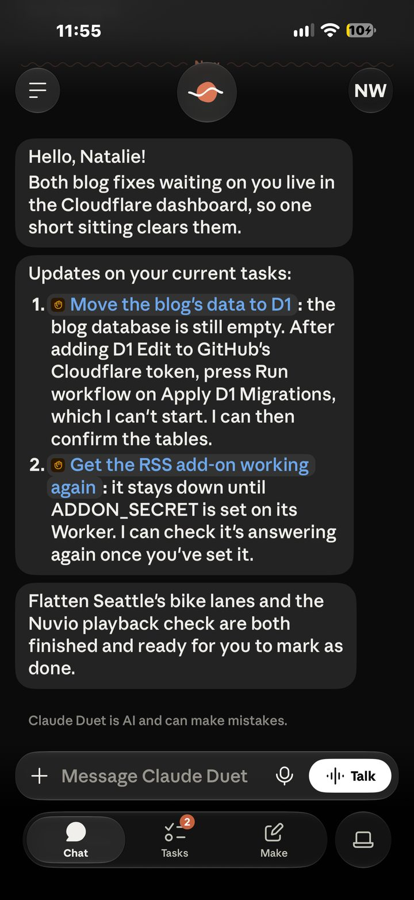
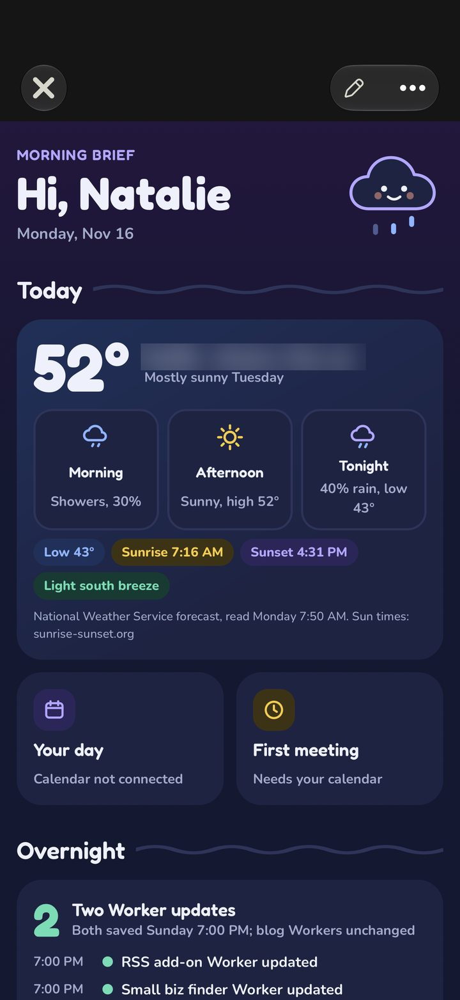
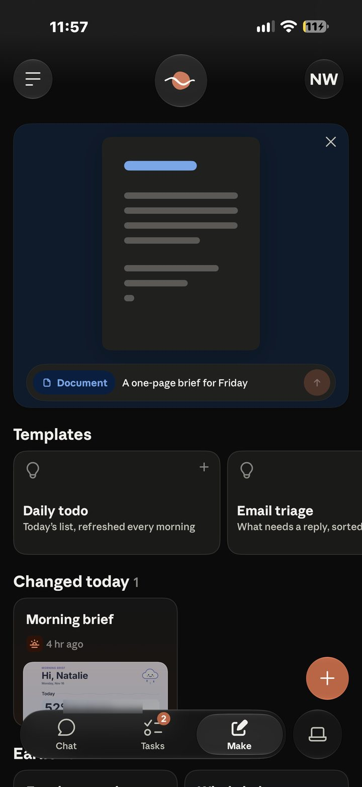
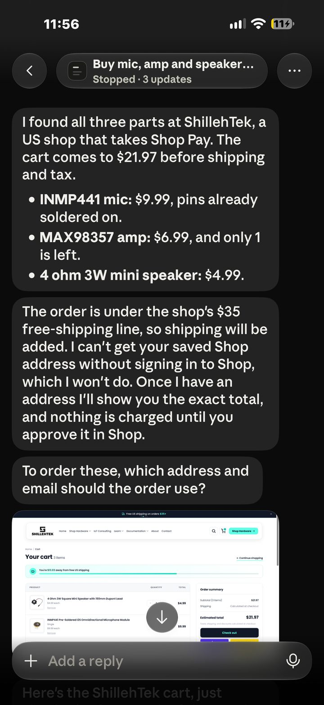

来源：https://nataliewalls.com/blog/first-day-with-claude-duet
取文：2026-11-28，直接下载

My First Day with Claude Duet

I started using Claude Duet this week. The pitch: Claude works as your chief of staff. You text it the way you'd text someone you trust, it does the legwork, and it comes back with answers instead of more work for you.

I've built my own assistant stacks before ([see: my OpenClaw setup](https://nataliewalls.com/blog/my-openclaw-setup)), so I know how much time goes into making an AI actually useful. I went in skeptical and threw basically my entire backlog at it on day one.

Here's what we got through.

## Some context: I'd abandoned this site

I got a full-time job and basically walked away from this site for about three months. I knew the database was down. I just wasn't sure what that actually broke.

That's the real pitch for something like Duet. Not "AI writes code." It's "the pile you've been avoiding finally gets looked at."

It also didn't start from zero. My old OpenClaw agent used to work out of Slack, so once I connected Slack, Claude read back through it and picked up right where that agent left off: what was half done and what was still open. No re-explaining my whole setup. That was genuinely useful.

## The database was dead. I didn't know what it broke.

First ask was boring: give the blog a health check and tell me the damage. The SurrealDB database behind my counters and a few tools had been unreachable for months, so we finally had a list of what was quietly broken instead of a vague bad feeling.

We decided to move to Cloudflare D1. I already live in the Cloudflare stack, so it was an easy call. Claude planned the move as a series of small PRs, created the D1 database, and we merged the first ones, including a pre-merge check that tests the table setup before anything lands on main. The rest of the move is queued up.

## The one time it was wrong

Early on, Claude told me the old database looked up. It wasn't. When the facts stopped lining up, it said so plainly, corrected itself, and we changed course.

This is the part that made me trust it more, not less. Every tool is wrong sometimes. What matters is whether it goes and checks the real thing instead of what it remembers, and whether it owns the mistake. Good rule for agents and humans alike: check before you answer.

## How I actually used it

The flow ended up pretty simple:

1. **I ask in the main chat.** Usually by text, a lot of the time by voice. One line is enough: "fix the build," "write a blog post," "find me these parts."
2. **Bigger asks become tasks.** Each one gets its own conversation and shows up on the Tasks tab, so the main chat stays readable and I can check on any one thing without scrolling.
3. **Code work comes back as a pull request.** It branches, makes the change, and waits for GitHub's checks to pass before it tells me it's ready.
4. **Nothing ships without my yes.** Merging, publishing, buying, sending: it asks first. I say "merge it" and it does.
5. **It comes to me.** A morning brief in the chat, a morning brief page, an evening roundup page that rebuilds every night, and check-ins during the day when something actually needs me.

The morning brief lands in the chat. Most days the only things waiting on me are the steps only I can do.

The morning brief page. Note the calendar card. More on that below. (Location blurred.)

The Make tab, where pages like the morning brief live.

## Quick wins

Some of the day was just stuff getting done:

- **Nuvio on my iPhone.** Set up and working.
- **A featured song on the homepage.** Hand-picked, currently "Wound" by Arca. We started with a Spotify embed and swapped it for the Tidal player.
- **A dog gallery at </dog>.** Obviously.

## Email: a halfway workaround, not an integration

I use Proton Mail, which is great for privacy and annoying for automation. There's no connector for it. The usual answer is Proton Bridge, but I didn't want to babysit a server just for that.

So we started on a workaround: Proton forwards copies of my mail to a Cloudflare Email Worker, with the goal of giving Claude a read-only view of my inbox. Let's be clear about what that is, though. It's half built, and even finished it's a workaround, not a real email integration. It only sees copies forwarded from here on, can't tell what I've already read, and can't reply. For an assistant whose whole job is knowing what needs me, that's a genuine gap.

## Finished a day later

- **Skyline mode for the [pattern designer](https://nataliewalls.com/pattern-designer).** My header pattern generator now has a city skyline style.
- **Flatten SF, but for Seattle.** The Seattle fork is live at </flatsea>, now with bike lanes.

## Life admin, too

It wasn't all code. Claude helped me shop for a necklace to keep a key on (I went with a Nite Ize lanyard), and we planned Sunday chili, with a reminder on Saturday to go buy everything for it.

A lot of this happened on a voice call while I was wrangling my dog. If I say "come on" mid-sentence, I'm not talking to you. Once I told Claude that, it ignored those bits and picked up right where I left off. Small thing, huge quality of life.

A parts run for an ESP32 project. It built the cart, then stopped and asked instead of signing in to my Shop account.

## What's still missing

It's not all smooth. The gaps I hit, for the way I was using it:

- **Email.** See above. A forwarding workaround isn't an inbox.
- **My calendar.** My calendar is an Exchange account on my iPhone, and Duet can't see it. The morning brief literally says "Calendar not connected," which kind of guts the "what's my day look like" part of a morning brief.
- **The last step is still mine.** Anything in the Cloudflare dashboard, like a token permission, a secret, or pressing Run on a workflow, waits on me. That's the right call for credentials, but it means the D1 move stalls until I sit down and click things.
- **It can't see my live site.** It can watch checks pass, but it couldn't open my deployed pages or previews to confirm something actually went live. I'm still the one who looks.
- **Shopping stops at checkout.** It'll build the cart and compare options, but it won't sign in to my accounts for my address, so I finish the order.

## So, was it good?

Yeah. What I noticed most is how little I had to manage it. I said what I wanted, it did the work, and it came back with "here's the PR" or "here's the one thing I need from you." Anything that needed my yes, like merging or publishing, actually waited for my yes.

All of that used about 75% of the weekly limit on the $20 plan.

It's not magic. Some things are still in progress, and one thing was confidently wrong for a bit. But by the end of day one my blog was healthier, I finally knew what was broken, and dinner was planned. That's a better day than most.

---

*Yes, Claude drafted this post. I read it and hit merge. That's kind of the whole idea.*
