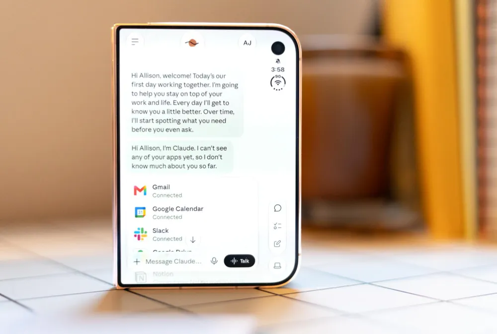
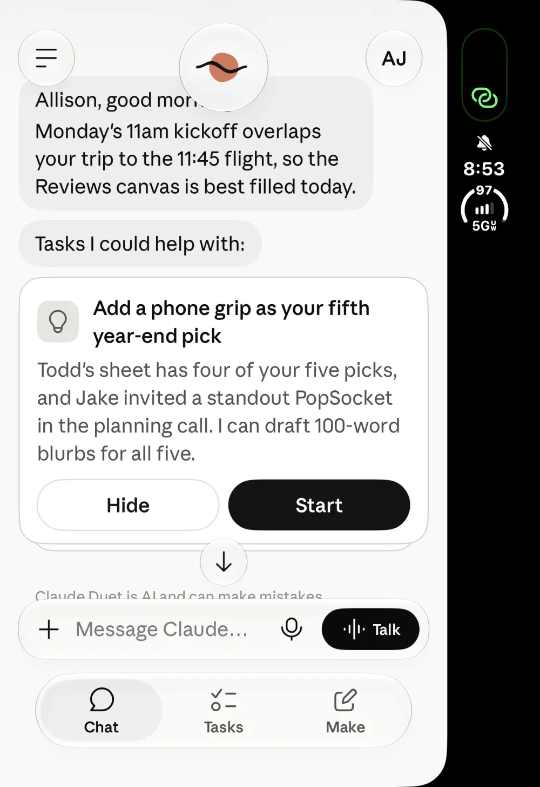
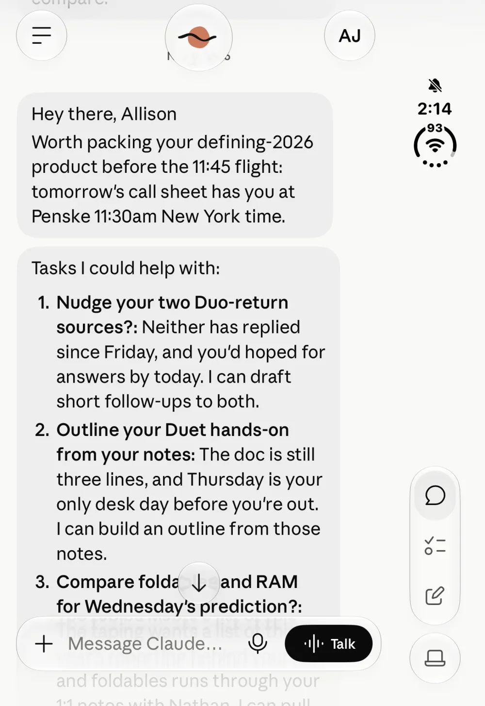



**收录说明**：浏览器标识直接下载；删去站内话题订阅、作者简介与文末「相关阅读」「最受欢迎」区块；三张作者实拍截图已本地化。原文全文存于本目录的 original.md，网站上不显示。

**内容摘要**：The Verge 评测者 Allison Johnson 用一周时间实测了 Claude Duet，接入了工作邮箱、日历、Google Docs 与 Slack。Duet 把一次例会纪要邮件里的内容与 Slack 私信联系起来，并从一份共享的周会文档推断出谁是她的上司；她休假前，Duet 发现剩余工作日不够完成一篇大稿，提出了处理方案并为编辑起草了 Slack 消息，消息还模仿了她小写书写的习惯。不足之处是 Duet 有时会过度积极：某天早上 9 点前就催她去改稿，以便把承诺的链接发给采访对象，却没意识到那并非硬性截止日期、当时编辑那边才早上 7 点；它还反复主动提出帮她起草文章，包括起草这篇评测本身。Johnson 认为 Duet 适合做跨邮箱、聊天、会议与文档查漏补缺的后盾，而不是替代她自己的组织方式或创意工作；她也写道，明知 Duet 能读到每一封邮件、草稿与 Slack 消息，仍会让人感到不安。

**保留理由**：提供了已收资料里没有的东西：Claude Duet 上线后第一篇主流媒体的一周一手实测，含跨应用联动成功的具体事例与误判紧急程度的反例，以及评测者对「把全部工作数据交给智能体」的直接感受。

---

Duet 是个不错的帮手，只是有时候有点一惊一乍。

*开工吧。*

 | 摄影：Allison Johnson / The Verge

通常，我测试的产品不会主动提出帮我写使用体验。Duet 不一样。

Claude Duet 是 Anthropic 面向消费者的 AI 智能体，也是一家 AI 公司试图说服我们「智能体对不写代码的人也有用」的最新尝试。这几个月挺有意思：Instinct 给了我们[一个令人印象深刻的文本型助手](/tech/1008254/instinct-agent-ai-hands-on-muse-dots)，Meta 把它那个可爱的小家伙 Muse [拿来帮我们买东西](/ai-artificial-intelligence/999526/meta-muse-ai-agent-hands-on-shopping)，OpenAI 则给了我们[更偏工作的 Dots](/ai-artificial-intelligence/1004096/openai-chatgpt-dots-hands-on-agent)。Claude Duet 比它们更聚焦于工作。它也比 [Claude Cowork](/ai-artificial-intelligence/1030709/anthropic-has-its-own-ai-powered-office-suite-now) 更面向消费者，而 Cowork 又比 Claude Code 更面向消费者——后者是今年早些时候[掀起一整轮炒作周期](/report/874308/anthropic-claude-code-opus-hype-moment)的编程智能体。过去一周，我在繁忙的出差和工作安排中一直在试用它。它有时真的很有用，有时像个唠叨鬼，还非常热衷于写关于它自己的文章。

据 Anthropic 说，Duet 仍然是一个「研究预览」，只有美国的 Pro、Max 和 Ultra 订阅用户可以访问，需要排队加入。它也不是来给你订墨西哥卷饼的；它面向的是「专业人士和小企业主」，本意是运用判断力，决定什么最需要你注意。

和 Meta 的 Muse 一样，Duet 有自己的应用。（如果你在家里跟着记分的话，是的，它已经更新为完全支持 iPhone Duo。译注：原文为 "If you're keeping score at home, yes, it has been updated to fully support the iPhone Duo"，"keeping score at home" 是体育转播里的口语，意为「如果你也在家跟着记分」。）Duet 采用了 Claude 标志性的明快极简设计。应用面向消费者，容易上手。等你把所有想要的生产力和聊天服务都连上，它就会寻找能帮上忙的地方，并以卡片形式提出来——你可以左右滑动来隐藏或接受，有点像待办清单版的 Tinder。

为了测试，我全力投入 Duet，把所有东西都给了它：工作邮箱、日历、Google Docs 和 Slack。这给它的磨坊送去了大量可磨的谷物，方式之多甚至超出我最初的想象。因为我们每两周一次的员工会议会自动由 Gemini 汇总成一封邮件，而 Duet 能访问我的邮箱，所以它能把会上说过的某件事和 Slack 里的一条私信联系起来。Duet 还推断出了我的上司是谁，因为我们有一份用于每周一对一会议的共享 Google Doc。AI 在能大量吸收数据时最有用，而 Duet 一点没耽误。

*你可以左右滑动这些卡片来忽略它们，或让 Duet 开始处理。*

Duet 每天早上都会用一条简短消息和当天的一些要点跟我打招呼，比如提醒我在赶飞机前带上某件拍视频要用的东西。在这之下，它会建议一些待办事项，通常最后会提出帮我起草一条消息，或往议程里加一项。

这常常很有帮助，尽管有时感觉像在和一个有点神经质的私人助理打交道。有一次，我发邮件给一位为报道采访过的人，说文章大概会在周二上线，上线后我会把链接发过去。周一深夜我把稿子交给了编辑，周二早上 Duet 就急得不行。还没到 9 点，它就指出稿子还在等编辑、我得赶紧处理——否则就发不出我承诺的链接了。这份担心有点放错了地方。它也没读出我邮件里的言下之意——那并不是硬性截止日期，也没注意到对我的编辑来说当时才早上 7 点。

有时感觉像在和一个有点神经质的私人助理打交道

另一些时候，它出人意料地有用。在规划接下来几周时，我漏掉了一件事：即将到来的休假只会给我留下几个工作日，之后又有一篇大稿要交。Duet 提出了一个方案，主动提出把带每周笔记的 Google Doc 更新给我的编辑，还为他起草了一条 Slack 消息说明这一变动。读者啊，这条消息写得实在*太*好了。它模仿了我这个千禧一代全用小写的习惯——还在旁边稍微自夸地指出了这一点——并且用了我们常用来指代自家 CMS 的缩写。但它也把「signature」缩成了「sig」，这我绝对不会，笑得我出声。无论如何，骗不了人；那条 Slack 消息带着「sent with Claude」的标签。

Duet 经常主动提出帮我起草文章，这对我来说永远是硬性拒绝。我自己的小博客我自己写，非常感谢你，*Claude*。如果你不是写作者，我能理解偶尔让它处理一些小的写作杂活会有帮助。但当它想帮忙的任务就是审阅它自己时，这开始变成「蜘蛛侠指着蜘蛛侠」的时刻。（译注：原文为 "a Spider-Man-pointing-at-Spider-Man moment"，指两个蜘蛛侠互相指着对方的迷因，形容双方互相指向对方、循环指认）

也许 CEO 们就是这么活的

也有点诡异。就算撇开我当时正在写关于 Duet 的文章这件事，知道自己发的每一封邮件、每一份草稿、每一条 Slack 它都能读，还是挺怪的。它能读到这一切，*是因为我选择了分享这些数据*，我完全清楚自己在做什么。但在实践中看到它是另一回事。我想知道，如果我知道自己其实不必为把事放进日历、写下待办清单、在会上专心而负责，因为 Duet 会处理，我的工作方式会不会改变。也许 CEO 们就是这么活的。倒不是说我喜欢建日历条目，但我怀疑自己最终会不会觉得和职场有点脱节。

我不认为 Duet 或任何其他 AI 智能体已经准备好让我们觉得自己都是自己那个小世界的 CEO。「私人助理」这个说法里有个关键词：私人。一个人能察觉语气里的细微差别，判断什么要紧、什么不要紧。一个人会把握沟通的惯例，并得体地运用。一个人可以圆融。Anthropic 的博客文章提到，公司仍在「测试它关于何时给你发消息的判断力」，所以 Duet 有可能随时间校准得更好一些。但 AI 整体上并不擅长理解细微差别或语气，也不清楚它是否有一天能做到。

对我来说，Duet 让我更清楚了自己想让 AI 为我做什么、不想让它做什么。现代职场里的沟通散落在各处——邮件、私信、会议、共享文档。让 AI 找出这些来源之间被忽略的不一致，并主动指出来，真的很有帮助。我喜欢它作为我自己组织系统的兜底，而不是替代品。我不喜欢它介入创作过程。一点都不喜欢。我想找到「我自己进入和绕过一个题目的方式」，就像 Hank Green 谈到他自己对 AI 的依赖时说的那样。如果你派一个机器人去做那些跑腿的活，你就失去了偶然撞见意外之物的机会。而那正是工作让人愉快的一部分。我也绝对不会让一个智能体替我审阅它自己。听见了吗，Duet？
