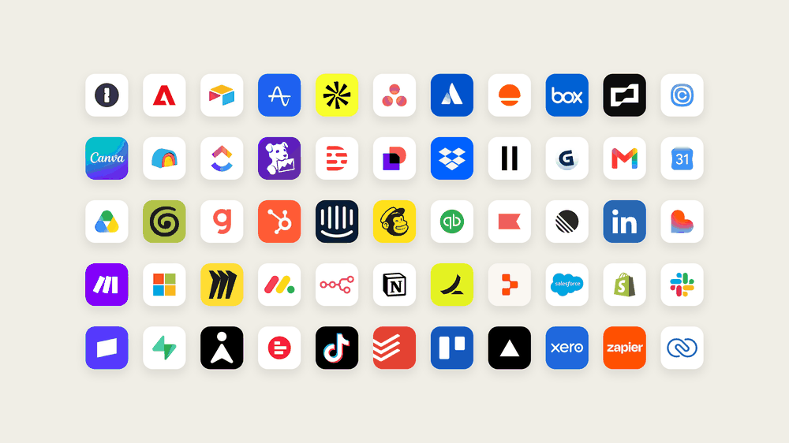



**收录说明**：直接下载；去掉了文首的「Join the waitlist」按钮、分类与阅读时长信息栏和文末的相关文章推荐；文首 2026-10-23 加入的说明框予以保留；1 张超过 600 KB 的图片已缩小。原文全文存于本目录的 original.md，网站上不显示，已翻译。

**内容摘要**：Anthropic 宣布开放 Claude Duet 研究预览：一款让 Claude 作为主动型智能体工作的独立应用（iOS、Android 与 claude.ai），先向美国的 Pro、Max 和 Ultra 订阅者按候补名单开放，包含在套餐内、与 Claude 其他功能共用用量限额。Claude Duet 围绕 Claude Opus 5.5 设计，沿用用户 Claude 账号中的记忆、技能和已连接应用；每天早上发送简报，每隔几小时检查一次已连接账号（文中解释持续检查会过快耗尽限额），只在需要时发消息；它有带自己浏览器的虚拟机，用户设备关机也能继续工作。发消息、付款、签署文件或删除任何东西之前，都会先展示要做的操作并等待批准；可使用 Claude Marketplace 中 6,000 多个连接器和插件，并可通过 Stripe 的 Link 用一次性虚拟卡购物。文中引用了 Anthropic 内部和小企业主的试用例子，并承认它可能误读对话、误判紧急程度，个人事务（如订票）不如工作类任务强。

**保留理由**：Claude Duet 的发布原文，给出了开放范围、定价方式、运行机制（定时检查、云端虚拟机、审批边界）和底层模型等一手信息。

---

研究预览今日起通过候补名单开放，首先面向美国的 Pro、Max 和 Ultra 订阅者。

Claude Duet 的安全、隐私与保障

2026 年 10 月 23 日 - 我们正在继续开发和加强这些保护措施。你可以[在此](https://claude.com/resources/articles/claude-duet-safety-privacy-and-security)进一步了解 Claude Duet 如何在设计上兼顾安全、隐私与安全性。

今天，我们开放 Claude Duet 的研究预览。这是一款新应用，Claude 在其中作为主动型智能体（proactive agent）工作。它会主动把需要你关注的事情带给你，完成你交给它的任务，即使你离开也会继续工作，并在代表你行动之前与你确认。我们为工作繁忙、事情多到难以追踪的专业人士和小企业主打造了 Claude Duet。

它以独立应用的形式在 iOS 和 Android 上提供，也在 claude.ai 上提供。在本次研究预览期间，Claude Duet 包含在 Pro、Max 和 Ultra 套餐中，并使用与 Claude 其他部分相同的用量限额。要获得访问权限，请[加入候补名单（在新标签页中打开）](https://claude.com/product/claude-duet)。

## 把注意力放在最重要的地方

我们将 Claude Duet 设计成一个你可以信任的伙伴。各类专业人士每天都要应付许多决定，我们认为他们会发现 Claude Duet 最有用。它帮助你确定把时间和精力花在哪里最值得，并为那些以前觉得不可能或令人望而生畏的宏大项目留出空间。

Claude Duet 之所以如此有用，在于它的判断力。我们围绕 [Claude Opus 5.5（在新标签页中打开）](https://www.anthropic.com/claude-opus-5-5) 设计了它，并把它打造得善于变通，能判断什么需要你、什么可以等待，以及何时应先与你确认。

每天早上，它会就你已连接应用中最重要的事项给你发一份简短简报。一天之中，它会持续留意这些应用，只在有事情需要你关注时才给你发消息。你也可以把各种形态的任务交给它——从安排会议这类简单的行政事务，到更复杂的任务，例如用几十种工具搭建仪表盘、创建财务或销售预测、制作原型，以及构建 Web 应用。

## 安全与审慎内置其中

Claude Duet 借鉴了多年来在智能体方面的安全、保障与隐私工作，既包括我们自己的，也包括企业用来运行其智能体的基础设施：

- Claude Duet 借鉴了我们的[可信智能体框架（在新标签页中打开）](https://www.anthropic.com/research/trustworthy-agents)，该框架也指导着 Claude Code 和 Claude in Chrome 等智能体。
- Claude Duet 对凭证（credentials）的处理遵循我们为 [Claude Managed Agents（在新标签页中打开）](https://www.anthropic.com/engineering/managed-agents) 采用的设计，因此它永远不会直接看到你的密码或登录令牌。
- 操作由我们的[自动模式分类器（在新标签页中打开）](https://www.anthropic.com/engineering/claude-code-auto-mode)批准，这一防护机制同样保护 Claude 和 Claude Code，避免它们采取你未要求的步骤。
- Claude Duet 对隐藏指令和提示注入（prompt injection）的防御来自我们的[浏览器使用研究（在新标签页中打开）](https://www.anthropic.com/research/prompt-injection-defenses)，我们的模型和防护措施也在更广泛的范围内覆盖这一点。
- 我们会对 Claude Duet 的安全基础设施进行对抗性测试。红队和一家外部公司对 Claude Duet 进行了渗透测试，它也在我们公开的[漏洞赏金计划（在新标签页中打开）](https://hackerone.com/anthropic)覆盖范围内。

**Claude Duet 如何处理敏感信息。** 我们还在发布 Claude Duet 时配备了新的专用分类器和安全系统提示词（safety system prompt），用于检查每条消息并防止敏感信息泄露。一个替你读取邮件并发送消息的智能体，时刻都在决定信息应该流向何处。这个新的分类器和提示词旨在拒绝分享最严格层级信息的请求，包括信用卡号和政府身份证件。其他敏感信息，例如健康或个人财务信息，只有在你明确指示 Claude Duet 发送时才会放行。

我们正在继续开发和加强这些保护措施，并将在未来几天分享更多关于 Claude Duet 如何在设计上保障安全的细节。

## 测试者如何使用 Claude Duet

Anthropic 的员工一直在使用 Claude Duet 完成更多工作，同时也为自己留出更多思考和在场的时间。负责我们 Claude Code 团队的 Boris Cherny 会在散步时和 Claude Duet 梳理脑子里的待办清单，而不是把工作留到书桌前。负责模型与产品行为设计团队的 Chelsea Larsson 会在离开去陪孩子之前把待办清单交给 Claude Duet，它会保存结果，供晚上生成报告。而 Claude Duet 背后的团队也用它来构建这个产品。负责该团队的 Karan Ahuja 用它安排用户访谈、与他一起制作原型，甚至交付代码。

我们让小企业主和创业者提前试用了 Claude Duet，其中一些人已经在用它帮助经营业务。以下是他们中的一些人说的话：

> Jess 每天早上都会收到 Claude Duet 的简报。有一天，它未被要求就指出她日历上的一场房产展示安排错了日期。「[这]正是我希望它不用我问就能发现的那类事情，」她说。

Jess Provencher，Pro Homes 的经纪人与所有者

> Amin 在南佛罗里达经营 Shahs of Kabob，约有 110 名员工。他用 Claude Duet 处理会计、客户支持和营销，并逐店处理了他的发票。「它把这一切都整合在一起，」他说。「我不需要打开 100 个标签页。」

Amin Ebrahimi，Shahs of Kabob 所有者

> Mya 即将与一位潜在客户通话。Claude Duet 在她的日历上看到了这件事，并准备了一份简报。它还注意到这通电话正好在她航班之前，并主动提出可以改期。「我都没意识到它就在我航班之前，」她说。「我很喜欢这种主动性。」

Mya Dalton，品牌策略师

## Claude Duet 如何工作

**来自 Claude 的上下文是基础。** Claude Duet 会沿用你 Claude 账号中的记忆、技能和已连接应用，因此设置它只需很少的工作。改变的是你们协作的方式：Claude Duet 会先来找你，你可以通过打字或语音在同一个持续对话线程中给它发消息，因此一句简短的回复和一个为期一周的项目都从同一个地方开始。

**你离开时，工作仍在继续。** Claude Duet 有一台带自己浏览器的虚拟机，因此不需要你的笔记本电脑或手机开着。用一条简短消息描述任务，它就会在后台弄清该使用哪些应用、采取哪些步骤。任务完成或需要你审阅时，你会收到通知。

**有事情需要你时，你会收到消息。** Claude Duet 每隔几小时检查一次你已连接的账号，因为不停检查会更快耗尽你套餐的限额。我们正在继续测试它关于何时给你发消息的判断，并会根据测试者的反馈持续调整。你也可以告诉它你想了解什么，以及多久一次。

**重要决定仍由你来做。** Claude Duet 会自行阅读、起草和准备工作。但在它发送消息、付款、签署文件或删除任何东西之前，它会准确展示即将做什么，并等待你的批准。有些事即使你批准也不能做，比如交易证券或在账户之间转移资金。你也可以断开 Claude Duet 有权访问的任何应用。

**连接你的业务所依赖的工具。** Claude Duet 可以使用 [Claude Marketplace（在新标签页中打开）](https://claude.com/marketplace/connectors-plugins) 中的 6,000 多个连接器和插件来：

- 找到你错过的 Gmail 和 Slack 消息，并帮你回复。
- 检查 Intuit QuickBooks 或 Stripe 中未付的发票，并起草提醒。
- 在 Gusto 中准备并运行薪资发放，填好工时、奖金和报销。
- 起草职位招聘信息，在你编辑并批准后发布到 LinkedIn。
- 帮助准备协议，并通过 Docusign 发送以供审阅和签署。
- 利用 HubSpot 中的联系人和交易历史起草跟进邮件。
- 在 Canva 中把你的产品发布变成社交媒体活动。
- 设置、设计并管理你的 Shopify 商店。即将推出更丰富的可视化编辑器，让你可以设计店面并在上线前预览。

你也可以使用 Claude Duet，通过 Link——Stripe 的数字钱包——为你的业务购买东西。Claude Duet 会与你确认商品，Link 会请你批准这笔支出。然后它用虚拟卡付款，因此你的真实卡号不会被分享。它还可以使用 Shopify 的 Shop Pay 在网上商店结账。即将推出：经你许可，它将能够使用你保存在 1Password 中的登录信息登录网站。

## 加入研究预览

这是 Claude Duet 的早期版本，它仍可能误读一段对话，或误判什么才算紧急。我们围绕工作构建了它的核心功能，因此个人事务（例如订票）没有那么强，而且它目前还不能向你展示它的浏览器。目前，Claude Duet 存在于自己的应用中，与主 Claude 应用分开。我们从早期用户那里学到的东西将塑造两者如何协同工作。

在研究预览期间，Claude Duet 与你套餐中的其余 Claude 功能共用用量限额，且使用方式与典型对话不同。它的后台检查会计入这些限额，而更大的任务（例如构建财务模型或演示文稿）需要更多模型轮次和后台工作。

我们从今天开始，面向美国的 Pro、Max 和 Ultra 用户开放。请[加入候补名单（在新标签页中打开）](https://claude.com/product/claude-duet)，一旦 Claude Duet 为你准备好，我们就会发邮件通知你。
