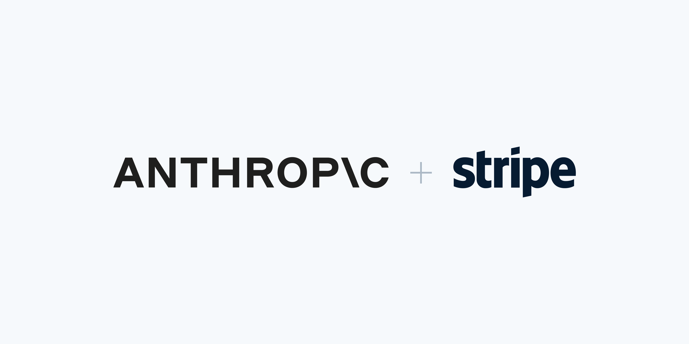



**收录说明**：合作方 Stripe 在 Claude Duet 发布当天发的新闻稿，有 Anthropic CTO 的引语，归入官方。直接下载，题图收入 images/。旧笔记 learning-ai-agent 引用过这一篇，2026-11-06 复核后收入。原文全文存于本目录的 original.md，网站上不显示，已翻译。

**内容摘要**：Anthropic 把 Link 的智能体钱包和 Stripe MCP 接入了 Claude Duet。用户可以让 Claude Duet 用 Link 在网上购物，每笔都由用户批准，再用虚拟卡完成交易。通过 Stripe MCP，可以在应用里开发票和付款链接、管理商品和价格、分析收入、办理退款。新闻稿称 Link 已为 200 多个个人智能体提供支付，其中包括 Meta Muse 和 Grok Bot。

**保留理由**：官方说明了 Claude Duet 的付款能力由谁提供、怎样确认，也显示 Link 同时服务多个 Personal Agent。

---

[Stripe 与 Anthropic 帮助创业者在 Claude Duet 中经营生意](/newsroom/news/anthropic-and-stripe)

[2026 年 10 月 21 日](/newsroom/news/anthropic-and-stripe)

- 企业主现在可以让 Claude Duet 使用 Link 进行购买
- Stripe MCP 服务器让 Claude Duet 用户无需离开应用就能办理退款并了解业务趋势

旧金山和都柏林——Stripe 今日宣布，Anthropic 已将 Link 的智能体钱包和 Stripe MCP 集成到 [Claude Duet](https://claude.com/resources/articles/claude-duet) 中。这款新应用以研究预览形式推出，帮助小企业主和专业人士掌握需要关注的事项，并跟进他们委派的工作。

借助 Stripe 打造的 Link，创业者可以让 Claude Duet 在互联网上的任何地方购买他们可能需要的任何东西——无论是数字广告、名片、团队午餐，还是更多白板笔。在 Claude 用虚拟卡完成交易之前，他们会批准每一笔购买。

借助 Stripe MCP，创业者可以使用 Claude Duet 发送发票和付款链接、管理商品和价格、分析收入以及办理退款——所有这些都无需离开应用。

「企业主正在要求智能体承担更多工作。他们想说的是『订购这些用品』或『给这位客户开发票』，并且知道智能体能够跟进到底，」Stripe 支付负责人 Kevin Miller 说。「借助 Link 的智能体钱包和 Stripe MCP，Claude Duet 可以承担更多这类日常工作，同时让企业主保持控制。」

「随着智能体开始为人们做实际工作，当金钱易手时，信任变得更加重要，」Anthropic 首席技术官 Rahul Patil 说。「Stripe 花了多年时间赢得各种规模企业的信任。把 Claude Duet 的购买建立在 Link 之上，让人们对每一美元都保持掌控，而这是智能体在任何人把真正责任交给它之前所需要的基础。」

Link 为 200 多个个人智能体提供支付支持，包括 [Meta 的 Muse](https://stripe.com/newsroom/news/stripe-helps-meta-muse-shop-with-link)、[SpaceXAI 的 Grok Bot](https://x.com/stripe/status/2093422396279791734) 和 [Instinct](https://x.com/stripe/status/2093386783899910486)。进一步了解 [Link 的智能体钱包](https://onelink.com/gb/agents)，以及 Anthropic 的 [Claude Duet](https://claude.com/resources/articles/claude-duet)。
