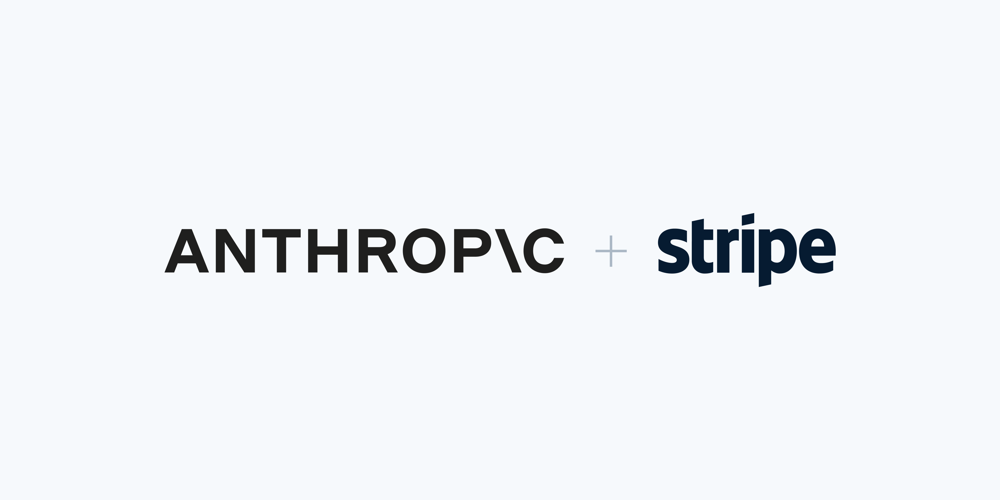

来源：https://stripe.com/newsroom/news/anthropic-and-stripe
取文：2026-11-06，直接下载

# [Stripe and Anthropic help entrepreneurs run their business inside Claude Duet](/newsroom/news/anthropic-and-stripe)

[October 21, 2026](/newsroom/news/anthropic-and-stripe)

- Business owners can now ask Claude Duet to make purchases with Link
- The Stripe MCP server lets Claude Duet users issue refunds and understand business trends without leaving the app

SAN FRANCISCO AND DUBLIN—Stripe today announced that Anthropic has integrated Link’s wallet for agents and Stripe MCP into [Claude Duet](https://claude.com/resources/articles/claude-duet), a new app launching in research preview that helps small business owners and professionals stay on top of what needs their attention and follows through on the work they delegate.

With Link, built by Stripe, entrepreneurs can ask Claude Duet to buy anything they might need, anywhere on the internet—whether that’s digital ads, business cards, lunch for the team, or more whiteboard markers. They approve each purchase before Claude completes the transaction with a virtual card.

With Stripe MCP, entrepreneurs can use Claude Duet to send invoices and payment links, manage products and prices, analyze revenue, and issue refunds—all without leaving the app.

“Business owners are asking agents to take on more of their work. They want to say ‘order these supplies’ or ‘send this customer an invoice’ and know the agent can follow through,” said Kevin Miller, head of payments at Stripe. "With Link’s wallet for agents and Stripe MCP, Claude Duet can do more of that everyday work while keeping business owners in control.”

"As agents start doing real work for people, trust matters even more when money changes hands," said Rahul Patil, Chief Technology Officer at Anthropic. "Stripe has spent years earning that trust from businesses of every size. Building Claude Duet's purchases on Link keeps people in charge of every dollar, and that's the foundation an agent needs before anyone hands it real responsibility."

Link powers payments for more than 200 personal agents, including [Muse from Meta](https://stripe.com/newsroom/news/stripe-helps-meta-muse-shop-with-link), [Grok Bot from SpaceXAI](https://x.com/stripe/status/2093422396279791734), and [Instinct](https://x.com/stripe/status/2093386783899910486). Learn more about [Link’s wallet for agents](https://onelink.com/gb/agents), and [Claude Duet](https://claude.com/resources/articles/claude-duet) from Anthropic.
