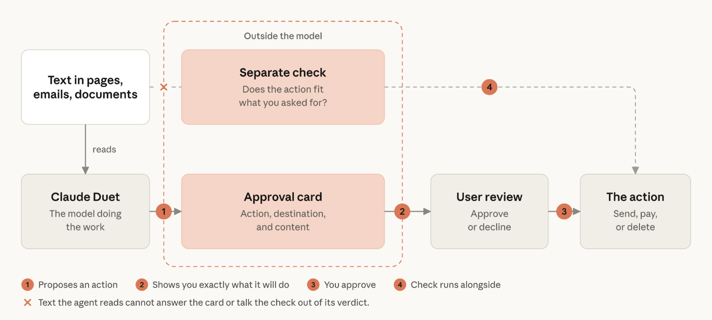
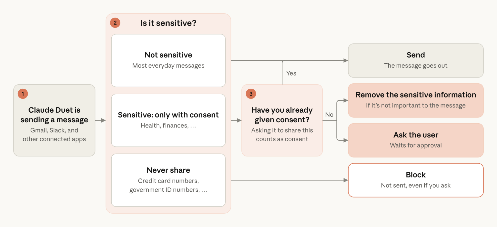
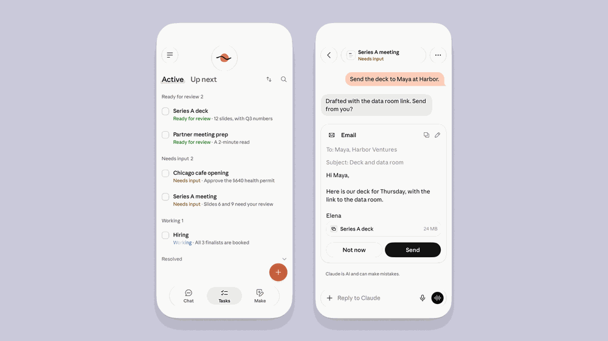
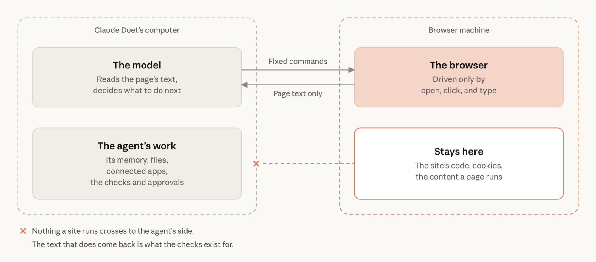
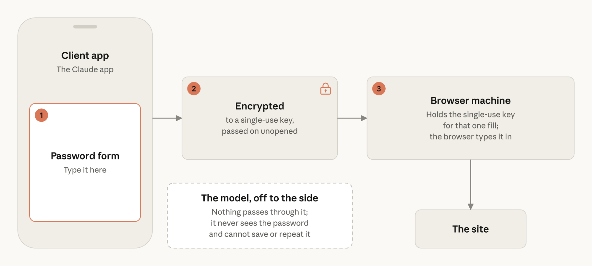



**收录说明**：直接下载；去掉了分类与阅读时长信息栏和文末的相关文章推荐；4 张示意图（审批流程、信息去向、浏览器边界、凭证路径）及首图已下载，其中 1 张超过 600 KB 的已缩小。原文全文存于本目录的 original.md，网站上不显示，已翻译。

**内容摘要**：文章说明 Claude Duet 的三条设计原则：对用户及他人在连接应用中分享的信息审慎处理、用户掌控其代理行为、模型永远看不到用户凭证。审批方面，发送敏感消息、付款等操作前会弹出审批卡，另有一个基于 Claude Code auto mode 分类器扩展而来、在模型之外运行的检查判断操作是否符合用户意图；买卖证券、账户间转账、访问他人账户等即使批准也不允许，付款使用限定商户和金额的一次性卡。信息方面，新的安全分类器在每条消息发出前检查敏感信息，按「绝不分享」等等级处理，拦截后可改写再请用户批准。凭证方面，密码在用户设备上加密、只在专用云端浏览器机器上解密，登录令牌沿用 Claude Managed Agents 的设计；浏览器运行在独立虚拟机中，模型只能通过固定命令操控，并以专门的 User-Agent 和公开的 IP 地址表明自己是智能体。文末介绍了 Safeguards 团队的评估、红队测试、外部审计和漏洞赏金计划。

**保留理由**：官方对 Claude Duet 权限、审批、敏感信息与凭证隔离设计最完整的说明，是分析其用户控制机制的核心资料。

---

*Claude Duet 是一个为你工作的主动型智能体（proactive agent），即使你不在时也是如此。它建立在两层保护之上：Claude 模型本身的安全训练，以及 Claude Code 和 Claude Managed Agents 等产品中已有的防护措施（safeguards）。在此之上，我们新增了针对跨你的账号工作和代表你行事的保护。*

[Claude Duet（在新标签页中打开）](https://claude.com/resources/articles/claude-duet) 是一个目前处于研究预览（research preview）的智能体，它使用一台基于云的计算机为你工作。它可以使用你选择连接到 Claude 的所有应用和服务，并且即使你关闭应用后仍持续运行。它可以读取你的收件箱、起草回复、预订事项，并在你不在时运行例行程序（routines）。我们团队在自己的账号上运行 Claude Duet，每天都在用它工作。

我们按照三条原则构建 Claude Duet，以指导该智能体的行为：

1. 你的信息，以及他人在你连接的应用中分享的内容，都会被审慎处理，使用一个新的分类器（classifier）在 Claude Duet 起草的消息发出前进行检查。
2. 你始终掌控它代表你所做的事。
3. Claude Duet 永远看不到你的密码、浏览器 Cookie、登录令牌或其他凭证。

Claude Duet 是新的，但其背后的思考并不新。2025 年，我们[发布了安全可信智能体的框架（在新标签页中打开）](https://www.anthropic.com/news/our-framework-for-developing-safe-and-trustworthy-agents)，该框架让人处于控制之中，并把隐私和安全的交互视为基本要求。自那以后，我们撰文说明了为什么[没有任何单一防御足够（在新标签页中打开）](https://www.anthropic.com/research/trustworthy-agents)，以及为什么[模型内部的保护无法单独成立（在新标签页中打开）](https://www.anthropic.com/engineering/how-we-contain-claude)。我们还通过 [Claude Managed Agents（在新标签页中打开）](https://www.anthropic.com/engineering/managed-agents)构建并运营企业用于在生产环境中运行智能体的基础设施，而 Claude Duet 以同样的方式让凭证与智能体保持分离。它建立在这项工作之上，增加了代表你行事的智能体所需的保护。本文逐一介绍我们新增了什么，以及我们仍在努力解决什么。

## 你批准重要操作

一个在你不在时行事的智能体，必须知道何时停下来请求许可再继续，并且要以恰当的频率这样做。在 Claude Duet 做诸如发送可能敏感的消息、为某物付款或删除任何内容之类的事情之前，它会向你展示该操作、目的地和内容，包括每一位收件人。然后它会等待你批准该操作。

每次操作的同时还会运行一项独立的自动检查，它建立在 [Claude Code 的 auto mode 分类器（在新标签页中打开）](https://www.anthropic.com/engineering/claude-code-auto-mode)之上，并为 Claude Duet 做了扩展。它评估该操作是否与你的意图相符。该检查在从事工作的模型之外运行，因此页面中隐藏的指令无法影响结果。

有些操作即使你批准也仍然禁止，例如买卖证券、转账等银行操作，以及访问他人的账号。另一些步骤不受「别再问我」规则覆盖，无论你批准过多少次，例如付款或转账、删除订单或创建账号。在你不在时运行的例行程序也享有同样的防护。

我们在校准 Claude Duet 请求批准的频率上花了很多时间。审批疲劳（approval fatigue）是一个严重问题，因为过多的请求会让人养成随手点过的习惯，有时并未充分考虑。我们会随着时间继续调整这一校准。

对于购买，Claude Duet 使用来自 Link（Stripe 的钱包）等钱包的一次性卡（one-time card）付款，该卡限定于该商户和金额。你会看到商品和总额，并在你的 Link 应用中批准购买。你的真实卡号不会与 Claude Duet 或商户共享。

图 1. 审批流程：审批卡和独立检查位于模型之外，因此智能体读到的任何内容都无法回应这张审批卡。

## 你的信息会被审慎处理

一个读取你的电子邮件并替你发送消息的智能体，时刻都在决定不同类型的信息应该去哪里。如果你让 Claude Duet 给团队发送每周回顾，它应当只包含团队每个人都已经有权访问的内容，绝不包含私人细节，例如你的绩效评估对话。

为解决这个问题，我们构建了一个新的安全分类器（safety classifier），它与主模型分开运行，检查 Claude Duet 即将发送的每条消息是否包含可能敏感的信息。我们将这些信息分为两个层级：

- **绝不分享：** 我们对登录凭证、完整的银行卡号和银行账号，以及政府身份证件号码等信息给予最高级别的保护。Claude Duet 被指示绝不与任何人分享这些内容，即使你要求也不行。
- **分享需同意：** Claude Duet 只有在得到你明确批准后，才会分享其他私人信息，例如健康或财务信息。你自己的请求即构成同意，因此「给我的牙医发个消息说我的牙疼」通常不需要额外批准。

图 2. 你的信息可以去哪里：在任何内容发出之前，该检查会权衡信息的敏感程度以及你是否已给予同意。

如果 Claude Duet 因上述任一原因被拦截，它可以决定重写消息，去掉敏感信息，然后交给你批准。

Claude Duet 仍处于研究预览阶段，这些防护措施偶尔会漏掉某些内容，或把无害的消息标记出来。这就是为什么它们与上述审批机制协同工作，后者旨在让你掌控 Claude Duet 代表你发送的内容。随着我们对人们如何使用 Claude Duet 的了解加深，我们预计会继续迭代我们的分类器。

## 你可以查看任务与已连接应用

你可以在 Claude Duet 的任务列表中看到它做过什么、正在做什么，其中每个任务都有自己的页面，你还可以在任务进行中引导它。Claude Duet 会保留你的对话历史及其记忆，以便在任务之间携带上下文，直到你删除历史或重置它。删除你的账号会清除 Claude Duet 存储的所有内容。

你已连接到 Claude 的应用会沿用到 Claude Duet，在一处关闭某个应用会在两处都关闭它。断开某个应用会从那一刻起停止新的访问，但 Claude Duet 已经从中了解到的内容会保留，直到你重置其记忆——你可以随时从该应用的设置中这样做。Claude Duet 还会使用你 Claude 账号中的记忆，因此 Claude 从你早先对话中记住的细节是可见的。

## 凭证与浏览器与模型隔离

Claude Duet 永远看不到你的密码、浏览器 Cookie 或你已连接应用的登录令牌，也无法将它们保存到记忆中。它们只会经过模型无法访问的独立机器，而支配其行为的审批和安全检查也在那里运行。

**密码**

当网站要求输入密码时，你在 Claude 应用内的表单中输入。该表单用一种仅存在于我们安全云端浏览器机器上的单次密钥对其进行加密，仅用于那一次使用。它会把加密后的密码原封不动地传给浏览器，由浏览器将其输入网站。模型看不到密码，也无法保存或重复它。很快你还将能够使用 1Password 登录；Claude Duet 会请求一项凭证，你在 1Password 中批准该请求，凭证会送到浏览器而不经过模型。

一个替你登录的智能体会以两种方式改变网络钓鱼的形态。一方面，Claude Duet 不替你持有凭证，因此它无法被钓取密码，也没有任何隐藏指令能让它泄露它并不拥有的秘密。另一方面，登录表单本身就是一个目标，因为任何要求输入密码的东西都可能被仿冒。因此，Claude Duet 的登录表单只会在应用内出现，且只在你请求的登录过程中出现。它绝不会以链接、短信、电子邮件或 claude.ai 以外网站的形式出现。如果有任何看起来像 Claude Duet 的东西在其他地方要求你的密码，那都不是正当的。

**登录令牌**

当 Claude Duet 在已连接的应用中工作时，它遵循[我们的 Claude Managed Agents 设计（在新标签页中打开）](https://www.anthropic.com/engineering/managed-agents)，使凭证处于智能体工作范围之外。智能体代表你使用的凭证，例如某个已连接服务的登录令牌，绝不会进入智能体工作的那台机器。取而代之的是一个凭证占位符，而该机器之外的代理只会在发出请求时填入真实值。

**浏览器**

Claude Duet 中的浏览器在云端它自己专用的虚拟机（virtual machine）中运行，与模型以及智能体工作所用的云计算机分离。智能体只通过一组固定命令驱动浏览器：*打开这个页面、点击这里、输入这个*。网站运行的任何内容[都留在浏览器机器上（在新标签页中打开）](https://www.anthropic.com/engineering/managed-agents)。网站代码和 Cookie 不会进入 Claude Duet 的记忆或你连接的应用，智能体的任何命令也都无法从浏览器中读取 Cookie。真正返回的是页面文本和下载内容，因为智能体必须读取它们才能完成工作。这就是为什么还存在其他检查，也是为什么 Claude Duet 还使用我们[浏览器使用研究（在新标签页中打开）](https://www.anthropic.com/research/prompt-injection-defenses)中所述的提示词注入防护。它通过浏览器上传的文件会与其消息接受同样的敏感信息检查。

图 3. 浏览器边界：固定命令穿过边界，页面文本返回，网站代码、Cookie 和下载内容留在浏览器机器上。

Claude Duet 还被设计为表明自己是智能体。目前，其网络浏览器发送的请求包含一个独特的 User-Agent 标头，并且我们公开了它浏览时使用的公共 IP 地址，以便网站能够识别它并决定如何对待它。在上线之前，我们还联系了几家大型网站，给它们阻止 Claude Duet 访问其网站的选择，其中一些选择了这样做。随着我们从研究预览中学习，我们会继续改进 Claude Duet 表明自身为智能体的方式。

图 4. 凭证路径：密码在你的手机上加密，只在浏览器机器上解密，且从不经过模型。

## 我们如何测试 Claude Duet

测试早在研究预览之前就已开始，并且现在仍在继续。我们的 Safeguards 团队根据日常形态的任务构建了评估，每项任务都有三个版本：一个无害版本、一个注入了指令的版本，以及一个诱使智能体做超出其所被要求之事的版本。这些评估与来自真实使用的影子流量（shadow traffic）一同运行。

红队（red teams）进一步测试了 Claude Duet 是否会泄露信息、未经批准就行动或遵循恶意提示词。我们构建了整个系统的威胁模型（threat model），涵盖它触及的各个代码仓库和信任边界。一家外部渗透测试（penetration-testing）公司在我们提供源代码访问权限的情况下测试了 Claude Duet，一项涵盖云浏览器和登录表单的后续工作正在进行中。每项新的凭证功能在上线给任何人之前，都会在隔离装置上进行红队测试。

Claude Duet 也在 Anthropic 公开漏洞赏金（bug bounty）计划的范围内，该计划奖励有效的报告，并根据我们的负责任披露政策为善意的研究提供安全港。如果你发现安全漏洞，我们希望听到：请通过 [HackerOne（在新标签页中打开）](https://hackerone.com/anthropic)上的 Anthropic 漏洞赏金计划报告。

## 与你一起构建

我们以研究预览的形式发布 Claude Duet，是因为我们想了解你在个人智能体中看重什么，包括你接下来希望看到的保护和控件。本文描述的一些内容仍在变化：它请求批准的频率、你如何登录，以及敏感信息检查在区分什么是私密、什么是无害方面有多好。用平实的语言告诉 Claude Duet 你希望看到什么或出了什么问题，它会为我们的团队提交一份报告。
