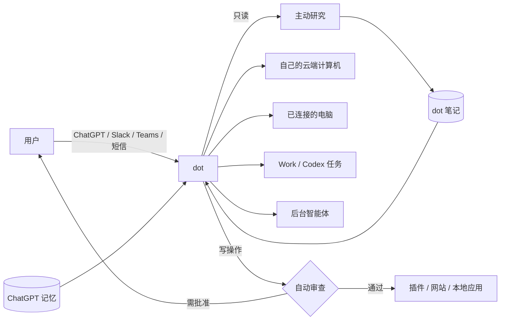

## 概要

- dots 是 ChatGPT 内置的常驻智能体，每个 dot 有一台 OpenAI 托管的持久云端计算机，可以选择连接用户的一台电脑，也能把任务委派给 Codex 和 ChatGPT Work。它更像一个调度层，执行环境与 OpenAI 已有的产品共用。（[运行环境](runtime/)）
- 「主动」的设计分成两段：只读的主动研究可以自动查看已连接的应用、形成记忆；发送、修改、购买等写操作必须经过独立的自动审查（Auto-review）和用户批准。（[持续执行](continuous-execution/)、[安全](security/)）
- 记忆依托 ChatGPT，这是优势：dot 从 ChatGPT 记忆和历史对话起步。但用户看不到、也不能逐条删除 dot 自己的记忆，断开应用不会清除，只能重置整个 dot。（[记忆与上下文](memory/)、[隐私](privacy/)）
- 入口是 ChatGPT 加上 Slack、Teams 等办公协作工具，短信仅为美国 Pro 用户的测试版。没有独立 App，也没有专用硬件。（[交互渠道](channels/)、[设备](devices/)）
- 门槛最高：Pro 100 美元/月起，没有免费层，EEA、英国、瑞士的个人用户不可用；首月之后的用量条款仍未公布。OpenAI 称最终会做大众产品甚至免费，但没有时间表。（[开放与价格](access-pricing/)、[商业与规模](business/)）
- 官方的安全说明和评估数据在同类产品中最详细，但官方也承认审查对浏览器和桌面操作的覆盖尚未核实，且没有第三方独立审计。（[安全](security/)）
- 实测评价分歧大：Wired 评为最佳，NYT、Pat Simmons 更偏向 Muse 或 Grok Bot，社交平台统计中好感垫底。反复出现的问题是报告的状态与实际结果不一致。（[实际效果与可靠性](reliability/)）

## 定位

官方的分工是：ChatGPT 聊天用于问答和想法，Work 用于委派任务，Codex 用于构建和调试软件，dot 用于「持续跟踪一项长期职责、在情况变化时想出下一步」，并可以把任务交给 Work 或 Codex（[文档：认识 dots]()）。dot 住在 ChatGPT 里：插件权限在 dots、ChatGPT、Work、Codex 之间共享，记忆与 ChatGPT 记忆相通，云端权限与 Work Cloud 共用。

面向的用户分两类：个人（Pro）和组织（Business Premium、Enterprise、Edu、Healthcare）。发布稿的场景偏工作，包括开发、发布、科研、销售、内容制作；企业试点中的「专职 dots」承担采购、发票、邮件营销、客户支持等职责（[推出 dots]()）。Tom's Guide 的判断是 Dots 面向专业人士和开发者团队，Muse 面向普通消费者，「最大的区别不是模型——而是客户」（[Tom's Guide]()）。

与其他跟踪产品相比，媒体和社区资料中的主要差异是：

| 对比对象 | 差异 | 资料 |
| --- | --- | --- |
| Meta Muse | Muse 免费起步、独立 App，面向个人杂事和购物，用 Sentinel 守网络出口；Dots 100 美元起、内置 ChatGPT，偏工作场景，用自动审查和安全登录 | [Tom's Guide]()、[Datawhale 综述]() |
| Grok Bot | 一个 dot 是单个智能体；Grok Bot 是几个有名字的 Bot 共用一台云电脑，「一个智能体对一队智能体」 | [入门成本对比]() |
| Claude Duet | 形态最接近（一个智能体、云电脑、已有记忆）；dot 的电脑可以打开和接管，Duet 不能；Duet 含在 20 美元 Claude Pro 中 | 同上 |
| Gemini Spark | Spark 原生整合 Google Workspace、含在 19.99 美元套餐中；Dots 靠 ChatGPT 插件生态 | [AI Agents Library]() |

社区也有批评：OpenAI 的 Chat、Work、Dots 三者各自独立、没有完全打通，「用起来割裂」（[智消前沿：家谱]()）。

## 时间线

| 日期 | 事件 | 资料 |
| --- | --- | --- |
| 2026-09-29 | DevDay 发布 dots：GPT-6 Astra 驱动，自有云端计算机，插件可连 4,000 多个应用，ChatGPT、Slack、Teams 可联系，短信「即将推出」；向 Pro 和 Business Premium 逐步推出，Enterprise 测试版默认关闭；首月用量不计入额度 | [推出 dots]()、[发布说明]() |
| 2026-09-29 | GPT-6 Astra 系统卡新增「附录：dots」；安全博客发布 | [系统卡附录]()、[安全博客]() |
| 2026-10-05 至 10-09 | 可在移动应用创建 dot；dot 可在 Codex 中开始和跟进会话线程、搜索 ChatGPT 对话、读写 Work 自动化；修复多项早期问题 | [移动端创建 dot]() |
| 2026-10-11 | 据转述，OpenAI 高管称已有 100 万个 dots 在运行 | [黑咖啡：全景解读]() |
| 2026-10-16 | 有用户在开发者论坛报告 dot 被分配到 GPT-6.1 Sol Low | [论坛帖]() |
| 2026-10-28 | 短信测试版向美国 Pro 用户推出（iMessage、RCS，经 Linq），dot 可主动发短信 | [发布说明：给你的 dot 发短信]() |
| 约 2026-10-29 | 首月用量豁免期满（第三方推算），用量条款未公布 | [入门成本对比]() |
| 2026-11-04 | GPT-6.1 Terra 成为驱动 dots 的模型之一；iOS 通知回复与分享；Windows 本地任务更可靠；Enterprise、Edu、Healthcare 可开启 | [11 月 2–6 日更新]() |
| 2026-11-18 | 企业版开始计费（预告） | 同上 |

## 整体架构

一个 dot 在 OpenAI 托管的云端计算机上运行（Linux、Chrome、终端，会话之间保留快照）。它的上下文来自当前任务、ChatGPT 记忆和自己的笔记；数据通过 ChatGPT 插件接入，也可以用云端浏览器登录网站，或通过用户连接的一台电脑使用本地文件和浏览器。

工作由三种方式触发：用户在 ChatGPT、Slack、Teams、短信中下达请求；定时任务或受支持的事件；dot 自己决定醒来，或主动研究发现了值得报告的事。执行时，dot 可以自己做，也可以分给并行的后台智能体、云端会话线程，或委派给 Work 和 Codex。

每个写操作在执行前都要经过自动审查，按任务授权、自定义规则和安全要求检查；需要批准时，用户在 ChatGPT 中确认，改密码、转账等操作必须由用户接管。

费用含在 Pro 和 Business Premium 订阅中，对话不计限额，委派出去的任务计入 Work 和 Codex 的额度；企业版按 dot 计费。

## 主题分析

| 主题 | 要点 |
| --- | --- |
| [运行环境](runtime/) | 每个 dot 一台持久的云端计算机，可选连接一台电脑，可委派给 Work 和 Codex，路径可并行；规格、并发、超时未公开 |
| [记忆与上下文](memory/) | 任务、ChatGPT 记忆、dot 笔记三层；会主动从应用形成记忆，但不能逐条查看或删除 |
| [持续执行](continuous-execution/) | 自主唤醒、定时、事件监控、只读主动研究；长任务可持续数天，但有漏跑和状态误标 |
| [连接器](connectors/) | 复用 ChatGPT 插件生态（4,000 多个应用）加浏览器和本地电脑；常见 SaaS 顺利，非标准集成费力，平台拦截已出现 |
| [交互渠道](channels/) | ChatGPT、Slack、Teams、短信测试版；跨渠道共享记忆、对话分开；批准回到 ChatGPT |
| [设备](devices/) | 云端执行，手机指挥，桌面授权本地访问；iOS 有专属入口；没有专用硬件 |
| [模型](models/) | GPT-6 Astra，11-04 起加入 GPT-6.1 Terra；选择规则未公开；有用户报告被分配到较弱的模型 |
| [安全](security/) | 授权绑定任务、自动审查、安全登录、隔离沙箱；评估数据详细，但浏览器路径覆盖未核实，无独立审计 |
| [隐私](privacy/) | 个人套餐按设置决定是否训练；只能整体删除；活跃 dot 快照多数情况下无最长保留期；欧洲个人用户不可用 |
| [开放与价格](access-pricing/) | Pro 100 美元起，无免费层；首月后条款未公布；企业版 11-18 起计费 |
| [商业与规模](business/) | 订阅捆绑加企业版；仅有「100 万个 dots 在运行」的转述数字；社交平台好感最低 |
| [实际效果与可靠性](reliability/) | 评测分歧大；调研、日程、代码表现好，网站拦截、创意和状态可信度问题较多 |

## 资料缺口

- **官方数据**：用户数、活跃度、收入；首月之后的用量条款；Pro 三档在 dots 上的差别；云端计算机规格与任务限制。
- **模型**：多个模型的分工规则；对 GPT-6.1 Sol 报告的回应。
- **独立验证**：第三方安全审计；系统性的任务完成率；数周以上的计划任务稳定性；Windows、移动端、短信渠道的实测。
- **生态**：第三方开发者接入方式；与亚马逊等平台的关系。
- **资料本身**：CNBC DevDay 直播稿只收了两条，IPO 和融资部分未收；「100 万个 dots」的一手出处；FSR 实测只收了节选。
