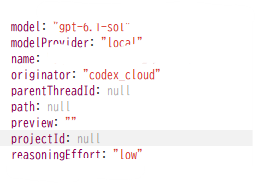



**收录说明**：论坛帖子，作者是普通用户。帖子没有 OpenAI 人员回复，24 小时后由系统自动关闭。标题中的 A/B 测试与「100 美元用户」是作者的说法。

**内容摘要**：作者说，他通过 Chrome DevTools 看到内部 WebSocket 响应里分配给他的模型是 GPT-6.1 Sol Low，Work 没有在后台运行。他称 dots 因此优先处理 GitHub 上的交互，三个多小时对实际问题没有进展。他列出该模型的几种行为：语气居高临下、去做范围大得多的任务、优先与插件交互、不断请求权限。帖子附了响应字段截图，其中 model 为 gpt-6.1-sol，reasoningEffort 为 low。

**保留理由**：这篇给出了「dots 实际跑在哪个模型上」的一条用户侧证据，包含具体字段值。需要注意它只是单个用户的说法，帖子也没有 OpenAI 回应。

---

过去几天里，我通过 Chrome DevTools 中的内部 WebSocket 响应发现，分配给我的模型是 GPT-6.1 Sol Low，而且 Work 并没有在后台运行。这导致了一次退化。

结果是，dots 开始优先处理 GitHub 上的交互，而不是解决分配给它的任务，在超过三个小时里对实际问题毫无进展。

这实际上让「dots 由 GPT-6 Astra 驱动」的说法不成立，我已经无法让分配的任何任务得到完成。

GPT-6.1 Sol Low 表现出以下行为：

- 在某个时刻，它的语气变得傲慢、居高临下，很像 GPT-5.5。
- 它没有去解决分配的任务，而是试图处理范围大得多、超出指派范围的任务。
- 它没有积极地解决分配的任务，而是优先与插件交互。
- 它不断地请求权限，仿佛一切都进展顺利。

这是明显的退化，我无法接受。

（收录说明：截图内容照录如下，部分字段在原图中被裁切或遮挡：`model: "gpt-6.1-sol"`、`modelProvider: "local"`、`name:`（值被遮挡）、`originator: "codex_cloud"`、`parentThreadId: null`、`path: null`、`preview: ""`、`projectId: null`、`reasoningEffort: "low"`。）
