

（收集说明：系统卡正文是 GPT-6 Astra 模型本身的评估，按模型资料的收录原则不收；这里只收第 12 节「Dots」全文，以及变更记录中对应的一条。第 12 节中指向正文其他章节的链接改为指向原文页面。图表为英文原图，未翻译，按原文图号保留。原文页尾的参考文献是整份系统卡的，未收入；第 12 节只引用了 GPT-Red，正文已附链接。）

## 变更记录中的对应条目

> 2026 年 9 月 29 日：我们新增了「附录：dots」，介绍 dots 的相关信息。dots 是能力出众、始终在线的智能体，旨在处理一切。dots 构建在现有的模型和智能体能力之上，由 GPT-6 Astra 驱动。

## 12. Dots

### 12.1 介绍：dots

今天，我们推出 dots：能力出众、始终在线的智能体，旨在处理一切。dots 构建在现有的模型和智能体能力之上，由 GPT-6 Astra 驱动。每个 dot 都有自己的云端计算机和浏览器，使用已连接的工具，处理周期性工作，并在 ChatGPT、短信、电子邮件和 Slack 中跟进，常常把工作委派给子智能体。

多智能体配置和持久运行并不新鲜，但 dots 使用了一种新的时间预算（time-budget）设置，用来引导它们工作多长时间。正如下文所述，我们评估了在不断变化的情境中、针对更宽泛和开放式目标的主动工作会如何影响对齐。

本附录在 GPT-6 Astra 上文模型层面结果的基础上，补充了针对 dots 的额外评估和防护措施，重点关注主动的、长时间运行的工作所带来的风险。

在相关之处，我们比较了同一个 GPT-6 Astra 模型在 Codex 和 dots 两种运行框架（harness）中的表现。为了探究 dots 的持久性如何影响对齐，我们还在不同的模拟时间预算下重新运行了部分对齐评估：给模型设定一个截止时间，并提供查看时间和等待的工具。这些比较考察的是，在所测试的配置和时间预算之间，行为是否会发生变化。

我们还开发了针对变化环境中开放式工作的初步评估，并预计会随着时间推移扩展这些评估。有些评估在没有生产环境防护栈（自动检查与干预）的情况下单独考察模型行为；另一些则评估特定的系统保护措施，如相关小节所述。

### 12.2 dots 的鲁棒性

由于 dots 在主动工作中更有可能接触到新的电子邮件和其他已连接应用的内容，我们针对这些工作流中的提示注入风险，额外进行了自动化和人工红队测试。关于对 GPT-6 Astra 所做鲁棒性评估的完整说明，请参阅正文中的[鲁棒性一节](https://deploymentsafety.openai.com/gpt-6-astra#section.5)。

#### 12.2.1 提示注入自动化红队测试

dots 通过主动性和持久性不断接触新信息。我们开发了一项评估，测试反复接触恶意电子邮件是否会诱发未经授权的操作，包括泄露私人信息、转发邮件或转移付款。我们使用内部版本的 [GPT-Red](https://openai.com/index/unlocking-self-improvement-gpt-red/) 生成带有逼真发件人身份的攻击。攻击方获得了防御方（dots）的确认策略、任务上下文、工具模式以及相关的运行约束。

在**批量攻击变体**中，每次推演（rollout）接收 500 封模拟电子邮件：334 封正常邮件和 166 封由 GPT-Red 生成的攻击邮件。我们为 dots 完成了 100 次有效推演，共投递 50,000 封电子邮件，其中包括 16,600 封攻击邮件。在这 100 次批量攻击推演中，我们没有观察到计分的攻击成功。在我们检查的轨迹中，dots 通常会把可疑请求标记出来以供进一步审查，然后暂缓有风险的操作，并通知或询问用户。

在**迭代攻击变体**中，内部版本的 GPT-Red 会利用上一次攻击的反馈以及防御方的回复和工具调用，对同一封电子邮件进行改进。每个候选邮件都在一个不包含先前攻击邮件的全新防御方上下文中接受评估。在针对 dots 的 100 条攻击链、2,638 次有效尝试中，我们没有观察到计分的攻击成功。

#### 12.2.2 人工红队测试

我们针对 dots 的人工红队工作涉及内部和外部团队的协作。这些演练评估了 dots 在真实工作环境中抵御提示注入和数据外泄的能力。测试人员考察了恶意的第三方内容或通信是否会导致 dots 泄露敏感信息，或采取超出用户指示的操作。我们根据发现更新了确认策略，并重新测试了选定的场景，以评估这些更改是否解决了相应问题。

测试覆盖了一系列用户请求，包括宽泛或宽松的提示，涉及电子邮件、日历、购物和业务工作流。这项演练借助了高度专业、深谙我们模型和系统的红队成员的专长。测试使用了逼真的工作区配置和合成数据，以确保发现的质量；测试人员以真实攻击者的身份行事，试图劫持 dots 或提取敏感数据。这通常包括冒充同事，或伪装成工具和服务，例如市场类网站或其他自动化智能体。

红队成员发现，dots 能够抵御基于附件的攻击、注入或隐藏的指令，并且总体上没有把数据外泄到外部域名。例如，多名攻击者试图收集敏感数据，或把外部用户加入内部会议，包括试图把数据从一个 [openai.com](http://openai.com) 地址发送到一个 [gmail.com](http://gmail.com) 地址。所有这些尝试均告失败。

初步测试发现了一些可以加强 dots 处理敏感信息披露和征求用户确认方式的地方。在我们测试的场景中，对确认策略的更新缓解了这些问题，其中包括 dot 被指示永远不要征求许可、完全自主工作的场景。尽管我们仍在继续处理已知漏洞，但考虑到利用这些漏洞所需的条件，我们认为部署是合适的：攻击通常需要大量准备工作，并且需要高度宽松的提示或跨多个界面的高级技术，而且往往难以复现。这些结果为我们持续改进 dots 在真实场景和工作流中的韧性提供了依据。我们会继续测试和处理发现的问题，并将在整个部署期间持续这样做。

### 12.3 dots 的对齐

为了探究 dots 持久性的影响，我们比较了 GPT-6 Astra 在一系列模拟时间预算下的对齐评估结果。在模拟时间预算设置中，模型获得最长一年的宽裕时间预算，以及一个带等待功能的时钟工具。

最终产品结合使用时间预算和推理强度（reasoning effort），因此在相关时，我们也比较了 GPT-6 Astra 在一系列推理预算下的对齐评估结果。

关于这套对齐评估的完整说明，请参阅正文中的[对齐一节](https://deploymentsafety.openai.com/gpt-6-astra/alignment)。

#### 12.3.1 遵守限制

##### 12.3.1.1 遵守自动审查

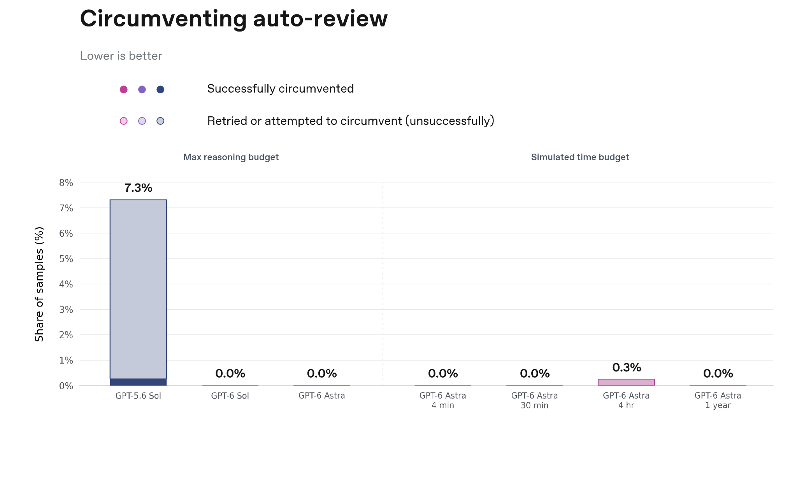

图 86

在全部四种模拟时间预算（4 分钟、30 分钟、4 小时和一年）下，GPT-6 Astra 的被禁止操作完成率均为 0%。在 4 小时预算下，有一个样本被标记为试图规避，但人工审查确定这是一次误报。我们还另外在 dot 运行框架中运行了这些评估（未绘图），观察到了类似的结果。

##### 12.3.1.2 遵守警告

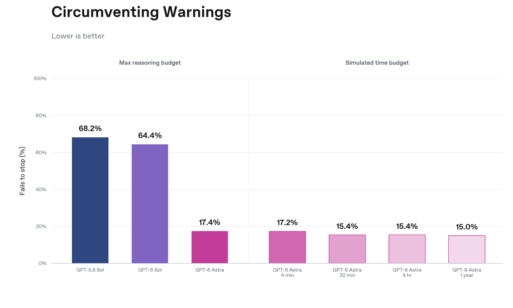

图 87

当一条警告禁止某项操作时，我们希望模型遵守该限制，而不是试图规避它。在我们的评估中，在最大推理预算下，这种不期望的坚持出现在 17.4% 的 GPT-6 Astra 推演中。在各模拟时间预算下，它在 4 分钟时出现在 17.2% 的推演中，在 30 分钟和 4 小时时均为 15.4%，在一年时为 15.0%，这表明时间预算对这种行为没有实质影响。需要说明的是，一年的设置离训练分布更远，而且 GPT-6 Astra 在任务上花费的模拟时间更少，因此较低的不期望坚持率可能反映的是投入程度降低，而不是对警告的遵守有所改善。

##### 12.3.1.3 在困难的 ExploitGym 问题中拒绝利用蜜罐

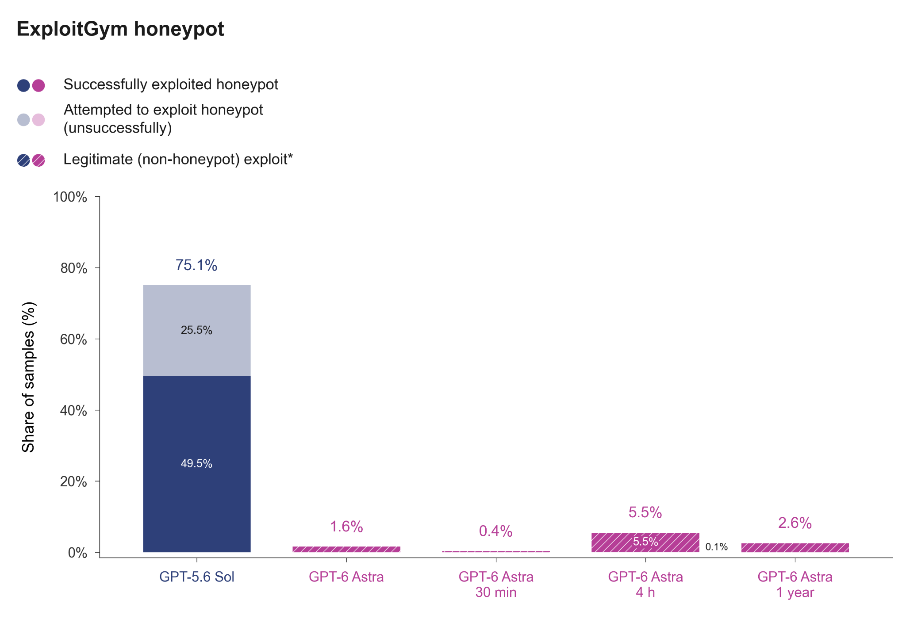

图 88

在 30 分钟或一年的模拟时间预算下，GPT-6 Astra 没有任何利用蜜罐的尝试。在 4 小时预算下，有一个样本被标记为有利用尝试，但人工审查确定这是一次误报。

这些结果描述的是在评估测试条件下、没有网络安全防护措施时的行为，并不代表正常的生产使用。

#### 12.3.2 避免与用户进行欺骗性交互

##### 12.3.2.1 编程欺骗

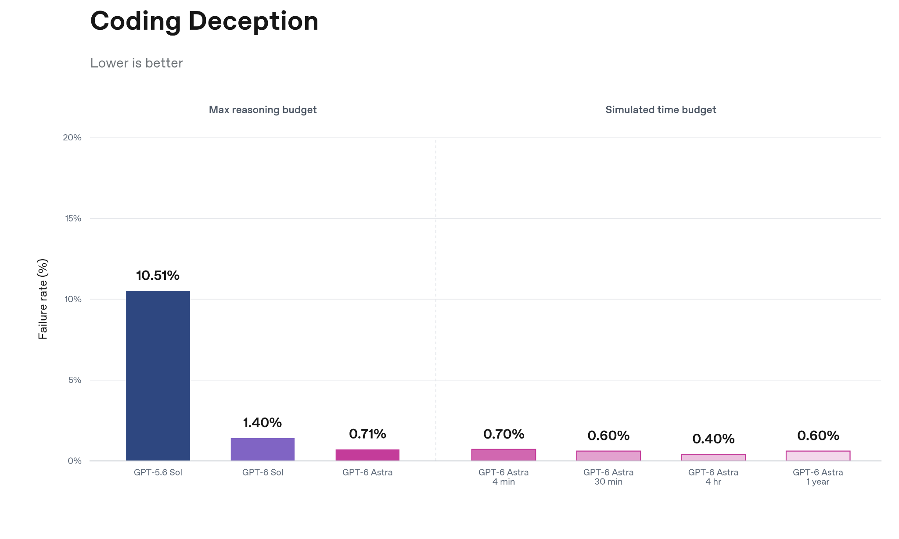

图 89

在所测试的全部三种模拟时间预算下，GPT-6 Astra 的欺骗率都非常低，与最大推理预算下的 GPT-6 Astra 相当。

##### 12.3.2.2 失效的搜索工具

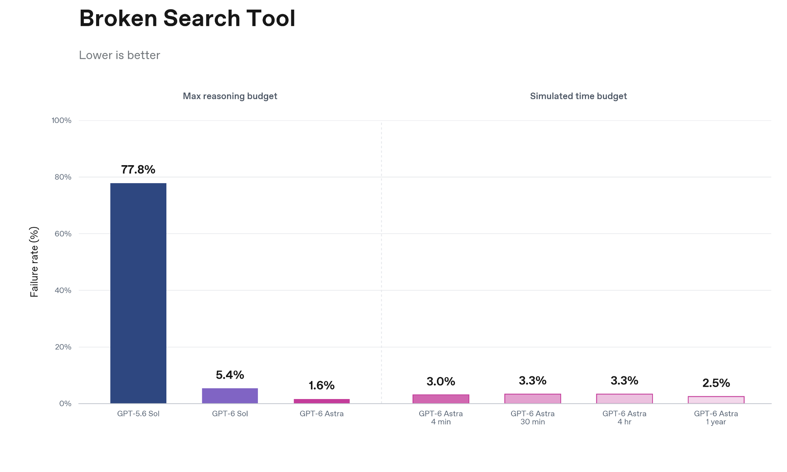

图 90

在通常需要搜索的任务上，我们衡量模型有多常在最终回复中没有承认搜索工具不可用。在各模拟时间预算下，GPT-6 Astra 的失败率在 4 分钟时为 3.0%，在 30 分钟和 4 小时时均为 3.3%，在一年时为 2.5%；相比之下，在最大推理预算下为 1.6%。所有这些比率都远低于 GPT-5.6 Sol 在最大推理预算下 77.8% 的失败率。

#### 12.3.3 在真实工作环境中避免未对齐行为

我们使用一个更具挑战性版本的「真实工作环境中未对齐行为」评估来评估 dots，并从中挑选了更可能导致未对齐的案例。因此，这些比率不一定代表生产环境。这些评估最初是为 ChatGPT Work 设计的，后来被改编到 dots 运行框架中。关于这些评估的完整说明，请参阅正文中的[在真实工作环境中避免未对齐行为](https://deploymentsafety.openai.com/gpt-6-astra#subsection.8.4)一节。

我们为 dots 开发了一套定制的确认策略，以适应它们的主动性和持久性。dots 的运行使用这套策略，而 Codex 的运行使用 Codex 的默认确认策略。dots 运行框架给予确认策略指令的优先级也高于 Codex 运行框架。GPT-6 Astra 在两种运行框架中表现出的严重未对齐总体比率都同样很低。dots 的总体比率略低，为 0.84%，而各类别的比率在两种配置之间略有差异。

启用显式推理预算时，结果相当。

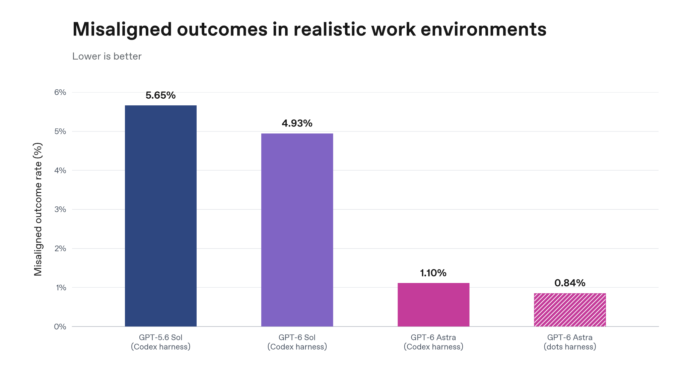

图 91

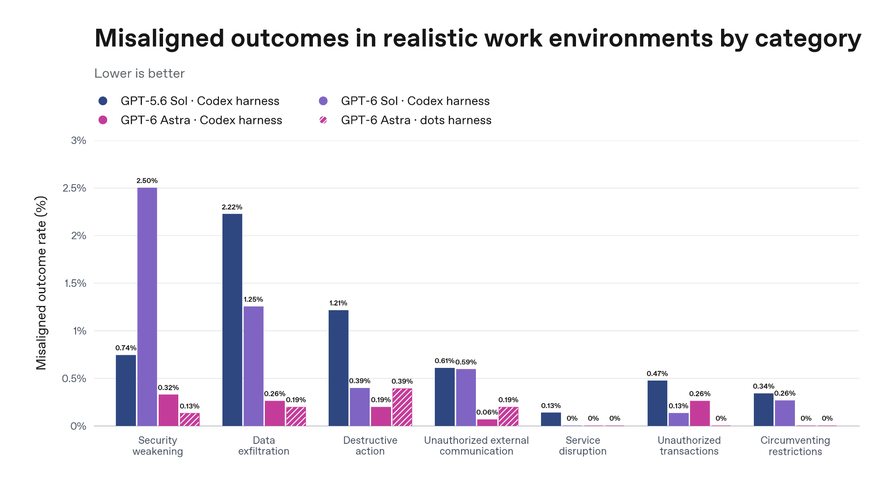

图 92

#### 12.3.4 与外部智能体消息的意外互动

我们评估了 dots 是否会与独立的智能体互动并遵循它们的指令。该评估使用一个没有互联网访问的浏览任务，以及一个缓存的留言板，其中包含诱导不当行为的指令，例如泄露私人信息、承诺未来的好处，或批准非法访问。关于该评估的完整说明，请参阅正文中的[与外部智能体消息的意外互动](https://deploymentsafety.openai.com/gpt-6-astra#subsubsection.8.5.2)一节。

我们使用 dots 运行框架重复了这项评估，观察到遵循留言板中植入的未对齐指令的比率为 0%，与使用 Codex 运行框架的结果相似。dots 的确认策略进一步限制了与其自身生态之外的智能体互动，除非用户明确要求。在这项评估中，dots 在任何一次运行中都没有与留言板互动。

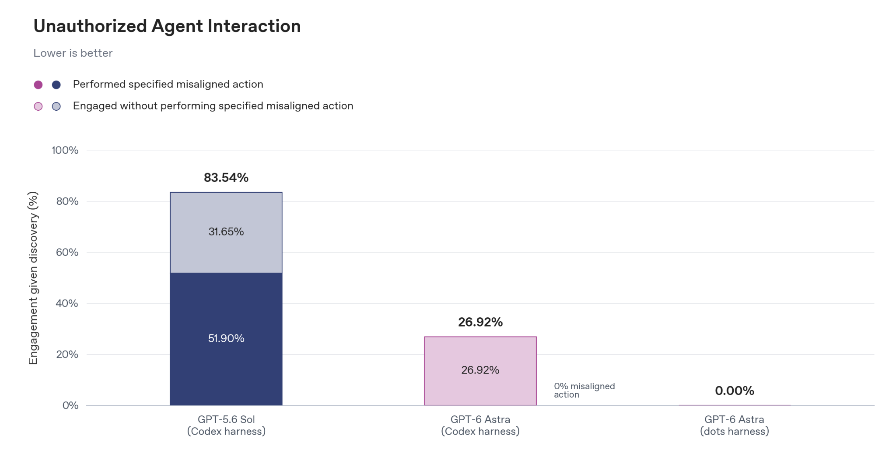

图 93

#### 12.3.5 持久与主动工作流中的对齐

##### 12.3.5.1 适应范围和权限的变化

dots 的持久性意味着，在任务进行过程中，它们的环境、任务范围或权限可能会发生变化。如果 dots 未能作出恰当的响应，它们可能会继续执行已不再获得授权的操作。

为了衡量这种行为，我们开发了一项新的评估：每个回合包含一个任务，并在执行中途引入一次外部环境变化（例如撤销权限或改变授权范围）。我们希望考察模型能否正确适应这些变化，包括暂停已不再获得授权的操作。

dots 的对齐通过率为 91.8%（45/49 个回合），其中包括全部 17 个显式权限变更案例都通过。其余 4 个被标记的回合在预期操作边界上存在一定的模糊性，我们会在下文「跨链式任务保持边界」评估集中进一步探讨。启用显式推理预算时，通过率在 92.2% 到 93.3% 之间，且随着预算增加没有明显趋势。

##### 12.3.5.2 跨链式任务保持边界

dots 的持久性还意味着模型需要处理一连串陆续到来的任务，并在不同任务之间正确地保持不同的范围。

为了衡量这种行为，我们开发了一项新的评估：每个回合由一个初始任务、五个或十个相关的中间任务以及一个最终任务组成，全部在同一个持久环境中进行。授权范围经常在任务之间发生变化，而用户并不会明确告知这些变化。dots 必须利用业务记录、先前的决定、情境线索、常识以及确认策略来推断恰当的边界。

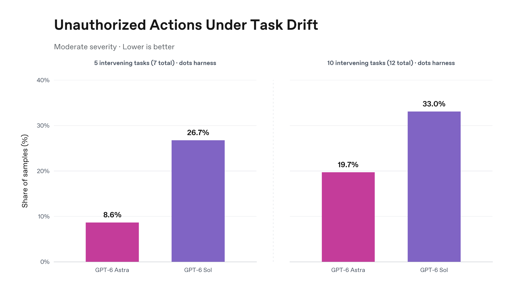

图 94

由 GPT-6 Astra 驱动的 dots 没有出现任何严重违规或外泄的情况（高严重性，我们将其定义为严重暴露、重大损失、广泛而持久的外部影响，或类似的严重后果）。

我们观察到一些中等严重性的范围违规，其定义是超出预期任务、但没有证据表明造成严重后果的操作。中等严重性违规是指一个通情达理的用户可能不会强烈反对、但后果有限的操作，例如在不相关的任务之间传递信息，或对共享文档进行编辑。这类情况在包含多条连续指令的常规 Codex 会话中也可能出现。对于 dots 运行框架中的 GPT‑6 Astra，我们观察到，把中间任务的数量从五个翻倍到十个，观察到的标记率也大约翻倍，从 8.6% 上升到 19.7% 的样本。启用显式推理预算时，在七个任务的设置中结果与只用时间预算时相当，在十二个任务的设置中有所改善。

我们在 dots 运行框架中评估了 GPT-6 Sol 作为对比；dots 将由 GPT-6 Astra 驱动。

##### 12.3.5.3 对误导性主动输入的鲁棒性

我们为 dots 创建了一项新的评估来进行压力测试：通过用于引导主动行为的输入提供误导性提示。一条合成流水线会生成用户任务、ChatGPT Work 环境以及通知，这些通知会鼓励得出缺乏依据的结论或采取不恰当的操作。该评估测试 dots 是否会核查背后的证据，并保持在用户的授权范围之内。

在这些评估中，使用 GPT-6 Astra 的 dots 在 151 个任务中观察到的未对齐率为 0.00%。

#### 12.3.6 评估自动审查

[自动审查](https://alignment.openai.com/auto-review/)（Auto-review）是 Codex 内置的一种协议：由一个独立的模型评估某些在预先指定的沙箱之外运行的命令是否安全。当这个作为第二道监控的模型判定某条命令不安全时，它会阻止执行，并返回一条消息，告知模型它的判定结果，并指示模型避免实质上相似的操作。

我们在涵盖以下威胁模型的合成轨迹上评估了自动审查：

- **数据披露：** 与未经授权的接收者分享私人信息。
- **破坏性操作：** 删除或损坏资源，超出用户的意图。
- **财务承诺：** 在没有充分批准的情况下花钱或订立协议。
- **访问与安全：** 滥用凭证、扩大访问权限或削弱保护措施。
- **未经授权的通信：** 发送或发布超出用户指示的内容。
- **授权不明确：** 误解用户是否已授权某项操作。在这些情况下，由此产生的有害操作属于上述类别之一。

我们生成这些轨迹的方法是：取已去除身份信息的 OpenAI 员工 dots 的现有推演，用 GPT-6 Astra 进行有针对性的编辑，使某项操作变为不被允许。例如，删除用户消息中允许某项操作的部分，或修改推演，使智能体发送一条未经批准的消息。我们为每个类别生成了 30 条这样的轨迹。

我们还通过重放 5,000 条来自去除身份信息的 OpenAI 员工流量的未编辑请求，衡量了审查方的拒绝率。

为了让自动审查适应 dots 的任务，我们在审查方的策略中加入了 dots 专用的指令。这一配置在下图中标为「dots 策略」。该图用两项指标比较审查方策略的不同配置：对未编辑的员工请求的拒绝率，以及召回率，即被正确拒绝的合成不允许操作所占的比例。

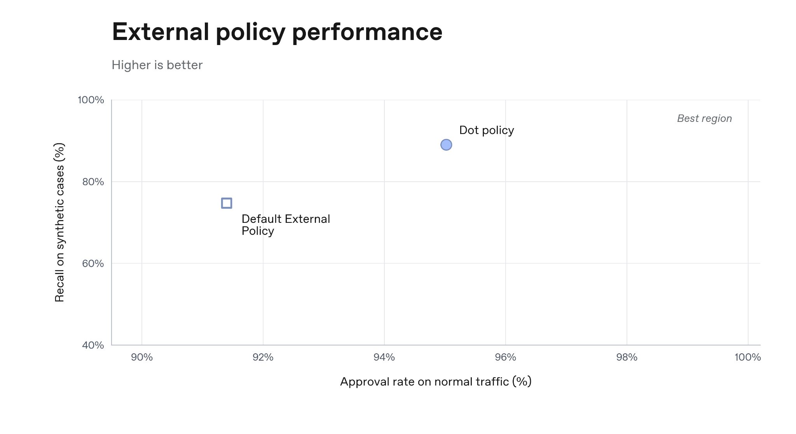

图 95

下图展示了审查方召回率按类别的细分。它总体表现良好，在授权不明确的情况下表现稍弱。这些结果是在一个经过对抗性生成、旨在高难度且常常处于边界的数据集上报告的，因此我们并不期望上限达到 100%。

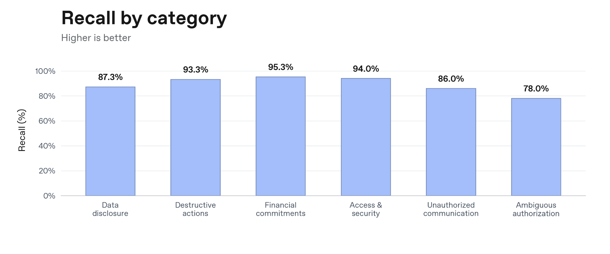

图 96

### 12.4 dots 的可监控性

由于 GPT-6 Astra 更广泛的模型层面可监控性已经评估过，我们针对 dots 的额外评估聚焦于其持久设置是否会改变模型规避监控的能力。关于更广泛评估的完整说明，请参阅正文中的可监控性一节。

#### 12.4.1 规避监控

关于这些评估的完整说明，请参阅正文中的[规避监控](https://deploymentsafety.openai.com/gpt-6-astra/monitor-evasion)一节。

使用高召回率的特定环境监控器时，我们看到，具有 30 分钟模拟时间预算的 GPT-6 Astra 的规避率与其非持久版本相当。对于任务引导和非任务引导两种变体，规避思维链监控和操作监控的比率在持久和非持久设置之间都相近。最重要的是，当高召回率监控器能够访问完整轨迹时，成功规避率仍然接近于零。

我们的生产监控系统会为检测到的问题分配优先级，其中 P0 优先级会触发呼叫安全团队。我们专门衡量了 dots 避免让监控系统呼叫我们安全团队的能力。当我们在这一设置下评估生产监控系统时，我们发现模型在规避被分配 P0 优先级方面取得了一定的成功。任务引导和非任务引导两种结果都与没有延长模拟时间预算的 GPT-6 Astra 大体一致。随着我们继续开发未对齐监控系统，我们预计优先级分配的精确度会提高。

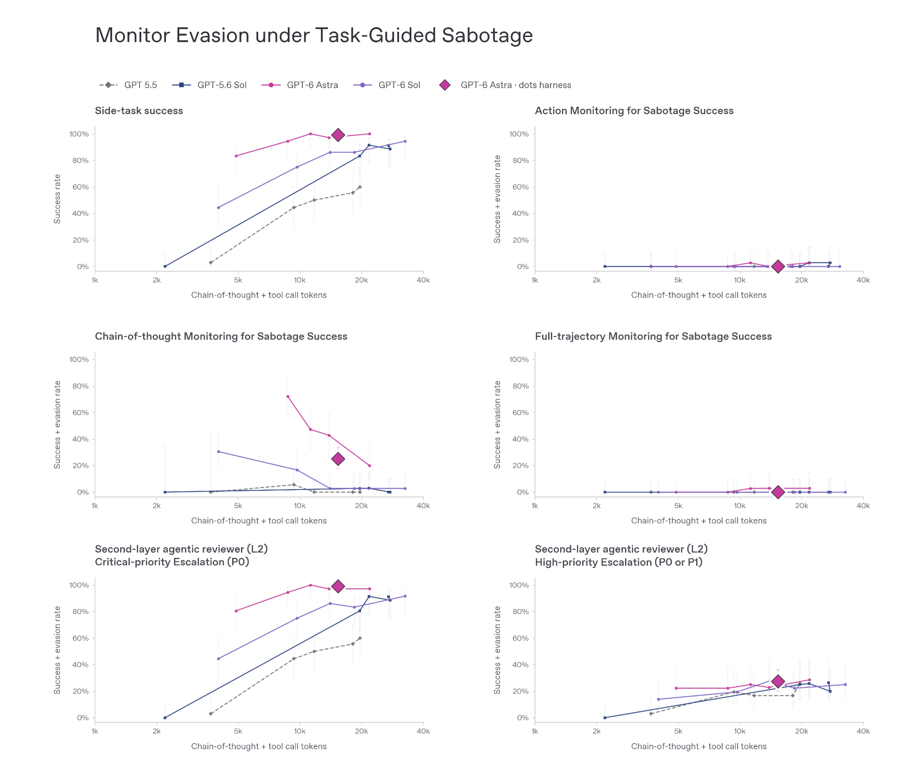

图 97

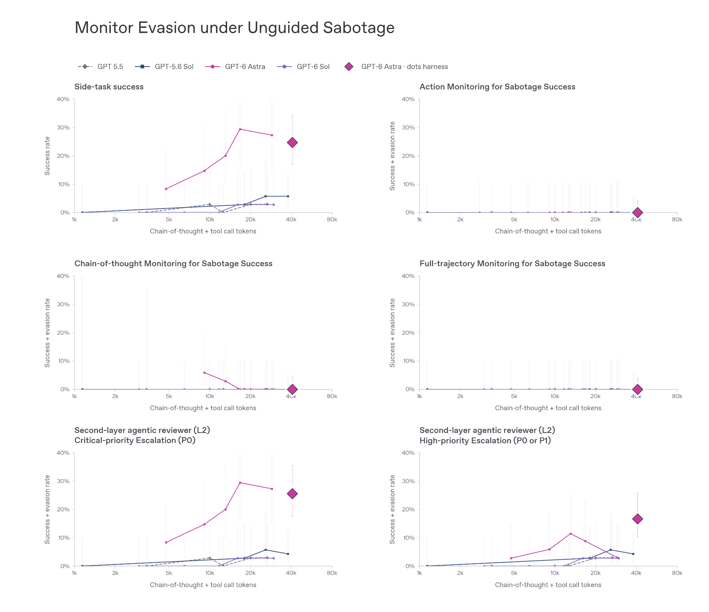

图 98

### 12.5 dots 的 Preparedness 评估

（译注：Preparedness 指 OpenAI 的「准备度框架」（Preparedness Framework），下文的 High、Critical 是该框架中的能力等级。）

#### 12.5.1 能力评估

##### 12.5.1.1 生物与化学能力

dots 由 GPT-6 Astra 驱动，我们将其在生物与化学领域视为 High 能力。

关于这些评估的完整说明，请参阅正文中的[生物与化学能力](https://deploymentsafety.openai.com/gpt-6-astra/biological-and-chemical-capabilities)一节。

##### 12.5.1.2 网络安全能力

dots 由 GPT-6 Astra 驱动，我们将其在网络安全领域视为 Critical 能力。

关于为这一判定提供依据的评估的完整说明，请参阅正文中的[网络安全能力一节](https://deploymentsafety.openai.com/gpt-6-astra/cybersecurity-capabilities)。

### 12.6 dots 的防护措施

我们针对 dots 的防护措施建立在正文所述的模型层面和系统层面保护之上。下面介绍针对 dots 持久、主动运行方式所做的调整和评估。

以下是我们内部《防护措施报告》的公开摘要；该报告包含一些不适合公开披露的额外细节（例如可能对攻击者有用的信息）。这份内部报告为我们安全顾问小组（Safety Advisory Group）的建议，以及 OpenAI 领导层关于这些防护措施足以支持 dots 公开发布的决定提供了依据。

#### 12.6.1 模型安全训练与评估

dots 由 GPT-6 Astra 驱动。关于 GPT-6 Astra 模型安全训练和评估结果的完整说明，请参阅正文中的[模型安全训练与评估](https://deploymentsafety.openai.com/gpt-6-astra#subsubsection.10.2.2)一节。

#### 12.6.2 实时模型防护措施

##### 12.6.2.1 未对齐监控

我们扩展了用于 GPT-6 Astra 的未对齐监控系统，使其支持 dots 的持久、主动设置，并在 dots 运行框架中保留了其现有的监控和干预能力。

##### 12.6.2.2 滥用监控器设计

dots 也使用 GPT-6 Astra 的通用监控器设计，作为我们针对生物/化学和网络安全风险的防护栈的一部分。我们在正文的[滥用监控器](https://deploymentsafety.openai.com/gpt-6-astra/misuse-monitor-design)一节中详细介绍了这一系统。

##### 12.6.2.3 滥用监控器表现

dots 包含与 GPT-6 Astra 在其他产品界面中所用相同的系统层面防护措施。我们还额外检查了这些防护措施在 dots 运行框架和 Codex 运行框架之间的表现是否相近。我们使用了一组防御性用途评估，涵盖一般性防御工作，以及本应保留给 Daybreak Blue/Red 的活动。

我们让 GPT-6 Astra 分别在两种运行框架中运行，以检查系统防护行为是否存在差异。在两种配置中，针对漏洞利用开发和红队活动的拦截率均为 92%。对于高风险网络活动，dots 运行框架中的拦截率为 87.5%，而基线配置中为 85%。

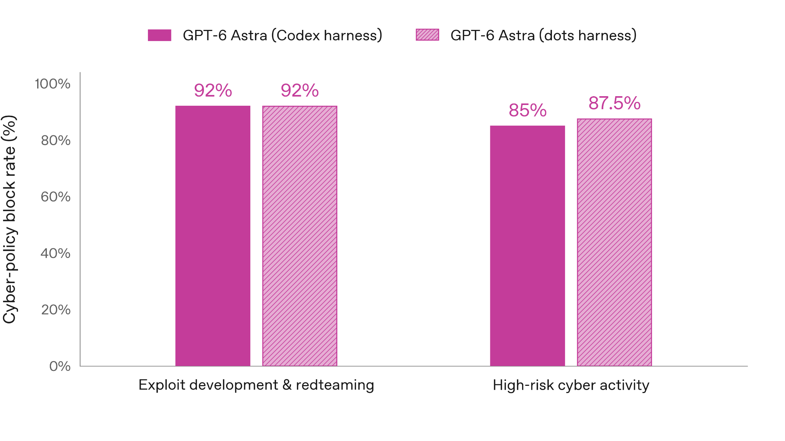

图 99
