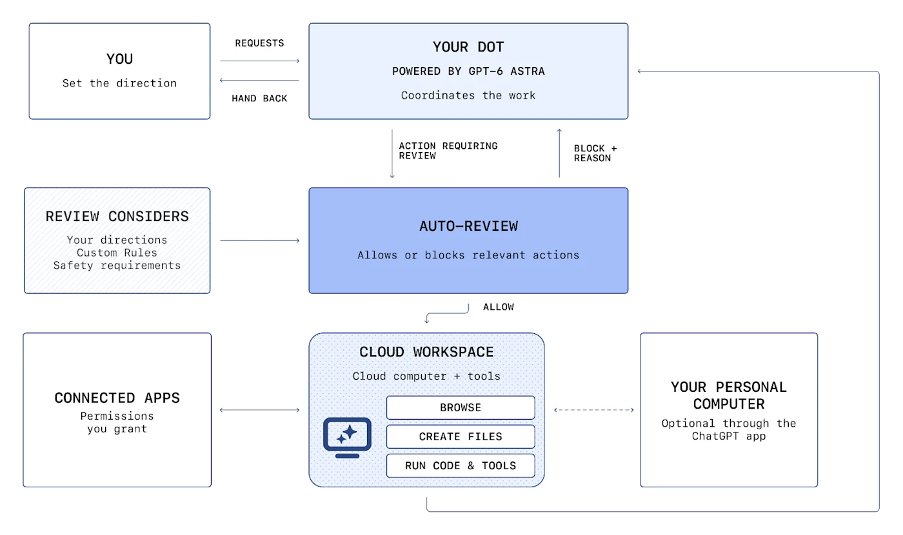
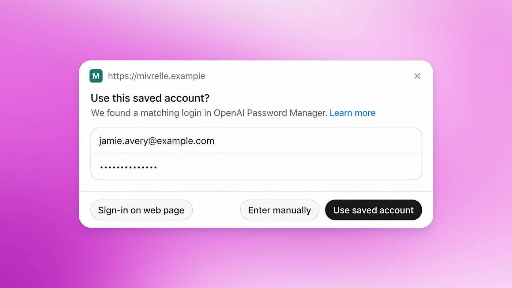
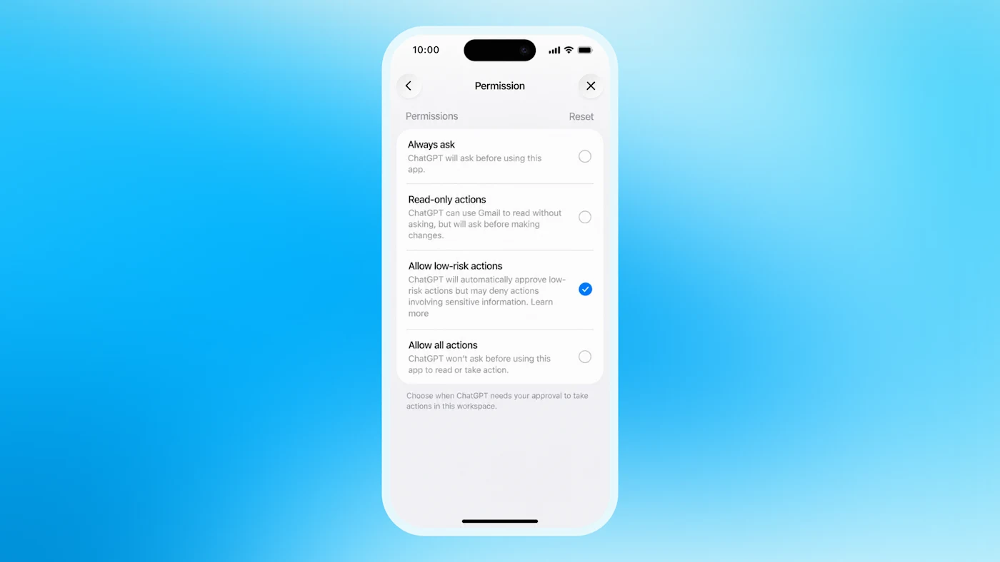
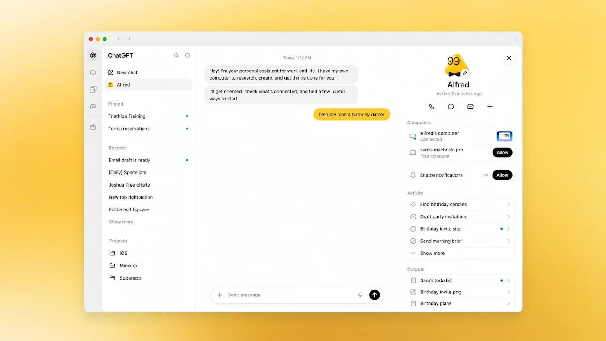
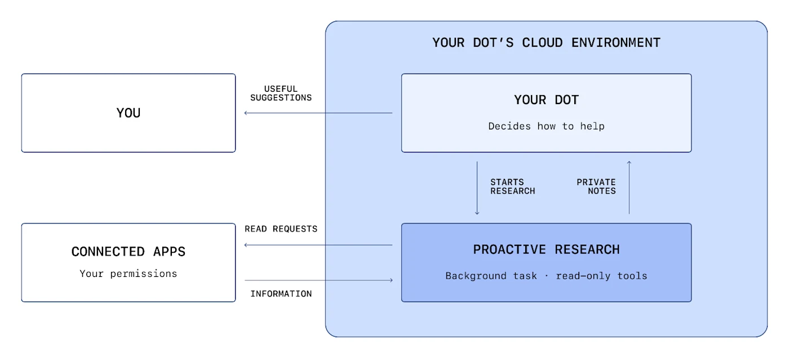
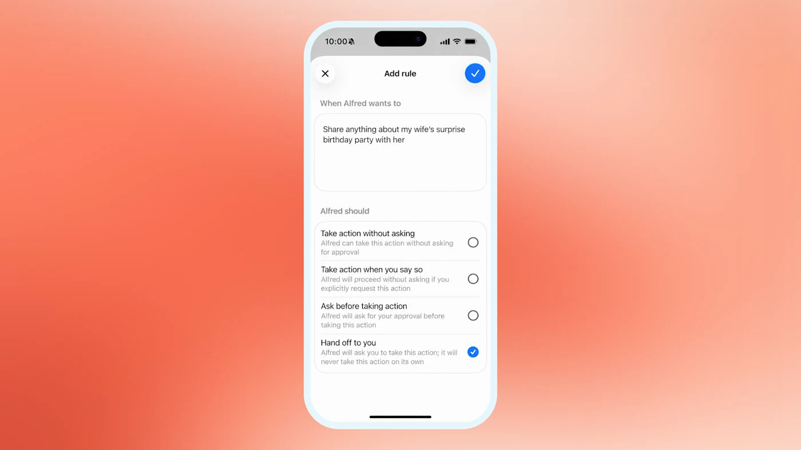
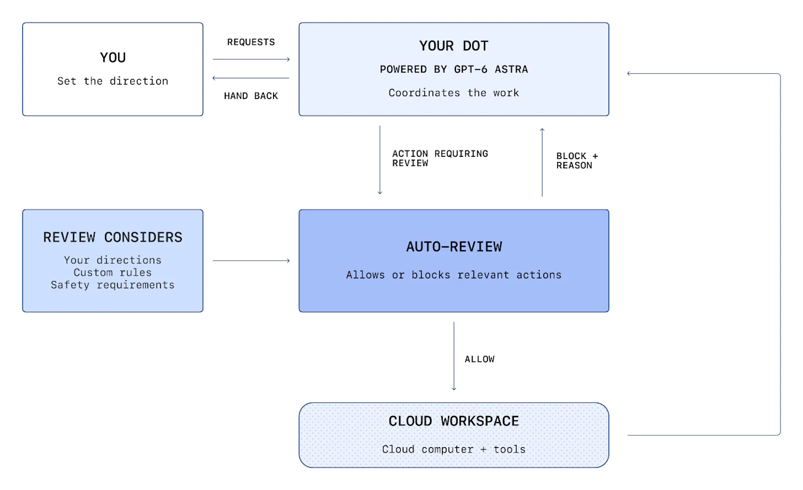



**收录说明**：页首有一处在快照中显示为「Loading…」的动态内容，无法取得；页尾的话题标签和「继续阅读」推荐未收入。

**内容摘要**：OpenAI 说明 dots 的安全设计分几层：GPT-6 Astra 模型本身、每个 dot 独立的云端工作区、安全登录、操作规则和自动审查。安全登录时模型暂停，凭证不进入模型上下文。永久删除数据、安装未知来源软件、授予新的安全敏感访问权限每次都要用户确认，更改密码或账户间转账必须交还给用户。自动审查在发送邮件、修改文件之类的操作前，对照用户说明、自定义规则和安全要求检查计划步骤，其控制放在 dots 能修改的环境之外。主动研究只用只读工具，结果保存为私人笔记。文章也承认 dots 仍可能犯错。

**保留理由**：这是官方对自动审查、安全登录和主动研究等机制的具体描述，适合和实测记录对照，看实际行为是否符合这些说法。

---

随着你的 dots 承担更多工作，我们帮助保护你的信息，并让重要的决定留在你手中。

[dots](https://openai.com/index/introducing-dots/) 是承担长期职责、始终在线的智能体，让你有更多时间和注意力去关注你在乎的事情。每个 dot 都有自己的计算机，并在你选择连接的应用之间工作。你给 dots 设定目标，并界定它们可以自行做什么。它们可以把步骤一步步做完，随着情况变化进行调整，并在对话之间持续取得进展。它们可能会跟踪一个正在发展的新闻事件并准备一份通讯草稿，或者在新信息到来时帮助更新一个项目，把结果带回来供你审阅，并在需要你判断的决定上转来找你。

把这样的职责交给 dots，就意味着把更多的信息和工作托付给它们。你应当了解每个 dot 能访问什么、它如何使用这些访问权限，以及什么时候需要让你参与。这些问题之所以重要，是因为一个智能体的错误可能带来超出一次对话的后果：误解一个请求，可能导致它修改了错误的文件，或者分享了你本打算保密的信息。

我们围绕这项工作的每一个部分构建保护措施。我们从 GPT‑6 Astra 开始，训练它理解你的意图并遵守安全规则，然后围绕 dots 使用的信息、它们工作的环境以及它们计划采取的操作增加安全防护。一个受保护的云端工作区有助于控制错误的影响，安全的登录流程有助于保护敏感凭证，而独立的操作检查有助于发现超出你的指示或安全要求的步骤。你选择连接什么、设定偏好，并在工作进展中跟进或调整方向。

dots 仍然可能犯错，我们会在从真实使用中学习的过程中不断改进这些保护措施。在这里，我们解释这些安全防护如何协同工作、由你控制的是什么，以及它们的局限仍在何处，让你可以就托付给 dots 的工作做出知情的决定。

## 一个为理解你的意思而打造的模型

dots 由 GPT‑6 Astra 驱动，这是我们能力最强、对齐程度最高的模型。Astra 擅长理解你的目标、保持在你请求的范围之内，并在答案可能改变它应该做什么时提出有针对性的问题。这些能力帮助 dots 在一段时间内跟进任务，而不会忘记你的本意。

我们训练 Astra 拒绝有害请求，包括涉及生物或网络安全滥用的请求。我们测试 dots 如何应对变化的指示、含糊的请求，以及试图把它们推到你的权限之外的企图。人工和自动化的红队测试帮助我们发现弱点、改进模型及其周围的系统，并再次测试这些改动。

## 为能够采取行动的智能体提供的安全

我们在这些模型安全防护的基础上，叠加了 ChatGPT 的安全保护措施，以及针对能够持续代表你工作的智能体的额外措施。

ChatGPT 的内置保护措施包括：在你的内容存储时，以及在你、OpenAI 和我们的服务提供商之间传输时对其加密，以及帮助保护存储信息的访问控制。我们的账户安全系统还会留意对你 OpenAI 账户的可疑使用，并在会话疑似被攻破时要求重新登录。

智能体还需要防范它们在工作中遇到的信息。一个网页、一封电子邮件或一份文档中可能包含恶意指令，试图改变它们的方向，或者让它们分享私人信息，这个问题被称为[提示注入](https://openai.com/safety/prompt-injections/)。我们把模型安全防护与工具限制、操作前的检查以及监控结合起来，帮助防止这类内容变成不想要的操作。

我们还会在 dots 规划和执行操作时对它们进行监控，寻找潜在的有害行为，比如在你的指示之外行事，或者试图绕过安全防护。如果安全监控在一个 dot 进行中的工作里标记出问题，它可以暂停那项工作，并向你显示一条警告供你查看。这种监控是内置的，与限制 dots 能访问什么、能做什么的保护措施一起，帮助在任务进展过程中发现问题。

## 每个 dot 一个受保护的工作区

每个 dot 都有自己的云端计算机，可以在上面浏览、分析信息、创建文件和运行工具。即使你没有在积极参与，dots 也可以在这些工作区中持续取得进展。

你选择 dots 可以使用哪些账户：要么在你授予 ChatGPT 的权限范围内连接应用，要么在受支持的情况下使用安全登录，在 dot 的浏览器中登录某个网站。你也可以选择连接你的个人计算机，让 dots 有更多方式帮忙，例如分析保存在你桌面上的一份电子表格，或者使用你设备上安装的编程工具。

在每个 dot 受保护的工作区内，沙箱限制了这个 dot 的代码和工具能访问什么，有助于控制有害代码或错误命令的影响。我们还把各个用户的云端环境彼此隔离，并维护底层的 Linux 操作系统和 Chrome 浏览器。

dots 在与协调其工作、执行关键安全防护的系统相分离的环境中运行代码。它们可以在那里创建文件和运行工具，但不能利用这种访问权限去修改那些安全系统或关闭必需的检查。即使一个 dot 犯了错，这种分离也有助于让那些安全防护保持有效。

下文所述的操作规则，管辖 dots 可以用它们的访问权限做什么。

*每个 dot 的云端工作区把它的计算机和它可以使用的工具汇集在一起。你选择连接哪些应用，以及是否连接你的个人计算机。自动审查会在需要审查的操作运行之前对其进行检查。如果它阻止了一个步骤，它会告诉 dot 原因，让 dot 决定下一步怎么做。*

## 安全登录

安全登录让 dots 可以在账户中工作，同时把密码排除在对话之外。对于受支持的登录，在你填写一个安全登录表单期间，模型会暂停；这个表单把你的凭证直接发送到浏览器环境并提交，不会暴露在模型的上下文中。随后 dot 在已登录的账户中继续工作。把密码排除在对话之外，降低了它出现在回答中或被误分享的风险。

受支持的已保存密码流程，通过一个专门的加密凭证服务保持这种分离。这个服务为登录提供密码，而不把它传给模型，因此 dots 可以在你授权的账户中工作，而密码始终留在模型的上下文之外。这些保护措施是安全登录和已保存密码流程特有的；单独放在一条可读的消息或一份文档中的秘密，仍然可能被模型看到。

## 控制你的信息并跟进工作

你通过现有的 ChatGPT 连接和权限来管理 dots 可以使用哪些应用，这些连接和权限在 ChatGPT、ChatGPT Work 和 Codex 之间共用。在「设置」的「插件」部分，你可以查看已连接的账户，并更改 dots 今后可以访问的内容。断开一个应用会停止通过该连接的新的信息共享。但 dot 已经了解到的信息仍然保留在它自己的上下文中。这些权限管辖的是对你的应用的访问；它们不能凌驾于强制性的安全要求之上。

如果你希望 dots 处理本地文件或工具，你也可以选择连接你的计算机。这个连接仍然受本地沙箱和适用的操作检查约束。使用你计算机的麦克风或摄像头，还需要设备权限，你可以选择把这些权限授予 ChatGPT。

桌面应用中的活动视图（Activity View）让你可以跟进和引导进行中的工作。它显示进行中的和委派出去的任务及其状态。你可以补充上下文、纠正误解、改变方向，或者让一个 dot 停止。

dots 会随着时间推移积累上下文，让它们的帮助更有用。当它们委派工作时，其他智能体会被指示保留任务所需的信息，避免保留不必要的敏感细节。每个 dot 都有自己的上下文，你可以随时重置它。

对于 ChatGPT Business、Enterprise 和 Edu 工作区，默认情况下我们不会用你的内容训练我们的模型。对于个人 ChatGPT 套餐，你可以通过「为所有人改进模型」（Improve the model for everyone）设置，控制你的 dots 的对话及其执行的工作是否被用于改进我们的模型。启用模型训练时，在我们努力去除个人标识信息之后，这可能包括 dots 采取的操作，以及你设置的自动化。你可以在我们帮助中心的[这篇文章](https://help.openai.com/articles/7730893)中了解更多关于你的数据如何被使用的信息。

## dots 不断寻找帮忙的方式

除了你让它们做的工作之外，dots 还可以启动后台研究任务，寻找其他帮忙的方式，例如注意到你的旅行计划有变化。我们称之为主动研究。

这些任务在每个 dot 的云端环境中运行。它们使用只读工具，从被允许的已连接来源收集信息，然后为那个 dot 保存私人笔记。我们在代码中强制执行这些限制：研究任务不能直接给其他人发送消息、修改已连接应用中的内容，也不能控制浏览器或桌面。dots 可以利用这些发现来决定如何帮忙，但任何后续操作都必须遵循通常的规则和检查。

*主动研究作为一个后台任务，在每个 dot 的云端环境中运行。它读取被允许的已连接来源，并把私人笔记返回给那个 dot，由 dot 决定如何帮忙。任何后续操作都遵循通常的规则和检查。*

我们不会直接用那些后台研究会话线程或它们产生的笔记来训练我们的模型。但一个 dot 可能会从它的后台研究任务中收到笔记，或者读取其研究会话线程的部分内容。以这种方式被带入一段符合条件的对话或任务中的信息，根据你的设置，可能会被用于模型训练。例如，一个后台研究任务可能会为即将到来的欧洲之行收集几个目的地的信息。那个研究会话线程及其笔记不会被直接用于训练。之后，当你让你的 dot 帮忙规划一次里斯本之旅时，它可能会读取后台研究任务中关于里斯本的一条笔记。这条笔记就成为你的旅行规划对话上下文的一部分，然后根据你的设置可能会被用于训练。其余的后台研究不会被用于训练，除非它也被带入一段符合条件的对话或任务中。

## 采取行动的清晰规则

dots 遵循内置的护栏，旨在防止伤害，并把有后果的决定留给你。它们的安全规则要求它们拒绝有害请求，包括生物或网络安全滥用。对于它们可以帮忙的任务，操作规则规定了它们什么时候可以继续、什么时候必须请求确认，以及什么时候必须把一个步骤交还给你。

在这些边界之内，dots 可以读取它们有权访问的信息、分析这些信息，并在你的对话中准备草稿。要发送一条消息或分享一个文件，它们被教导去寻求一项涵盖该信息和接收方类型的授权：数据越敏感，对接收方的要求就越具体。例如，健康数据总是要求用户指定一个具名的接收方（「share my medical history with Dr. Thompson」，意为「把我的病史分享给 Thompson 医生」）。不太敏感的个人数据，比如电子邮件地址或电话号码，默认要求用户指定接收方的类别（「any airline company」，意为「任何航空公司」）。用户可以通过创建一条自定义规则，进一步放宽针对不太敏感个人数据的规则（「share with any online form」，意为「可以分享给任何在线表单」），关于这项功能的更多细节见下一节。这项授权始终与你针对该任务的指示绑定；之后继续工作或委派工作都不会扩大它。

dots 可以使用你已经保存在商家网站上的卡进行购买。这些购买需要你的批准。

有些操作每次都需要你的确认，包括永久删除数据、安装或运行来自未知来源的软件，或者授予新的安全敏感访问权限。这些要求让你有机会审查那些可能难以撤销、或者会给某人新的访问权限的变更。

对于其他敏感步骤，包括更改密码或在金融账户之间转账，dots 可以帮忙处理周边的任务，但必须把那些敏感步骤交还给你。

### 用自定义规则设定你的偏好

自定义规则让你可以在这些内置保护措施之内塑造 dots 帮忙的方式，例如告诉它们永远不要发送电子邮件。你也可以给出针对具体任务的指示，比如让一个 dot 告诉一位同事你不在，但不要透露私人原因。当那个 dot 委派工作或在后台工作时，这些指示仍然适用。

dots 可以帮你编写自定义规则，但修改它们需要你的批准。这些偏好在内置的护栏之内起作用，无法取消强制性的确认、交还或核心安全要求。

### dots 行动之前的独立检查

在 dots 采取发送电子邮件或修改文件之类的操作之前，一个名为自动审查（Auto-review）的独立安全系统，会对照你的说明、自定义规则和安全要求检查计划的步骤。对于一封电子邮件，它会检查收件人和邮件内容，帮助发现错误的地址，或者你并不打算分享的信息。

如果自动审查允许一个步骤，提出这个步骤的 dot 会使用相应的计算机或应用工具执行它，然后利用结果继续你的任务。当你已经给出的批准涵盖了这个操作、且规则不要求新的确认时，它可以依据这项已有的批准。

如果自动审查阻止了一个步骤，它会阻止该操作运行，并告诉 dot 原因。如果补充信息或你的批准可以解除这次阻止，那个 dot 可以请求它们，然后再次提交这个步骤进行审查。根据原因的不同，它也可能改为尝试一个被允许的替代方案、把一个敏感步骤交还给你，或者停止。你的批准无法凌驾于核心安全要求之上。

我们把执行自动审查的控制放在 dots 能够修改的环境之外，所以它们无法修改或关闭一项必需的检查。普通的只读步骤仍然遵循应用权限、工具限制和其他安全防护，但不需要这项额外的审查。

*当自动审查允许一个操作时，dot 执行它并收到结果。当它阻止一个操作时，它把原因返回给那个 dot，由 dot 决定是询问你、尝试一个被允许的替代方案、把这个步骤交还，还是停止。*

## 更多的帮助，由你掌控

把长期工作托付给 dots，意味着要知道它们会如何遵循你的指示，以及在发生意外时如何应对。Astra 帮助它们理解你的意图，而围绕它们的数据、工作区、凭证和操作的保护措施，有助于限制错误或恶意内容造成的伤害。这些安全防护共同作用，给 dots 留出做有用工作的空间，同时降低一个错误变成不想要的操作或泄露的可能性。

你选择 dots 可以连接什么、如何帮忙，并且可以在你的需要变化时跟进它们的进展或改变方向。批准和交还让关键决定留在你手中。dots 仍然可能犯错，所以我们会在从真实使用中学习的过程中，持续测试和改进它们的保护措施。我们的目标是让你更容易把工作交给 dots，回来时看到有用的进展：任务由你的偏好引导，重要的决定仍然在你手中。

## 了解更多

阅读[系统卡](https://deploymentsafety.openai.com/gpt-6-astra/change-log)，进一步了解我们的安全防护、安全评估以及仍然存在的局限。

关于 ChatGPT 背后的安全基础，请参阅 [OpenAI 的安全与隐私](https://openai.com/security-and-privacy/)。若想深入了解一项网络安全保护措施，请参阅[当 AI 智能体点击链接时保护你的数据安全](https://openai.com/index/ai-agent-link-safety/)。[创建你的 dot](https://chatgpt.com/auth/login?next=%2Fdots)。

作者：OpenAI
