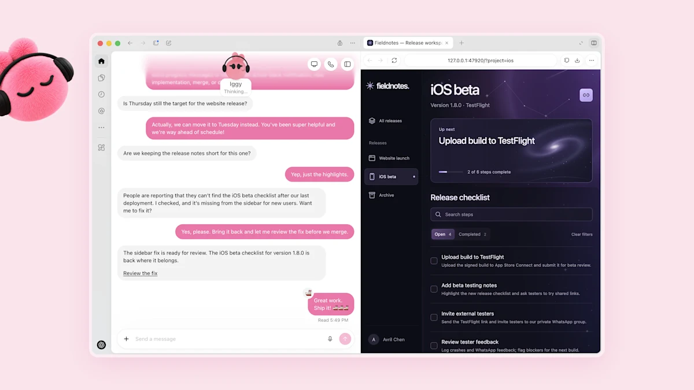
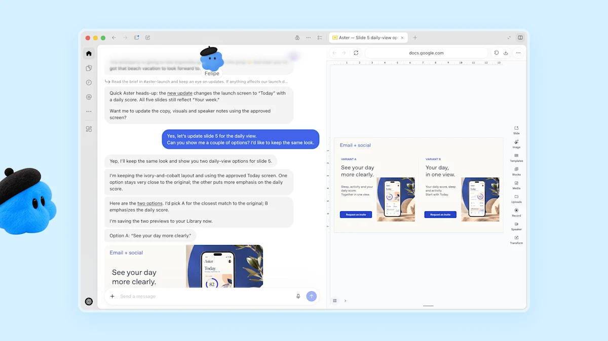
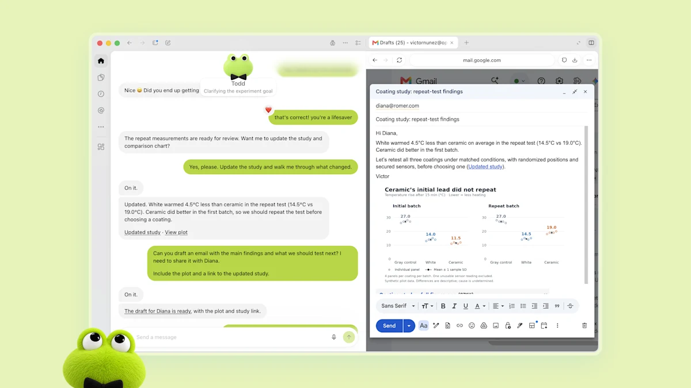
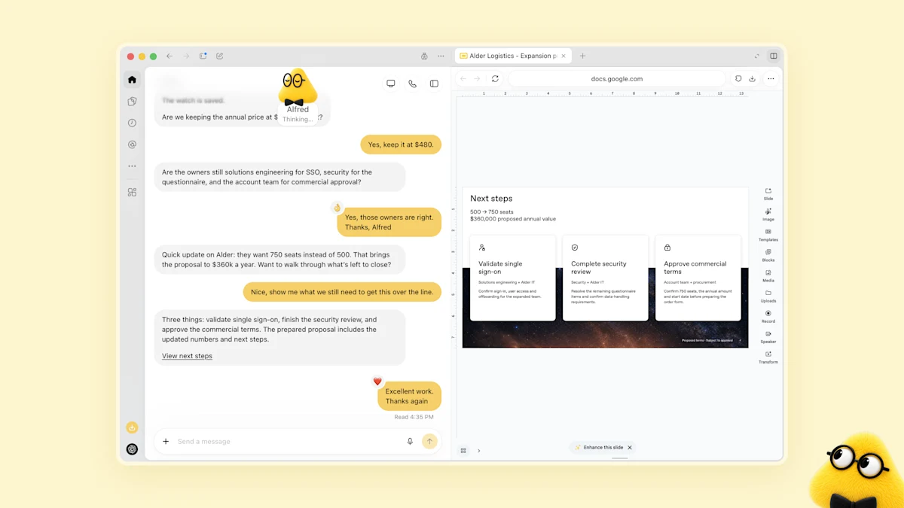



**收录说明**：页首的「创建你的 dot」「联系销售」按钮、页尾的话题标签和「继续阅读」推荐未收入。页首有一处在快照中显示为「Loading…」的动态内容，无法取得。

**dots 是能力出众、始终在线的智能体，旨在处理一切。** 它们是一种与 AI 协作的全新方式：了解对你重要的事情，始终在代表你工作，并把重要的工作从你手上接过去，让你夺回更多的时间和注意力。

dots 是为你撑腰的前沿智能。它们由 GPT‑6 Astra 驱动，拥有自己的云端计算机，会随着时间推移从反馈中学习，并且可以 24/7 地朝着你的目标工作。通过我们的插件生态，它们可以轻松连接 4,000 多个应用，获得在你需要的任何地方提供帮助的工具。

无论是通过 ChatGPT、Slack 还是 Teams，你的 dot 始终触手可及。你可以在过程中提问、探讨想法、给出反馈；当你需要把某件事说清楚时，也可以直接打一通语音电话。你们一起工作得越多，你的 dot 就越了解你的偏好、你的思考方式，以及在你看来什么才算好。

dots 的魔力在于，它们会按照你会采用的方式把工作做完交给你，有时甚至在你想到要提出之前。有 dots 在你身边，那些你一直没有时间或支持去追求的宏大想法和项目，开始变得可以实现。

在 OpenAI 内部，我们正在一窥当智能始终在你身边工作时，工作会是什么样子。一个错误出现在 Slack 里，dots 立刻开始调查。一份新设计送达，dots 把它变成一个可用的应用，而团队专注于客户反馈。一个规划周期开始，dots 让每个人都同步朝着截止日期推进。在 OpenAI 之外，一位早期测试者的 dot 注意到他忘了给一家出版物开发票，于是准备好发票，并在他批准后发了出去。

今天，你可以从你的主 dot 开始，给它起个名字，让它成为你自己的。随着时间推移，我们设想会有成组的 dots 代表你协同工作。我们正开始在符合条件的市场中，向 Pro、Business Premium 和 Enterprise 套餐推出 dots。我们计划很快把 dots 扩展到更多用户。我们还将提供专职 dots（specialist dots）的预览，它们拥有自己的身份以便进行访问管理，配有 IT 配置的硬件，并支持与公司记录系统的深度集成，让它们能够在组织内部承担明确界定的职责。

## dots 可以独立工作

dots 可以使用它们自己的云端计算机、自己的浏览器以及你连接的应用，做几乎任何事情。

你可以随时打开你的 dot 的计算机查看它的工作。除了它们自己的计算机之外，dots 还可以连接其他设备，你也可以允许你的 dot 连接并使用你的笔记本电脑，让它直接在你身边发挥作用。

你的 dot 可以接过一个项目放手去做，即使它同时还在处理其他几个项目。你可以不断给它带来新的任务和想法，而不必在不同的会话线程之间周旋，也不必指挥每一步。

## dots 是你的延伸

有了一个了解你的目标和标准的 dot，你可以承担更多工作，而不必指挥每一步。下面是具体的样子：

**把反馈变成经过测试的修复**

你是一名开发一个应用的开发者。你的 dot 关注客户反馈中反复出现的请求，界定一些较小的改进和错误修复，构建并测试它们，然后把完整的 PR 带给你审阅，并附上展示改动的视频。你可以一边继续构建下一个主要功能，一边审阅你的 dot 准备好的修复和改进。

**在范围变化时修改一次发布**

你在主导一次产品发布。你的 dot 了解你的受众、定位和创意标准。当产品范围发生变化时，它会弄清楚这对整个叙事意味着什么，修改发布材料，并准备素材和文档改动的草稿。你回来时，看到的是一份按你所定方向调整好的发布计划和创意作品，随时可以审阅。

**用新证据更新分析**

你是一名科学家。你的 dot 了解你的研究问题，以及你如何评估证据。当新数据到来时，它会重新运行分析，调查意料之外的结果，并更新你论文中的图表。当发现发生变化时，它会修改支撑性的解释，并标出需要你审阅的地方。你从实验室回来时，看到的是反映最新证据的工作。

**在需求变化时更新方案**

你是一名销售负责人，正在引导一笔企业交易通过技术评审。你的 dot 对照产品文档检查客户需求和账户历史，找出还需要测试的内容，为一个关键集成构建概念验证，并推荐一位处理过类似交易的解决方案工程师。当需求和测试结果发生变化时，它会更新方案和测试计划，并标出悬而未决的问题。你和你的工程师专注于与客户的交谈，并批准各项承诺。

**把内容制作工作自动化**

你是一名内容创作者。你的 dot 了解你的语气，以及什么对你的受众重要。当一份新的访谈文字稿到来时，它会找出适合剪辑的片段，准备节目说明，并起草社交媒体帖子供你批准。它会把你的修改贯彻到所有材料中，并学习什么能引起共鸣，让你有更多时间去创作。

## dots 在你工作的地方工作

与你的 dot 协作就像进行一次对话一样简单。你可以在桌面、网页和移动端的 ChatGPT 中给 dots 发消息或打电话。它们也可以给你发消息，告诉你进展、问题或需要你做的决定。

你还可以在 Slack 和 Teams 中给你的 dot 发消息，短信功能也即将推出。在 ChatGPT 中开始一个项目，在 Slack 中与工作团队分享上下文，然后让你的 dot 跟进到底。dots 在每个渠道之间携带上下文，所以无论你在哪里联系你的 dot，它都掌握完整的上下文。

## 一切始终由你掌控

dots 在 ChatGPT 的保护措施之上，针对它们能做的工作增加了[额外的安全和隐私防护措施](https://openai.com/index/how-we-build-safety-security-and-privacy-into-dots/)。你可以设定边界、跟踪进展，并参与需要你做的决定。

### 内置的安全防护

每个 dot 都在它自己的云端计算机上工作，而你的计算机及其内容保持独立，除非你选择连接它。在登录受支持的网站时，dots 可以使用已保存的密码，而不会把它们暴露给模型。

当你没有在积极地与它协作时，你的 dot 会在后台寻找帮忙的方式。我们称之为「主动研究」。它通过你已经连接的应用来做这件事，使用的工具被限制为只读，这意味着它们不能发送消息、修改应用内容，也不能控制你的浏览器或计算机。

dots 内置的安全防护措施有助于抵御恶意指令，并监控潜在的有害行为。如果我们的监控系统检测到安全问题，它可以暂停或停止 dot 的工作。

### 访问与权限

你选择 dots 可以访问哪些应用，并可以通过你现有的 ChatGPT 应用控制来管理它们的权限。

dots 一开始就带有内置规则，规定什么时候可以独立行动、什么时候需要请求批准。自定义规则让你可以允许特定操作、要求批准或阻止它们。内置的安全要求始终适用，你可以在活动视图中跟踪进展（包括后台工作），并在需要时调整 dots 的方向。

默认情况下，我们不会使用来自 ChatGPT Business、Enterprise 或 Edu 工作区的内容来改进我们的模型。在个人 ChatGPT 套餐中，你可以控制 dots 的对话和工作是否被用于[改进我们的模型](https://help.openai.com/articles/7730893-data-controls-in-chatgpt)。我们不会直接用主动研究或你的 dot 写给自己的笔记来训练模型。根据你的设置，如果其中的信息有助于形成一段符合条件的对话或任务，这些信息可能会被使用。

### 操作审查与批准

dots 使用[自动审查](https://learn.chatgpt.com/docs/sandboxing/auto-review)（auto-review），对照你的说明、自定义规则和安全要求，检查那些可能影响你的账户或分享信息的操作。这有助于确定哪些工作可以继续、哪些需要批准，以及哪些必须由你亲自完成。某些敏感任务，比如更改密码，始终由你来做。

你可以在[我们关于 dots 安全的博客](https://openai.com/index/how-we-build-safety-security-and-privacy-into-dots/)、我们的[帮助中心](http://help.openai.com/articles/20001529)和我们的[系统卡](https://deploymentsafety.openai.com/gpt-6-astra/change-log)中，进一步了解我们对 dots 的安全做法。dots 仍然可能犯错，所以请始终审阅有后果的工作。

## 为你的组织提供专职 dots

你的 dot 代表你工作；**专职 dots** 则在你的组织内承担专门的职责。你的公司为每个 dot 设置它自己的身份、凭证，以及完成其任务所需系统的访问权限。在工作过程中，这个 dot 会适应新的信息，并根据你团队的反馈不断改进。我们正在借鉴在 OpenAI 内部早期测试中积累的经验，涉及采购、发票处理、电子邮件营销、客户支持和商务合同。

我们从有针对性的企业试点开始。我们的工程团队将直接与各组织合作，界定每个 dot 的职责、它可以使用的工具，以及人们如何审阅和批准它的工作。如果你有希望由专职 dot 承担的工作，我们很想听听你的想法。

### 把专职 dots 带到 Microsoft Agent 365

我们还在与微软合作，把专职 dots 与 Agent 365 中的企业治理和安全控制集成起来。目标是让企业能够通过它们已经在使用的微软工具来管理 dots。

## 开始使用 dots

dots 今天开始在 ChatGPT 中向[符合条件的市场](https://help.openai.com/articles/20001530)中的 Pro 和 Business Premium 用户推出。企业用户（包括 Edu 和 Healthcare）在其工作区管理员启用后，可以试用测试版。

你的第一个 dot 包含在你的 Pro 或 Business Premium 套餐中，不额外收费。它全天候可用，可以与你交谈、帮你思考，并帮你掌握对你重要的事情。你的套餐还包含一份用于更深入工作的额度，在发布后的第一个月有延长的限额。将来，你将能够添加更多 dots，并通过提高每个 dot 的速度或它每月能承担的工作总量来扩大它的产出。

与你的 dot 的对话不计入你的 ChatGPT 使用限额。当你让你的 dot 在 Codex 或 ChatGPT Work 中启动或管理任务时，这些任务照常计入你的使用限额。

要开始使用，请在 ChatGPT 桌面应用或你的桌面浏览器中创建你的第一个 dot，连接你的应用，然后让它自我介绍。完成初始设置后，你就可以在 ChatGPT 移动应用中给它发消息了。

我们会在了解是什么让 dots 每天都有用的过程中，不断改进它们。我们会尽可能分享我们的心得，并用它们来指导我们接下来要打造的东西。

作者：OpenAI
