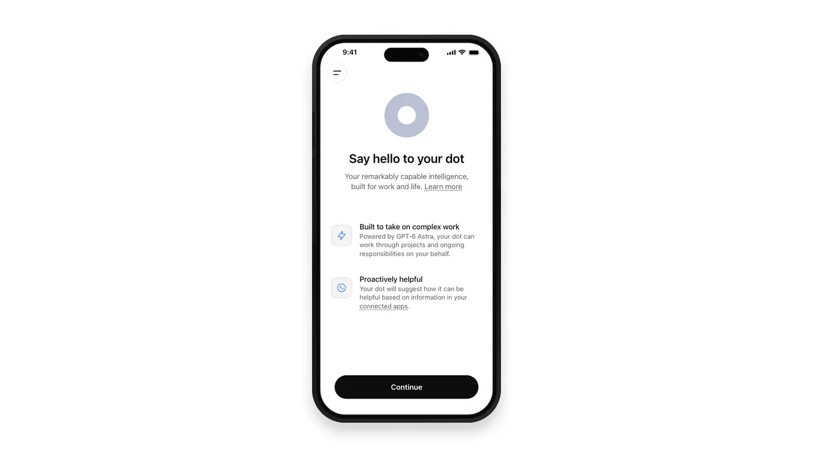
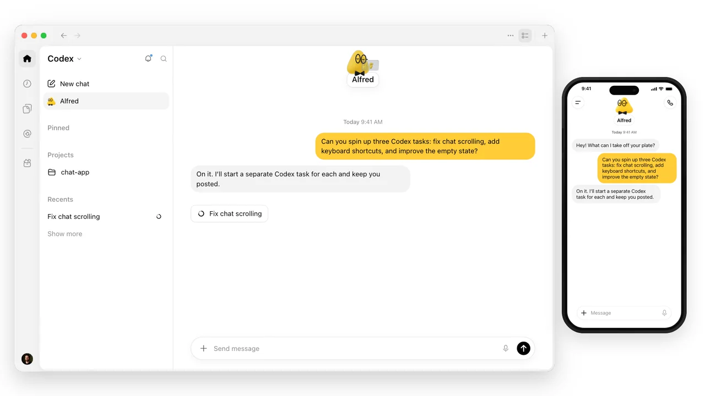



（收集说明：这是 ChatGPT Learn「What's new」栏目中的 dots 专稿。页首的「返回 What's new」链接和页尾的「开始与你的 dot 一起工作」推荐卡片未收入。原文两段演示视频以封面图加视频链接保留。）

2026 年 10 月 5 日至 9 日

现在你可以在 ChatGPT 移动应用中创建你的 dot。给它起名、定制它的外观、连接插件，都可以在手机上完成。你还可以选择让 ChatGPT 打开时直接进入你的 dot 的对话，这样当你想接着之前的进度继续时，它已经准备好了。

[视频：在移动应用中创建 dot 的演示](https://cdn.openai.com/devhub/docs/dots/demos/dots-demo-mobile-onboarding-1080p-v1.webm)

## 把你的 dot 带进你的 Codex 工作

你的 dot 可以在 Codex 中开始工作，并跟进已有的会话线程。它可以搜索你的 ChatGPT 对话，并利用你现有 Codex 会话线程和自动化中的上下文。它也更善于判断什么时候应继续一个已有的 Codex 会话线程、什么时候应新开一个，有助于把相关的工作放在一起。

你的 dot 也可以读取和编辑 ChatGPT Work 的自动化。让它查看已安排的内容，或在你的需求变化时更新某个定期任务。

[视频：dot 在 Codex 中开始和跟进任务的演示](https://cdn.openai.com/devhub/docs/dots/demos/dots-demo-codex-tasks-1080p-v1.webm)

## 其他改进

- **更快、更流畅的工作：** 云端浏览和侧边栏加载更快。我们减少了等待回复时的停顿，让对话记录的滚动和动画更流畅，并修复了一个可能导致网络用量过大的问题。
- **更少不必要的通知：** 修复了你正在使用 ChatGPT 时手机上仍收到多余通知的问题。
- **网页端的对话更清晰：** 改进了代码块和附件的显示，并修复了 Safari 和 Firefox 中的字符渲染问题。由你的 dot 管理的会话线程可以随着工作的变化自行重命名，多余的「已创建任务」消息也更少了。
- **设置更可靠：** 修复了 Outlook 设置卡住的问题，并增加了电子邮件验证码的自动填充。
- **审阅和恢复更容易：** 计划指引更清晰，加载失败的活动可以重试。网页端的安全横幅更稳定，批准按钮也不会再被过大的 Gmail 预览遮挡或隐藏。
- **Enterprise 访问更可靠：** 修复了网页端以及发起语音通话时的访问问题。
