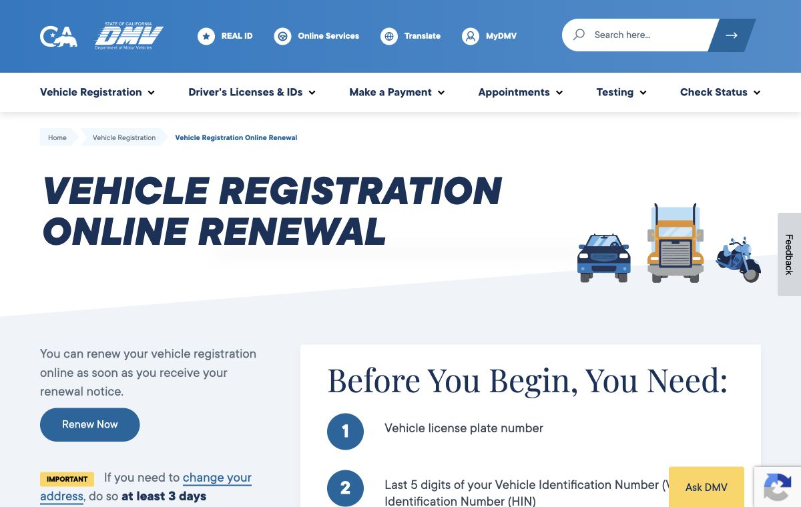



（收集说明：原页面中有若干界面示意组件（模拟的聊天窗口、浏览器窗口、登录表单），以下整理为「界面示意」段落；示例提示在原页面中以卡片和可复制文本各出现一次，这里只保留一次。）

你的 dot 是一个始终在线（always-on）的智能体，能让工作在你的各种工具和项目之间持续推进。在它工作时你可以继续和它交谈，它会主动来找你，带来结果或需要你做的决定。

第一次把工作委派给智能体？先从[与智能体协作](https://learn.chatgpt.com/codex/working-with-agents)开始。

我们正在扩大驱动 dots 的前沿模型家族，加入 GPT-6.1 Terra。你的 dot 可以在工作的不同部分调用不同的模型。GPT-6.1 Terra 建立在 GPT-6 系列在对齐方面的改进之上，并使用为 GPT-6 Astra 开发的安全防护措施。

你的 dot 住在云端，拥有自己的计算机和浏览器。即使你的电脑关着，你也能联系到它，它也能继续工作。它可以做研究、分析数据、准备文档和构建软件，并利用过去对话中的相关上下文和你的偏好。

**Dots 正在逐步向符合条件的账户推出。** 关于套餐、地区和工作区要求，请参阅[开放范围与访问](#开放范围与访问)。

## 让它成为你自己的

在 ChatGPT 移动应用、桌面应用或桌面浏览器中创建你的 dot。在手机上，你可以给它起名字、自定义外观并连接插件。在桌面应用中，你还可以连接你的计算机。设置步骤请参阅[入门](https://learn.chatgpt.com/codex/dots/getting-started#create-your-dot)。

你的 dot 会自我介绍，并利用它能获得的上下文，建议它可以帮忙的方式。在它熟悉你的工作期间，你就可以开始和它交谈了。

给你的 dot 起个名字，选择它的形状、颜色、眼睛、眼镜和配饰。你可以随时更改这些设置。

你的 dot 一开始的标识名（handle）类似 @yourname-dot。给它起名字会更新这个标识名，例如，一个名叫 Alfred 的 dot 会变成 @tibo-alfred。

## 给你的 dot 发消息或打电话

在 ChatGPT 移动应用、桌面应用或桌面浏览器中创建你的 dot 并与它交谈。你可以在其中任何一处开始，然后在另一台设备上继续与同一个 dot 交谈。不支持移动端网页。

（界面示意：桌面端。今天 9:41 AM。用户：「Compare three venues for our team offsite.」（比较三个适合我们团队外出活动的场地。）dot：「I’ll compare capacity, travel, and price.」（我会比较容量、交通和价格。）输入框：发送消息。）

（界面示意：移动应用。今天 9:41 AM。dot：「I’ll compare capacity, travel, and price.」用户：「Keep the total under $5,000.」（总价控制在 5,000 美元以内。）dot：「I’ll use that budget as I compare the options.」（我会按这个预算来比较各个选项。）输入框：给 Alfred 发消息。）

你可以给你的 dot 发消息或打电话，来讨论工作、调整优先级或做出决定。在 ChatGPT 中，选择你的 dot 对话中的电话按钮即可开始通话。通话时你也可以打字发消息。通话结束后，你分配的工作可以继续进行。

无论在 ChatGPT、Slack、Teams 还是通话中，你联系的都是同一个 dot。改变与它交谈的地方，不会开启一个新的 dot，也不会重置它的记忆。消息留在各自的渠道里，而你的 dot 可以跨渠道使用相关的上下文。在把私人对话中的信息分享给其他人之前，你的 dot 会确认你是否允许。

告诉你的 dot 把不同类型的更新发到哪里。例如，让它把例行进展留在 ChatGPT 里，把需要决定的事带到 Slack 找你。说明哪些变化需要你关注，比如某个截止日期面临风险。

打开你的 dot 的个人资料，选择**添加**（Add），连接一种可用的联系方式。短信功能正在以测试版的形式向美国的 ChatGPT Pro 用户推出。请参阅如何通过 iMessage 或 Android 上的 RCS [设置短信](https://learn.chatgpt.com/codex/dots/channels#texting)。其他联系它的方式请参阅[给你的 dot 发消息](https://learn.chatgpt.com/codex/dots/channels)。

在 Slack 中，你可以私信你的 dot，或者在你已经把它加入的频道中提及它。默认情况下，它只回应你；你可以指示它与其他人互动。现有的权限和安全防护仍然适用于它分享和做的事情。告诉它要关注哪些频道和事件。仅仅把它加入一个频道并不会开始监控。你也可以在 Microsoft Teams 中给你的 dot 发消息。请参阅 [Slack 与 Teams](https://learn.chatgpt.com/codex/dots/channels#slack-and-teams)。

## dots 如何工作

你的 dot 在对话之间工作。它跟踪进展，判断接下来需要做什么，并随着情况变化跟进到底。一旦你让它处理某件事，你可以带着新的信息或优先级回来，而不必重新开始这项工作。你的 dot 会带回结果，并在需要你判断的决定上转来找你。

（界面示意：Alfred，今天 9:41 AM。dot：「Hi, I’m your dot. I keep working between our conversations.」（嗨，我是你的 dot。在我们的对话之间我会一直工作。）用户：「What happens while I’m away?」（我不在的时候会发生什么？）dot：「I track progress and follow up as things change. I’ll bring you results and ask when I need your decision.」（我会跟踪进展，并随着情况变化跟进。我会把结果带给你，需要你决定时会来问你。）提示：「Tell me what to watch for and when to update you.」（告诉我要关注什么，以及什么时候向你汇报。））

你的 dot 可以自己决定何时暂停、何时醒来继续工作；你不需要为每一次跟进都设定固定的时间表。它可以使用后台智能体并行处理多件事情，同时你继续和它交谈。它还会研究已连接的信息，建议有用的下一步。

例如，如果你的 dot 在帮忙组织一次外出活动，它可以在大家确认参加时更新人数，并在发送修改报价的请求之前先征求你的意见。

### 记忆与上下文

你的 dot 会利用对话内容、相关的 ChatGPT 记忆，以及它自己保存的关于你的偏好、决定和进行中工作的笔记。这些笔记会跨对话和联系方式延续下去，所以它可以随着你的工作变化，在你们讨论过的内容基础上继续推进。

它还可以研究已连接的信息，并保留私人笔记，以找出有用的下一步。这种研究是只读的；后续的操作需要相应的权限。请参阅[任务与记忆](https://learn.chatgpt.com/codex/dots/tasks-and-memory)。

### 它的计算机与你的计算机

你的 dot 在云端有自己的计算机和浏览器，用于研究、处理文件和运行软件。在你的设备关闭时，云端工作可以继续。当你需要查看浏览器或亲自完成某个步骤时，打开它的计算机并选择**接管**（Take over）。准备好让你的 dot 继续时，选择**交还控制**（Return control）。连接方面的细节请参阅[计算机与应用](https://learn.chatgpt.com/codex/dots/computers-and-apps)。

（界面示意：Alfred 的计算机。浏览器标签页「Vehicle Registration Renewal」（车辆注册续期），地址 dmv.ca.gov/portal/vehicle-registration/vehicle-registration-renewal/；窗口底部有浏览器、终端和文件三个图标；状态：**Alfred** 正在控制。）

通过你的 dot 的个人资料连接一次你的计算机，就能让它的本地文件、代码和应用可供你的 dot 工作使用。你一次只能连接一台个人计算机。这个连接在各项任务之间保持不变。你的计算机必须在线并打开 ChatGPT 应用，你的 dot 才能使用它。这项权限独立于把你的计算机连接到 Codex 或启用 Work Sync。

你的 dot 可以使用为你的账户安装并启用的受支持[插件](https://learn.chatgpt.com/codex/plugins)，连同它们已连接的账户和现有权限。例如，用 Gmail 查找相关邮件，用 Google Drive 处理文档，用 GitHub 调查代码并准备修改。每个插件都必须已连接，并被允许执行你所请求的操作。本地技能需要一台已连接的计算机。连接一个消息渠道并不会自动授予对你的应用或计算机的访问权限。

每种连接的用途不同：

| 连接 | 它能实现什么 |
| --- | --- |
| 消息渠道 | 在那里与你的 dot 交谈并接收更新。 |
| 已连接的应用或插件 | 在其权限范围内使用该服务的信息和工具。 |
| 本地计算机 | 在这台计算机可用时，处理它的文件、应用和任务。 |

连接一个消息渠道，并不会同时连接你的收件箱、其他应用或本地计算机。你的 dot 的云端计算机独立于你的设备及其已登录的浏览器会话。

### 登录网站

你的 dot 使用与 ChatGPT Work 相同的私密浏览器登录流程。当某个网站需要登录时，它可以给你发送一个登录请求。打开这个请求，在一个私密表单中输入你的凭证和任何要求的验证信息。你的凭证会绕过对话，直接进入浏览器。你也可以选择**接管以登录**（Take over to sign in），在网站上亲自完成这些步骤，完成后选择**完成**（Done）。

1. 打开登录请求

   （界面示意：dot：「Sign in to your venue account so I can review the saved proposal.」（登录你的场地账户，这样我就能查看保存的方案。）按钮：登录 venues.example.com。）

2. 私密登录

   （界面示意：https://venues.example.com。登录 venues.example.com。输入你的登录信息以继续。了解更多。字段：电子邮件地址、密码。选项：保存到密码。按钮：接管以登录、以后再说、登录。）

云端浏览器有自己的会话，独立于你计算机上的浏览器。一旦你登录，你的 dot 就可以在之后的工作中使用这个会话，直到你退出登录，或者网站要求再次登录。在可用时，**保存到密码**（Save to Passwords）让你可以选择保存这次登录。使用已保存的登录信息进行新的登录，需要你的确认。请参阅[网站登录](https://learn.chatgpt.com/codex/dots/computers-and-apps#sign-in-to-a-website)。

有些网站会屏蔽云端浏览器，或要求额外的验证。你可以让你的 dot 改为尝试一台已连接的计算机。这可能会在那台计算机上创建一个单独的任务；它不会转移云端浏览器的会话。

### 任务与对话

你的 dot 可以使用后台智能体、开启新的云端会话线程，并在已连接的计算机上创建 Work 或 Codex 任务。它还可以继续现有的本地 Codex 任务。对于需要你的代码仓库和配置的云端编程工作，它可以使用你创建的 Codex 云端环境。

云端会话线程会以单独对话的形式出现在桌面、网页和移动应用中，你可以在那里查看结果并给出进一步的指示。本地 Codex 任务出现在已连接的计算机上。在这些任务运行时，你可以继续和你的 dot 交谈。

在桌面应用中，打开你的 dot 的个人资料并选择**活动**（Activity），然后打开某个任务，查看它的进展、结果或需要输入的请求。你的 dot 可以检查它所创建任务的结果，并向这些任务发送后续指示。关于任务在哪里运行以及如何继续它们，请参阅[任务与记忆](https://learn.chatgpt.com/codex/dots/tasks-and-memory#assigned-work)。

连接你的计算机，可以让你的 dot 处理它上面的任务和文件。这并不会让你的 dot 访问每个应用中的每一段对话。

### 权限与批准

内置的安全防护、你现有的 ChatGPT 应用权限，以及自动批准检查，从一开始就适用。在一个操作影响你的账户或分享信息之前，审查会决定你的 dot 是可以继续、需要你的批准，还是必须把某个步骤交给你。

你可以添加关于希望你的 dot 如何工作的说明，比如要求它在发送之前先给你看草稿。自定义规则是可选的控制，用于设定更具体的长期边界。无论是说明还是自定义规则，都不能凌驾于内置的安全要求之上。请参阅[控制你的 dot](https://learn.chatgpt.com/codex/dots/controls)。

## dots 与 ChatGPT Work 和 Codex 的比较

以下是 dots 与 ChatGPT Work 和 Codex 的比较，以及它们如何协同工作。

| 体验 | 何时使用 |
| --- | --- |
| 聊天 | 当你想在对话中得到一个答案、一个解释、一些想法，或者起草某样东西时。 |
| ChatGPT Work | 当你有一项任务要委派时，比如研究、分析或创建一个文件，无论是现在还是按计划进行。 |
| Codex | 当你想构建、调试、测试或审查软件，并直接使用代码和开发者工具时。 |
| 你的 dot | 当你想让一个智能体持续跟踪一项长期职责、在情况变化时想出下一步，并在对话之间跟进时。它可以在 ChatGPT、Slack 或 Teams 中向你汇报，并把任务委派给 ChatGPT Work 或 Codex。 |

## 与你的 dot 协作

从你经常需要检查或更新的工作开始。描述这项职责并分享它所需的原始材料，然后检查它的工作，说明需要修改什么。

### 交给它一项职责

对于一次外出活动，分享计划和场地方的邮件，然后让你的 dot 找出即将到来的决定和截止日期。

示例：要组织的一次外出活动

> Help me keep our offsite on track. Read the plan and venue emails I shared, and make a list of decisions, deadlines, and things we're waiting on. Focus on anything that affects the budget or needs an answer this week. Draft suggested replies for my review, but don't send them.

（译注：意为「帮我让我们的外出活动按计划推进。阅读我分享的计划和场地方邮件，列出需要做的决定、截止日期和我们正在等待的事情。重点关注任何影响预算或本周需要答复的事项。起草建议的回复供我审阅，但不要发送。」）

在扩大这项职责之前，先检查第一次的结果，并纠正任何遗漏的细节。

### 选择何时、在哪里听到它的消息

告诉你的 dot 要保持哪些内容最新，以及哪些变化值得你关注。它可以自己决定何时跟进。如果你想在特定时间得到更新，请包含时区以及持续时长或结束日期，并让它确认这个时间安排。

示例：定时检查

> Check the connected planning channel each weekday at 9 AM Central for the next four weeks. Update our offsite list when something changes. Message me in ChatGPT if a deadline is at risk or you need a decision from me. Keep routine updates in the checklist. Confirm the schedule.

（译注：意为「在接下来的四周里，每个工作日美国中部时间上午 9 点检查已连接的规划频道。有变化时更新我们的外出活动清单。如果某个截止日期面临风险，或者你需要我做决定，就在 ChatGPT 里给我发消息。例行更新留在检查清单里。确认这个时间安排。」）

### 检查与调整方向

当优先级发生变化时，告诉你的 dot 在已经进行中的工作里要改变什么。

问问你的 dot 它在做什么、哪些事情需要你的意见。在桌面应用中，打开它的个人资料，用**活动**查看委派出去的任务。让它列出周期性的工作，并确认安排了哪些事情。

使用**暂停**（Pause）来停止你的 dot 当前的主要任务。在**活动**中单独停止委派出去的任务，在**已安排**（Scheduled）中单独取消周期性任务。结束语音通话并不一定会停止已分配的工作。请参阅[停止工作](https://learn.chatgpt.com/codex/dots/controls#stop-work)。

检查重要的结果及其来源。你的 dot 可能会犯错，而停止一项任务并不会撤销它已经完成的操作。

### 与你的 dot 协作的方式

让你的 dot 能够访问相关来源，并告诉它要跟踪什么。例如：

- **让一份销售方案保持最新。** 分享方案和客户需求。当所需的席位数或条款发生变化时，让你的 dot 更新数字，跟踪未完成的安全和技术审查，并把接下来的决定带给你。
- **根据每次访谈准备内容。** 分享访谈素材和照片。让你的 dot 起草一段配文、节目说明和剪辑创意供审阅。在发布之前，你可以在手机上调整标题或语气。
- **让发布材料与产品保持一致。** 连接发布频道，分享简报、演示文稿和已批准的视觉素材。让你的 dot 标出影响宣传活动的产品变化，并准备修改后的文案、幻灯片和演讲者备注供你审阅。
- **在结果出来时更新一项研究。** 分享研究和新的测量数据。让你的 dot 更新比较图表，解释重复实验的结果与第一批结果哪里不同，并起草一份发现摘要和建议的下一步测试供审阅。
- **跟进软件反馈。** 连接反馈来源和代码项目。让你的 dot 调查报告的问题，比如侧边栏中缺少一个条目，并在合并之前准备一个修复供代码审查。

## 开放范围与访问

**面向工作区管理员：** 关于工作区设置、权限以及安全与治理指引，请参阅[为工作设置 dots](https://learn.chatgpt.com/codex/enterprise/dots-admin-guide)。

Dots 正在逐步推出。即使你的套餐符合条件，你也可能不会立即看到 dots。

- **Pro 100、Pro 200 和 Pro 500：** 面向欧洲经济区、英国和瑞士以外的 18 岁以上用户。
- **Business Premium：** 正在全球推出。
- **Enterprise：** 正在全球推出。Dots 默认关闭，必须由工作区管理员启用。

与你的 dot 的对话不计入你的 ChatGPT 使用限额。你的 dot 在 Work 或 Codex 中启动或管理的任务，照常计入这些产品的使用限额。你的套餐包含一份用于更深入工作的额度，在发布后的第一个月有延长的限额。

你可以在 ChatGPT 移动应用、桌面应用或桌面浏览器中创建你的 dot。在移动端设置时，请使用最新版本的移动应用。不支持移动端网页。

## 参考

| 指南 | 涵盖内容 |
| --- | --- |
| [入门](https://learn.chatgpt.com/codex/dots/getting-started) | 设置、你的第一次对话，以及分配工作。 |
| [消息](https://learn.chatgpt.com/codex/dots/channels) | ChatGPT、通话、短信、Slack 和 Teams。 |
| [任务与记忆](https://learn.chatgpt.com/codex/dots/tasks-and-memory) | 分配的工作、周期性任务、上下文和主动研究。 |
| [计算机与应用](https://learn.chatgpt.com/codex/dots/computers-and-apps) | 云端工作、本地访问、插件和网站登录。 |
| [控制](https://learn.chatgpt.com/codex/dots/controls) | 查看活动、管理权限和停止工作。 |
