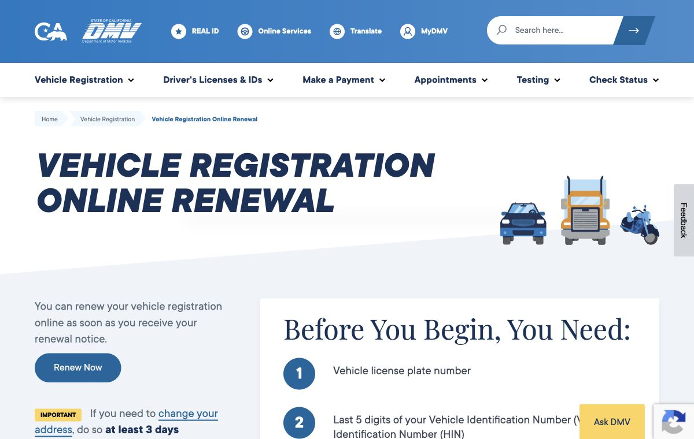



**收录说明**：OpenAI 在 ChatGPT Learn 上发布的 dots 文档，文档不标日期，页面日期取第一轮收集日期 2026-11-05。第一轮收集时直接翻译，原文未单独存档；2026-11-28 按新流程重新抓取（直接下载），原文存于本目录的 original.md（网站上不显示）：删去占位图、界面图标和按钮文字残留；5 处界面示意组件（模拟的聊天窗口、浏览器窗口、登录表单）整理为「（界面示意：……）」段落，示例提示只保留一次；浏览器窗口示意里的 chromium、terminal、files 三张小图按界面元素删去；页内相对链接改为绝对地址。新版有新增和改写，旧译文已删去（由 git 保留），已翻译。

**内容摘要**：dot 是始终在线的智能体，在对话之间继续推进工作，可以把工作分给并行的后台智能体；驱动 dots 的前沿模型家族加入了 GPT-6.1 Terra，dot 会在不同工作部分调用不同模型。它在云端有自己的计算机和浏览器，还可以连接多台个人电脑、插件和 Slack，在 ChatGPT、Slack 或通话中联系到的是同一个 dot。页面给出 dots 与聊天、Work、Codex 的分工对照表。开放范围：Pro 100、Pro 200、Pro 500 面向欧洲经济区、英国、瑞士以外的 18 岁以上用户，Plus 向部分用户逐步推出，Business Premium 视工作区资格开放，Business Standard 每位成员可建一个个人 dot，Enterprise、Edu、Healthcare 在符合条件的工作区已正式可用、2026-11-18 起默认开启。Pro 与 Business Premium 用户与 dot 的对话不计入 ChatGPT 用量限额，dot 在 Work 或 Codex 中启动的任务照常计入。

**保留理由**：这是 dots 整体定位的官方主文档，含与聊天、Work、Codex 的分工表、开放范围和用量口径；新版记录了套餐扩大、Teams 渠道撤下和企业版默认开启。

---

你的 dot 是一个始终在线的智能体，让工作在你的各种工具和项目之间持续推进。它工作时你可以继续和它交谈，它也会带着结果或需要你做的决定来找你。

刚接触把工作委派给智能体？请先阅读[与智能体一起工作](https://learn.chatgpt.com/codex/working-with-agents)。

我们正在扩大为 dots 提供支持的前沿模型家族，加入 GPT-6.1 Terra。你的 dot 可以在工作的不同部分调用不同模型。GPT-6.1 Terra 基于 GPT-6 系列的对齐改进，并使用为 GPT-6 Astra 开发的防护措施。

你的 dot 住在云端，有自己的计算机和浏览器。即使你的电脑关机，你也可以联系它，它也能继续工作。它可以做研究、分析数据、准备文档和构建软件，并利用过去对话中的相关上下文和你的偏好。

套餐、地区和工作区要求见[开放范围与访问](#access)。

## 让它成为你自己的

你可以在 ChatGPT 移动应用、桌面应用或桌面浏览器中创建你的 dot。在手机上，你可以给它起名字、自定义外观并连接插件。在桌面应用中，你还可以连接你的计算机。设置步骤见[入门](https://learn.chatgpt.com/codex/dots/getting-started#create-your-dot)。

你的 dot 会自我介绍，并利用它能获得的上下文，建议它可以在哪些方面帮忙。在它逐渐了解你的工作的同时，你就可以开始和它交谈。

给你的 dot 起个名字，并选择它的形状、颜色、眼睛、眼镜和配饰。这些你随时可以更改。

你的 dot 一开始会有一个类似 @yourname-dot 的句柄。给它命名会更新句柄，例如名为 Alfred 的 dot 句柄是 @tibo-alfred。

## 给 dot 发消息或通话

在 ChatGPT 移动应用、桌面应用或桌面浏览器中创建你的 dot 并与它交谈。你可以从其中任一设备开始，然后在另一台设备上继续使用同一个 dot。不支持移动端网页。

（界面示意：桌面端；今天 9:41；为我们团队的异地会议比较三个场地。；我会比较容量、交通和价格。）

（界面示意：移动应用；今天 9:41；我会比较容量、交通和价格。；总价控制在 5,000 美元以内。；我在比较各个选项时会按这个预算来。）

你可以给 dot 发消息，或与它通话，讨论工作、更改优先级或做出决定。在 ChatGPT 中，选择 dot 对话里的电话按钮即可开始通话。通话时你也可以输入消息。通话结束后，你已分配的工作可以继续。

在 ChatGPT、Slack 或通话中，你联系到的是同一个 dot。改变交谈的地方不会新建一个 dot，也不会重置它的记忆。消息留在各自的渠道中，而你的 dot 可以使用跨渠道的相关上下文。在把私人对话中的信息分享给其他人之前，你的 dot 会确认你已经允许这样做。

告诉你的 dot 把不同种类的更新发到哪里。例如，让它把日常进展留在 ChatGPT，把需要决定的事带到 Slack 找你。说明哪些变化需要你关注，比如某个截止日期面临风险。

打开你的 dot 的个人资料，选择**添加**（Add），连接一种可用的联系方式。短信正在以测试版向美国、加拿大和墨西哥的 ChatGPT Pro 用户推出。了解如何在 Android 上通过 iMessage 或 RCS [设置短信](https://learn.chatgpt.com/codex/dots/channels#texting)。联系它的其他方式见[给 dot 发消息](https://learn.chatgpt.com/codex/dots/channels)。

在 Slack 中，你可以私信你的 dot，或在已把它加入的频道中 @ 它。默认情况下，它只回应你；你可以指示它与其他人员互动。它分享和做的事仍受现有权限和防护措施的约束。告诉它要关注哪些频道和事件。仅把它加入频道并不会开始监控。设置说明见[在 Slack 中给 dot 发消息](https://learn.chatgpt.com/codex/dots/channels#slack)。

## dots 如何工作

你的 dot 在对话之间工作。它跟踪进度、判断下一步需要做什么，并在情况变化时跟进落实。一旦你让它处理某件事，你可以在带来新信息或调整优先级后回来，而不必重新开始这项工作。你的 dot 会把结果带回来，并在需要你判断的决定上征求你的意见。

（界面示意：Alfred；今天 9:41；你好，我是你的 dot。我会在我们的对话之间继续工作。；我不在的时候会发生什么？；我跟踪进度，并在情况变化时跟进。我会把结果带给你，需要你做决定时会问你。；告诉我该关注什么，以及什么时候通知你。）

你的 dot 可以自己决定何时暂停、何时醒来继续工作；你不需要为每次跟进设定固定时间表。它可以使用后台智能体同时处理多件事情，而你可以继续和它交谈。它还会研究已连接的信息，提出有用的下一步建议。

例如，如果你的 dot 在帮忙组织一次外出活动，它可以在有人确认后更新人数，并在发送修改报价的请求前先问你。

### 记忆与上下文

你的 dot 会利用当前对话、相关的 ChatGPT 记忆，以及它自己保存的关于你的偏好、决定和正在进行的工作的笔记。这些笔记会跨对话和联系方式延续，因此随着工作变化，它可以在此前讨论的基础上继续。

它也可以研究已连接的信息，并保存私人笔记，以找出有用的下一步。这种研究是只读的；后续操作需要相应权限。参见[任务与记忆](https://learn.chatgpt.com/codex/dots/tasks-and-memory)。

### 它的计算机与你的计算机

你的 dot 在云端有自己的计算机和浏览器，用于研究、处理文件和运行软件。即使你的设备关机，云端工作也可以继续。当你需要查看浏览器或亲自完成某一步时，打开它的计算机并选择**接管**（Take over）。准备好让 dot 继续时，选择**交还控制权**（Return control）。连接细节见[计算机与应用](https://learn.chatgpt.com/codex/dots/computers-and-apps)。

（界面示意：Alfred 的计算机；车辆注册续期；dmv.ca.gov/portal/vehicle-registration/vehicle-registration-renewal/；**Alfred** 正在控制）

通过 dot 的个人资料连接一次你的计算机，就能让它的本地文件、代码和应用可供 dot 的工作使用。你可以[连接多台计算机](https://learn.chatgpt.com/codex/dots/computers-and-apps#connect-your-computer)，并告诉 dot 某个任务使用哪一台。连接在任务之间保持有效。你的计算机必须在线并打开 ChatGPT 应用，dot 才能使用它。这项许可与把计算机连接到 Codex 或启用 Work Sync 是分开的。

你的 dot 可以使用你的账号已安装并启用的受支持[插件](https://learn.chatgpt.com/codex/plugins)，连同其已连接的账号和现有权限。例如，用 Gmail 查找相关邮件，用 Google Drive 处理文档，用 GitHub 调查代码并准备改动。每个插件都必须连接并获得许可，才能执行你请求的操作。本地技能需要已连接的计算机。连接一个消息渠道并不会自动授予对你的应用或计算机的访问权限。

每种连接各有用途：

| 连接 | 它能实现什么 |
| --- | --- |
| 消息渠道 | 在那里和你的 dot 交谈并接收更新。 |
| 已连接应用或插件 | 在其权限范围内使用该服务的信息和工具。 |
| 本地计算机 | 在可用期间使用该计算机的文件、应用和任务。 |

连接消息渠道并不会同时连接你的收件箱、其他应用或本地计算机。你 dot 的云端计算机与你的设备及其已登录的浏览器会话是分开的。

### 登录网站

你的 dot 使用与 ChatGPT Work 相同的私密浏览器登录流程。当网站需要登录时，它可以向你发送登录请求。打开请求，在私人表单中输入你的凭据和所需的任何验证。你的凭据会送到浏览器，而不经过对话。你也可以选择**接管并登录**（Take over to sign in），亲自在该网站上完成步骤，完成后选择**完成**（Done）。

1. 打开登录请求

（界面示意：登录你的场地账号，这样我就能查看已保存的方案。；登录 venues.example.com）

2. 私密登录

（界面示意：https://venues.example.com；登录 venues.example.com；输入你的登录信息以继续。了解更多；电子邮箱地址；密码；保存到密码）

云端浏览器有自己的会话，与你计算机上的浏览器分开。一旦你登录，你的 dot 就可以在后续工作中使用该会话，直到你退出登录或网站要求重新登录。在可用时，**保存到密码**（Save to Passwords）让你可以选择保存这次登录。使用已保存的登录信息进行新的登录需要你确认。参见[网站登录](https://learn.chatgpt.com/codex/dots/computers-and-apps#sign-in-to-a-website)。

有些网站会阻止云端浏览器，或要求额外验证。你可以让 dot 改用已连接的计算机。这可能会在那台计算机上创建一个单独的任务；它不会转移云端浏览器的会话。

### 任务与对话

你的 dot 可以使用后台智能体、启动新的云端线程，并在已连接的计算机上创建 Work 或 Codex 任务。它也可以继续已有的本地 Codex 任务。对于需要你的仓库和环境的云端编程工作，它可以使用你已创建的 Codex 云端环境。

云端线程会在桌面、网页和移动应用中显示为单独的对话，你可以在那里查看结果并给出进一步指令。本地 Codex 任务显示在已连接的计算机上。这些任务运行时，你可以继续和你的 dot 交谈。

在桌面应用中，打开你的 dot 的个人资料并选择**活动**（Activity），然后打开一个任务查看其进度、结果或输入请求。你的 dot 可以查看结果，并向它创建的任务发送后续指令。任务在哪里运行、如何继续，见[任务与记忆](https://learn.chatgpt.com/codex/dots/tasks-and-memory#assigned-work)。

连接你的计算机可以让 dot 使用该计算机上的任务和文件。它不会让 dot 访问每个应用中的每一段对话。

### 权限与批准

内置防护措施、你现有的 ChatGPT 应用权限以及自动批准检查从一开始就会生效。在一项操作影响你的账号或分享信息之前，审查会判定你的 dot 能否继续、是否需要你的批准，还是必须把某一步交给你。

你可以添加关于希望 dot 如何工作的指令，例如要求它在发送前先把草稿给你看。自定义规则是可选的控件，用于更具体的长期边界。指令和自定义规则都不能覆盖内置的安全要求。参见[控制你的 dot](https://learn.chatgpt.com/codex/dots/controls)。

## dots 与 ChatGPT Work、Codex 的比较

以下是 dots 与 ChatGPT Work、Codex 的比较，以及它们如何协同工作。

| 体验 | 什么时候用 |
| --- | --- |
| Chat（对话） | 当你想在对话中得到答案、解释、想法，或帮助起草某些内容时。 |
| ChatGPT Work | 当你有任务要委派，例如研究、分析或创建文件，可以现在做，也可以按时间表做时。 |
| Codex | 当你想构建、调试、测试或审查软件，直接与代码和开发者工具打交道时。 |
| 你的 dot | 当你希望有个智能体持续跟踪一项长期职责、在情况变化时判断下一步，并在对话之间跟进时。它可以在 ChatGPT 或 Slack 中向你通报进展，并把任务委派给 ChatGPT Work 或 Codex。 |

## 与你的 dot 一起工作

从你经常需要查看或更新的工作开始。描述这项职责，分享它需要的来源材料，然后检查它的工作，说明哪里需要改。

### 交给它一项职责

以一次外出活动为例，分享计划和场地方的邮件，然后让 dot 找出即将到来的决定和截止日期。

要组织的一次外出活动

> Help me keep our offsite on track. Read the plan and venue emails I shared, and make a list of decisions, deadlines, and things we're waiting on. Focus on anything that affects the budget or needs an answer this week. Draft suggested replies for my review, but don't send them.

（译注：意为「帮我让我们的外出活动按计划推进。读我分享的计划和场地方邮件，列出需要做的决定、截止日期和我们在等回复的事。重点关注任何影响预算或本周需要答复的事。起草建议的回复供我审阅，但不要发出去。」）

检查第一次结果，纠正遗漏的细节，然后再扩大这项职责。

### 选择何时、在哪里收到它的消息

告诉你的 dot 要保持哪些信息最新，以及哪些变化值得你关注。它可以自己决定何时跟进。如果你希望在特定时间收到更新，请写明时区和持续时长或结束日期，并让它确认这个时间安排。

定时的检查

> Check the connected planning channel each weekday at 9 AM Central for the next four weeks. Update our offsite list when something changes. Message me in ChatGPT if a deadline is at risk or you need a decision from me. Keep routine updates in the checklist. Confirm the schedule.

（译注：意为「在接下来的四周里，每个工作日美国中部时间上午 9 点检查已连接的规划频道。有变化时更新我们的外出活动清单。如果某个截止日期面临风险，或者你需要我做决定，就在 ChatGPT 里给我发消息。日常更新留在检查清单里。确认这个时间安排。」）

### 检查并调整方向

当优先级变化时，告诉你的 dot 在已在进行的工作中要改什么。

询问你的 dot 正在做什么、哪些需要你输入。在桌面应用中，打开它的个人资料，用**活动**（Activity）查看委派出去的任务。让它列出周期性工作，并确认已安排了什么。

用**暂停**（Pause）停止 dot 当前的主要任务。在**活动**中停止委派的任务，在**已安排**（Scheduled）中单独取消周期性任务。结束语音通话不一定停止已分配的工作。参见[停止工作](https://learn.chatgpt.com/codex/dots/controls#stop-work)。

检查重要结果及其来源。你的 dot 可能出错，而停止任务并不会撤销它已经完成的动作。

### 与 dot 一起工作的方式

让你的 dot 访问相关来源，并告诉它要跟踪什么。例如：

- **保持销售方案最新。** 分享方案和客户要求。当所需的席位数或条款变化时，让 dot 更新数字、跟踪未完成的安全和技术审查，并把接下来的决定交给你。
- **根据每次访谈准备内容。** 分享访谈材料和照片。让 dot 起草配文、节目说明和片段创意供你审阅。你可以在发布前用手机调整标题或语气。
- **让发布材料与产品保持一致。** 连接发布频道，分享简报、演示文稿和已批准的视觉素材。让 dot 标出影响该活动的产品变化，并准备修订后的文案、幻灯片和演讲者备注供你审阅。
- **结果出来时更新研究。** 分享研究和新的测量数据。让 dot 更新对比图表，说明重复结果与第一批的差异，并起草结论摘要和拟议的后续测试供你审阅。
- **跟进软件反馈。** 连接反馈来源和代码项目。让 dot 调查所报告的问题（例如侧边栏中缺少某个条目），并在合并前准备修复供代码审查。

## 开放范围

**致工作区管理员：** 工作区设置、权限以及安全与治理指引见[为工作设置 dots](https://learn.chatgpt.com/codex/enterprise/dots-admin-guide)。

访问权限取决于你的套餐、地区和工作区设置。dots 正在逐步向部分 Plus 用户和 Business Premium 账号推出。

- **Pro 100、Pro 200 和 Pro 500：** 面向欧洲经济区、英国和瑞士以外年满 18 岁的用户提供。
- **Plus：** 正在逐步向欧洲经济区、英国和瑞士以外年满 18 岁的部分用户推出。
- **Business Premium：** 在受支持的 ChatGPT 地区提供，视工作区资格而定。
- **Business Standard：** 在受支持地区，符合条件的 ChatGPT Business Standard 成员可以使用 dots。每位成员可以在其 Business 工作区中创建一个个人 dot。用量限制适用。
- **Enterprise、Edu 和 Healthcare：** 在符合条件的工作区已正式可用。当前的工作区资格和地区可用性见[开始使用你的 dot](https://help.openai.com/en/articles/20001530-getting-started-with-your-dot)和 [ChatGPT 的数据驻留与推理驻留](https://help.openai.com/en/articles/9903489-data-residency-and-inference-residency-for-chatgpt)。在管理员预览期间，你的管理员可以为你的角色启用访问权限。从 2026 年 11 月 18 日起，除非你的工作区选择退出，访问默认开启。

对于 Pro 和 Business Premium，与 dot 的对话不计入你的 ChatGPT 用量限额。你的 dot 在 Work 或 Codex 中启动或管理的任务，照常计入这些产品的用量限额。你的套餐包含一定额度的深入工作用量。Enterprise 的定价和委派任务收费见 [Enterprise 预览与计费](https://learn.chatgpt.com/codex/enterprise/dots-admin-guide#enterprise-preview-and-billing)。

你可以在 ChatGPT 移动应用、桌面应用或桌面浏览器中创建你的 dot。在移动端设置时请使用最新版本的移动应用。不支持移动端网页。

## 参考

| 指南 | 内容 |
| --- | --- |
| [入门](https://learn.chatgpt.com/codex/dots/getting-started) | 设置、第一次对话和分配工作。 |
| [消息](https://learn.chatgpt.com/codex/dots/channels) | ChatGPT、通话、短信和 Slack。 |
| [任务与记忆](https://learn.chatgpt.com/codex/dots/tasks-and-memory) | 已分配的工作、周期性任务、上下文和主动研究。 |
| [计算机与应用](https://learn.chatgpt.com/codex/dots/computers-and-apps) | 云端工作、本地访问、插件和网站登录。 |
| [控制](https://learn.chatgpt.com/codex/dots/controls) | 查看活动、管理权限和停止工作。 |
