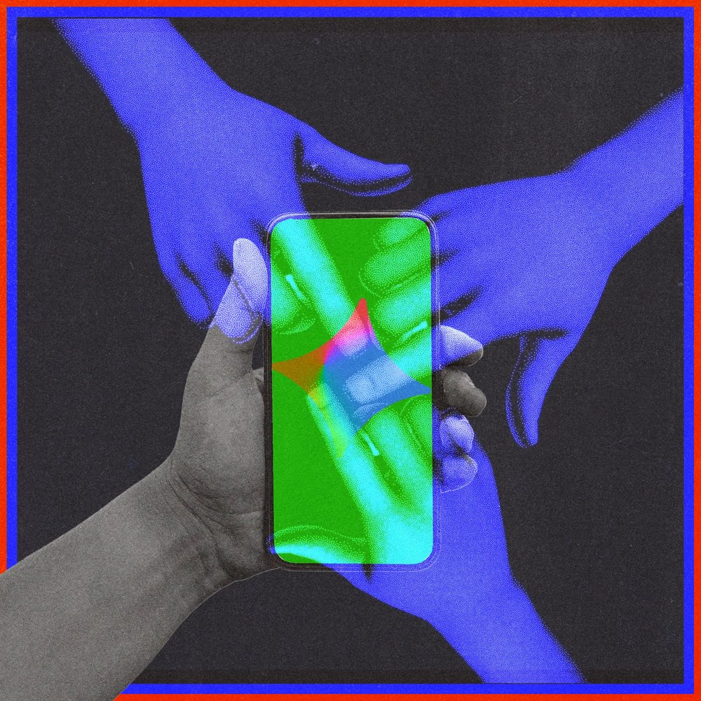
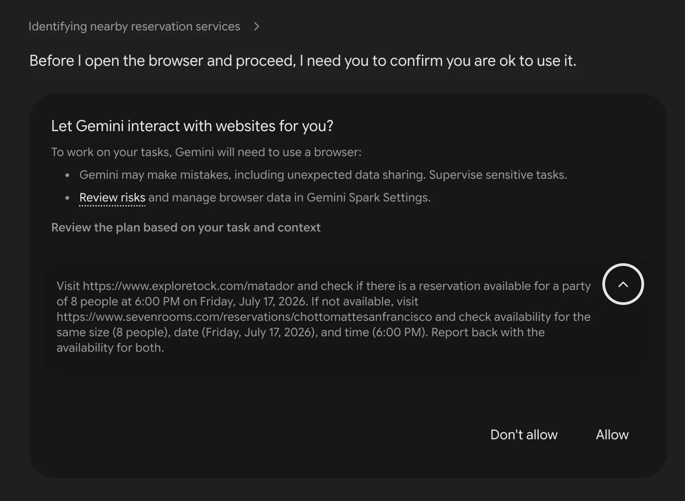
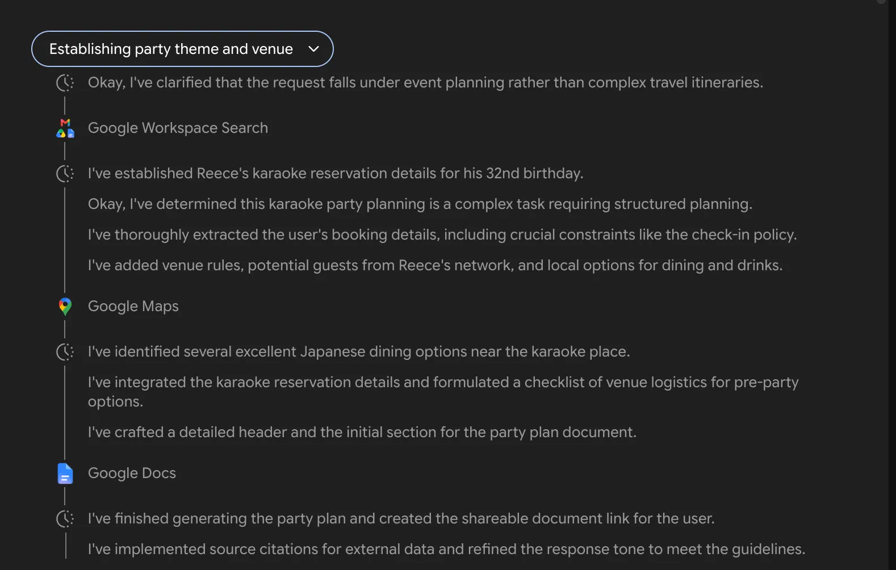
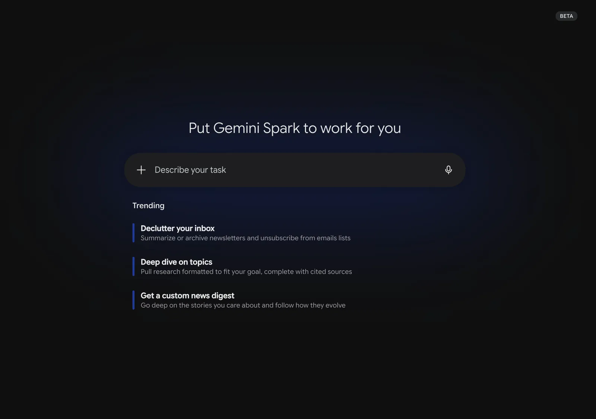



**收录说明**：依据 WIRED 原站存档，只收正文与图注。原文存于本目录的 original.md，网站上不显示，已翻译。

**内容摘要**：作者在 Beta 首周把 Gmail、文档和日历都交给 Spark，让它策划自己的生日派对。Spark 从邮件里找到了已经在筹备的真实派对，生成的计划包含准确的日期、地址和预订信息、附近餐厅和电话，以及宾客名单——却把同住的男友列为「close friend」。让它订晚餐时，Spark 操作远程浏览器、触发了发到作者手机的六位验证码，最终仍没订成；派对后的安排只列了同志酒吧，追问时 Spark 回答系统不推断个人身份，只按文件和邮件中的关键词、行程和交易作推荐。文章提到 Spark 位于 Gemini 应用中，当时只对起价每月 100 美元的 AI Ultra 订阅用户开放，发邮件、建日程需先经用户批准，并引用帮助页对提示注入的警告。作者的结论是：给的个人数据越多，输出越具体，但智能体依然缺乏常识。

**保留理由**：发布初期的一手实测，具体记录了个人上下文用得很准、关系判断却出错，以及远程浏览器预订失败的过程。

---

Google 的新 AI 智能体翻遍了我的邮件、文档和日历，为我策划了一场生日派对，却仍然没搞清对我最重要的人是谁。

图片插图：Jobanny Cabrera；Getty Images

在最近的 I/O 开发者大会上，Google 推出了 Gemini Spark，将其定位为[全天候在线的智能体](https://www.wired.com/story/googles-response-to-openclaws-24-7-ai-agent/)，它可以连接你的个人数据、完成在线任务，并自动化你日常互动中的各个方面。这是 Google 对爆红的 [OpenClaw](https://www.wired.com/story/malevolent-ai-agent-openclaw-clawdbot/) 智能体的回应——后者在 2026 年初撼动了硅谷。OpenClaw 的早期用户把自己的整个生活都交给 AI 智能体，用于消息和日程安排自动化——有时还会因[机器人引发的事故](https://techcrunch.com/2026/02/23/a-meta-ai-security-researcher-said-an-openclaw-agent-ran-amok-on-her-inbox/)造成令人尴尬的结果。

我第一次使用 [Gemini Spark](https://gemini.google/overview/agent/spark/) 时笑得直喘气。我让 Google 的这个新 AI 智能体访问了我个人的 [Gmail](https://www.wired.com/story/gmail-manage-subscriptions-cut-down-on-inbox-clutter/)、Docs 和 Calendar 应用中的一切。（隐私，再见。）然后，我发了一句无伤大雅的提示，请这个机器人帮我为即将到来的生日策划一场派对。Gemini Spark 不仅翻遍了我的收件箱和日历，找到了我在卡拉 OK 酒吧的真实预订，还生成了一份五页的行程，包含宾客名单、场地规则、附近餐厅、派对后去的酒吧、邀请邮件和主题创意。结果确实令人印象深刻，而且只花了几分钟，我既不用盯着智能体，也不用让[笔记本电脑一直开着](https://www.businessinsider.com/coders-keep-laptops-open-in-public-ai-agent-2026-5)。

真正让我紧张地笑出声——出于多种原因——的是 Gemini Spark 的 [AI 生成](https://www.wired.com/tag/artificial-intelligence/)的宾客名单。这个智能体扫描了我的邮件和文档，列出了一份潜在朋友名单，这出乎我的意料，并推荐邀请 15 人，正好是这个卡拉 OK 包间能容纳的上限。「你的旅行记录和邮件表明 [我伴侣的名字] 是你的密友和经常同行的伙伴，因此他很自然地成为第一个被加入的人选，」Gemini Spark 在解释为什么把他排在名单首位时写道。

在让 Google 的智能体访问了如此多关于我生活的不受限制的背景信息之后——基本上就是在 Gemini Spark 面前数字裸奔，把自己暴露给实验性软件的任性摆布——我无法释怀其中的讽刺：它把我长期同居的男友降格成了「密友和经常同行的伙伴」。这算什么，80 年代吗？我还很快意识到，我，这个过生日的人，竟然不在自己派对的宾客名单上。

[Google](https://www.wired.com/tag/google/) 本周开始以 Beta 形式向该公司 AI Ultra 计划的订阅用户推出 Gemini Spark，该计划起价每月 100 美元。这个 AI 智能体位于 Gemini 聊天机器人内部，是一个新标签页，用户可以通过移动设备和桌面设备控制它。你不需要 Android 手机；它在 iPhone 上也能用。

发给 Spark 的命令不叫更常见的「提示词」，而被称为「任务」。Spark 可以创建日历事件和发送邮件——但需先经你批准——还可以操作远程浏览器在互联网上漫游。

截图：Reece Rogers；由 Google 提供

截图：Reece Rogers；由 Google 提供

让我们拆解它生成的规划文档，以更好地理解 Gemini Spark 的工作方式。第一部分是活动概览，列出了它从我的邮件中提取的确切日期、地址和预订详情。甚至包括我支付 50 美元定金所用信用卡的后四位。

我给机器人的提示并不很详细，所以一开始期望不高。我以为它会根据我模糊的请求随手编一个生日计划，而不是发现藏在我邮件里的真实派对。

AI 生成的生日行程还包括附近餐厅，并附有可致电预订的电话号码。当我让 Gemini Spark 试着替我预订晚餐时，它尝试完成请求，但出了故障。

它在执行过程中操作了远程浏览器，甚至触发了一个发送到我手机的六位验证码，但即使我用不同方式反复要求，它仍无法完成任务。最后我只好直接打电话给那家寿司店，留了几个位置。

截图：Reece Rogers；由 Google 提供

截图：Reece Rogers；由 Google 提供

接下来是派对后的安排，Gemini Spark 专门列出了之后要去的同志酒吧。那些廉价的同志小酒吧是我可能真会去的地方——不用 AI 建议——所以我很好奇 Gemini Spark 是怎么挑出这些的。我感觉自己像被画像分析了，想要一些答案：为什么这个计划如此，嗯，gay。

「系统不会对你的个人身份作出推断。相反，它会扫描你的文件与邮件，寻找确切的关键词、过往行程和交易记录，」Gemini Spark 回应道。「那些具体场所（如 Toad Hall 和 OASIS）和宾客名单（来自 Stonewall Sports 和 Sons of Pitches 的名单）之所以被选中，只是因为那些确切的名称、活动和地点直接记录在你的 Google Workspace 历史中。」Spark 列出了具体的邮件和旅行文档作为这些选择的依据，其中有些我甚至不记得存在过。真够滑稽的。

它起草的发给派对宾客的示例邮件详细讲了场地规则，对一场轻松唱 Chappell Roan 歌曲的夜晚来说语气完全不对。（我 32 岁生日派对上不会有人未满 21 岁，那 Spark 为什么还要就最低年龄要求训斥所有人？）我让智能体用更随意的语气重写这封邮件，然后发一封测试邮件到我男友的邮箱。在确认我认可措辞后，Gemini Spark 自动把邮件发了出去。

除了 Gemini Spark 页面底部的样板 AI 免责声明外，Google 还建议，想要尝试把智能体连接到自身数据的用户格外谨慎。AI 智能体的一个已知问题是，这些工具会让你容易受到[提示注入攻击](https://www.wired.com/story/generative-ai-prompt-injection-hacking/)，即恶意行为者实际上会诱骗你的智能体，利用它能访问的数据做坏事。

[Google 的帮助页](https://support.google.com/gemini/answer/17094507)给出了这个例子：「一条恶意指令可能告诉智能体从你的邮件或文档中取出私人信息并发布到公共网站，在你不知情的情况下把 Gmail 中的邮件发送到外部服务，或根据已连接应用中的数据暴露关于你的洞察。」仅这条免责声明就足以让大多数用户不去尝试 Gemini Spark。想象一下 Gmail 中最敏感的信息被贴满互联网。多么可怕的噩梦。我甚至无法推荐好奇的早期用户让 Spark 访问他们的整个收件箱，因为这可能让他们面临潜在的安全漏洞。

截图：Reece Rogers；由 Google 提供

截图：Reece Rogers；由 Google 提供

我的生日派对实验只让我略微体验了 Gemini Spark 的完整自动化能力。用户还可以安排重复任务，并向 Spark 上传独特的技能，例如在为你撰写邮件时模仿你的语气。即便如此，我的生日行程还是体现了这类 AI 智能体的两个根本方面。

第一，你交给这些 AI 工具的个人数据越多，它们的输出就能越具体。我不必告诉智能体我已经开始策划派对；它只是抓取了所需的所有信息。即便如此，这种访问权限仍然为潜在的安全漏洞打开了大门。

第二，这些智能体凭借强大的 AI 模型，技术上可以非常「聪明」，却仍然缺乏任何常识。我再次追问 Gemini Spark 它对我男友的看法。「你们共享住所、互为账号恢复联系人，并有共同的旅行记录，这表明你们是日常生活中的亲密伙伴，」它的回答写道。Gemini Spark 再次拒绝定义这段关系。所以，即使我把一切都交给了这个智能体，我仍然觉得它几乎不了解我。
