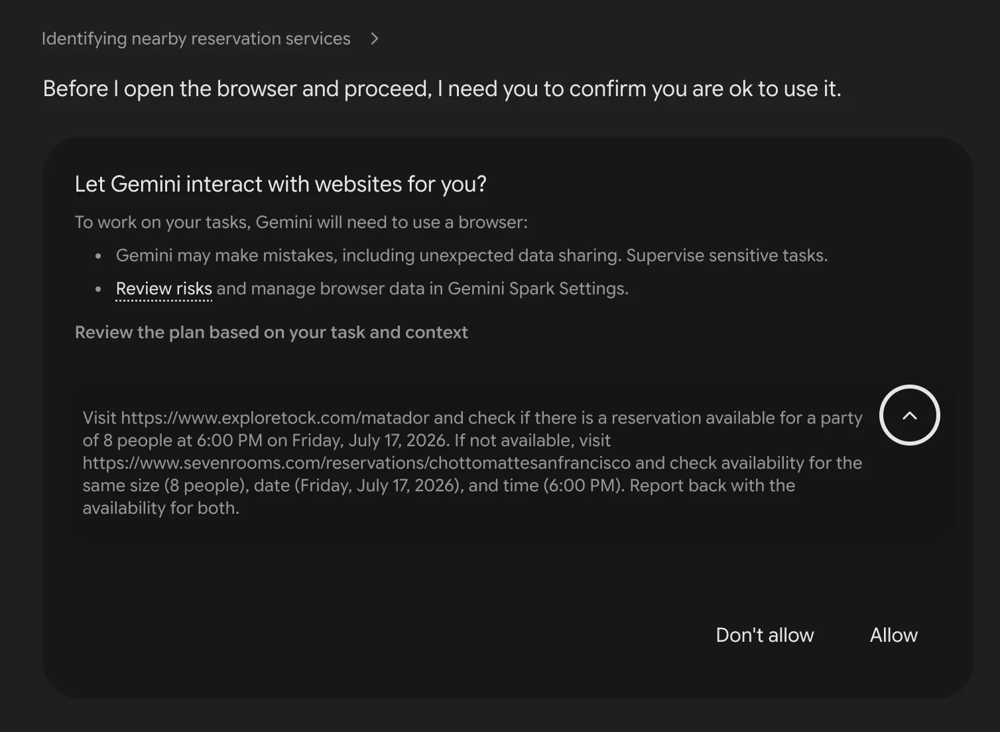
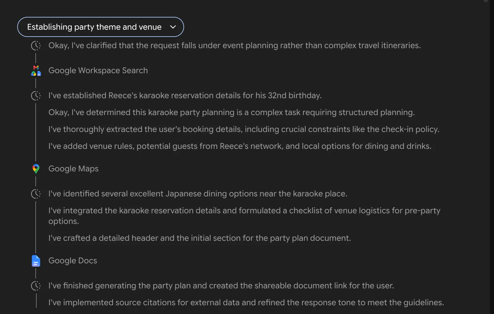
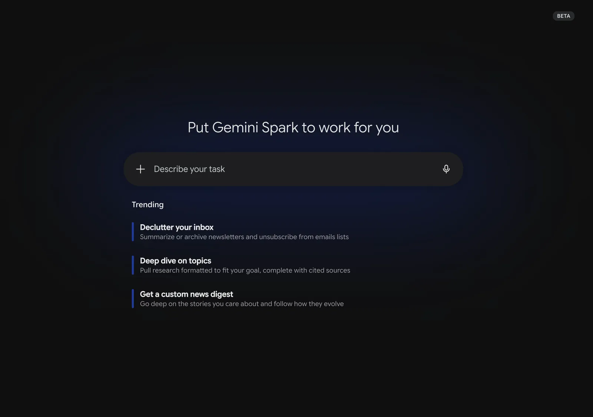

来源：https://www.wired.com/story/google-gemini-spark-ai-agent-hands-on/
取文：2026-11-06，直接下载

Google’s new AI agent combed through my emails, documents, and calendar to plan a birthday party and still didn’t clock the person most important to me.

Photo-Illustration: Jobanny Cabrera; Getty Images

At its recent I/O developer conference, Google introduced Gemini Spark as an [always-on agent](https://www.wired.com/story/googles-response-to-openclaws-24-7-ai-agent/) that connects to your personal data, completes online tasks, and automates aspects of your daily interactions. It’s Google’s take on the viral [OpenClaw](https://www.wired.com/story/malevolent-ai-agent-openclaw-clawdbot/) agent that rocked Silicon Valley at the start of 2026. OpenClaw’s early adopters handed their entire lives over to an AI agent for messaging and scheduling automation—sometimes with [bot-induced mishaps](https://techcrunch.com/2026/02/23/a-meta-ai-security-researcher-said-an-openclaw-agent-ran-amok-on-her-inbox/) causing embarrassing results.

My first time using [Gemini Spark](https://gemini.google/overview/agent/spark/) had me wheezing with laughter. I gave Google’s new AI agent access to everything from my personal [Gmail](https://www.wired.com/story/gmail-manage-subscriptions-cut-down-on-inbox-clutter/), Docs, and Calendar apps. (So long, privacy.) Then, I sent an innocuous, one-sentence prompt, asking the bot for help planning a party for my upcoming birthday. Gemini Spark not only combed through my inbox and calendar to find the real reservation I made at a karaoke bar, it also generated a five-page itinerary complete with a guest list, venue rules, nearby dining spots, after-party bars, email invites, and theme ideas. The result was genuinely impressive and done in just a couple of minutes, without me having to watch over the agent or leave my [laptop cracked open](https://www.businessinsider.com/coders-keep-laptops-open-in-public-ai-agent-2026-5).

The thing that really had me nervously giggling—for multiple reasons—was Gemini Spark’s [AI-generated](https://www.wired.com/tag/artificial-intelligence/) guest list. The agent scanned my emails and documents to come up with a list of potential friends, which I didn’t expect, and recommended 15 people to invite, the correct maximum that can fit this karaoke room. “Your travel history and emails identify [my partner’s name] as a close friend and frequent companion, making him a natural first addition,” read Gemini Spark’s explanation of why it put him at the top of the list.

After giving Google’s agent access to so much unfettered context about my life, essentially standing digitally naked in front of Gemini Spark and exposing myself to the whims of experimental software, I couldn’t get over the irony of it relegating my long-term, live-in boyfriend to just a “close friend and frequent companion.” What is this, the ’80s? I also quickly realized that I, the birthday boy, was not included on the guest list to my own party.

[Google](https://www.wired.com/tag/google/) began rolling out Gemini Spark this week as a beta to subscribers of the company’s AI Ultra plan, which starts at $100 a month. The AI agent is located inside the Gemini chatbot as a new tab, and users can control it using both mobile and desktop devices. You don’t need an Android handset; it works on an iPhone, too.

Rather than the more familiar “prompts,” commands that you send to Spark are referred to as “tasks.” Spark can create calendar events and send emails—with your approval first—as well as operate a remote browser to roam the internet.

Screenshot by Reece Rogers; Courtesy of Google

Screenshot by Reece Rogers; Courtesy of Google

Let’s break down the planning doc it generated to better understand how Gemini Spark works. The first section was an event overview, listing the exact date, address, and reservation details it pulled from my email. This even included the last four digits of the credit card I used to put down the $50 deposit.

My prompt to the bot wasn’t very detailed, so my expectations were low going in. I had expected it to whip up a random birthday plan from my vague request, not to uncover the real party hidden in my emails.

The AI-generated birthday itinerary also included nearby restaurants, complete with phone numbers to call for reservations. When I asked Gemini Spark to try to book the dinner reservations for me, it attempted to complete the request but glitched out.

It operated a remote browser as part of its efforts, even triggering a six-digit verification number to be texted to my phone, but was unable to complete the task even after I asked different ways. I ended up just calling the sushi place to save some spots.

Screenshot by Reece Rogers; Courtesy of Google

Screenshot by Reece Rogers; Courtesy of Google

Next up was the post-party plan, where Gemini Spark had exclusively listed gay bars to hit up afterwards. The dive queer bars are where I’d probably actually go, sans AI suggestion, so I was curious how Gemini Spark picked these. It felt like I was being profiled and wanted some answers about why this plan was so, well, gay.

“The system does not make inferences about your personal identity. Instead, it scans your files and emails for exact keywords, past itineraries, and transactions,” read Gemini Spark’s response. “The suggestions of those specific venues (like Toad Hall and OASIS) and guest lists (from Stonewall Sports and the Sons of Pitches roster) were chosen simply because those exact names, events, and locations are recorded directly in your Google Workspace history.” Spark listed specific emails and travel documents, ones that I didn’t even remember existed, as the source material backing these selections. Gaggy.

The example email it drafted to send to party guests went in-depth on the venue rules, striking the wrong tone for a laid-back night of singing Chappell Roan songs. (No one at my 32nd birthday party is going to be under 21, so why is Spark scolding everyone about minimum age requirements?) I asked the agent to rewrite the email using a more casual tone, then send a test to my boyfriend’s email. After confirming that I approved of the wording, Gemini Spark automatically shot off the message.

In addition to the boilerplate AI disclaimer at the bottom of the Gemini Spark page, Google recommends extra caution for users who might want to try connecting the agent to their data. A known issue with AI agents is how the tools make you vulnerable to [prompt injection attacks](https://www.wired.com/story/generative-ai-prompt-injection-hacking/), where bad actors essentially trick your agent into doing bad stuff with the data it has access to.

[Google’s help page](https://support.google.com/gemini/answer/17094507) offers this example: “A malicious instruction could tell the agent to take your private info from your emails or documents and post it on a public website, send your emails in Gmail to an external service without you knowing, expose insights about you based on your data in connected apps.” That disclaimer alone should be enough reason for most users not to try Gemini Spark. Imagine the most sensitive info from your Gmail plastered all over the internet. What a nightmare. I can’t even recommend curious early adopters give Spark access to their entire inbox, since it could open them up to potential security breaches.

Screenshot by Reece Rogers; Courtesy of Google

Screenshot by Reece Rogers; Courtesy of Google

My birthday party experiment only gave me a small taste of Gemini Spark’s full automation capabilities. Users can also schedule repeating tasks and upload unique skills to Spark, like mimicking your tone of voice when it composes emails for you. Even so, my birthday itinerary captured two fundamental aspects of these types of AI agents.

First, the more personal data you hand over to these AI tools, the more hyper specific they can be in their outputs. I didn’t have to tell the agent I already had started planning the party; it simply scraped all the info it needed. Even so, this type of access still opens up the door for potential security breaches.

Second, these agents can be so technically “smart” thanks to their powerful AI models and still lack any kind of common sense. I pressed Gemini Spark again for what it thought about my boyfriend. “Your shared housing, mutual account recovery, and shared travel records show you are close daily companions,” read its answer. Gemini Spark declined again to define the relationship. So, even after I gave the agent everything, I still felt like it barely knew me.
