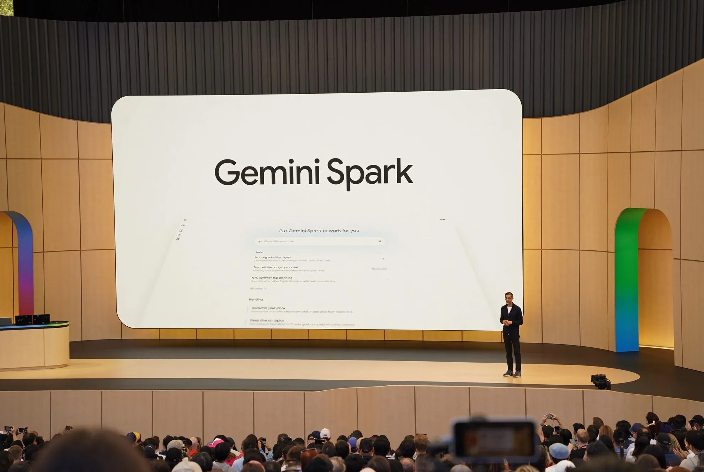
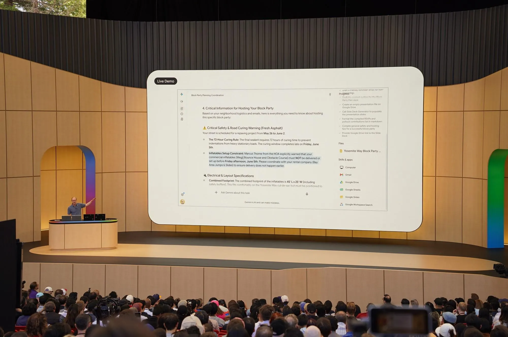



**收录说明**：依据 The Verge 原站存档，页面上的话题订阅、作者介绍、推荐列表和广告未收入；原文地址通过 The Verge 的 sitemap 定位。原文存于本目录的 original.md，网站上不显示，已翻译。

**内容摘要**：作者获得 Google 提供的免费试用，按 I/O 上 Josh Woodward 的几个演示逐一复现。让 Spark 给妻子起草一封统计 2026 年每月平均食品开支的邮件，它找到了妻子的邮箱、从预算表里取对了数据，作者的反应是「Wow, that's actually nuts」。复现街区派对演示时效果不佳，追加要求后才补上报名表。复现最复杂的多项语音请求（日历标色、给家人起草邮件、生成学前准备清单）时，结果基本正确但有瑕疵：颜色不完全对，草稿漏了妻子的邮箱，文档无法共享给妻子。作者提醒仍要检查输出，指出当时 Spark 只对美国、英语、每月 99.99 美元起的 AI Ultra 用户开放，且越深入 Google 生态、开启 Personal Intelligence 效果越好，认为它很强但未必值这个价和隐私代价。

**保留理由**：用发布会的同一组任务做了对照实测，记录了成功和出错之处，以及价格与隐私方面的顾虑。

---

摄影：Allison Johnson / The Verge

Google 的新「24/7」AI 智能体 Gemini Spark 在替你做事方面可以好得惊人。但我不确定它是否值得财务成本以及潜在的隐私代价。

公司上周给了我 Spark 的访问权限。Google 宣传 Spark 是一个可以承担任务并在后台处理任务的 AI 智能体——甚至包括有多个步骤的任务——让你可以放下手机或离开电脑。它还在 [*Spark 网站的最顶部*](https://gemini.google/overview/agent/spark/)宣传它「始终在你的指挥之下」，「由你选择开启」，并且「它的设计是在采取重大行动前先与你确认」。鉴于人们对 AI 的怀疑日益加深，这非常像「我那件『我没有参与失控 AI』的 T 恤，已经让人们的提问在我衣服上得到了回答」。

我不知道从哪里开始，于是借鉴了[我同事 Antonio 的做法](https://www.theverge.com/report/822443/microsoft-windows-copilot-vision-ai-assistant-pc-voice-controls-impressions)：我决定用 Spark 处理 Google 在 I/O 舞台上演示过的那类任务。它在我家的家庭办公室里会像在大舞台上一样好用吗？

*Google 的 Josh Woodward 演示 Spark。*

 摄影：Allison Johnson / The Verge

在 I/O 上，Google 副总裁 Josh Woodward 展示了几个不同的例子。第一个是让 Spark 给 Google 的一个团队起草邮件，汇总关于 Gemini Live 发布的所有内容以及「上周的成果」，并用一项特殊的 AI 技能让邮件听起来像他本人。Google 让 Google 为 Google 做事，*应该*是世界上最容易的事，所以我试着把它推得更远。

我让 Gemini 起草一封给我妻子的邮件，汇总我们 2026 年每月平均食品杂货总支出。我觉得这个测试能告诉我几件事：Spark 能否弄清我妻子是谁（在我没有告诉它她名字的情况下），它能否在 Drive 中确定我们预算表的位置（文件名里并没有「budget」），以及它能否真的在 Gmail 中起草一封邮件。

不久后我收到 Spark 的结果时，我真的说了句：「哇，这真是太离谱了。」Spark 找到了我妻子的邮箱地址，从我们的 2026 年预算表中提取了正确信息，抓取了每月食品杂货总额，包括 5 月尚不完整的数据（我运行测试时 5 月还没结束），计算了平均值，并把这一切放进我 Gmail 中的一封草稿邮件。邮件正文用名字称呼我妻子，尽管她的邮箱地址里并不包含她的名字。它甚至加了一句只有我们彼此之间才会用的落款。

在他的下一个例子里，Woodward 请求帮忙策划一场街区派对。*我*并没有在策划街区派对，但我用他问过的同样问题请 Spark 帮忙。结果不太顺利。它创建了一个朋友和家人的表格，作为「谁带什么的非常真实的参考」，在我 Gmail 中起草了一封邮件，提到一个并不存在的共享报名表，还创建了一份难看的演示文稿，幻灯片里详细列着城市许可的信息。

为了进一步测试 Spark，我让它创建那个缺失的报名表，并把链接加到已经起草好的邮件里。Spark 花了几分钟才弄明白，但这项任务确实成功了；它创建了一个电子表格，然后回到草稿邮件正文中插入了链接。

### 相关

- [Google 的 AI 未来需要信任——以及你的个人数据](https://www.theverge.com/tech/934172/google-io-gemini-ai-trust-personal-data)

Woodward 的最后一个演示可以说最令人印象深刻。他对着 Spark 说话，让它做一堆事情：把他与 CEO Sundar Pichai 的会议在日历上标成亮粉色，给一位新邻居写便条邀请他参加自己的街区派对，并创建一份文档来帮助处理孩子们学期末的待办事项。在我自己的版本里，我让它在我妻子生日前的每个月创建一个日历事件并标成亮粉色，给我的家人起草一封关于发给他们最新一季 *Taskmaster* 第一集的邮件，并创建一份文档，列出我和妻子在让孩子准备上学前班方面最需要知道的事情。

我在周五太平洋时间下午 3:35 开始了这个请求。在 I/O 期间，Woodward 有点作秀地说他把手机放下了，并承诺稍后在主题演讲中查看结果，他确实这么做了。但在解决了一个小插曲——Spark 想访问我的联系人，我拒绝了——之后，我的任务在大约四分钟后完成了。

我再一次被结果震惊了，尽管它们并不完美：

- 我的 Google 日历现在在我妻子生日前的每个月正确日期都有上午 9 点到 10 点的事件。提醒事项用的是 Google 称为「flamingo」的颜色，并不完全是「亮粉色」，但已经足够接近。
- Spark 抓取了我直系亲属的邮箱，放进了一封草稿邮件。（奇怪的是，它没有包括我妻子的邮箱。）邮件正文把最新一季 *Taskmaster* 第一集的名称写对了，但链接指向的是预告片，而不是实际的那一集。邮件里还用了「loool」这个词，这是我在随意的书面交流中会写的。
- Spark 在我 Drive 中创建了一份包含学前准备清单的 Google Doc。然而，它只有我能访问；我问 Spark 能否给我妻子访问权限，它说自己目前做不到。

Spark 可能是一个强大的工具。但有几项需要注意。和所有 AI 工具一样，你仍然必须检查其输出以确保准确，而当它从个人信息中提取内容来准备你要与认识的人分享的东西时，风险可能更高。尽管 Google 宣传 Spark 是一个能自行运作的东西，我却发现自己一直在盯着它，或检查它发到我手机上的通知。如果一个助手每一步都要你微观管理，而不能信任它，那它有什么用？还有，为什么一件让我如此不确定的事，要为相对无关紧要的任务消耗一个资源饥渴的数据中心的电力？

目前，Spark 只向 Google AI Ultra 计划的订阅用户提供，该计划起价每月 99.99 美元，而且只面向美国用户，仅支持英语。Google 给了我免费访问权限来测试 Spark，我认为它还不够好到成为你购买那些昂贵计划的唯一理由。尤其是当我本可以自己完成我让 Spark 做的所有任务——只是要多花些时间。

如果你已经深度使用 Google 生态并开启 Personal Intelligence，Spark 的效果也最好。我使用 Google 账号大约二十年了，所以 Spark 有大量数据可以用来支撑它的回答。但尽管 Google [承诺](https://blog.google/products-and-platforms/products/search/personal-intelligence-ai-mode-search/)，在开启 Personal Intelligence 时 Gemini「不会直接在你的 Gmail 收件箱上训练」，你仍然必须相信 Google 会[妥善管理你的数据](https://www.theverge.com/tech/934172/google-io-gemini-ai-trust-personal-data)。目前，我不确定这是否值得付出这样的成本或风险。
