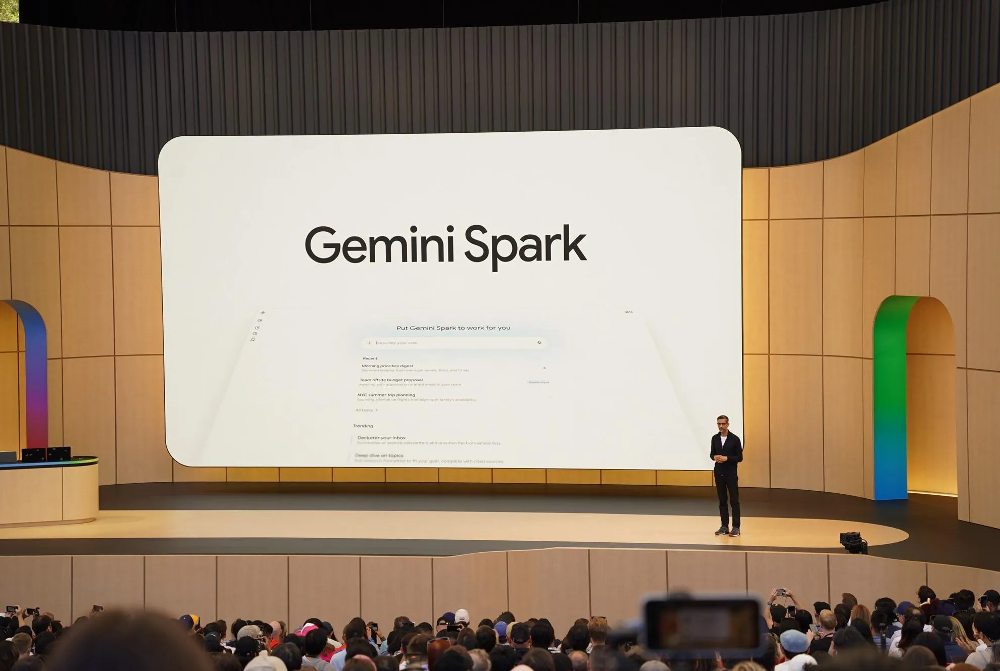
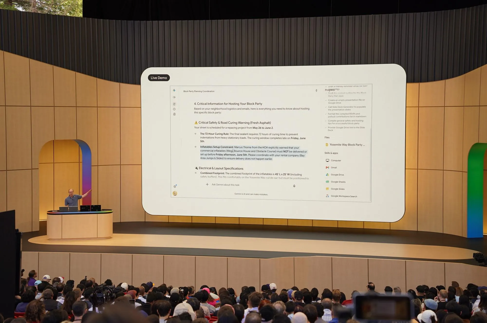

来源：https://www.theverge.com/tech/941138/google-gemini-spark-ai-agent-hands-on
取文：2026-11-06，直接下载

Photo by Allison Johnson / The Verge

Google’s new “24/7” AI agent, Gemini Spark, can be shockingly good at doing things on your behalf. But I’m not sure it’s worth the financial cost and potential privacy tradeoffs.

The company gave me access to Spark last week. Google advertises Spark as an AI agent that can take on tasks and work on them in the background — even tasks that have multiple steps — allowing you to put your phone down or walk away from your computer. It also advertises [*at the very top* *of the Spark website*](https://gemini.google/overview/agent/spark/) that it’s “always under your direction,” that “you choose to turn it on,” and that “it’s designed to check with you before taking major actions.” Given the mounting skepticism toward AI, it’s very much “my ‘not involved in rogue AI’ T-shirt has people asking questions already answered by my shirt.”

I didn’t know where to start, so I took a page from [my colleague Antonio’s book](https://www.theverge.com/report/822443/microsoft-windows-copilot-vision-ai-assistant-pc-voice-controls-impressions): I decided to use Spark to tackle tasks like what Google demonstrated onstage at I/O. Would it work as well in my home office as it did on the big stage?

*Google’s Josh Woodward demoing Spark.*

 Photo by Allison Johnson / The Verge

At I/O, Google VP Josh Woodward showed off a few different examples. The first was asking Spark to draft an email to a team at Google, compile everything about the Gemini Live launches and “wins from last week,” and use a special AI skill to make the email sound like him. Google asking Google to do things for Google *should* be the easiest lift in the world, so I tried to push it further.

I asked Gemini to draft an email to my wife that compiles our total monthly average grocery spending in 2026. I figured this test would tell me a few things: Could Spark figure out who my wife was (without me giving Spark her name), could it determine where our budget spreadsheet is in Drive (which does not have “budget” in the file name), and could it actually draft an email in Gmail?

When I got the result from Spark shortly after, I really said: “Wow, that’s actually nuts.” Spark found my wife’s email address, pulled the right information from our 2026 budget spreadsheet, grabbed the monthly grocery totals including the incomplete data from May (which still wasn’t over when I ran the test), averaged the totals, and put it all in a draft email in my Gmail. The text of the email addressed my wife by her first name, even though her email address does not contain her first name. It even included a sign-off that we use just for each other.

In his next example, Woodward asked for some help planning a block party. *I’m* not planning a block party, but I asked Spark for help using the same questions he asked. It didn’t go well. It created a table of friends and family as a “highly realistic reference for who is bringing what,” drafted an email in my Gmail mentioning a shared sign-up sheet that doesn’t exist, and created an ugly deck with slides detailing information about city permits.

To push Spark, I asked it to create that missing sign-up sheet and add a link to the email that was already drafted. While Spark took a few minutes to figure it out, that task did work; it created a spreadsheet and went back to the draft email text and dropped in the link.

### Related

- [Google’s AI future demands trust — and your personal data](https://www.theverge.com/tech/934172/google-io-gemini-ai-trust-personal-data)

Woodward’s last demo was arguably the most impressive. He talked at Spark to ask it to do a bunch of things: make his meetings with CEO Sundar Pichai hot pink on his calendar, write a note to a new neighbor to invite him to his block party, and create a document to help with to-dos for his kids for the end of the school year. For my own version, I asked it to make a calendar event each month ahead of my wife’s birthday and make it hot pink, draft an email to my family about sending them the first episode of the latest season of *Taskmaster*, and create a document with the top things my wife and I need to know about getting our toddler ready for preschool.

I started this request at 3:35PM PT on Friday. During I/O, Woodward made a bit of a show about putting his phone down and promising to check the results later in the keynote, which he did. But after addressing one hiccup — Spark wanted to access my contacts, which I declined — my task was done about four minutes later.

Once again, I was a little floored by the results, though they were imperfect:

- My Google calendar now has events from 9–10AM on the correct day of each month leading up to my wife’s birthday. The reminders are in what Google calls “flamingo,” which isn’t exactly “hot pink,” but close enough.
- Spark grabbed the emails of my immediate family and put them in a draft email. (Strangely, it didn’t include my wife’s.) The text of the email got the name of the first episode of the latest season of *Taskmaster* correct, but linked to a trailer instead of the actual episode. The email also included the term “loool,” which is something I write in casual written conversation.
- Spark made a Google Doc in my Drive with a preschool preparation checklist. However, it’s only available to me; I asked Spark if it could give access to my wife, but it said it isn’t currently able to do that.

Spark could be a powerful tool. But there are a few caveats I should mention. Like all AI tools, you still have to check its output to make sure it’s accurate, which could have higher stakes when it’s pulling from personal information to prepare things you share with people you know. Although Google pitches Spark as something that can operate on its own, I found myself constantly watching it or checking the notifications it sent to my phone. What good is an assistant if you have to micromanage their every move instead of trusting them? And why should something I feel so unsure about drain power from a resource-hungry data center for relatively inconsequential tasks?

Currently, Spark is only available to subscribers of Google’s AI Ultra plan, which starts at $99.99 per month, and only to users in the US and only in English. Google gave me free access to test Spark, and I don’t think it’s good enough to be the sole reason to spring for those expensive plans. Especially when I could do all of the tasks I asked Spark to do on my own — they would just take more time.

Spark also works best if you’re already deep in the Google ecosystem and have Personal Intelligence on. I’ve had a Google account for around two decades, so Spark has a lot of data it can use to inform its answers. But while Google [promises that](https://blog.google/products-and-platforms/products/search/personal-intelligence-ai-mode-search/) Gemini “doesn’t train directly” on your Gmail inbox with Personal Intelligence turned on, you’ll still have to put your faith in Google that it will be a [good steward of your data](https://www.theverge.com/tech/934172/google-io-gemini-ai-trust-personal-data). For now, I’m not sure if that’s worth the cost or the risk.
