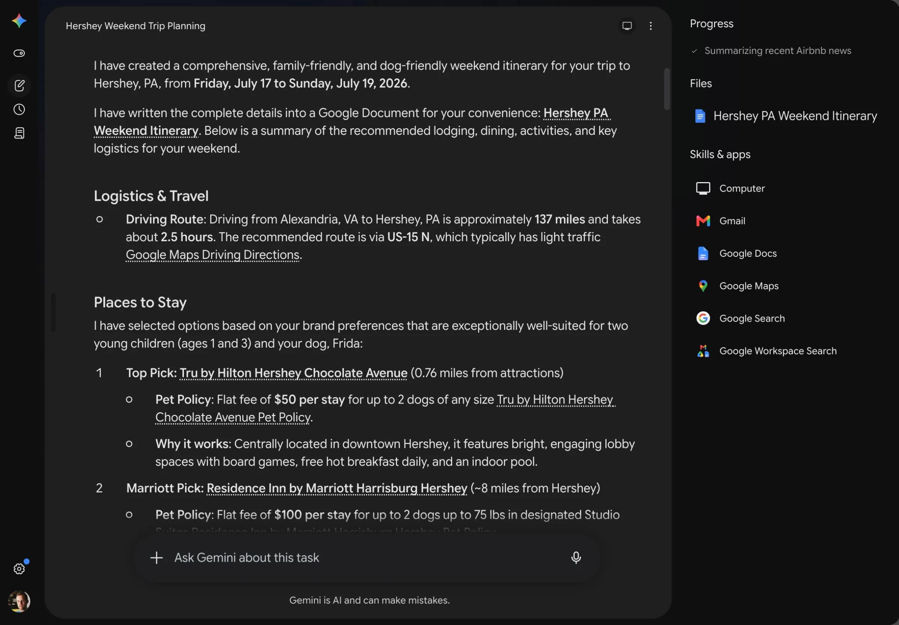
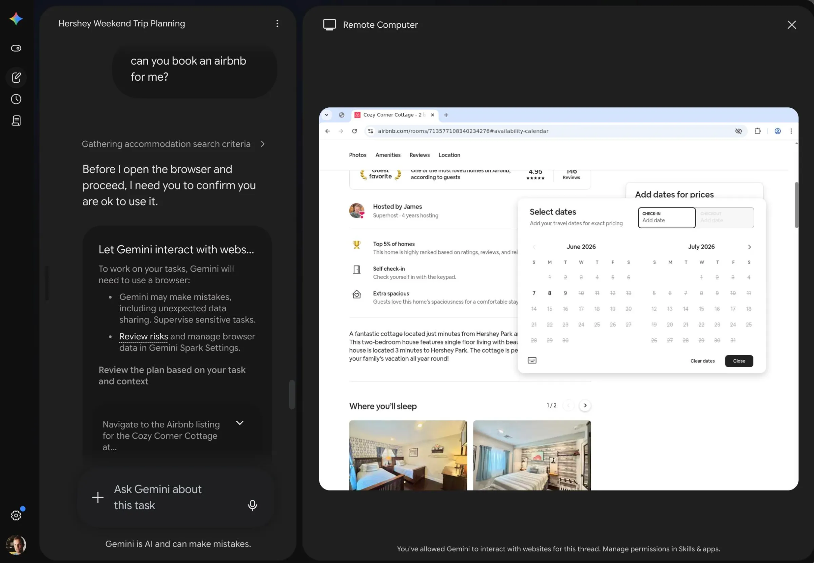



**收录说明**：依据 The Verge 原站存档，页面上的话题订阅、作者介绍、推荐列表和广告未收入；原文地址通过 The Verge 的 sitemap 定位。原文存于本目录的 original.md，网站上不显示，已翻译。

**内容摘要**：作者让 Spark 规划一家四口带狗去宾夕法尼亚州 Hershey 的周末。几分钟后得到的行程是他见过最详细、最个人化的：包含从他家出发的驾车路线（地址他没提供）、带宠物费的酒店、知道两个孩子的年龄并据此说明谁需要门票、记得妻子不吃洋葱，后来又按他父母同行改成 Airbnb，并直呼父母的名字。唯一失败是请它预订 Airbnb：Spark 请求网页操作权限后访问 Airbnb，作者认为是被 Airbnb 拦截了。作者称这是最惊艳的 AI 体验之一，也让人毛骨悚然，认为分享得越多系统就越有用，这正是当下用户被要求作出的交换。

**保留理由**：具体展示了 Spark 如何调用 Google 掌握的个人数据，以及第三方网站拦截智能体的情况。

---

根据过去四年的每一个产品演示，规划旅行都是 AI 的杀手级用例。它们都承诺，只要告诉它你要去哪里，你的聊天机器人 / 智能体 / 其他流行词就会详尽地搜索旅行选项、研究所有好玩的事、查遍当地热门地点，并为你提供一份完整的行程。到目前为止，我发现这只在最泛泛的层面上有效：如果你想做地球上任何一座城市里最显而易见的六件事，AI 能帮上忙，但也就仅此而已。

我使用 Spark 的体验非常不同，[这是 Google 新的全天候 AI 智能体](https://www.theverge.com/tech/932996/google-gemini-spark-antigravity-io-2026)。Spark [是一个雄心极大的东西](https://www.theverge.com/tech/941138/google-gemini-spark-ai-agent-hands-on)：Google 打算让它成为你使用外部应用的界面，并随着时间推移甚至操作你的电脑。（「网络访问更好的 OpenClaw」是一种不算错的描述。）Spark 目前正向 Google 每月 99 美元的 AI Ultra 计划推出，但 Google 允许我提前试用。我测试了一些简单的、面向操作的事情，比如让 Spark 浏览我的 Gmail 收件箱并建议一堆我应该退订的东西，以及让它翻我的 Google Docs 找我仍未完成的旧任务。这两件事它都做得不错，甚至为我创建了一份整理得很好的文档，里面有一堆可快速退订各种营销邮件的链接。

然后，我给 Spark 安排了一个简单的旅行规划任务。「我将在 7 月 18 日那个周末和妻子、两个孩子以及狗一起去宾夕法尼亚州 Hershey。你能为整个周末做个计划吗，包括住宿、吃饭、活动和一切其他事情？」我略去了一些关键细节，比如我那个周六晚上有演唱会门票，但我想先从 Hershey 最显而易见的六件事开始，再看看会怎样。

几分钟后，Spark 回了我。「我已为你的宾夕法尼亚州 Hershey 之行创建了一份全面、适合家庭且适合狗的周末行程，时间为 2026 年 7 月 17 日星期五至 7 月 19 日星期日。」它分享了一个为我创建的 Google Doc 链接，以及几千字令人震惊地详细、有用的行程。

我从 AI 机器人那里得到过的最详细、最个性化的旅行行程。

 截图：David Pierce / The Verge

首先，它提供了从我家出发的驾车路线，这个地址 Google 当然知道，但我并没有提供。它列出了几个酒店选项，包括它们的宠物费，以及一些 Frida 可能会喜欢的适合狗的活动。我从未告诉 Google 我的狗叫 Frida；我只能猜测 Spark 是从兽医发来的邮件中发现的。

Spark 还随口提到，我儿子 Lewis 可以免费进入 Hershey Park，因为他还不满一岁，但因为 Arthur 三岁了，他需要买票。我不知道 Spark 是在猜 Lewis 下午什么时候午睡，还是它以某种方式知道了，但它把午睡时间安排在下午 1:30 是对的。

整个 Spark 行程都充满了这样的细节。它包含了我妻子的名字，并考虑到她不喜欢吃洋葱或葱。它把周六晚上的 Thomas Rhett 和 Niall Horan 演唱会也列了进去，大概是根据我邮件中的 Ticketmaster 确认信，并指出我们买的票包含停车。当我看到它提到那天晚上要请保姆时，我想起要说明我的父母正是为此同行，于是我在对话中添加了一条备注。

「这真是个好消息！」Spark 回复道，愉快地直呼我父母的名字，并把推荐从酒店改成了 Airbnb。当我让 Spark 把所有信息放进一个 Google Doc 并分享给 Anna 时，它找到了我妻子的邮箱，附上文档，起草了一封听起来像是我们是业务同事而不是夫妻的说明，然后发送了出去。

我很确定是 Airbnb 封了这次操作，不是 Google。

 截图：David Pierce / The Verge

Spark 唯一让我失望的一次，是我让它预订 Airbnb。它提示我允许 Gemini 代表我与网站交互，导航到 Airbnb，然后似乎很快就被拦截了。「由于 Airbnb 的安全和认证政策，我无法直接代表你登录、处理付款或完成预订。」它转而提供了几个相关且在你所需日期有房的地方，并提醒我预订所需的信息。

一方面，这是我经历过的最令人震惊地印象深刻的 AI 体验之一。Google 的 AI 实力，加上它通过 Google 的 Personal Intelligence 功能掌握的大量关于我的数据，生成了一份个性化且有价值的行程，非常契合我和我家人的需求。它把行程整理出来，并以一个真正的人类助理会用的方式呈现给我——包含大量针对我们情况的具体细节，提到重要的人的名字，并为我们所有的具体需求做了安排。每次我读这份行程，都会被其中的又一个细节震撼；我怀疑我们会几乎完全照它执行。

另一方面，我无法摆脱整件事带给我的那种深深的诡异感。Spark 所做的感觉有点神奇，也非常具有侵入性。Spark 如此随意地说出我孩子的名字和年龄，提醒我它知道我住在哪里，并找到我确信自己从未主动提供给 Google 的信息，这很奇怪。理智上，我知道 Google 对我了解得惊人地多——把我的邮件、日历、照片和搜索历史加起来，基本就能把我摸透。但看到 Spark 把所有这些数据不当作需要保护的东西，而当作需要挖掘的东西，就是让人感觉不舒服。

这就是我们所有人现在被要求做出的交换。你愿意与 AI 系统分享多少自己，与该系统能有多大用处之间存在直接关联。Google 正处于[如此强势的地位](https://www.theverge.com/ai-artificial-intelligence/861863/google-gemini-ai-race-winner)，正是因为它已经拥有所有这些信息，而 OpenAI、Anthropic 和其他公司则在拼命想办法积累这些信息。我们被承诺的 AI 工具，是那些深入了解我们、能代表我们采取行动、甚至不需要我们在场就能做决定的工具。除非我们向机器完全敞开自己，否则这些都行不通。所以，这就是我们被要求、甚至被强迫去做的事。

你知道「如果你没有为它付费，你就是产品」这句话吗？AI 把这句话又推进了一步。我们实际上*确实*在为此付费。而我们——我们的通信、我们的照片、我们自己的生活——既是原材料，也是最终产品，一切都在不断被挖掘、分类，并以新的方式反馈给我们。其中一些可能很了不起；所有这些都需要这种交换。我猜今年夏天我会在 Hershey 度过一个美妙的周末，但我永远无法摆脱被监视的感觉。据说是为了我好。
