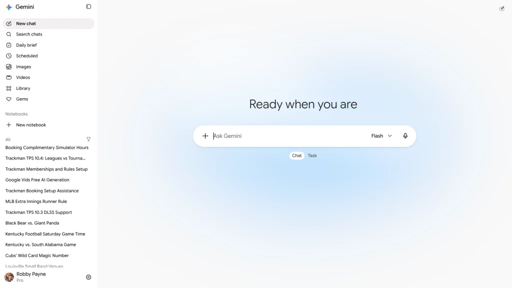



**收录说明**：依据 Chrome Unboxed 原站存档，页面上的会员推广、「Featured Videos」、去广告链接和文末订阅区块未收入。原文存于本目录的 original.md，网站上不显示，已翻译。

**内容摘要**：Chrome Unboxed 报道网页版 Gemini 的服务器端改版：原来要通过侧栏的「Switch to Spark」进入独立界面，现在这个开关被移除，输入框下方直接提供聊天与任务的选择；对话历史与 Spark 工作流合并到同一个侧栏，定时和重复的任务集中到新的「Scheduled」页面。文章指出 Google 没有为这次改动发布官方博客，作者认为用「Tasks」取代「Spark」这一品牌名是正确的。

**保留理由**：比 9to5Google 早约两周记录了网页版先行改版，与之合起来构成 Spark 更名为 Task 的时间线。

---

自 Google 首次推出 **Gemini Spark** 作为其自主的、全天候后台 AI 智能体以来，这项技术和执行都令人印象深刻。跨 Gmail、Google Calendar 和 Drive 移交复杂、多步骤操作的能力，或设置重复的自主计划，感觉是我们近来常听说的智能体 AI 向前迈出的一大步。

但它呈现的方式在日常使用中感觉有点笨拙。Spark 没有让人感觉是 Gemini 的自然延伸，而是生活在自己独立的空间里。你必须亲自点击侧栏中的「Switch to Spark」按钮，这从根本把你的工作区一分为二。对日常用户来说，这造成了不必要的分隔和摩擦。

现在，Google 悄然弥合了这道鸿沟。在向网页版 Gemini 推出的一个细微的服务器端更新中，Google 取消了独立的 Spark 空间，把任务直接并入主界面，并把整个体验简化为更清爽的整体工作流。

没有 Spark 开关的网页版 Gemini

## 提示框处的聊天与任务之分

最直接的变化在你进入 Gemini 首页的那一刻就出现了。那个引发分歧的「Switch to Spark」侧栏开关完全消失了；取而代之的是，主提示框下方整齐地放着一个直观的 **Chat** 或 **Task** 切换控件。

## 所有内容都在一个侧栏里

整合并不止于提示窗口；你的历史记录和工作流现在也统一了。

此前，在过去对话和活跃的 Spark 工作流之间跳转，需要用现已移除的 Spark 开关在两个完全不同的界面之间来回切换。现在，你活跃和已完成的任务线程就与标准对话一起放在左侧主侧栏中。

更重要的是，自动化和重复例程获得了智能的组织升级。你不必再在隐藏的子菜单里翻找，现在侧栏里就有一个专门的、名称贴切的 **「Scheduled」** 区域。你分配的任何重复任务都会被固定在你能在几秒内检查、暂停或调整的位置。

## 丢掉行话是正确的做法

虽然 Google 尚未发布概述这一变化的官方博客文章，但放弃「Spark」这一标签、改用直白的「Tasks」，是鼓励更多用户使用这个强大 AI 工具的绝对正确的做法。

Google 喜欢给各种 AI 功能起名字，在我看来，这些都无法帮助实际用户理解哪个 AI 智能体/模型做什么。把 Spark 重新表述为*进行对话*或*分配任务*之间的简单选择，让这个平台对任何曾感到畏惧、或对 Spark 最初实现有些困惑的人来说都立刻平易近人。

这个更新目前似乎正通过网页版上账号级别的服务器端推送逐步推出。如果你的界面还没更新，接下来几天请留意 **gemini.google.com**，我敢打赌你也会看到它。
