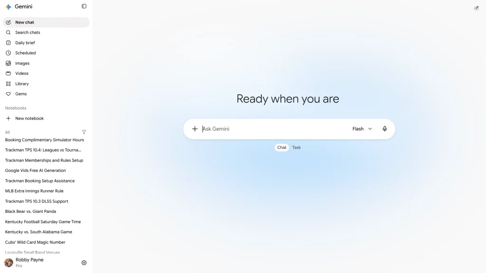

来源：https://chromeunboxed.com/google-is-quietly-ditching-the-spark-brand-to-merge-tasks-directly-into-gemini/
取文：2026-11-06，直接下载

Since Google first introduced **Gemini Spark** as its autonomous, 24/7 background AI agent, the tech and the execution have been really impressive. The ability to hand off complex, multi-step actions across Gmail, Google Calendar, and Drive, or set recurring autonomous schedules feels like a big step forward for the agentic AI we hear so much about these days.

But the way it has been presented has felt a tad clunky in day-to-day use. Instead of feeling like a natural extension of Gemini, Spark has lived in its own silo. You had to physically click a “Switch to Spark” button in the sidebar, which fundamentally split your workspace in two. For everyday users, it created unnecessary separation and friction.

Now, Google has quietly closed that divide. In a subtle server-side update rolling out to Gemini on the web, Google has eliminated the separate Spark silo, folded tasks directly into the main interface, and simplified the entire experience into a cleaner overall workflow.

Gemini on the web with no Spark toggle

## Chat vs. Task right at the prompt box

The most immediate change presents itself the second you land on the Gemini homepage. The divisive “Switch to Spark” sidebar toggle is completely gone; and instead, sitting neatly beneath the main prompt box, you’ll find an intuitive toggle for **Chat** or **Task**.

## Everything in one sidebar

The consolidation doesn’t stop at the prompt window; your history and workflows are now unified too.

Previously, jumping between past conversations and active Spark workflows required toggling back and forth between two entirely different interfaces with the now-removed Spark toggle. Now, your active and completed task threads live right alongside your standard conversations in the main left sidebar.

More importantly, automated and recurring routines have received a smart organizational upgrade. Rather than hunting through hidden sub-menus, you now have a dedicated, aptly named **“Scheduled”** section right in the sidebar. Any recurring task you’ve assigned is now pinned right where you can inspect, pause, or tweak it in seconds.

## Dropping the jargon is the right move

While Google hasn’t published an official blog post outlining the change, dropping the “Spark” label in favor of straightforward “Tasks” is 100% the right move to encourage more users to take advantage of this powerful AI tool.

Google love to add names to all sorts of AI features, and in my opinion, none of that helps actual users understand which AI agen/model does what. Reframing Spark into a simple choice between *having a conversation* or *assigning a task* makes the platform instantly approachable for anyone who felt intimidated or a bit confused by Spark’s initial implementation.

The update appears to be rolling out via an account-level server-side push on the web right now. If your interface hasn’t updated yet, keep an eye on **gemini.google.com** over the next few days and I’d wager you’ll be seeing it, too.
