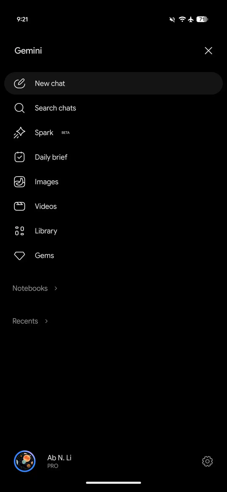
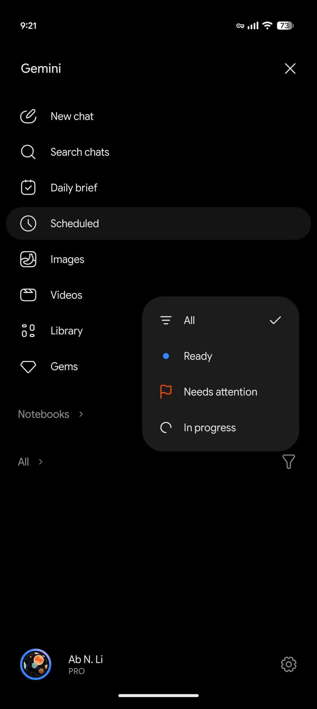
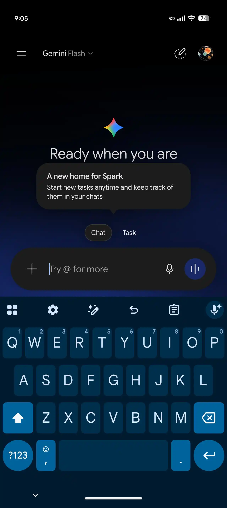
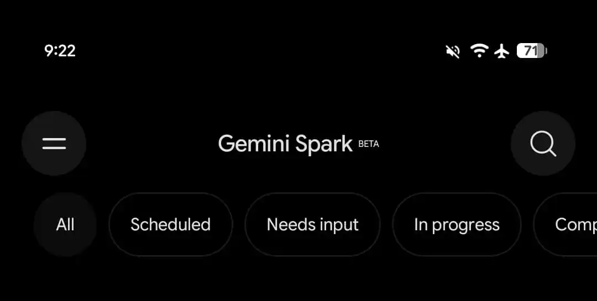
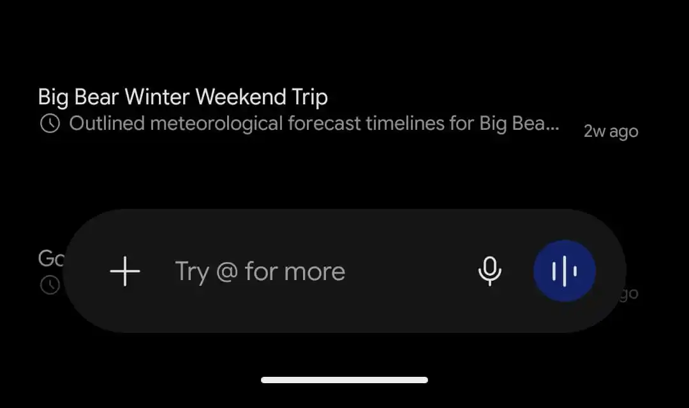
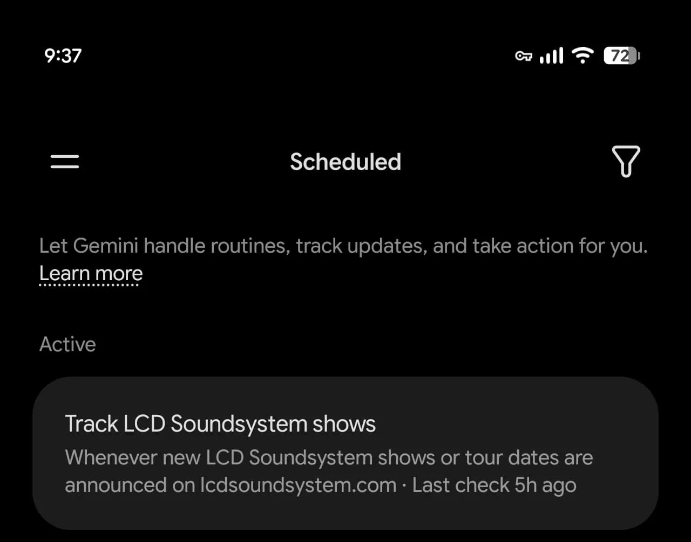
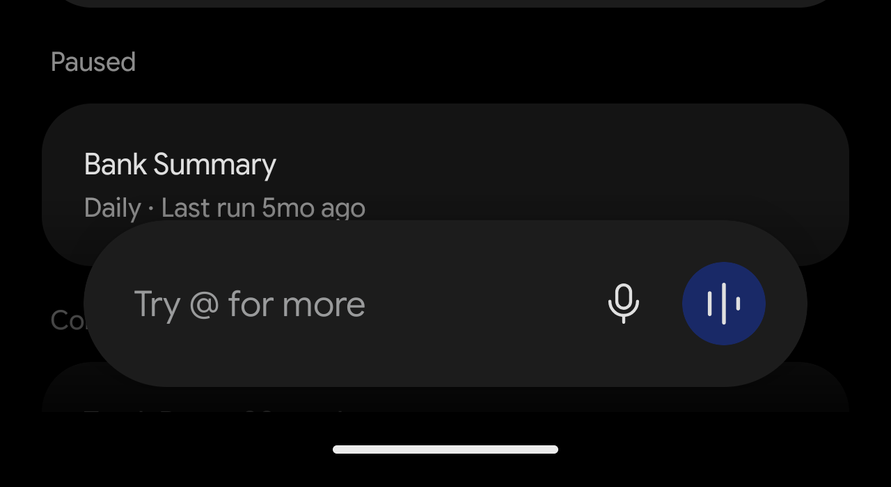
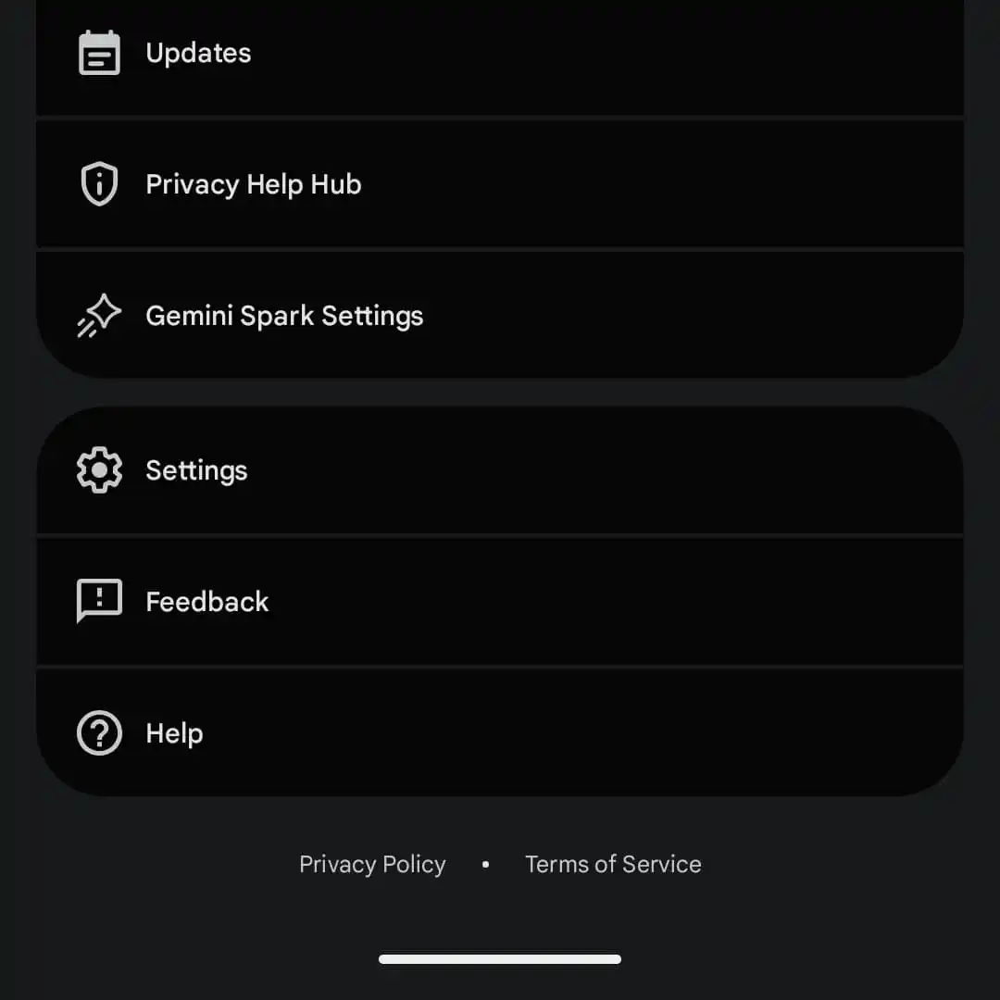
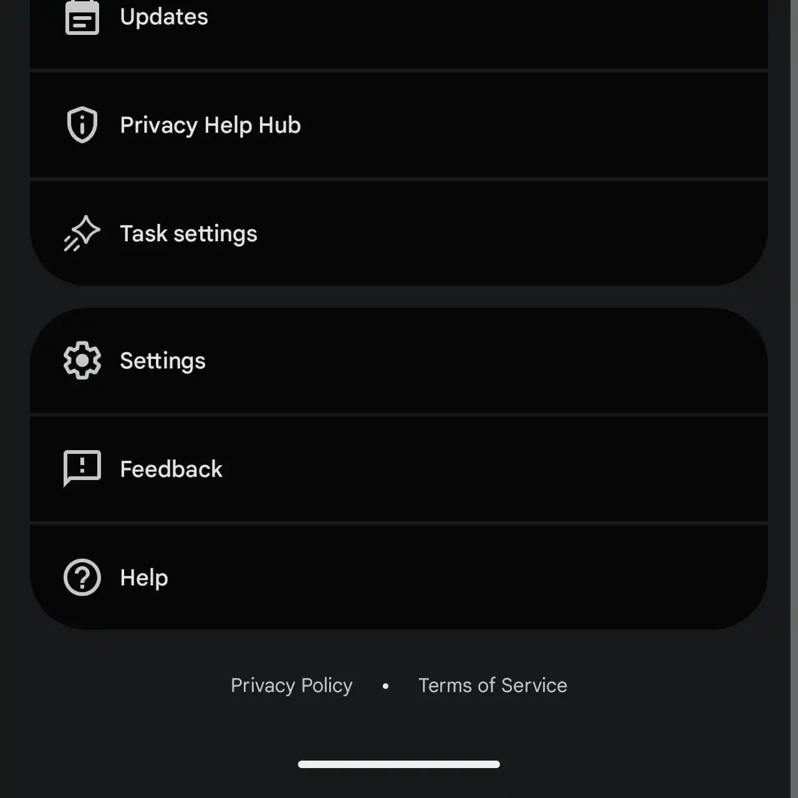



**收录说明**：依据 9to5Google 原站存档，页面上的广告提示、联盟链接声明和站点介绍未收入。旧笔记 learning-ai-agent 的 Gemini Spark 资料索引引用过这篇。原文存于本目录的 original.md，网站上不显示，已翻译。

**内容摘要**：9to5Google 观察到 Android 版 Gemini 的改版：输入框上方新增「Chat」与「Task」按钮，「Task」就是 Gemini Spark，Google 称这是 Spark 的新家，可以随时开始新任务。导航栏里的「Spark」消失，新增「Scheduled」页面，集中显示 Spark 任务和计划操作；聊天和 Spark 任务合并为同一份历史，可按全部、就绪、需要处理等筛选；账号菜单里的「Gemini Spark Settings」改名为「Task settings」。改版通过服务器端推送到 Android，当时 iOS 和网页版尚未看到；使用仍需 AI Pro 或 Ultra 订阅。

**保留理由**：Spark 改名为 Task 的界面证据；Google 没有发布正式公告，这是更名时间线的主要依据之一。

---

除了改版[设置和导航抽屉](https://9to5google.com/2026/09/28/gemini-side-panel-settings-redesign/)之外，Google 还把它旗下的 Spark 个人智能体与 Gemini 的主要聊天体验合并了。

这次改版在提示框正上方新增了「Chat」和「Task」按钮。「Task」就是 Gemini Spark，Google 解释说，现在有了「Spark 的新家：随时开始新任务，并在你的对话中跟踪它们。」

*旧版与新版对比*

作为这一变化的一部分，「Spark」从导航抽屉中消失，同时引入了一个新的「Scheduled」页面。它展示 Spark 任务和已计划的操作，信息流按进行中（Active）、已暂停（Paused）、已完成（Completed）和建议（Suggested）分类整理。

与此同时，底部的对话列表不再叫 Recents。所有聊天和 Spark 任务合并为一份历史记录。新的筛选图标让你可以按全部（All）、就绪（Ready）、需要关注（Needs attention）和进行中（In progress）排序。

Google 似乎在通过这次改版淡化「Spark」品牌。另一个例子是，账号菜单里的「Gemini Spark Settings」已被重命名为「Task settings」。

这一变化正通过 Android 上的服务器端更新推出。我们在 iOS 或网页版上还没看到。Gemini Spark 需要 AI Pro 或 AI Ultra 订阅。

Gemini 的全天候个人智能体于 5 月的 I/O 2026 上发布，通过这次更新，它更好地融入了整个应用。由于体验不再孤立，开始任务变得快得多。

