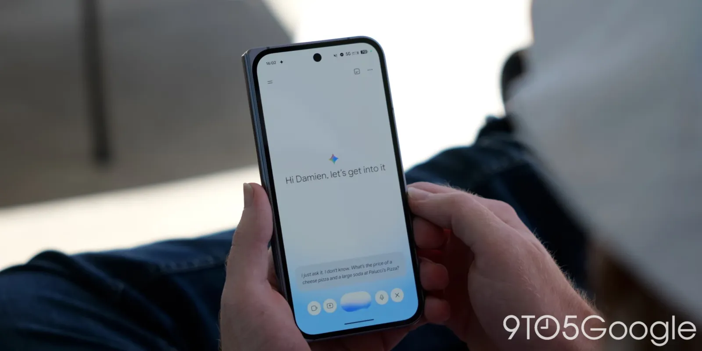
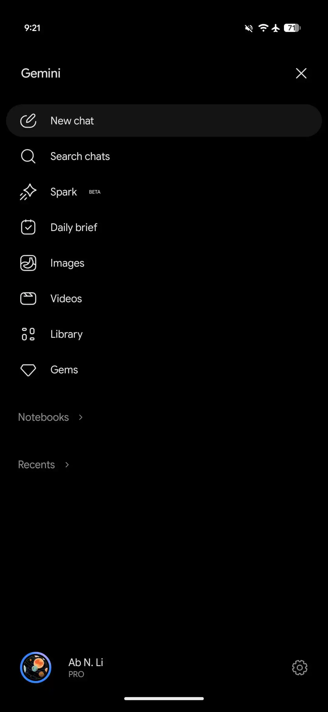
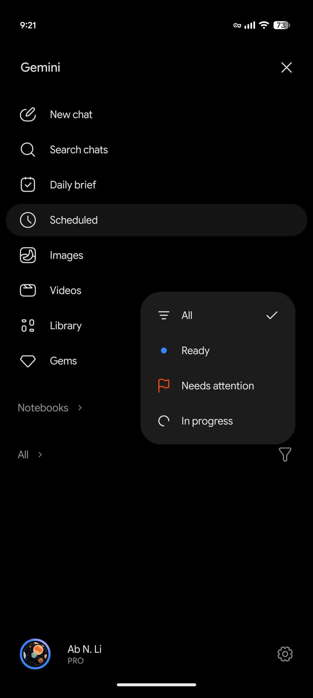
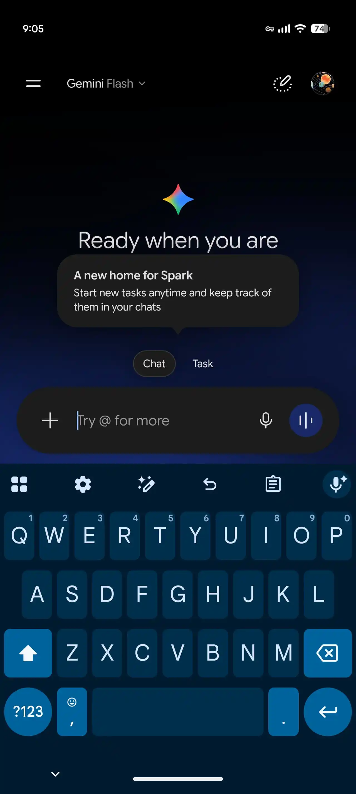
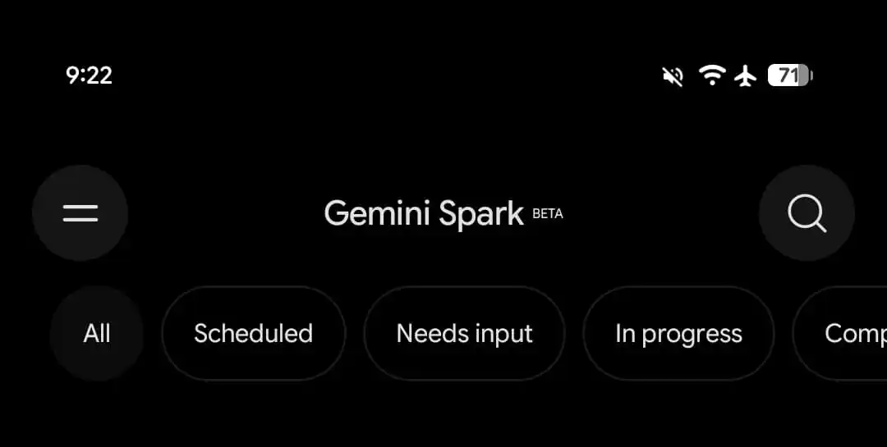
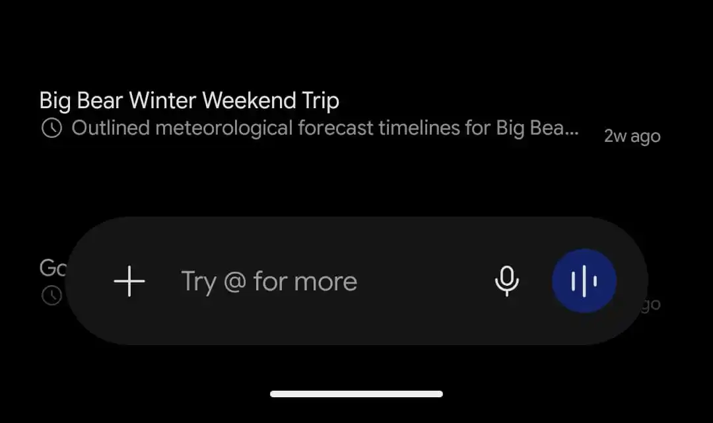
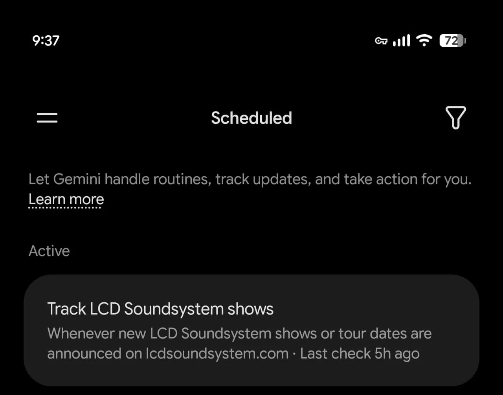
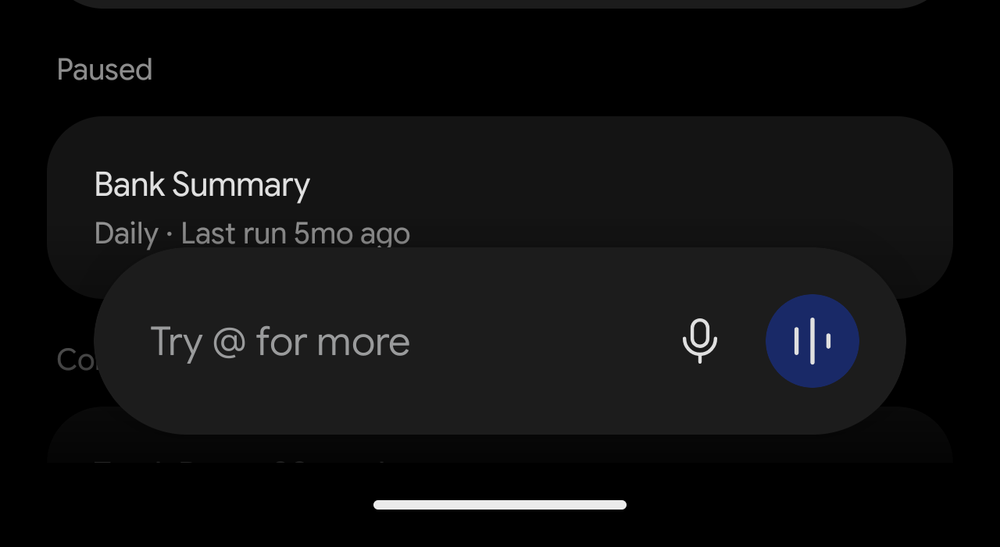
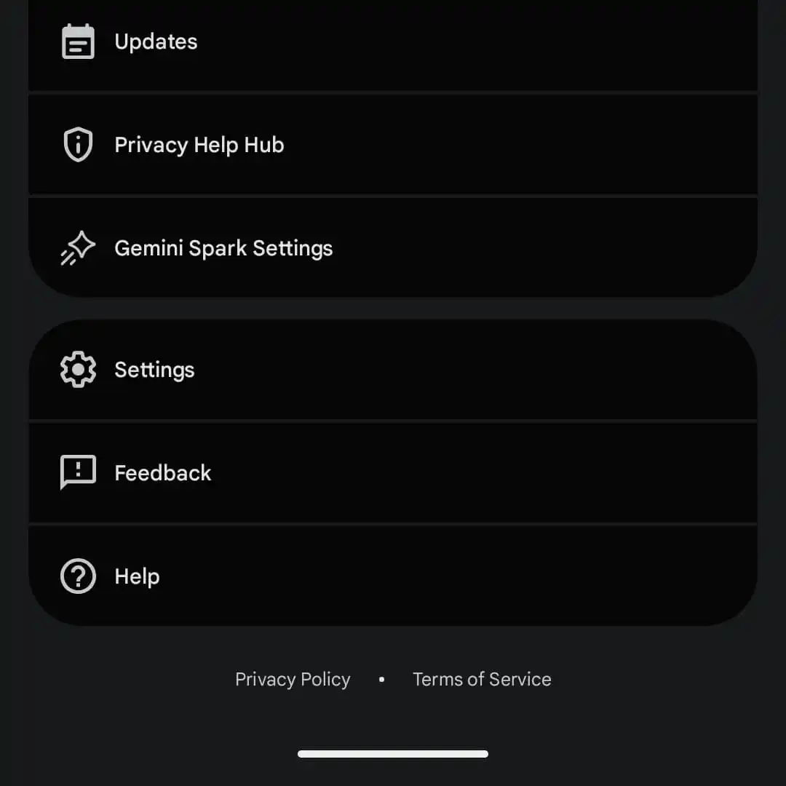
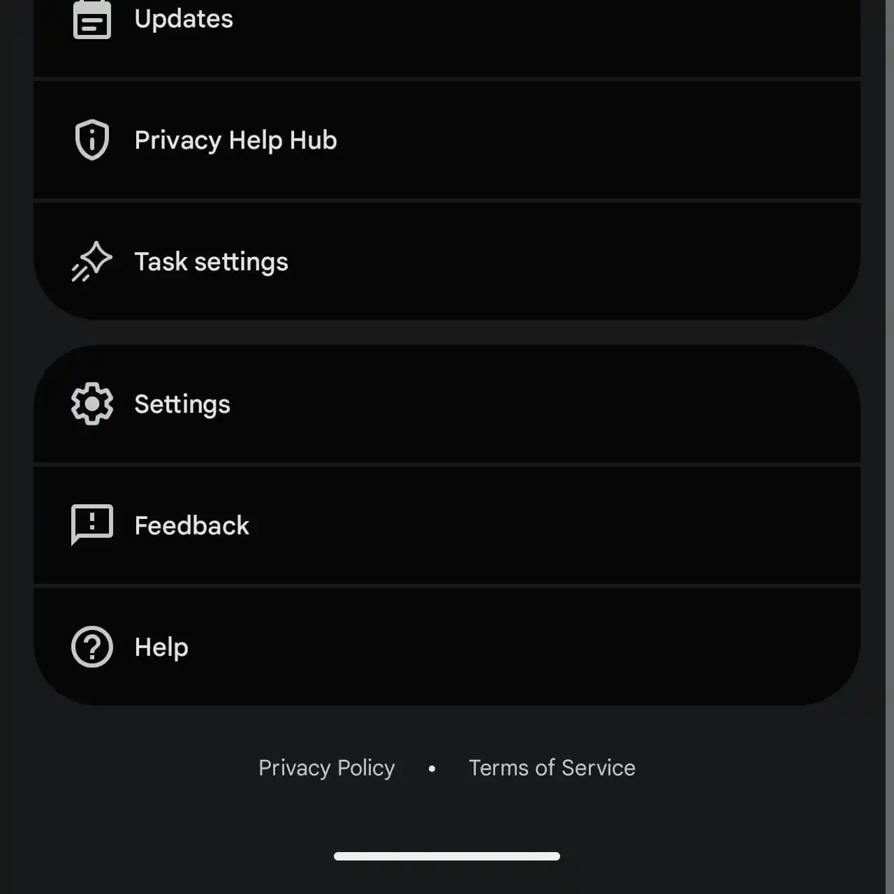

来源：https://9to5google.com/2026/10/12/gemini-spark-task-redesign/
取文：2026-11-06，直接下载

In addition to revamping [settings and the navigation drawer](https://9to5google.com/2026/09/28/gemini-side-panel-settings-redesign/), Google is combining its Spark personal agent with the main Gemini chat experience.

This redesign adds buttons for “Chat” and “Task” just above the prompt box. “Task” is Gemini Spark, with Google explaining that there’s now a “new home for Spark: Start new tasks anytime and keep track of them in your chats.”

*Old vs. new*

As part of this change, “Spark” disappears from the navigation drawer, while a new “Scheduled” page is introduced. This surfaces Spark tasks and Scheduled actions, with the feed organized by Active, Paused, Completed, and Suggested.

Meanwhile, the list of conversations at the bottom is no longer called Recents. All chats and Spark tasks are combined into one history. The new filter icon lets you sort by All, Ready, Needs attention, and In progress.

Google appears to be deemphasizing the “Spark” branding with this redesign. Another example is how “Gemini Spark Settings” in the account menu has been renamed to just “Task settings.”

This change is rolling out via a server-side update on Android. We’re not seeing it just yet on iOS or the web. Gemini Spark requires an AI Pro or AI Ultra subscription.

Announced at I/O 2026 in May, Gemini’s 24/7 personal agent is now better integrated into the overall app with this update. It’s much quicker to start a task with the experience no longer siloed off.

