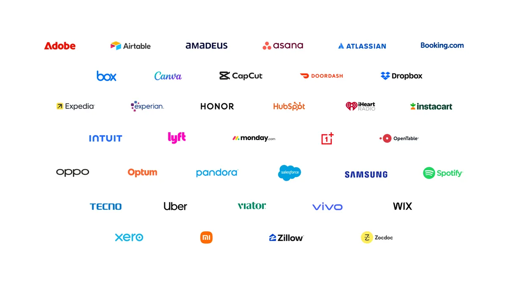



**收录说明**：Google I/O 2026 当天的 Gemini 应用发布文。只收导语、更新清单、「Gemini Spark」一节和「Gemini app for macOS」一节（后者讲 Spark 进入 Mac 应用）；Neural Expressive 设计语言、Gemini Omni 视频模型、Daily Brief 三节和页面上 AI 生成的摘要未收。旧笔记 learning-ai-agent 的 Gemini Spark 资料索引引用过这篇。原文存于本目录的 original.md，网站上不显示，已翻译。

**内容摘要**：Google 在 I/O 2026 发布 Gemini Spark，称它是全天候（24/7）的个人 AI 智能体，让 Gemini 从回答问题的助手变成在用户指示下实际干活的伙伴。Spark 运行在 Gemini 3.5 上，使用 Antigravity harness，与 Gmail、Docs、Slides 等 Workspace 工具深度集成；因为是云端智能体，合上电脑、锁上手机后仍在后台工作。举例有定期解析信用卡账单找出隐藏订阅费、教它技能每天汇总孩子学校的截止日期、把会议记录整理成文档并起草邮件；当天上线 Canva、OpenTable、Instacart 的 MCP 连接。用户决定是否开启、连接哪些应用，花钱、发邮件等高风险动作前会先询问。Spark 当周给受信测试者，下周以 Beta 向美国 AI Ultra 订阅用户开放，夏天进入 macOS 应用。

**保留理由**：Spark 的官方发布原文，给出了模型与 harness、云端运行、确认机制和最初的开放范围。

---

*Gemini 正在成为一个更有用的 AI 助手，拥有直观的新界面、主动的每日简报（Daily Brief），以及 Gemini Spark——一个帮你全天候把事做完的智能体。*

对 Gemini 应用来说，这是成绩斐然的一年。去年在 Google I/O 上，Gemini 服务的用户为 4 亿。今天，230 个国家和地区的 9 亿多人、使用 70 多种语言，每月都在向 Gemini 寻求帮助。

为迎接 Google I/O 2026，以下是新增内容：

- **Gemini 3.5 Flash：** 我们下一代模型中的第一款，把前沿智能与快如闪电的执行结合在一起。
- **Neural Expressive：** 为 Gemini 打造的全新设计语言，鲜明、动态、完全重新构想。
- **Gemini Omni：** 我们的新模型，可以把文本、图像和视频提示词无缝转化为电影级的高质量视频输出。
- **Daily Brief：** 一个新的智能体，为你提供个性化的晨间简报，整理好开始新一天所需了解的信息。
- **Gemini Spark：** 一个全天候（24/7）的个人 AI 智能体，旨在主动管理任务，帮助你在自己的指示下应对数字生活。
- **MacOS 应用：** 我们的桌面应用将集成 Gemini Spark，使其能在你的本地机器上运行，还将加入强大的新语音功能。

## Gemini Spark：从信息到行动

我们同时推出 Gemini Spark，一个帮助你应对数字生活的全天候个人 AI 智能体。Spark 代表 Gemini 的一次重大转变，把它从一个能回答问题的助手，转变为在你的指示下代表你实际做事的主动伙伴。

Gemini Spark 运行在 Gemini 3.5 上，并使用 Antigravity harness。它与你在日常依赖的 Workspace 工具深度集成，例如 Gmail、Docs、Slides 等。更棒的是，由于它是云端智能体，即使你合上笔记本电脑或锁上手机，Spark 仍会在后台继续工作。这样的组合意味着 Spark 随时准备把复杂任务从你手上接过去，让你能更专注地陪伴最重要的事。

使用 Gemini Spark，你可以：

- **设置重复任务或触发器：** 自动解析每月信用卡账单，标记新增或隐藏的订阅费用。
- **教它新技能：** 指示它检查收件箱中来自孩子学校的持续更新，提取关键截止日期，并向你和你的伴侣发送汇总的每日摘要。
- **创建完整工作流：** 让它把电子邮件和聊天中的原始会议记录综合起来，用它发现的内容创建精美的 Google 文档，甚至起草启动项目时配套的电子邮件。

这仅仅是开始。我们有一份排得满满的路线图，功能会在整个夏天陆续发布。我们正在扩展 Gemini 连接应用列表，今天上线与 Canva、OpenTable 和 Instacart 的新 MCP 连接，还有更多合作伙伴正在接入。未来几周，Spark 将能使用这些 MCP 连接为你把事情办成。我们还会增加新能力，包括给 Spark 发短信和电子邮件、创建自定义子智能体，以及操作你的本地浏览器。

Spark 在你的指示下运行。你选择是否开启它、连接哪些应用，并且它被设计为在执行花钱或发送电子邮件等高风险操作前先征求你的意见。

Gemini Spark 将于本周向受信测试者推出，我们计划下周以 Beta 形式向美国 Google AI Ultra 订阅用户推出。

## 适用于 macOS 的 Gemini 应用：掌控你的桌面

我们正在为适用于 macOS 的 Gemini 应用进行重大更新。今年夏天，我们将把 Gemini Spark 引入 Gemini 桌面应用，让它能帮助处理涉及本地文件的任务，并在你的桌面上自动化工作流。

我们还在 macOS 应用中创新语音体验，类似于我们在 The Android Show 上[预览](https://blog.google/products-and-platforms/platforms/android/gemini-intelligence/)的内容。你不必再担心边想边说时出现的那些「呃」或「那什么来着」。利用你屏幕上的上下文，Gemini 可以把你的自由表达转化为精确的草稿，即时重新排版文字以捕捉你的意图，就发生在你的光标所在处。

macOS 应用今天向所有用户开放[下载](https://gemini.google/mac)，Gemini Spark 和新语音功能将在今年夏天晚些时候推出。

今天的所有更新都让我们更接近一个真正通用助手的愿景——个人化、主动且强大。所以，无论你是忙碌的学生、家长还是小企业主，我们都期待看到你能用 Gemini 做些什么。
