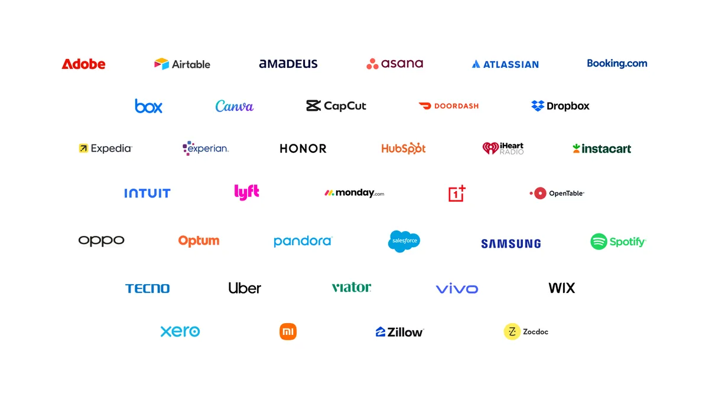

来源：https://blog.google/innovation-and-ai/products/gemini-app/next-evolution-gemini-app/
取文：2026-11-06，直接下载

*Gemini is becoming a more helpful AI assistant, with an intuitive new UI, proactive daily briefs and Gemini Spark, an agent to help you get things done around the clock.*

It’s been a banner year for the Gemini app. Last year at Google I/O, Gemini was serving 400 million users. Today, more than 900 million people across 230 countries and more than 70 languages turn to Gemini for help every month.

In time for Google I/O 2026, here’s what's new:

- **Gemini 3.5 Flash:** The first in our next generation of models that combines frontier intelligence with lightning-fast action.
- **Neural Expressive:** A vibrant, dynamic and completely reimagined design language for Gemini.
- **Gemini Omni:** Our new model that can seamlessly transform text, images and video prompts into cinematic, high-quality video outputs.
- **Daily Brief:** A new agent that gives you a personalized morning brief and organizes exactly what you need to know to start your day.
- **Gemini Spark:** A 24/7 personal AI agent designed to proactively manage tasks and help you navigate your digital life, all under your direction.
- **MacOS app:** Our desktop app will be integrating Gemini Spark so it can operate on your local machine, and it will also add powerful new voice features.

## Gemini Spark: From information to action

We’re also introducing Gemini Spark, a 24/7 personal AI agent that helps you navigate your digital life. Spark represents a big shift for Gemini, transforming it from an assistant that can answer your questions into an active partner that does real work on your behalf and under your direction.

Gemini Spark runs on Gemini 3.5 and uses the Antigravity harness. It’s deeply integrated with the Workspace tools you rely on daily, like Gmail, Docs, Slides and more. Even better, because it is a cloud-based agent, Spark keeps working in the background even when you close your laptop or lock your phone. That combination means Spark is ready to take complex tasks off your plate so you can be more present for what matters most.

With Gemini Spark, you can:

- **Set recurring tasks or triggers:** Automatically parse monthly credit card statements to flag new or hidden subscription fees.
- **Teach it new skills:** Direct it to check your inbox for ongoing updates from your kids' school, extract critical deadlines and send a consolidated daily digest to you and your partner.
- **Create complete workflows:** Ask it to synthesize raw meeting notes across emails and chats, create polished Google Docs with its findings and even draft the companion email kicking off a project.

This is just the beginning. We’ve got a packed roadmap of features shipping over the summer. We’re expanding our list of Gemini connected apps with new MCP connections to Canva, OpenTable and Instacart launching today, and a full list of more partners are integrating now. In the coming weeks, Spark will be able to use these MCP connections to get things done for you. We'll also be adding new abilities, including texting and emailing Spark, creating custom sub-agents and operating your local browser.

Spark operates under your direction. You choose whether to turn it on and what apps it connects to, and it’s designed to ask you first before performing high-stakes actions like spending money or sending emails.

Gemini Spark will roll out to trusted testers this week, and we're planning to roll it out as a Beta for U.S. Google AI Ultra subscribers next week.

## Gemini app for macOS: Take control of your desktop

We’re working on big updates to the Gemini app for macOS. We’ll be bringing Gemini Spark to the Gemini desktop app this summer so it can help with tasks involving your local files and automate workflows across your desktop.

We’re also innovating on new voice experiences in the macOS app, similar to what we [previewed](https://blog.google/products-and-platforms/platforms/android/gemini-intelligence/) at The Android Show. You won’t have to worry about all the “ums” or “what abouts” that happen as you think aloud. Using the context from your screen, Gemini can turn your free-flowing speech into precise drafts, instantly reformatting the text to capture your intent, right where your cursor is.

The macOS app is available to [download](https://gemini.google/mac) today for all users, with Gemini Spark and the new voice features will roll out later this summer.

All of today’s updates get us closer to our vision of a truly universal assistant that’s personal, proactive and powerful. So whether you’re a busy student, parent or small business owner, we look forward to what you can do with Gemini.

