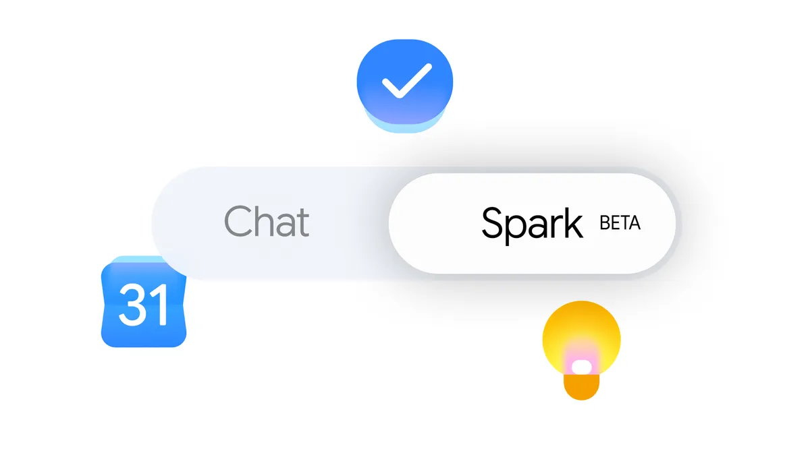



**收录说明**：官方更新文。页面上的分享按钮、音频播放器和 AI 生成的要点摘要未收入。旧笔记 learning-ai-agent 的 Gemini Spark 资料索引引用过这篇。原文存于本目录的 original.md，网站上不显示，已翻译。

**内容摘要**：Spark 进入 Gemini 的 macOS 应用，可以处理桌面文件和应用，例如把下载文件夹里的 PDF 分类归档；即将支持从手机远程给 Mac 上的 Spark 派任务。macOS 版以 Beta 形式面向 18 岁以上的美国 AI Ultra 订阅用户。连接应用新增 Google Tasks、Google Keep，以及 Canva、Dropbox、Instacart、OpenTable 等第三方集成，并开始支持自定义 MCP。Spark 还获得实时追踪话题、对事件作出反应的能力，例如球赛结束后立即推送集锦与分析。

**保留理由**：记录了 Spark 从云端扩展到本地 Mac、开放自定义 MCP 和事件监控的时间点。

---

*我们正在把 Gemini Spark 带到 macOS 应用，让它与你更多常用的应用连接，并提升它实时追踪你所关注话题的能力*

今天，我们推出 Gemini Spark 的更新，使其更加有用，从新的桌面体验，到与你常用应用更深的连接。以下是新增内容：

## 把 Gemini Spark 带到你的 Mac

我们正在把 Spark 带到 Gemini 的 macOS 应用，帮你自动化桌面上耗时的任务。

Gemini Spark 现在可以走出聊天窗口，处理你桌面文件和应用中的繁重工作。例如，你可以让 Gemini Spark 把「下载」中的所有 PDF 分类到特定文件夹，把数小时的手动文件整理变成瞬间操作。Gemini Spark 还把你的桌面与 Google Workspace 连接起来，因此你可以直接让它用你电脑上保存的最新发票创建预算电子表格，并创建定期更新该表格的计划。为保护你的信息安全，Gemini Spark 只能访问你授权它使用的文件。

很快，你甚至可以远程运行任务。你可以从手机向 Gemini Spark 分配一个多步骤任务——例如让它在你的 Mac 上找到某份特定的销售报告，取出总营收数字，并通过电子邮件发给你——然后让它在你外出时在你的电脑上执行这项工作。

Gemini Spark for macOS 以 Beta 形式面向 18 岁及以上的 Google AI Ultra 订阅用户提供，首先在美国推出。请到 [gemini.google/mac](https://gemini.google/mac/) 下载应用以开始使用。

## 把 Gemini Spark 连接到你的常用应用

我们扩展了连接应用，让 Spark 能在你使用的更多服务中帮到你。它现在可与 Google Tasks 和 Google Keep 配合使用，这意味着你可以让 Spark 扫描 Keep 中零散的想法记录，并把它们变成 Tasks 中的行动项。我们还推出了与 Canva、Dropbox、Instacart、OpenTable 和 Zillow Rentals 的集成，让你可以轻松设计自定义传单、访问并共享文件、为约会之夜预订餐桌、订购每周杂货，或预约公寓看房。这些连接应用将在未来一周内陆续在网页版和移动版的 Gemini Spark 上推出，并将在未来几周内推向 macOS 应用。

我们还在推出对自定义模型上下文协议（Model Context Protocol，MCP）的支持，让你能够把你常用的应用直接连接到 Spark，构建更贴合你的助手。

## 实时掌握话题动态

我们还在让 Gemini Spark 具备智能追踪话题并实时对事件作出反应的能力。例如，如果你想在你最喜欢的足球队比赛后及时了解集锦和分析，Spark 会在比赛结束的那一刻把最新内容带给你。或者，如果某只股票达到某个阈值，你可以让 Spark 给你发送一份详细的财务报告。现在，除了你的电子邮件，你还可以让 Spark 关注博客、新闻网站、社交媒体、金融、购物、天气和体育，这样你就不必不停地刷新。

这些更新从今天开始陆续推出，我们期待在今年夏天分享更多关于 Spark 下一步的内容。
