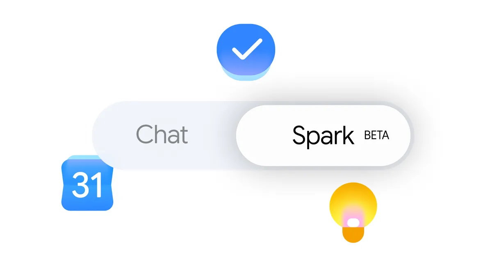

来源：https://blog.google/innovation-and-ai/products/gemini-app/gemini-spark-updates-june-2026/
取文：2026-11-06，直接下载

*We’re bringing Gemini Spark to macOS app, connecting it with more of your favorite apps, and improving its ability to track your topics in real time*

Today, we’re rolling out updates to Gemini Spark that make it even more helpful, from a new desktop experience to deeper connections with your favorite apps. Here’s a look at what’s new:

## Bring Gemini Spark to your Mac

We’re bringing Spark to the Gemini macOS app to help you automate time-consuming tasks across your desktop.

Gemini Spark can now move beyond the chat window, and tackle the heavy lifting across your desktop files and apps. For example, you can turn hours of manual file sorting into an instant action by asking Gemini Spark to sort all the PDFs in your Downloads into specific folders. Gemini Spark also connects your desktop and Google Workspace, so you can simply ask it to create a budget spreadsheet using the latest invoices saved to your computer, and create a schedule to update it regularly. To keep your information secure, Gemini Spark only has access to the files you give it permission to use.

And coming soon, you’ll even be able to run tasks remotely. You can assign a multi-step task to Gemini Spark from your phone — like asking it to find a specific sales report on your Mac, pull the total revenue number, and email it to you — and let it execute the work on your computer while you're away.

Gemini Spark for macOS is available in Beta to Google AI Ultra subscribers aged 18 and over, starting in the US. Download the app at [gemini.google/mac](https://gemini.google/mac/) to get started.

## Connect Gemini Spark to your favorite apps

We’ve expanded our connected apps so Spark can help you across more of the services you use. It now works with Google Tasks and Google Keep, meaning you can ask Spark to scan your scattered brain-dumps in Keep and turn them into action items in Tasks. We’re also launching integrations with Canva, Dropbox, Instacart, OpenTable and Zillow Rentals, so you can easily design custom flyers, access and share your files, reserve a table for date night, order your weekly groceries or reserve an apartment tour. These connected apps are rolling out over the next week on Gemini Spark on web and mobile and will be rolling out to the macOS app in the coming weeks.

We’re also rolling out support for custom Model Context Protocol (MCP), giving you the ability to connect your favorite apps directly into Spark to build a more tailored assistant.

## Stay up to date on topics in real time

We’re also giving Gemini Spark the ability to intelligently track topics and react to events in real time. For example, if you want to stay up to speed on highlights and analysis after your favorite soccer team plays, Spark brings you the latest the moment the match ends. Or, you can ask Spark to send you a detailed financial report if a stock reaches a certain threshold. You can now ask Spark to keep an eye on blogs, news sites, social media, finance, shopping, weather and sports, in addition to your email, so you don't have to constantly hit refresh.

These updates are rolling out starting today, and we look forward to sharing more about what’s next for Spark this summer.
