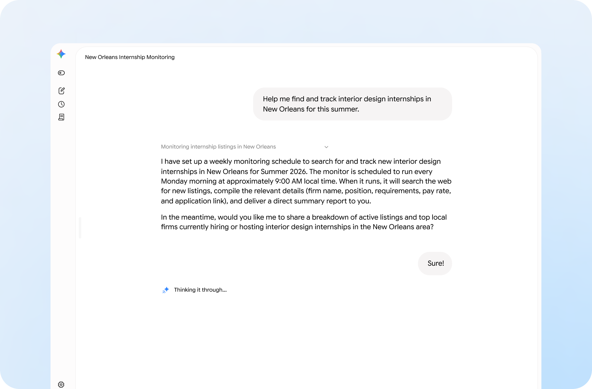
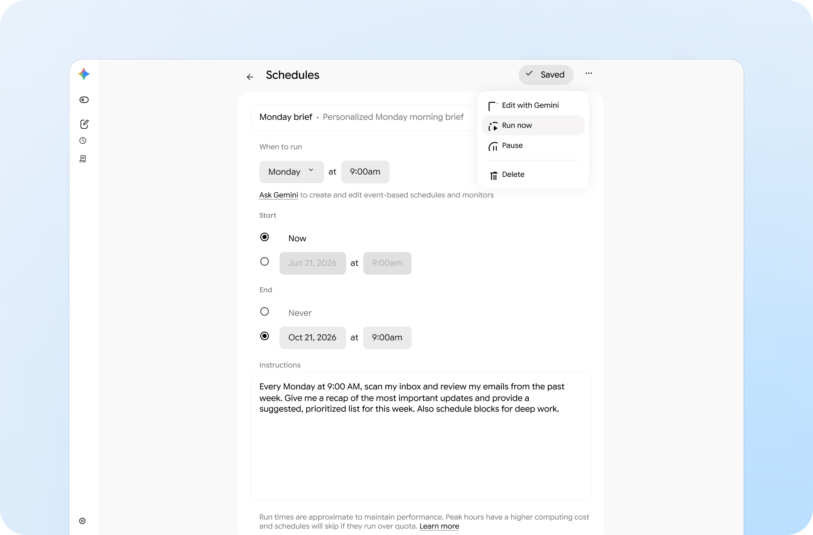
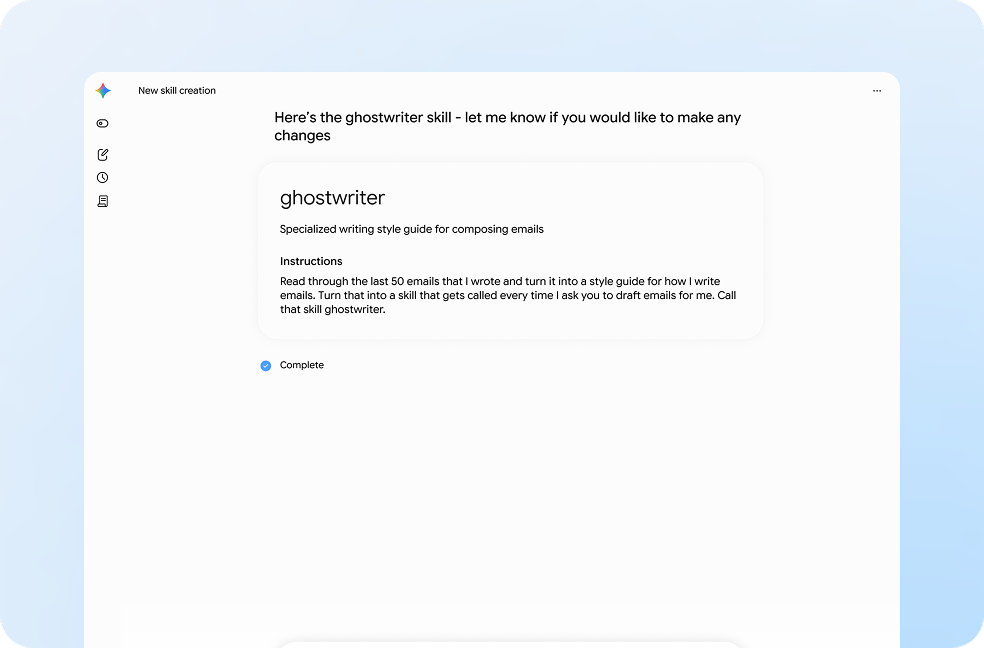
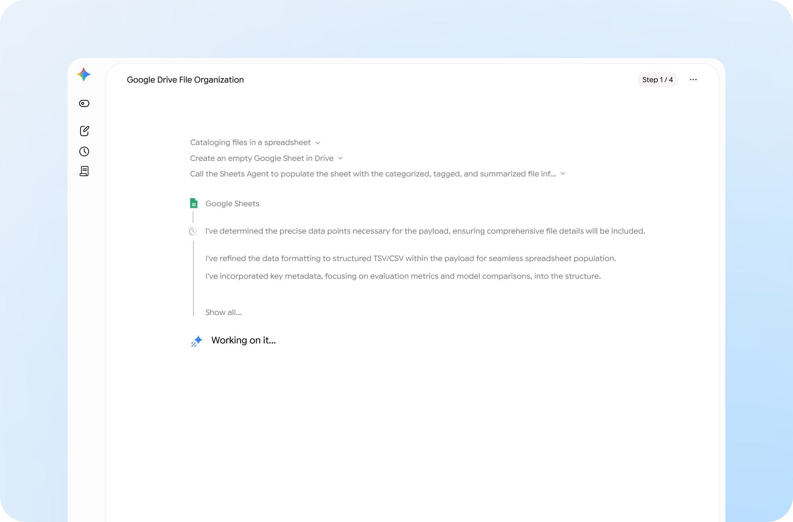
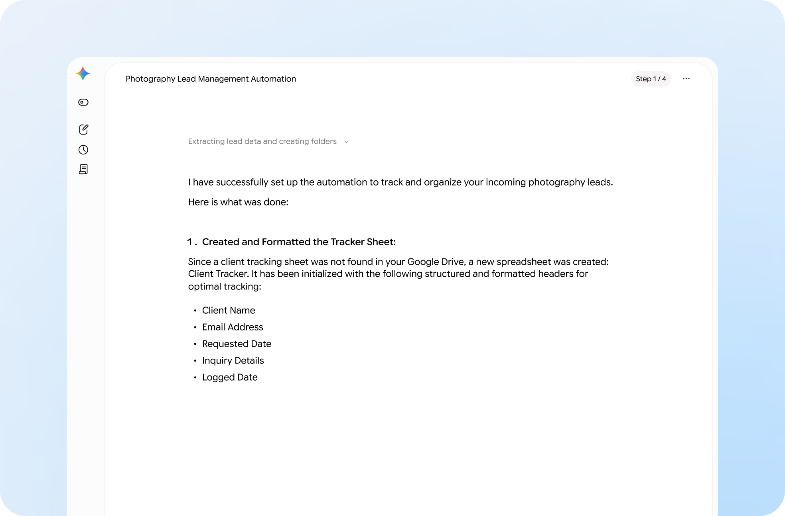
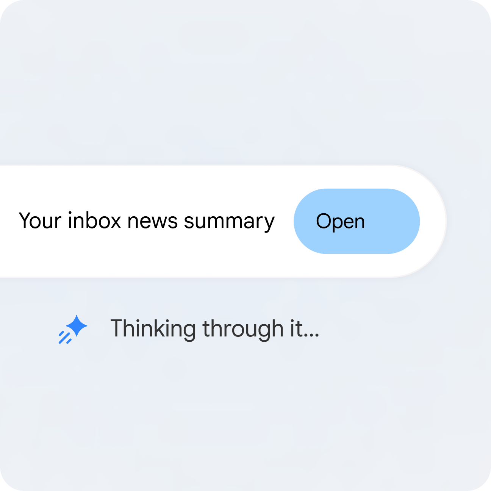
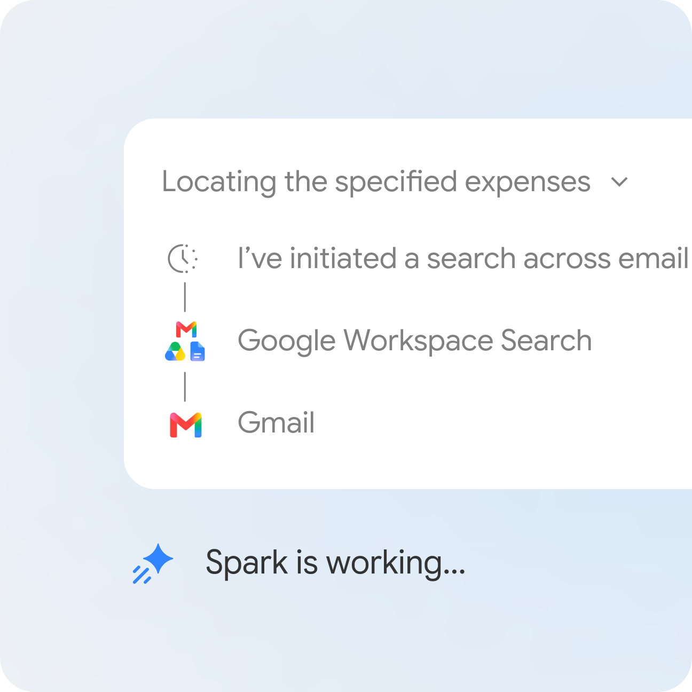
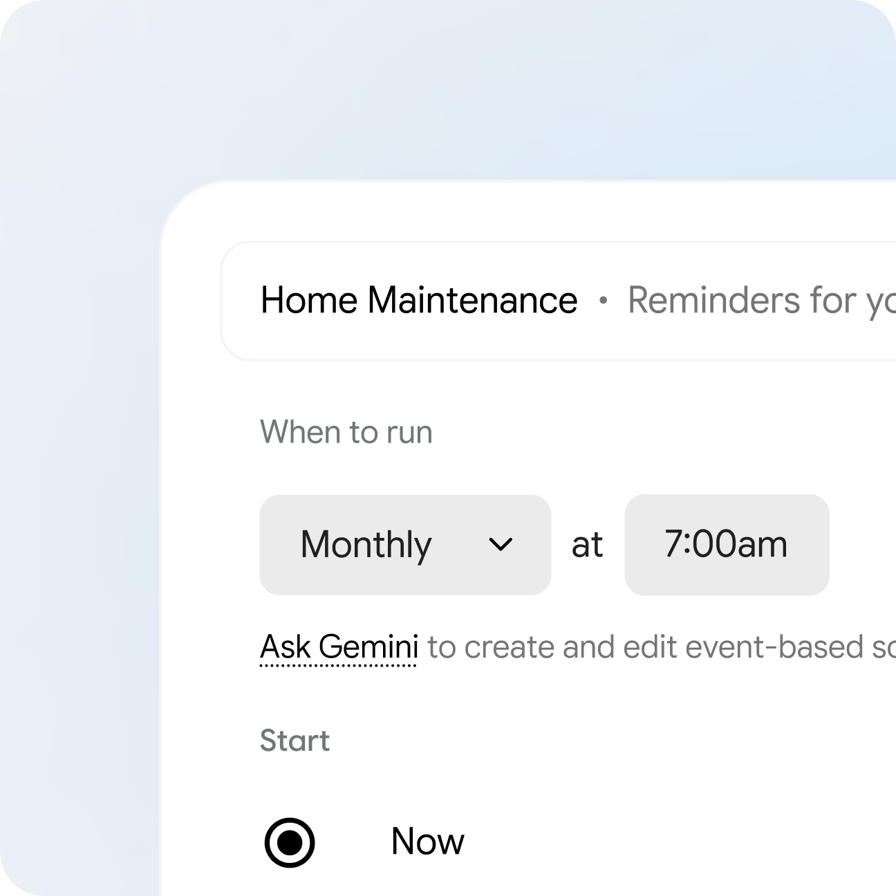
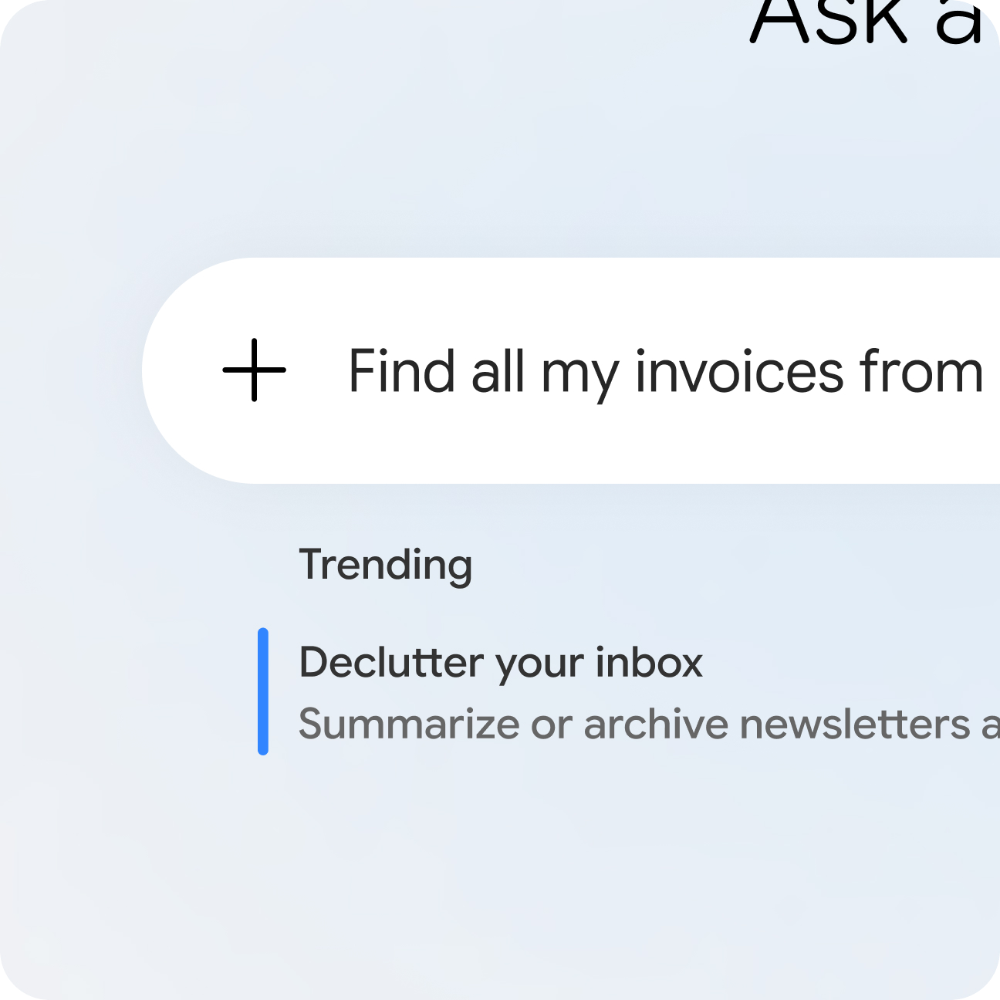



**收录说明**：Spark 改名为 Task 后，产品页已经下线，依据 Internet Archive 的快照存档。页面上每个示例任务在静态 HTML 里出现两次，去掉了重复的一份；常见问题的题目在折叠按钮里，抽取时丢失，按页面上的顺序补回为小标题。原文存于本目录的 original.md，网站上不显示，已翻译。

**内容摘要**：产品页称 Spark 帮用户打理数字生活，给它一个任务就在后台 24/7 工作，即使手机和电脑都关着。页面按任务、计划（Schedules）、技能（Skills）、Workspace、整理五类给出示例提示词，例如追踪实习岗位、每周一汇总邮件、把自己写过的 50 封邮件变成写作风格技能。场景部分包括多步骤待办、订阅邮件综述、团体出行记账、根据发票预判家里的维护需求、查找发票，以及网页调研和预订。常见问题说明 Spark 面向部分国家 18 岁以上的 Google AI Pro 和 Ultra 订阅用户，原生连接 Gmail、Calendar、Drive、Docs、Sheets、Slides、YouTube、Google Maps 等，并称 Spark 不会不加区分地读取邮件，而是按用户的指示工作。

**保留理由**：改名前官方产品页的最后版本，保存了 Google 对 Spark 的定位、示例场景和常见问题。

---

## Gemini Spark：你的 24/7 个人 AI 智能体。

Gemini Spark 帮助你打理数字生活。给它一个任务，它就会在后台全天候工作，即使你的手机和笔记本电脑都关着。它自主运行，但始终在你的指挥之下。你选择开启它，它的设计是在采取重大行动前先与你确认。

- [试用 Gemini Spark](https://gemini.google.com/spark)

任务

帮我找并追踪今年夏天新奥尔良的室内设计实习机会。

计划

每周一上午 9:00，扫描我的收件箱，回顾我过去一周的邮件。给我一份最重要的更新简报，并提供一份按优先级排序的待办清单建议。再安排一些日历时段用于深度工作。

技能

读一遍我最近写的 50 封邮件，把它变成一份我写邮件的风格指南。把它变成一个每次我让你帮我起草邮件时都会调用的技能。把这个技能叫做 ghostwriter。

Workspace

扫描我的 Google Drive，把最重要的文件整理到一个电子表格中，标记信息并添加一些相关备注。

整理

当我收到询问摄影服务的邮件时，自动提取客户姓名、请求日期，并把这条线索记录到我的「Client Tracker」表格中。然后创建一个以客户名字命名的新 Google Drive 文件夹。

## 你最复杂的待办，**已完成。**

多步骤任务对 Gemini Spark 来说不在话下。它可以从头到尾承担繁重的工作。借助 Personal Intelligence，你可以选择连接应用，让 Gemini Spark 在你的数字生态中串联信息，在最需要的地方采取行动。无论你是看着它工作，还是让它在后台运行，它始终在你的指挥之下。

## 你的收件箱，已汇总。

随时掌握你所在行业的所有兴趣和新闻。让 Gemini Spark 关注你的订阅，并总结本周的关键主题。有价值的洞察几秒钟内即可呈现。

## 搞定团体旅行。

把混乱的邮件链变成一份总体计划。Gemini Spark 可以为你下一次团体出游承担繁重工作，包括把收据记录到电子表格，并给同行的人发邮件，让每个人都知道计划。

## 你家的新英雄。

把过去的文书变成对未来的保障。Gemini Spark 会调查你的发票，持续预判你家的下一步需求。告诉它向你的日历添加重复提醒，并在 Keep 中维护一份更新的用品清单，这样你就能把更多时间用来生活，而不是做家务。

## 发票捉迷藏冠军。

Gemini Spark 能穿透收件箱的噪音，精准呈现你所需的内容，例如待处理的发票和放错位置的收据，并为你整理好，让你能把时间花在真正重要的部分——行动上。

## 浏览、预订、购买。

Gemini 可以完成所有耗时的调研和实时网页浏览，跨多个网站收集信息、比较选项，甚至帮助你完成预订。

## 常见问题

### 在哪里可以获取 Gemini Spark，它什么时候会来到我这里？

Gemini Spark 是你的个人 AI 智能体，目前面向部分国家 18 岁以上的 Google AI Pro 和 Ultra 订阅用户以及部分企业用户提供。如果你还没有，别担心，我们正在未来几周内迅速向更多用户和企业扩展访问。在[此处](https://support.google.com/gemini/answer/17094507?hl=en&co=GENIE.Platform%3DAndroid&sjid=2353166824601345951-NA)进一步了解 Gemini Spark 的可用性。

### Gemini Spark 可以与哪些应用配合使用？

Gemini Spark 可以原生连接你常用的 Google 应用，如 Gmail、Calendar、Drive、Docs、Sheets、Slides、YouTube 和 Google Maps。这些连接默认关闭，只需前往你的设置即可开启。启用后，Spark 可以帮助你在整个数字工作空间中采取行动。

### Gemini Spark 会 24/7 读取我的邮件吗？

任务、技能和计划协同工作，释放 Gemini Spark 的全部潜力。借助任务，你可以把 AI 智能体连接到你的 Google Workspace 生态（包括 Gmail、Calendar、Docs、Sheets 和 Slides），让它开始工作。在构建技能时，你可以准确界定希望 Spark 如何针对你经常做的事情采取行动，从而定制体验，免去重复输入提示的麻烦。最后，计划让你能按自己的方式自动化工作量，通过设置基于时间或条件的触发器，在恰好需要时执行任务。

### Gemini Spark 与传统聊天机器人有何不同？

不会。尽管它是一个在后台运行的自主 AI 智能体，但它不会不加区分地读取你的邮件。它在你的指挥下工作，帮助你管理邮件。

### Gemini Spark 能帮我整理拥挤的收件箱吗？

标准聊天机器人等待提示，而 Gemini Spark 可以在你的指挥下代表你主动采取行动。它不只是回答问题，还能跨你的应用完成多步骤任务，因此是真正的 AI 智能体，而不仅仅是对话工具。

### 自动化我的任务需要编程技能吗？

当然。它是一个能力很强的邮件管理 AI 智能体。你可以指示它起草回复、按优先级排序收到的消息，或从长邮件线程中提取行动项，使它成为你在被未读消息淹没时的完美个人 AI 智能体。

完全不需要。我们设计 Gemini Spark 是为了让它成为人人都能使用的 AI 智能体。你用日常对话与它交互。无论你是要设置复杂的多应用计划，还是只把它当作处理日常任务的个人 AI 智能体，都不需要技术专长。

检查回答。密切监督，必要时打断。需要订阅。兼容性和可用性因情况而异。18 岁以上。
