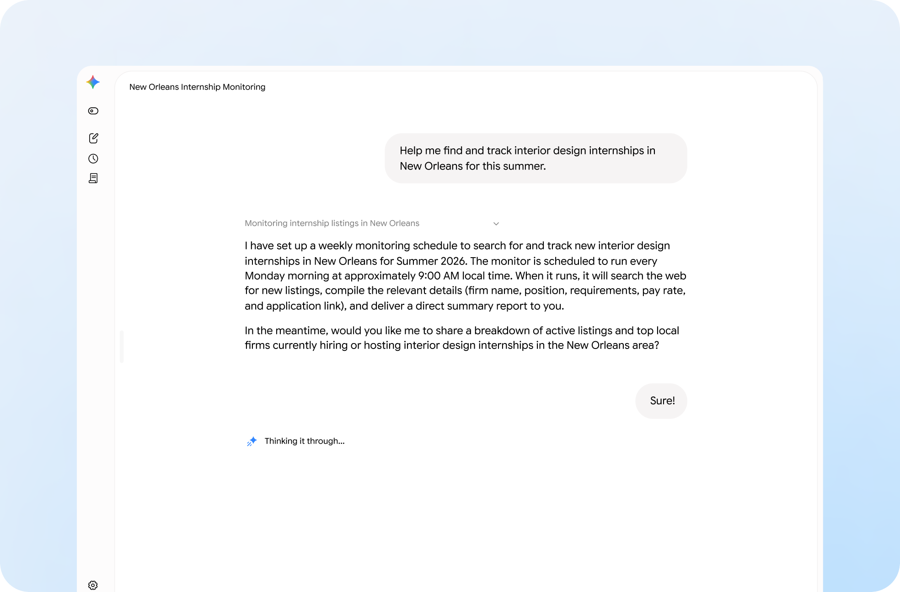
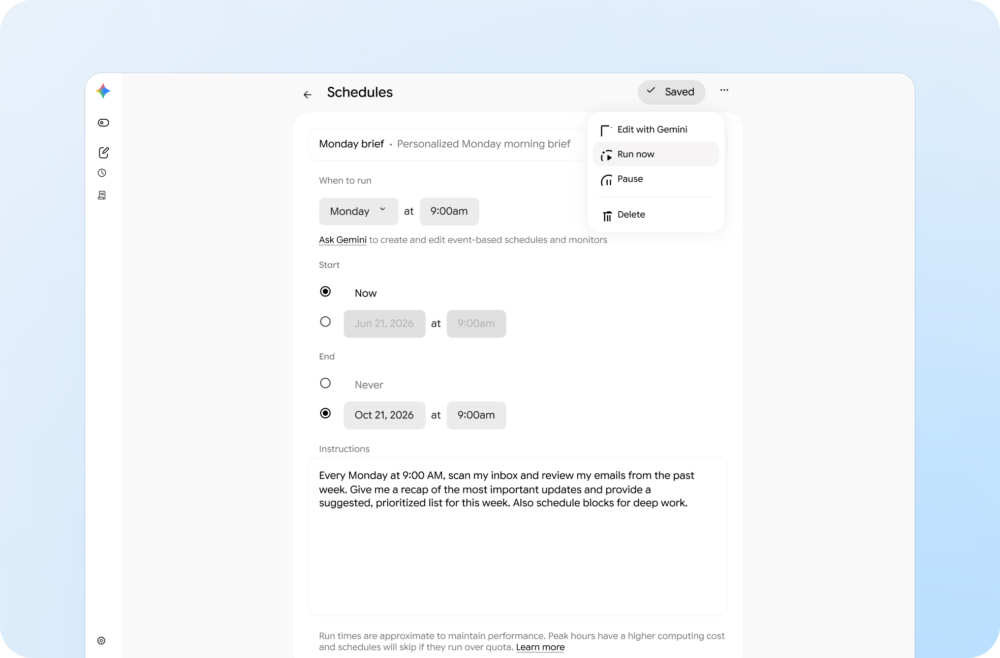
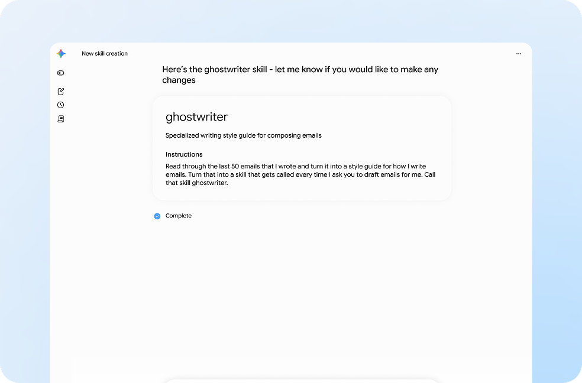
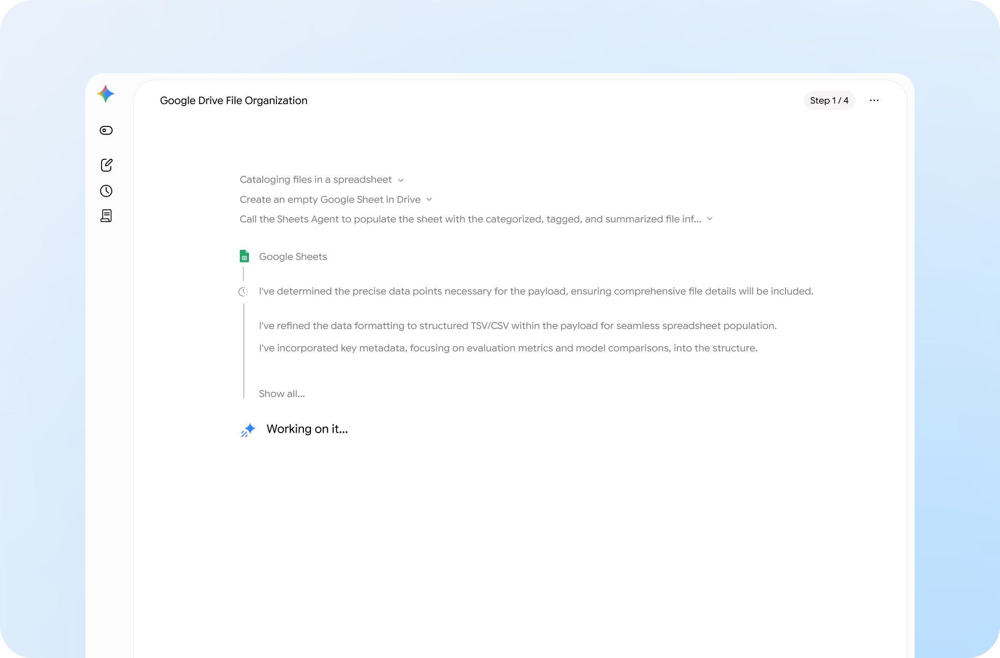
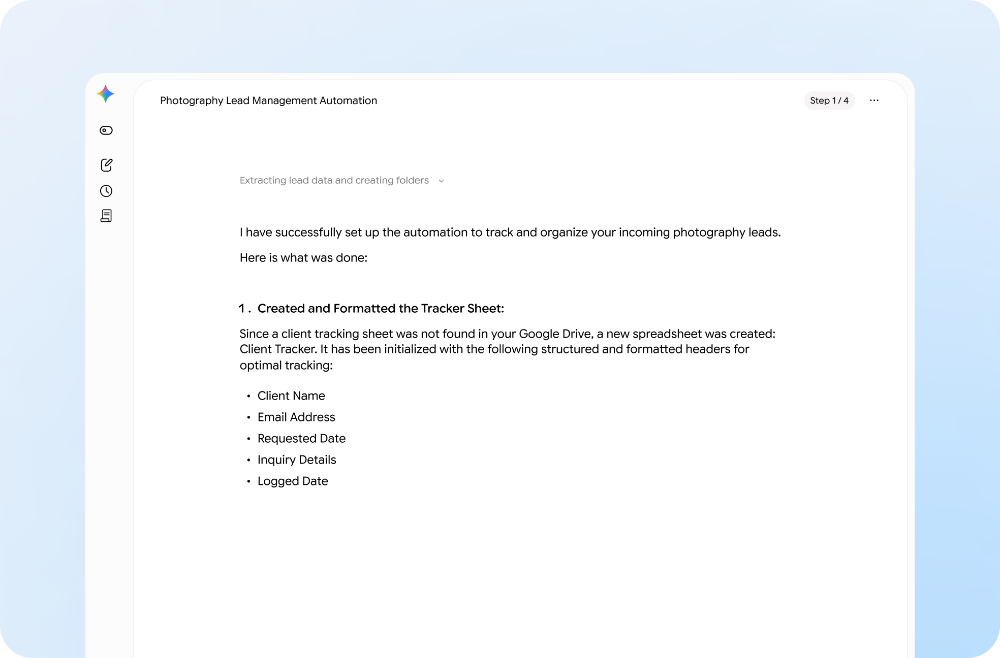
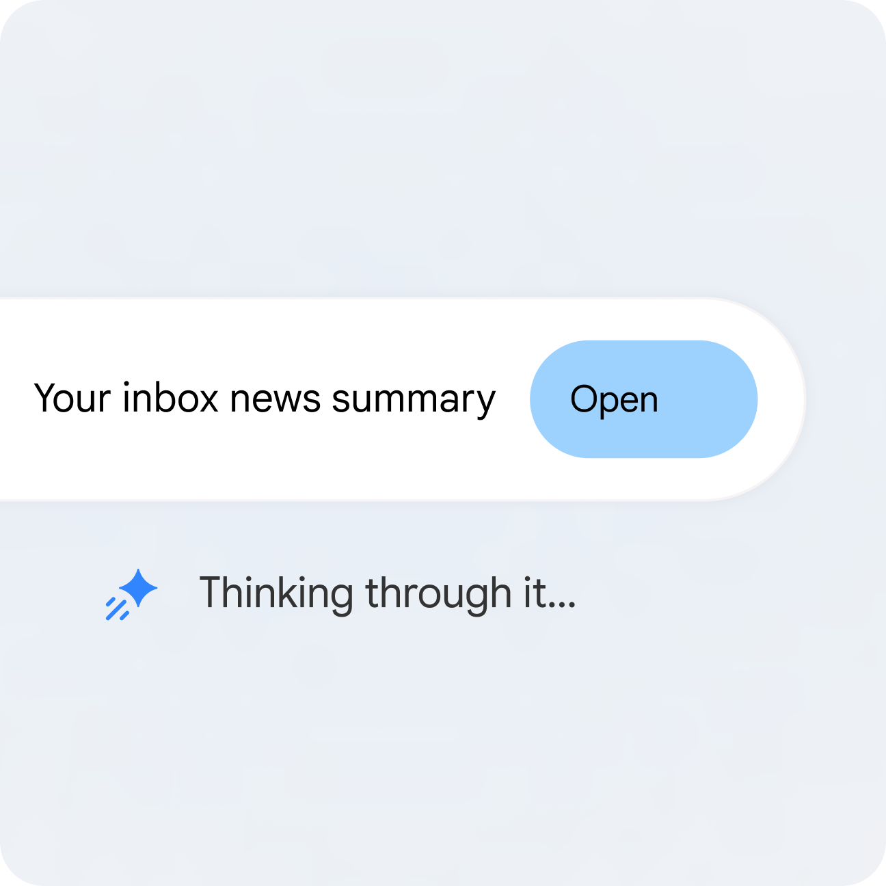
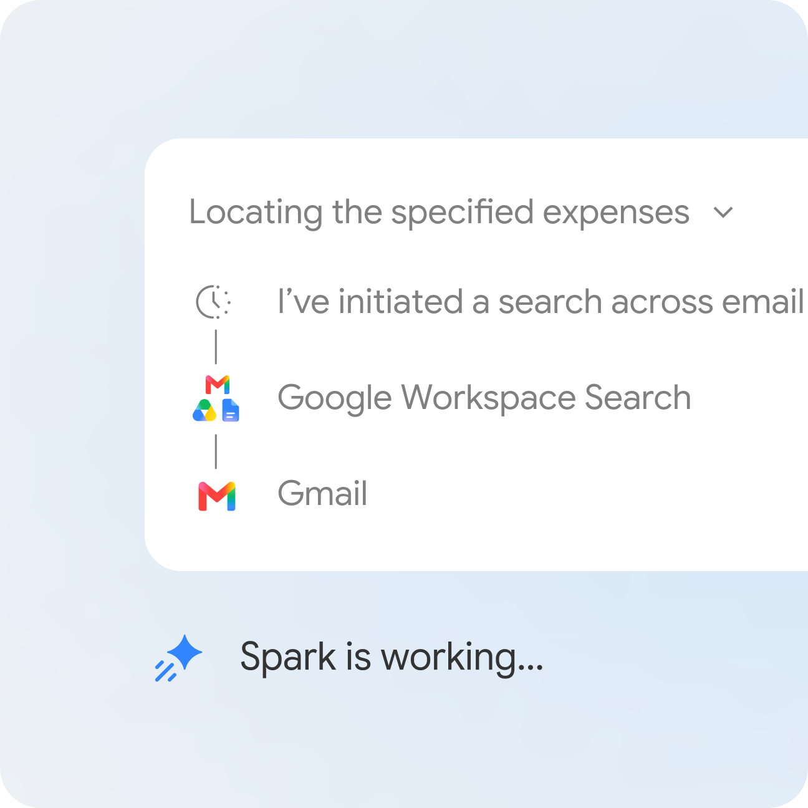
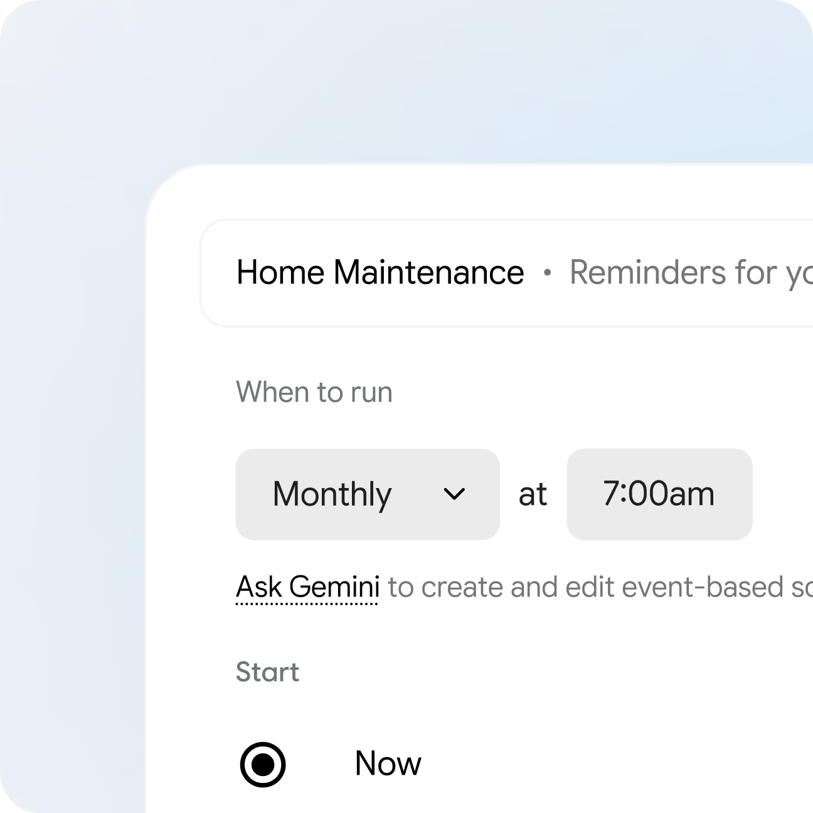
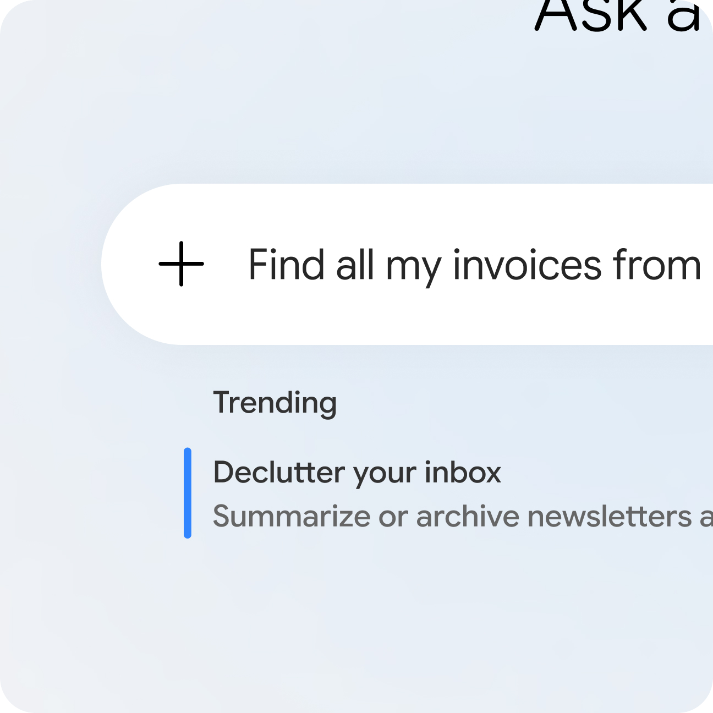

来源：https://web.archive.org/web/20261011114836/https://gemini.google/overview/agent/spark/
取文：2026-11-06，Wayback 快照 20261011114836（原地址现在跳转到 gemini.google/about/）

## Gemini Spark: Your 24/7 personal AI agent.

Gemini Spark helps you navigate your digital life. Give it a task and it works in the background 24/7, even if your phone and laptop are turned off. It operates autonomously, but always under your direction. You choose to turn it on and it's designed to check with you before taking major actions.

- [Try Gemini Spark](https://gemini.google.com/spark)

Tasks

Help me find and track interior design internships in New Orleans for this summer.

Schedules

Every Monday at 9:00 AM, scan my inbox and review my emails from the past week. Give me a quick recap of the most important updates and provide a suggested, prioritized to-do list for this week. Also schedule some calendar blocks for deep work.

Skills

Read through the last 50 emails that I wrote and turn it into a style guide for how I write emails. Turn that into a skill that gets called every time I ask you to draft emails for me. Call that skill ghostwriter.

Workspace

Scan my Google Drive and organize the most important files in a spreadsheet tagging information and adding some notes about it.

Organization

When I receive an email inquiring about my photography services, automatically extract the client’s name, requested date, and log the lead in my “Client Tracker” Sheet. Then create a new Google Drive folder named after the client.

## Your most complex to‑dos, **done.**

Multi-step tasks are no match for Gemini Spark. It can handle the heavy lifting from start to finish. With Personal Intelligence, you can choose to connect apps and let Gemini Spark connect the dots across your digital ecosystem to take action where it matters most. Whether you watch it work or let it run in the background, it’s always under your direction.

## Your inbox, synthesized.

Stay on top of all your industry interests and news. Have Gemini Spark keep an eye on your subscriptions and summarize critical themes for the week. Valuable insights are served in seconds.

## Get a grip on the group trip.

Turn messy email chains into a master plan. Gemini Spark can handle the heavy lifting for your next group getaway including logging receipts into a spreadsheet, and sending an email to the crew so everyone knows the plan.

## Your home’s new hero.

Turn past paperwork into future proofing. Gemini Spark investigates your invoices to anticipate your home’s next needs continuously. Tell it to add recurring reminders to your Calendar and keep an updated supply list in Keep, so you can spend more time living, not doing house chores.

## The invoice hide and seek champion.

Gemini Spark cuts through the noise of your inbox to surface exactly what you need, like pending invoices and misplaced receipts, and organizes them for you, so you can spend time on the truly important part, the action.

## Browse it, book it, buy it.

Gemini can do all the time-consuming research and live web browsing to gather information across multiple sites, compare options, and even help you complete bookings.

## Frequently asked questions

### Where can I get Gemini Spark, and when is it coming to me?

Gemini Spark is your personal AI agent currently available for Google AI Pro and Ultra subscribers over 18 in select countries as well as select business users. Don't worry if you don't have it yet, we’re rapidly expanding access to more users and businesses over the coming weeks. Learn more about Gemini Spark’s availability [here](https://support.google.com/gemini/answer/17094507?hl=en&co=GENIE.Platform%3DAndroid&sjid=2353166824601345951-NA).

### Which apps can Gemini Spark work with?

Gemini Spark can connect natively with your favorite Google apps like Gmail, Calendar, Drive, Docs, Sheets, Slides, YouTube, and Google Maps. These connections are turned off by default, just head to your settings to turn them on. Once activated, Spark can help you take action across your entire digital workspace.

### Is Gemini Spark reading my emails 24/7?

Tasks, Skills, and Schedules work together to unlock Gemini Spark's full potential. With Tasks, you can put your AI agent to work by connecting it to your Google Workspace ecosystem, including Gmail, Calendar, Docs, Sheets, and Slides. As you build Skills, you define exactly how you want Spark to take actions on things you do often, tailoring your experience and saving you from repetitive prompting. Finally, Schedules allow you to automate your workload on your own terms by setting up time-based or conditional triggers to execute tasks exactly when you need them.

### How does Gemini Spark differ from a traditional chatbot?

No. Although it is an autonomous AI agent running in the background, it does not read your emails indiscriminately. It works under your direction to help you with email management.

### Can Gemini Spark help organize my crowded inbox?

While standard chatbots wait for a prompt, Gemini Spark can take proactive action on your behalf, under your direction. It doesn't just answer questions, it completes multi-step tasks across your applications making it a true AI agent rather than just a conversational tool.

### Do I need coding skills to automate my tasks?

Absolutely. It is a highly capable AI agent for email management. You can instruct it to draft replies, sort incoming messages based on priority, or extract action items from long threads, making it the perfect AI agent for personal use when you're overwhelmed by unread messages.

Not at all. We designed Gemini Spark to be an accessible AI agent for everyone. You interact with it using regular conversation. Whether you're setting up complex, multi-app schedules or just using it as a personal AI agent for your daily tasks, no technical expertise is required.

Check responses. Supervise closely, interrupt when needed. Subscription required. Compatibility and availability vary. 18+.
