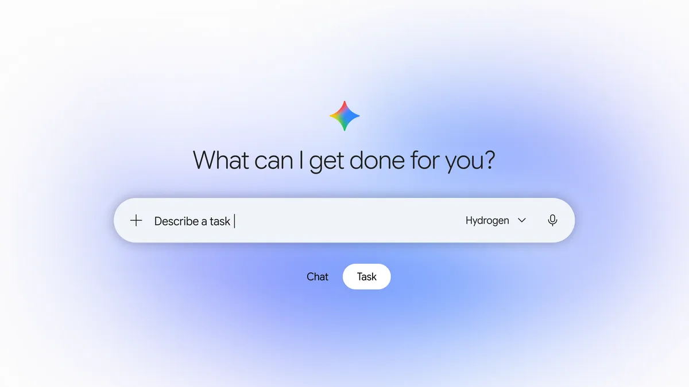
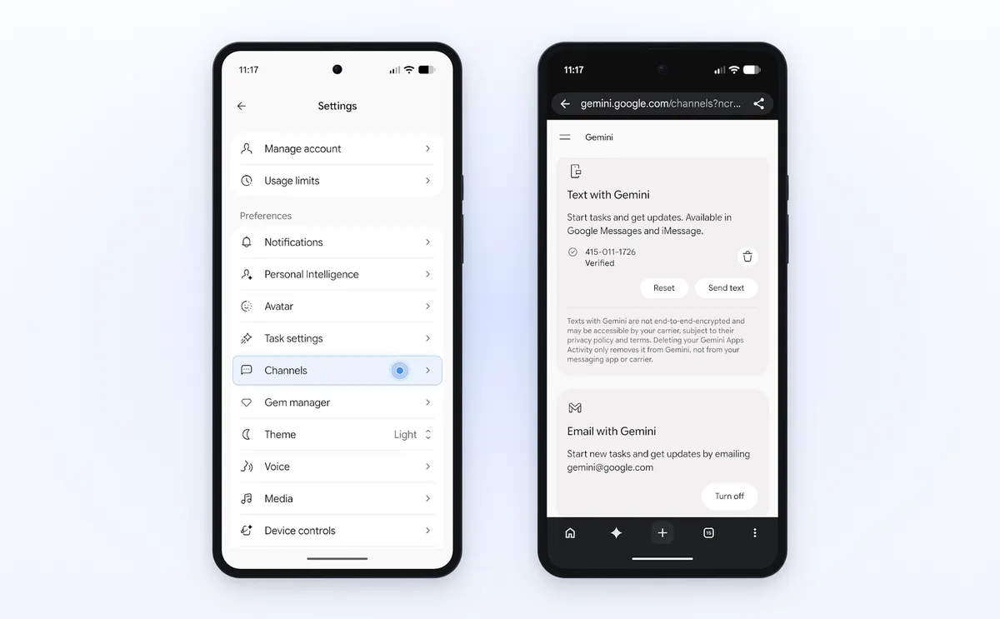



**收录说明**：官方博客，作者是 Gemini 应用、Labs 与 AI Studio 的副总裁。页面上的分享按钮、音频播放器、AI 生成的要点摘要和「Explore other styles」切换未收入；头图换成站点提供的 1200 像素宽版本；两个脚注从页面脚注区补回，改为 Markdown 脚注。原文存于本目录的 original.md，网站上不显示，已翻译。

**内容摘要**：Tasks in Gemini 从 2026-11-17 起免费向美国、日本、韩国、加拿大、澳大利亚、印度的数亿用户推出，使用新的 Gemini 4 Hydrogen 模型，一批高级功能先在美国推出。作者以自己的使用为例：让 Gemini 同时给两家经销商打电话并在五分钟内订好保养预约，用 Google Password Manager 登录公用事业门户，查出 389 美元电费账单的原因。购物走 Agent Payments Protocol（AP2），由 Visa、Mastercard 与（即将支持的）American Express 提供令牌，可设消费上限；还可以通过 RCS 短信和转发邮件到 gemini@google.com 派任务，Gemini 目前可连接 60 多个应用。安全部分称任务在 Agent Compute Engine 的硬件隔离虚拟机中运行，点击「购买」前会请求确认；入口是把首页开关从 Chat 切到 Task。

**保留理由**：官方对 Task 免费开放及短信、邮件、支付、代打电话一批新功能的发布文，给出了地区、模型、支付协议与隔离环境的说法。

---

*Gemini 现在可以打电话、付账单，并帮你完成任务。*

最好的助手了解你，并帮你把事情办成。今天起，你可以把更多任务交给 Gemini，然后继续过你的一天。我们打造它是为了所有那些被上课、开会、接送孩子填满、任务越堆越多的人。我们的目标是让 Gemini 为你省时省钱。

从现在开始，这项更新将在美国、日本、韩国、加拿大、澳大利亚和印度免费向数亿人推出，使用我们新的 Gemini 4 Hydrogen 模型。我们还会先在美国推出一批高级功能。

## 它如何改变我的日常

如果你的邮件、日历、密码、照片、文件和支付卡已经在 Google 生态里，Gemini 就是你作为个人助手的最佳选择，因为这些敏感数据已经安全地存放在 Google，你不需要把它们发送到别处。

以下是我的用法。

最近，我们家小型厢式车的发动机故障灯亮了。唉。我拿出 Gemini，对它说：「我们的小型厢式车该保养了。请给最近的两家经销商打电话，想办法在接下来一个月左右的某个周五清晨约到保养。」

因为 Gemini 通过 [Personal Intelligence](https://blog.google/innovation-and-ai/products/gemini-app/personal-intelligence/) 已经知道我们开的是 2019 款 Honda Odyssey、也知道我们住在哪里，它在 Google 地图上找到了最近的几家店，并同时给两家打了电话[^1]。谢天谢地，我不用忍受任何等待音乐。Gemini 办成了事，在我 Google 日历里找到了我有空的时段，不到五分钟就把周五清晨的预约加了进去。搞定。（在经销商那端，Gemini 一开口就说明自己是 AI。商家随时可以[选择退出](https://support.google.com/business/answer/7690269)，而且除非我同意，Gemini 不会透露我的付款或私人账号信息。）

在后台，Gemini 同时给两家经销商打了电话，替我听了等待音乐，在只接受预约（不接受到店）的那家店订好了时间，并把周五的预约放进我的日历，而我不必自己去核对。

上个月，我们收到一张出乎意料的 389 美元电费账单，它帮我们实实在在省了钱。我授予 Gemini 通过新的 Google Password Manager 集成访问我们公用事业门户的权限，并让它分析我邮件里的过往账单。Gemini 工作了几分钟，然后精准找到了原因。主要祸首是我们的热泵，原来它在下午 4 点左右启动，正好赶上高峰电价。我和妻子自己翻 PDF 和邮件是绝不可能发现这一点的。

我也会用它处理小事。为了即将回俄克拉何马州的假期旅行，我最近让 Gemini 给我推荐最好的 USB-C 充电器。Gemini 借助 Google 的 Shopping Graph 快速比较了各款充电器，追问了我对功率和颜色的要求，然后通过新的 Google Pay 集成帮我结账。最棒的是：它还找到了一个折扣码，让我又省了 10 美元。搞定。

Gemini 现在使用 Agent Payments Protocol（AP2）来完成这类购买。我们正与 American Express（即将支持）、Mastercard 和 Visa 合作，在受支持的卡片上用数字令牌保障你的购买安全。用 Gemini 购物时，你仍然能在结账时获得卡片的积分、返现或购买保护。你还可以事先设定硬性消费上限，Gemini 被设计为不会超出你的预算。你所有的收据和物流信息会直接进入 Google Wallet，而 Google Wallet [从今天开始](https://blog.google/products-and-platforms/platforms/google-pay/wallet-available-ios-united-states/)扩展到 iOS。接下来，我们会把 [Universal Commerce Protocol（UCP）](https://developers.google.com/merchant/ucp)集成到 Gemini 中，让每个人都能期待从发现商品到结账都更快、更可靠的购物体验。

Gemini 让你设定消费上限，同时仍然赚取卡上的每一英里航程、每一笔返现和每一项权益。

Gemini 也能帮忙解决工作日的晚餐。最近我早上匆忙出门时，面对几乎空空的冰箱，用新的 RCS 集成[^2]给 Gemini 发了条短信：「把千层面、草莓、黄瓜和香草冰淇淋加到我们的 Instacart 订单里。」出门路上，我看到食品柜里有个空了的 Cheerios 盒子，就拍了张照，补发了一句：「这个也加上。」Gemini 加上了，然后把我交给 Instacart 完成订单。我们到家时，食品杂货已经放在门口了。搞定。如今 Gemini 可以连接 60 多个常用应用，作为开发者，你也可以申请加入我们的[已连接应用平台](https://blog.google/innovation-and-ai/technology/developers-tools/connected-apps-one-place/)。

我和妻子还用 Gemini 处理医疗账单、跟踪保险续期，以及掌握孩子们的日程。本周早些时候，我把一批学校邮件从 Gmail 转发到 gemini@google.com。不到一分钟，所有日期都进了我的日历，并邀请了我妻子。更棒的是，它发现篮球训练有一次冲突，并问我要不要给另一位家长发短信换一下接送安排。

## 我们如何保护你的数据

随着 Gemini 能力增强，我们不断提升安全防御。当你给 Gemini 分配任务时，它会使用 [Google Cloud 的 Agent Compute Engine](https://cloud.google.com/blog/topics/ai-infrastructure/agent-compute-engine-deep-dive)，在专属于你的账号、从不与其他用户共享的硬件隔离虚拟机中工作。每台虚拟机都有沙箱隔离，因此 Gemini 在一个独立、隔离的环境中工作，该环境会定期由我们的安全红队测试。这个沙箱只是多层防御中的一层，其他层还包括提示注入过滤器（用于扫描搜索结果、网页等）以及 Google 安全浏览，以限制 Gemini 可以打开的链接。

Gemini 处理任务时，你随时可以介入给它更多指令；它也被设计为在关键步骤前暂停并与你确认。例如，Gemini 被设计为在点击「购买」前请求你的确认或预先批准，并在指令含糊时提出澄清问题。对于你已经信任的日常事务，比如把那盒 Cheerios 加进购物车，你可以把它设为「始终允许」，这样它就不会反复打扰你。

最后，我们为你提供设置和工具，帮助你保护数据和隐私。你可以随时调整任务设置、断开 Google 和第三方应用，或删除对话历史。关于我们如何实施多层纵深防御安全策略的详细介绍，请阅读我们的[技术论文](https://blog.google/security/how-geminis-defense-in-depth-approach-works/)。

也请通过 Google 的 [AI 漏洞奖励计划（AI Vulnerability Reward Program，AI VRP）](https://bughunters.google.com/about/rules/google-friends/ai-vulnerability-reward-program-rules)参与我们的漏洞赏金计划，共同提升智能体系统的安全性。

## 你可以如何帮助我们改进

虽然我们对任务做了大量测试以尽量减少错误，但并没有消除所有错误。你可能会遇到任务无法完成或没有达到预期的情况。遇到这种情况时，请给该回答点「踩」来提供反馈。

例如，个人助手浏览网页的方式仍在演进，因为网站也还在适应这些新用例。在某些网站上，Gemini 可能能走完大部分流程，然后把屏幕交还给你，让你点最后一个按钮。我们正直接与主要网站和安全服务商合作，帮助网页生态演进，使其对网站所有者和个人助手都能良好运作。几十年来，机器人默认被拦截，因为其中大多数是恶意的。个人助手需要更细致的处理方式，我们相信开放、可验证的标准会让所有人受益。

## 如何试用

准备好交出你的下一个任务了吗？打开 Gemini，把首页开关从 Chat 切到 Task，然后告诉 Gemini 你需要做什么。从美国开始，你还可以把邮件转发到 [gemini@google.com](mailto:gemini@google.com)，或按以下说明给 Gemini 发短信：

1. 在 Android 或 iOS 上打开 Gemini，点**设置**
2. 点**渠道**
3. 在**用短信与 Gemini 交流**下点**设置**
4. 验证你的电话号码

我们迫不及待想看到 Gemini 第一个帮你划掉的是什么。

[^1]: 通过 Gemini 拨打电话目前在印第安纳州、路易斯安那州、明尼苏达州、蒙大拿州和内布拉斯加州不可用。
[^2]: 你必须拥有美国电话号码，并使用符合条件的移动运营商。
