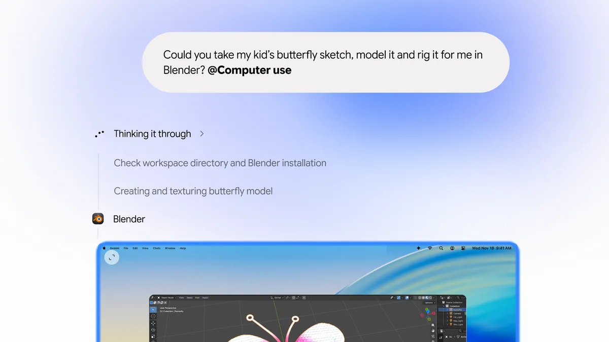



**收录说明**：官方博客。页面上的分享按钮、音频播放器、AI 生成的要点摘要和「Explore other styles」切换未收入；脚注从页面脚注区补回，改为 Markdown 脚注。博客没有提到 Task，但帮助页「Manage browser & app permissions for tasks in Gemini」把 Computer use 设置放在任务线程的权限里讲，并链到 Mac 上的任务帮助页，所以按 Task 资料收入。原文存于本目录的 original.md，网站上不显示，已翻译。

**内容摘要**：2026-11-19 起，Gemini 的 Mac 应用可以用 computer use 跨本地文件、桌面应用和网页完成多步任务。Gemini 在隔离的后台窗口里工作，聊天中有实时预览，用户的屏幕和光标不受占用；用户选择 Gemini 可访问的应用，可随时暂停，关键动作前需要批准。示例包括批量调色、从本地 PDF 提取数据填运费表、从多地区仪表盘生成 Google Slides、批量上架二手商品。目前只在美国以英语推出，脚注要求 Apple Silicon Mac、macOS Sequoia 15.0 以上、18 岁以上个人账号，面向 Google AI Plus、Pro、Ultra 用户。

**保留理由**：说明了 Mac 上 computer use 的运行方式（隔离后台窗口）与硬件、账号门槛，可与 6 月 Spark 上 Mac 时的说法对照。

---

*Gemini 现在可以在后台操作 Mac 应用和网站，完成复杂的任务。*

从今天起，Mac 版 Gemini 应用中的 computer use 帮助你在本地文件、桌面应用和网页之间完成多步任务。这能为你省下平时需要几十次点击的重复工作。你只需描述你需要什么，Gemini 就替你完成点击、输入、菜单和表单操作。

Gemini 在一个隔离的后台窗口中工作，聊天里就有实时预览。你的主屏幕和光标完全不受占用，因此你可以继续打字、设计或接电话，不被打断。隐私和安全是内置的：你选择 Gemini 可以访问哪些应用，实时观看每一步，随时暂停，并在关键操作发生前批准它们。

以下是你可以今天就试起来的几种用法：

- **加快创意工作流程：** 在你常用的设计软件里批量给照片调色，或搭建复杂的 3D 场景。
- **跳过手动填表：** 从本地 PDF 中提取重量、尺寸和地址，用来填写多箱运费报价。
- **把实时数据变成可直接演示的幻灯片：** 从多个地区的实时仪表盘抓取指标和截图，在 Google Slides 中生成一份演示文稿。
- **批量上架出售商品：** 分析本地文件夹中的衣物照片、调研定价、记录商品信息，并在转售平台上准备好商品列表。

computer use 正以英语在美国的 Mac 版 Gemini 应用中逐步推出[^1]。在 [gemini.google/mac](http://gemini.google/mac) 下载应用即可开始。

[^1]: 需要运行 macOS Sequoia 15.0 及以上的 Apple Silicon Mac。面向 18 岁以上、使用个人 Google 账户的用户，可提供给 Google AI Plus、Pro 和 Ultra 用户。
