

**收录说明**：Gemini 新的产品页，替代已下线的 Spark 产品页（旧版快照见 2026-10-11 的 Spark 产品页）。页面分 Tasks、Skills、Connected Apps 三部分，全部收入。常见问题的题目在折叠按钮里，抽取时丢失，按页面顺序补回为小标题；Tasks 部分的两个示例提示词在静态 HTML 中各出现两次，去掉了重复的一份；页面图片已下载，较大的几张已缩小。原文存于本目录的 original.md，网站上不显示，已翻译。

**内容摘要**：页首称 Tasks in Gemini 免费，入口是把主聊天的开关从 Chat 切到 Tasks；常见问题写明免费面向美国、加拿大、澳大利亚、印度、日本、韩国的 18 岁以上用户，部分国家的 Pro/Ultra 用户也可用。Tasks 可原生连接 Gmail、日历、Drive、Docs、Sheets、Slides、YouTube、Google 地图，另有 50 多个第三方应用；常见问题称 Tasks 虽在后台运行，但不会不加区分地读取邮件。Skills 部分介绍可复用、可叠加的技能，并给出 Gems 停用与自动迁移为技能的时间表。Connected Apps 部分列出 Instacart、Lyft、OpenTable、Shopify、QuickBooks、Notion、Figma、Adobe Creative Cloud 等第三方应用。

**保留理由**：改名、免费开放后官方对 Task 的定位与常见问题，并把 Tasks、Skills、Connected Apps 放在一起介绍，可与 Spark 时期的产品页对照。

---

认识 **Tasks in Gemini。** 免费使用，帮手众多。

把繁琐的杂事交出去，让 Gemini 帮你省时间，还能帮你找到省钱的办法——现在免费。

- [试用 Tasks in Gemini](https://gemini.google.com/app/download/mobile?android-min-version=301356232&ios-min-version=322.0&is_sa=1&pt=9008&mt=8&target=agent&&&&campaign_id=gemini_tasks_webpage&ct=gemini_tasks_webpage&icid=microsite_gemini_productivity_page&redirect=home)

## 噢，你能**完成**的事。

那些通常要花时间、开一堆标签页、来回折腾许多次的事情，都可以让它来帮忙。有你的引导，接下来 Gemini 就能接手。

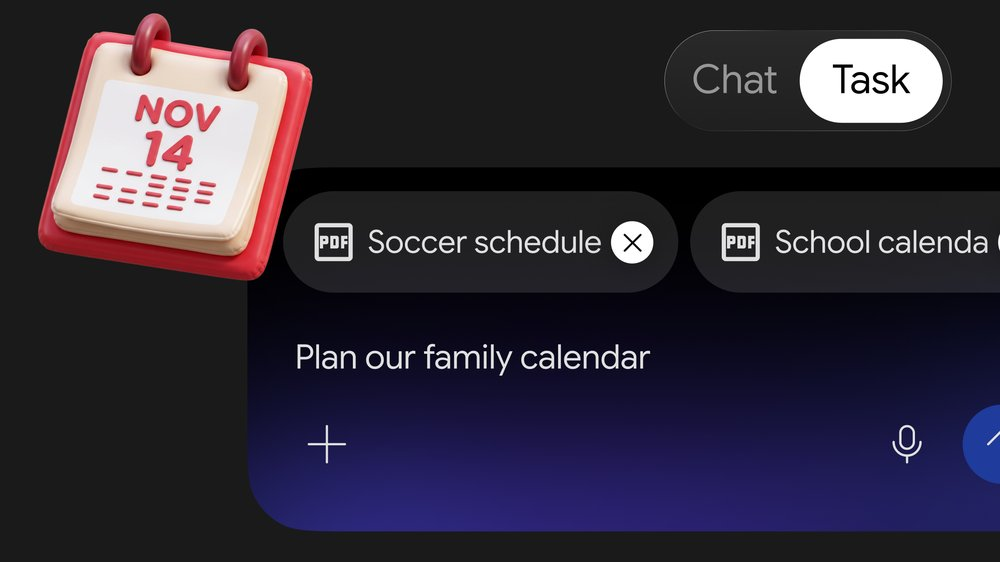

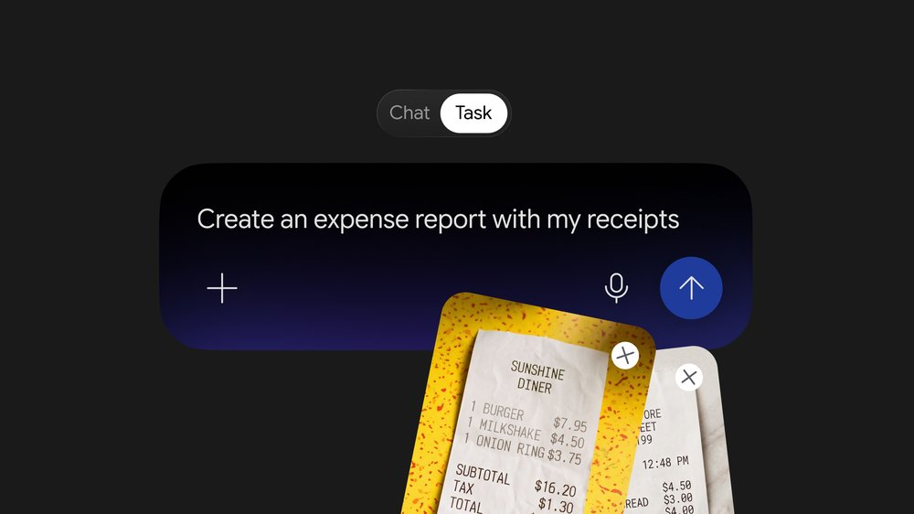

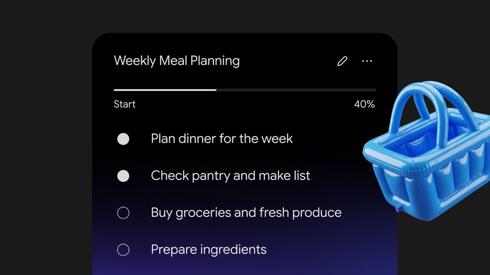

## 用 Gemini 找到省钱的办法。

让 Gemini 去搜寻省钱的办法。找出你不再需要的重复性开支，为你最想要的优惠设置提醒，还有更多。

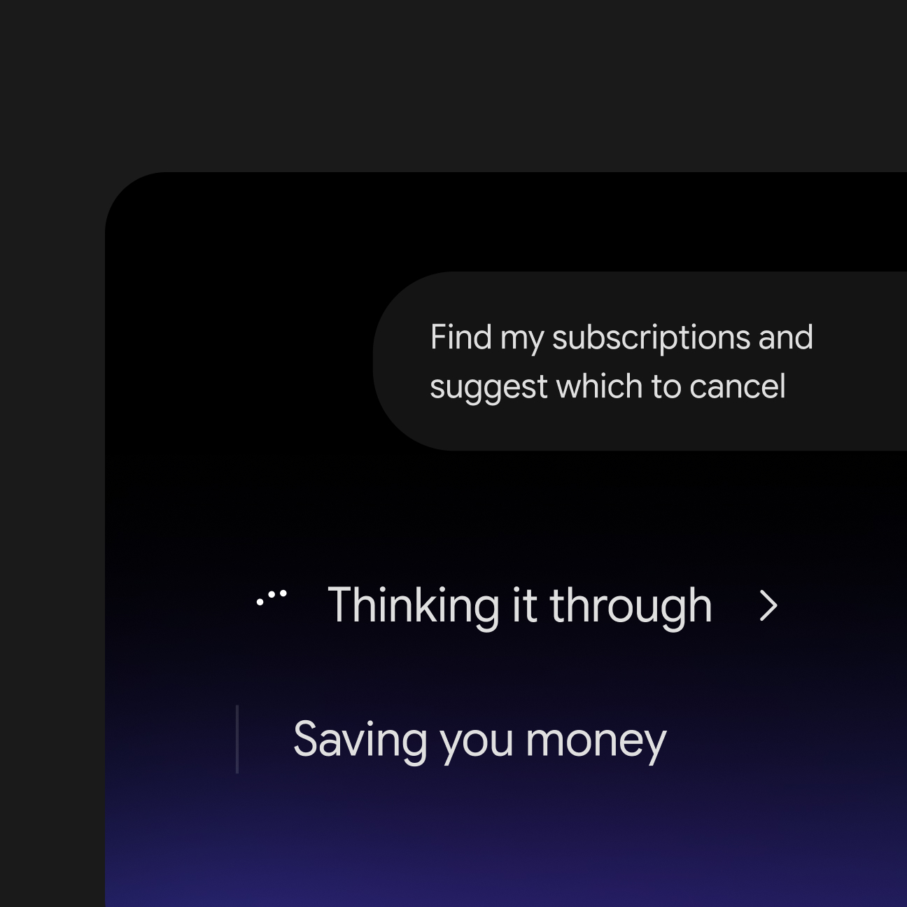

## 为自己工作，而不是独自工作。

从开始动手到把事情做完。把你想完成的事交给 Gemini，让它与你并肩工作。

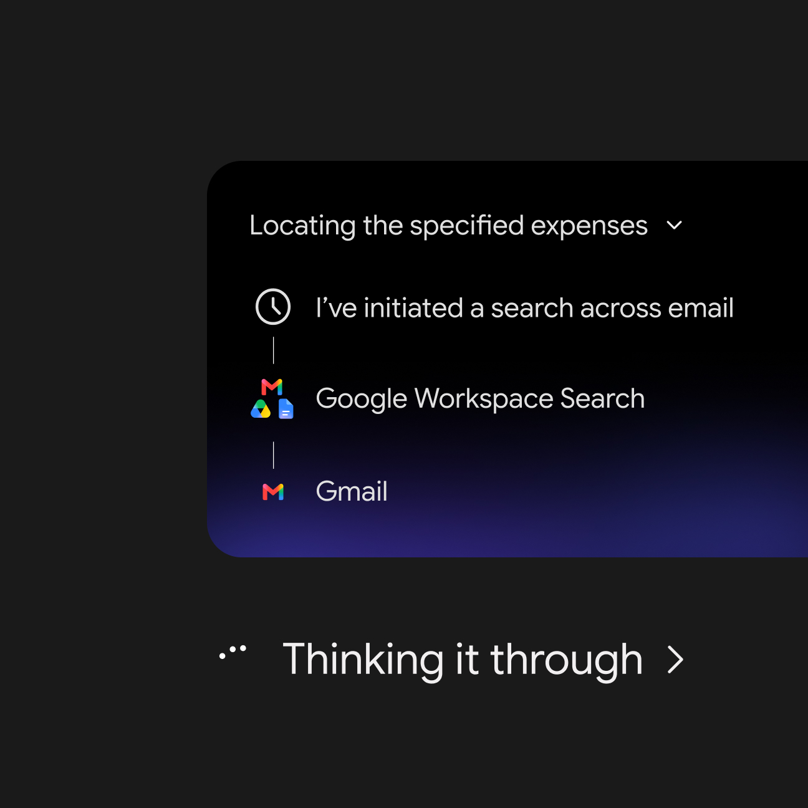

## 就当它已经做好了。

从最初的想法，到做好的演示文稿、文档、电子表格等等。Gemini 可以在你的对话中直接帮你创建、编辑和完善所有文件。

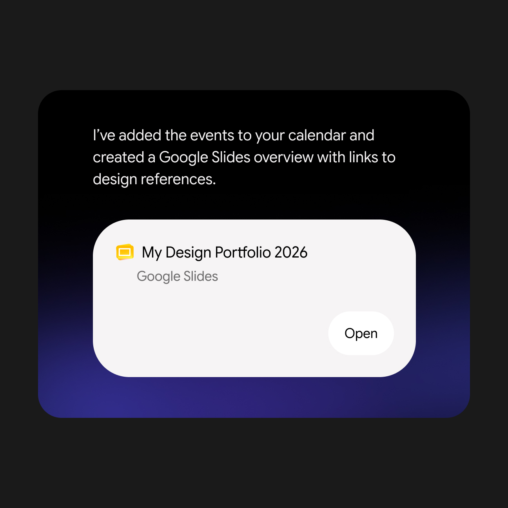

## 让 Gemini 开工。

找出你的工作流自动化中还缺什么。让 Gemini 在你的指挥下，从开始动手到把事情做完。

- [试用 Tasks in Gemini](https://gemini.google.com/app/download/mobile?android-min-version=301356232&ios-min-version=322.0&is_sa=1&pt=9008&mt=8&target=agent&&&&campaign_id=gemini_tasks_webpage&ct=gemini_tasks_webpage&icid=microsite_gemini_productivity_page&redirect=home)

## 你最复杂的待办，**已完成。**

那些通常要花时间、开一堆标签页、来回折腾许多次的事情，都可以让它来帮忙。有你的引导，接下来 Gemini 就能接手。

任务

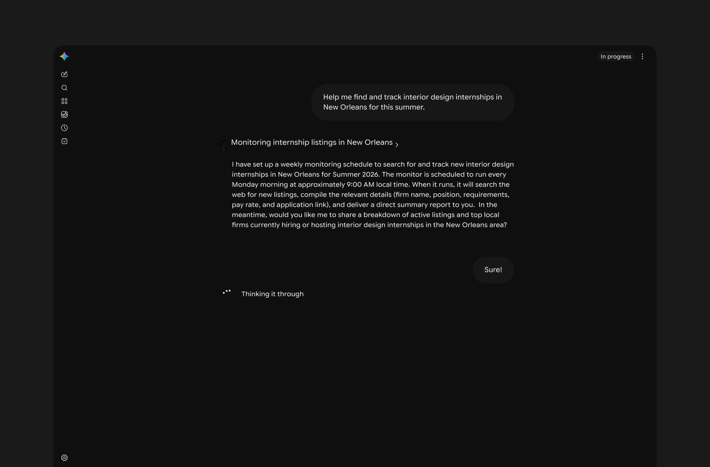

Help me find and track interior design internships in New Orleans for this summer.
（译注：意为「帮我找今年夏天新奥尔良的室内设计实习，并持续跟进」。）

计划

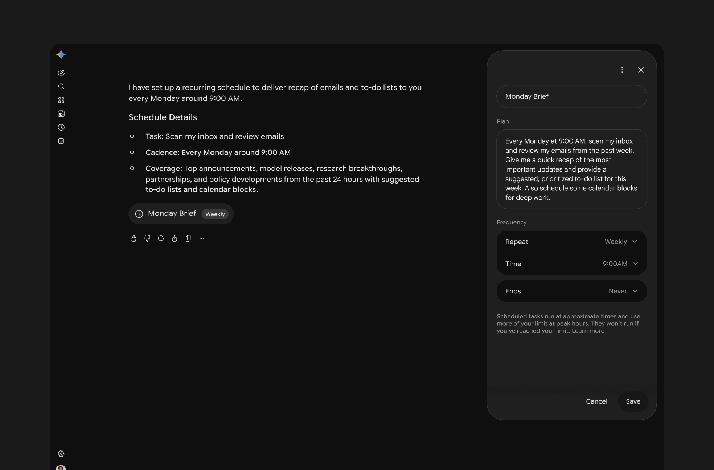

Every Monday at 9:00 AM, scan my inbox and review my emails from the past week. Give me a quick recap of the most important updates and provide a suggested, prioritized to-do list for this week. Also schedule some calendar blocks for deep work.
（译注：意为「每周一上午 9:00，扫描我的收件箱，查看过去一周的邮件。简要回顾最重要的更新，并给出一份按优先级排好的本周待办清单。另外安排一些用于深度工作的日历时段」。）

## 常见问题

### 在哪里可以使用 Tasks in Gemini，什么时候会提供给我？

Tasks in Gemini 现在可以直接从 Gemini 的主聊天中使用。只要把开关从「Chat」切换到「Tasks」，就能把繁琐的杂事交给 Gemini。

无论是安排每天早晨的邮件和日历简报、为即将到来的旅行制定行程，还是把重复性的调研自动化，Tasks in Gemini 都会从头到尾完成执行，并在结果准备好时立即通知你。

Tasks in Gemini 对美国、加拿大、澳大利亚、印度、日本和韩国 18 岁以上的用户免费提供，部分国家的 Pro/Ultra 用户也可使用。关于 Tasks in Gemini 的可用情况，[点此](https://support.google.com/gemini/answer/17094507)了解更多。

### Tasks in Gemini 可以和哪些应用配合使用？

Tasks in Gemini 可以在你熟悉和喜欢的应用中工作。Gemini 可以原生连接你常用的 Google 应用，如 Gmail、日历、Drive、文档、表格、幻灯片、YouTube 和 Google 地图，还提供 OpenTable、Instacart 等 50 多个第三方应用供用户关联。这些连接默认关闭，只需前往设置或 Gemini 中的自定义页面即可开启。启用后，Tasks in Gemini 就能帮你在整个数字工作空间中采取行动。

### 「任务、技能和计划」是什么？

任务（Tasks）、技能（Skills）和计划（Schedules）协同工作，才能释放 Tasks in Gemini 的全部潜力。通过任务，你可以把 Gemini 连接到 Google Workspace，包括 Gmail、日历、文档、表格和幻灯片。当你构建技能时，你就在定义希望 Tasks in Gemini 如何采取行动，从而定制你的体验，也免去为最常重复的需求反复输入提示词。最后，计划让你按自己的方式自动化工作：设置基于时间或基于条件的触发器，在你恰好需要的时候执行任务。

### Tasks in Gemini 会 24 小时不间断读取我的邮件吗？

不会。虽然 Tasks in Gemini 在后台运行，但 Gemini 不会不加区分地读取你的邮件。它在你的指挥下工作，协助你管理邮件。

### Tasks in Gemini 与传统聊天机器人有什么区别？

标准聊天机器人等待提示词，而 Tasks in Gemini 可以在你的指挥下主动替你行动。任务让 Gemini 能够支持用户跨应用完成多步骤任务，使它成为真正的 AI 智能体，而不只是对话工具。

### Tasks in Gemini 能帮我整理拥挤的收件箱吗？

当然可以。Gemini 可以与 Gmail、Drive、日历和表格等你其他的 Google 应用无缝连接。你可以让它起草回复、发送邮件、按优先级整理收到的消息、从长长的对话串中提取待办事项，甚至直接把邮件转发给 Gemini 来启动一个新任务。

### 自动化我的任务需要编程技能吗？

完全不需要。你可以用日常对话的语言向 Tasks in Gemini 下达提示。无论是设置复杂的跨应用计划，还是只用来帮你管理日常任务，都不需要技术专长。

## 创建一次，**无限**使用。

## 创建技能很简单。

把任何你要做不止一次的事情变成可复用的技能。Gemini 可以根据你的要求自动触发正确的流程。

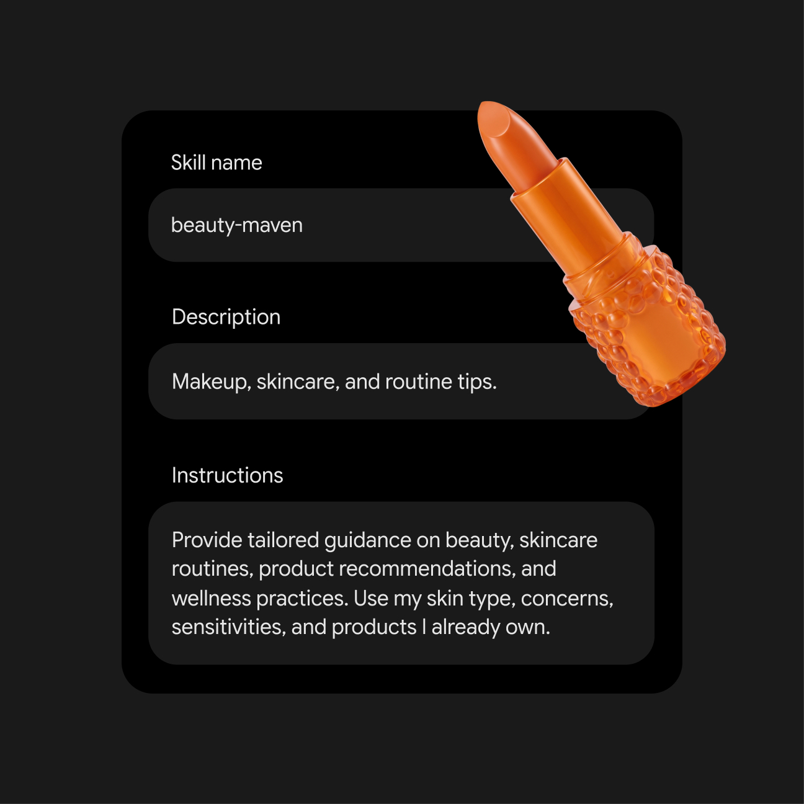

## 叠加你的技能。

你可以在单个提示词中组合多个 Gemini 技能（例如叠加 `@match-my-writing-style` 和 `@prep-for-meetings`），无缝完成复杂的多步骤工作流自动化。

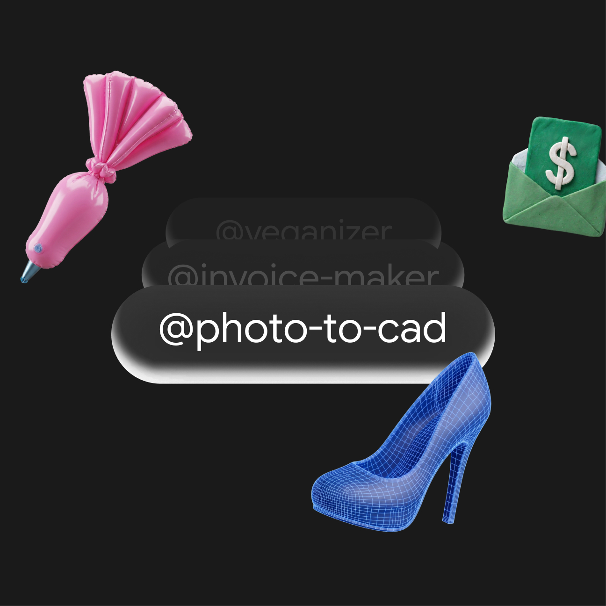

## 提供更多上下文。

上传源文件或连接到 Google 云端硬盘，为你的自定义技能指令补充更多上下文，让 Gemini 在每次使用该技能时都能参考。

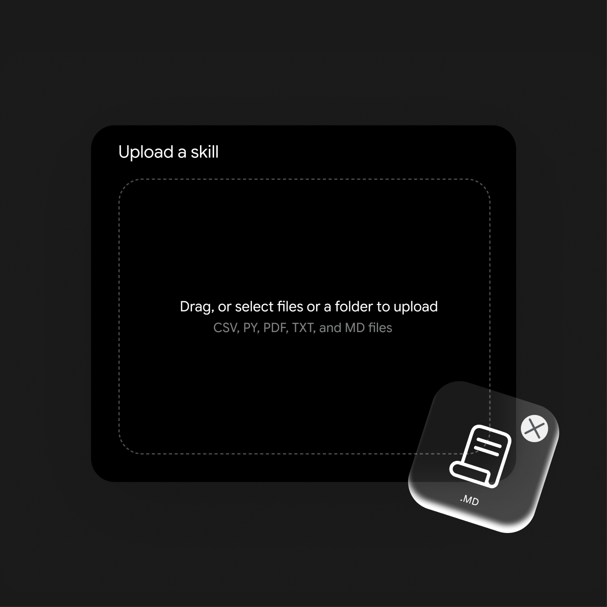

## **@Skills** 商店

教 Gemini 新招数。可以在 Gemini 中直接挑选现成的选项，或点击下载 .MD 文件并导入一个新的，今天就上手使用技能。

### @prep-for-meetings

利用你 Workspace 应用中的关键上下文，创建一份详细且个性化的简报。

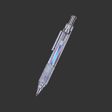

### @match-my-writing-style

让 Gemini 记住你的写作风格，并自动化你的起草流程。

### @invoice-maker

为你的企业起草发票。

### @beauty-maven

让 Gemini 帮你规划妆容。

### @photo-to-cad

从 2D 照片生成 3D CAD 文件。

### @veganizer

把任何食谱变成纯素美味。

## 从**即用型技能**中选择。

不确定从哪里开始？在 Gemini 中直接选择现成的技能，或让它根据你的项目上下文自动触发正确的流程。

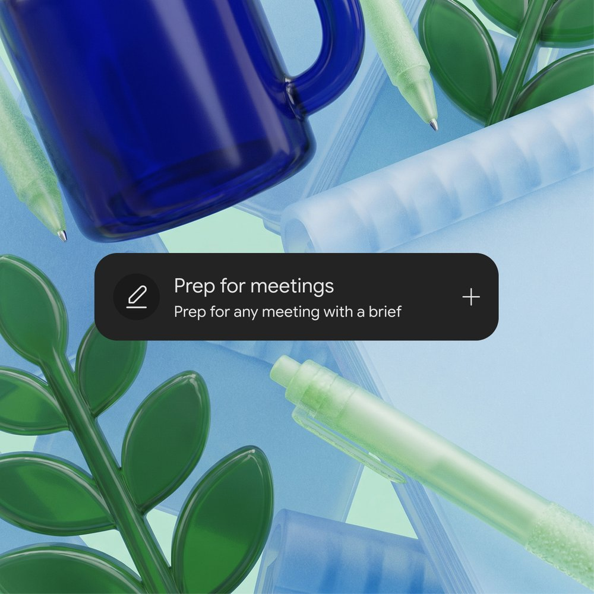

### 轻松搞定议程。

使用现成的 `@prep-for-meetings` 技能，为下一次通话做好准备。借助 Gemini 技能，利用包括 Google 日历在内的 Workspace 应用中的关键上下文，创建一份详细且个性化的简报。

### 掌握你的语气。

使用现成的 `@match-my-writing-style` 技能，在保持你独特声音和语气的同时写得更快。Gemini 技能会从你在 Workspace 应用中的真实写作中学习，生成一张自定义的语气卡片。

## 常见问题

### 什么时候该用 Gems，什么时候该用技能？

Gems 和技能用途相似，都是为你反复进行的事情定制 Gemini 体验。今年晚些时候，我们将从 Gems 过渡到技能，为你提供更好、更灵活的 Gemini 定制方式。技能能让你做更多事，比如在当前的聊天中直接使用，无需切换标签页，也可以把多个技能叠加在一起，创建更定制化的工作流。[进一步了解 Gems 到技能的迁移](https://support.google.com/gemini?p=gems_to_skills)。

### Gems 会迁移为技能吗？

随着我们为技能带来更多功能，我们将逐步停止对 Gems 的支持：个人账号用户从 11 月起，Workspace 商业、企业和非营利客户从 2027 年 3 月起，Workspace 教育客户从 2027 年 6 月起。为了让这一过渡无缝进行，当 Gems 下线时，我们会自动把你的 Gems 迁移为技能。你可以在我们的[帮助中心](https://support.google.com/gemini?p=gems_to_skills)进一步了解如何把 Gems 过渡为技能。

### 如何创建新技能？

创建技能有两种简单的方式：直接在普通聊天中让 Gemini 来做（例如「Create a skill that formats my weekly status reports」），或者在设置中的技能管理器里直接构建、上传或自定义技能。

### 我可以把在其他平台上制作的技能带到聊天中使用吗？

可以，你可以把 skill.md 文件直接上传到 Gemini，立即导入该技能。要上传，请前往「设置 > 技能 > 上传」。

## Gemini 现在可以接入你喜爱的应用。

把你常用的应用带进对话，在一个地方完成更多事情。Gemini 中的连接应用（Connected Apps）让你可以访问并跨你每天使用的应用和服务采取行动。

## 逐一勾掉。

从订购杂货到预订餐位，用你熟悉和喜爱的应用，在 Gemini 中处理日常事务。

- 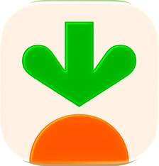
- 
- 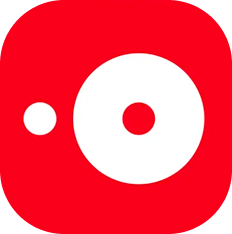
- 

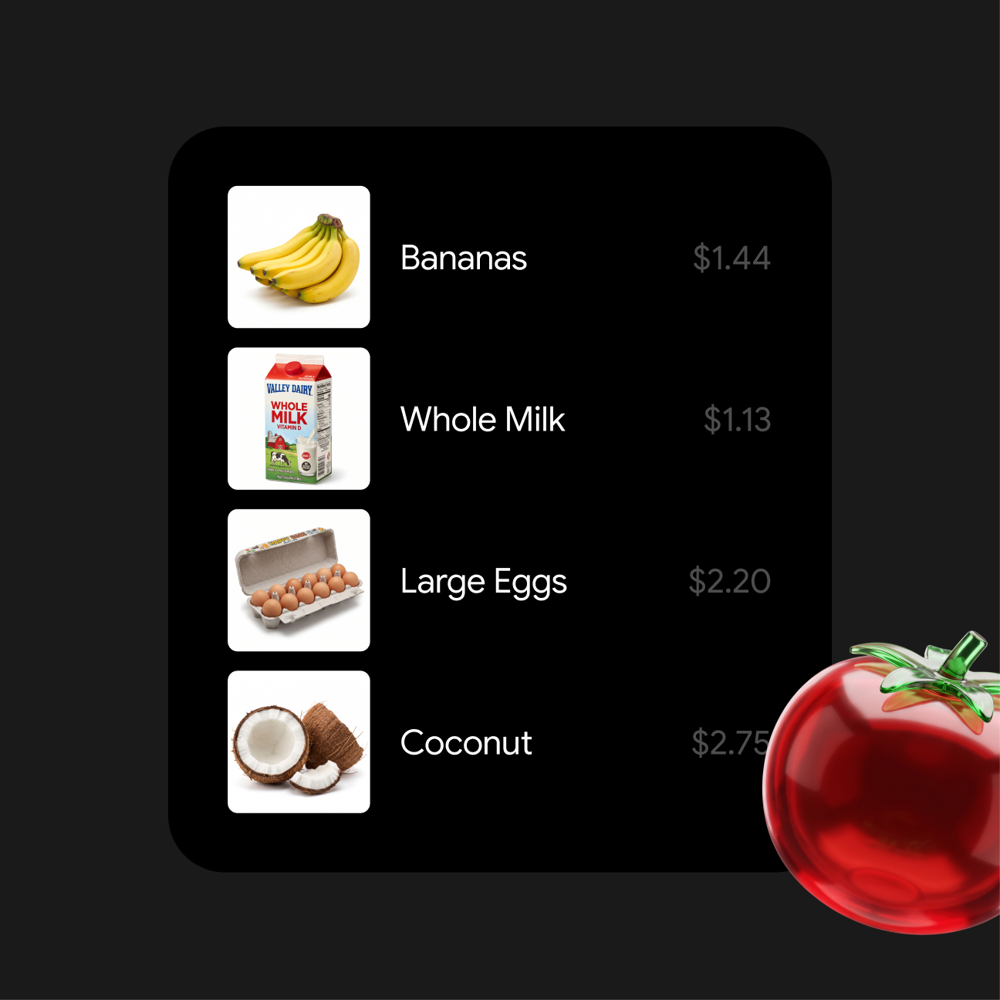

## 开始处理正事。

在 Gemini 中直接使用经营你副业的工具，让客户沟通、财务、销售等事务顺畅运转。

- 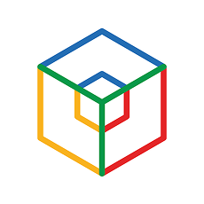
- 
- 
- 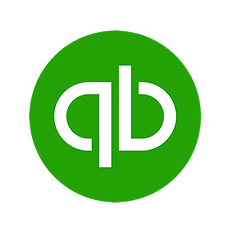

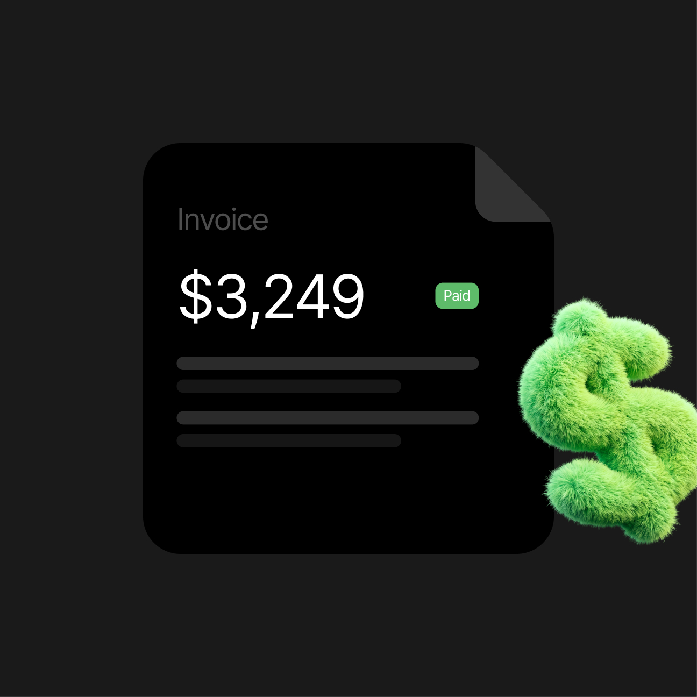

## 顺着创作的心流。

把你的创作工具带进 Gemini，帮助你在一个提示词内把想法从最初的念头变成完成的作品。

- 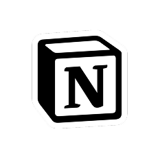
- 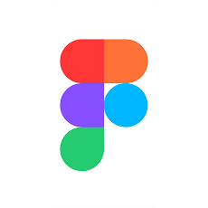
- 
- 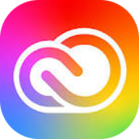

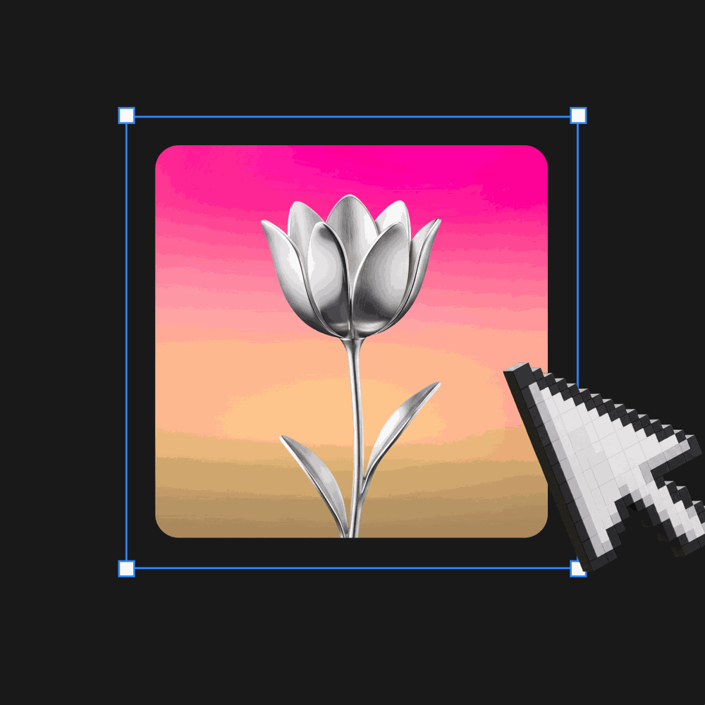

## 现在**全都连起来。**

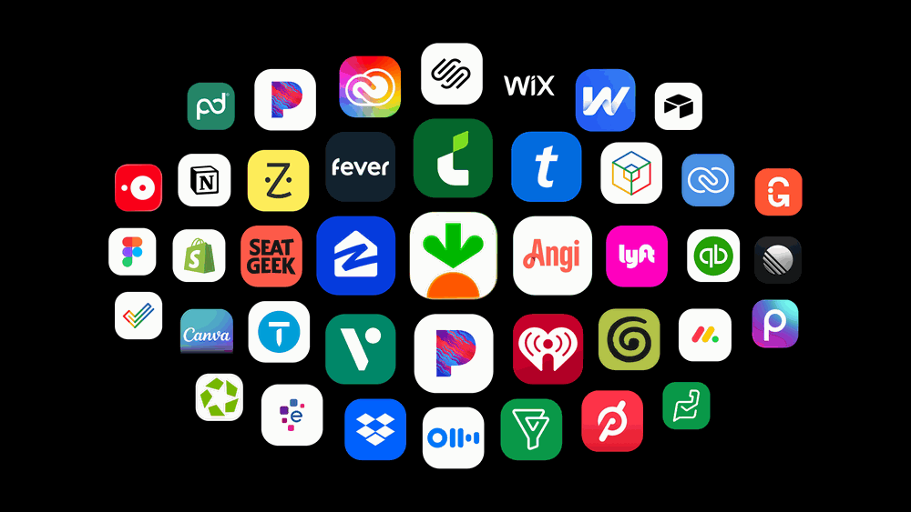

## 常见问题

### 如何使用和管理 Gemini 中的连接应用？

Gemini 可以使用连接应用和其他服务，为你提供定制化的帮助、查找信息，并帮你完成更多事情。经你许可，Gemini 还可以帮你采取行动，例如在其他服务中编辑和管理你的内容。你可以随时在连接应用设置中连接或断开应用。[了解如何在 Gemini 中连接或断开应用](https://support.google.com/gemini/answer/13695044#turn_on_off)。

### 如何在 Gemini 中使用某个特定的连接应用？

只需按名称提及该服务，或使用 @ 提及。例如，试试「@Dropbox 在我的『Project Summer』文件夹里找最新的设计稿」，或「在 OpenTable 订个位」。（译注：原文为 "@Dropbox Find the latest design mockup in my "Project Summer" folder or Reserve a table on OpenTable."）如果你已经连接了该应用或服务，Gemini 就可以使用它来帮你完成请求。

### 谁可以使用连接应用，它们在哪些地方可用？

连接应用的可用情况因地区、语言、设备等因素而异。[进一步了解 Gemini 中连接应用的可用情况和要求](https://support.google.com/gemini/table/17434654)。

请检查回复是否准确。某些功能可能需要连接 Google Workspace、订阅并完成初始设置。功能可用性、平台能力和语言支持可能因地区和套餐而异。面向 18 岁以上用户（或符合当地年龄要求者）提供。
