来源：https://gemini.google/overview/productivity/
取文：2026-11-28，直接下载（浏览器标识）

Meet **Tasks in Gemini.** Free of charge, full of help.

Hand off your busywork so Gemini can save you time and find ways to save money—now free of charge.

- [Try Tasks in Gemini](https://gemini.google.com/app/download/mobile?android-min-version=301356232&ios-min-version=322.0&is_sa=1&pt=9008&mt=8&target=agent&&&&campaign_id=gemini_tasks_webpage&ct=gemini_tasks_webpage&icid=microsite_gemini_productivity_page&redirect=home)

## Oh, the things you’ll **accomplish.**

Get help with the things that normally take time, tabs, and a whole lot of back-and-forth. With your guidance, Gemini can take it from here.

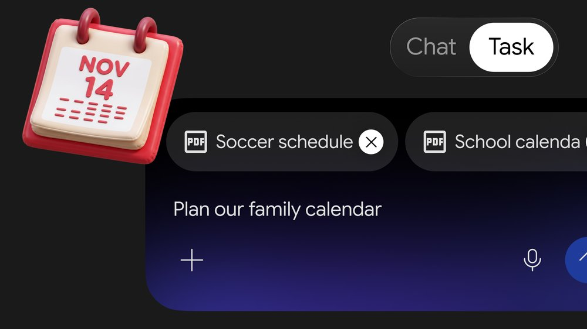

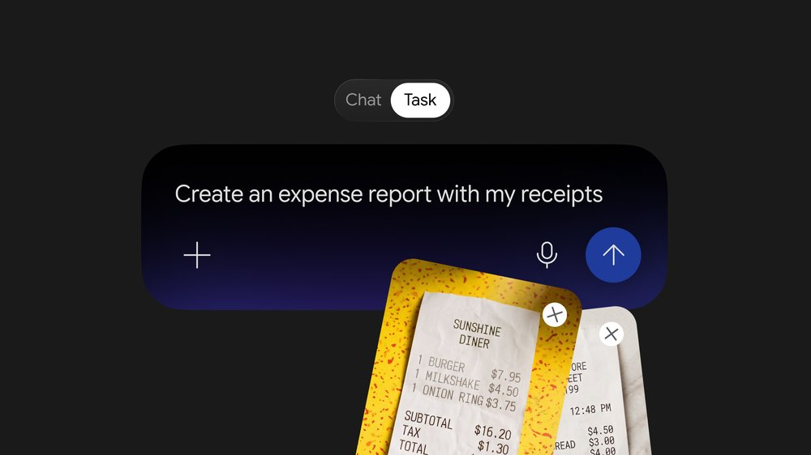

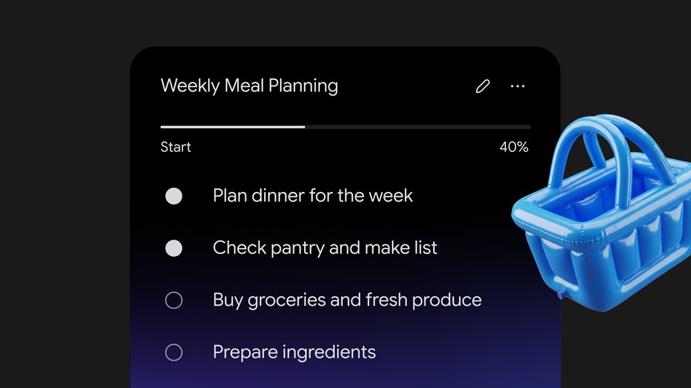

## Find ways to save with Gemini.

Put Gemini on the hunt for ways to save. Identify recurring expenses you no longer need, get alerts for your most-desired deals, and more.

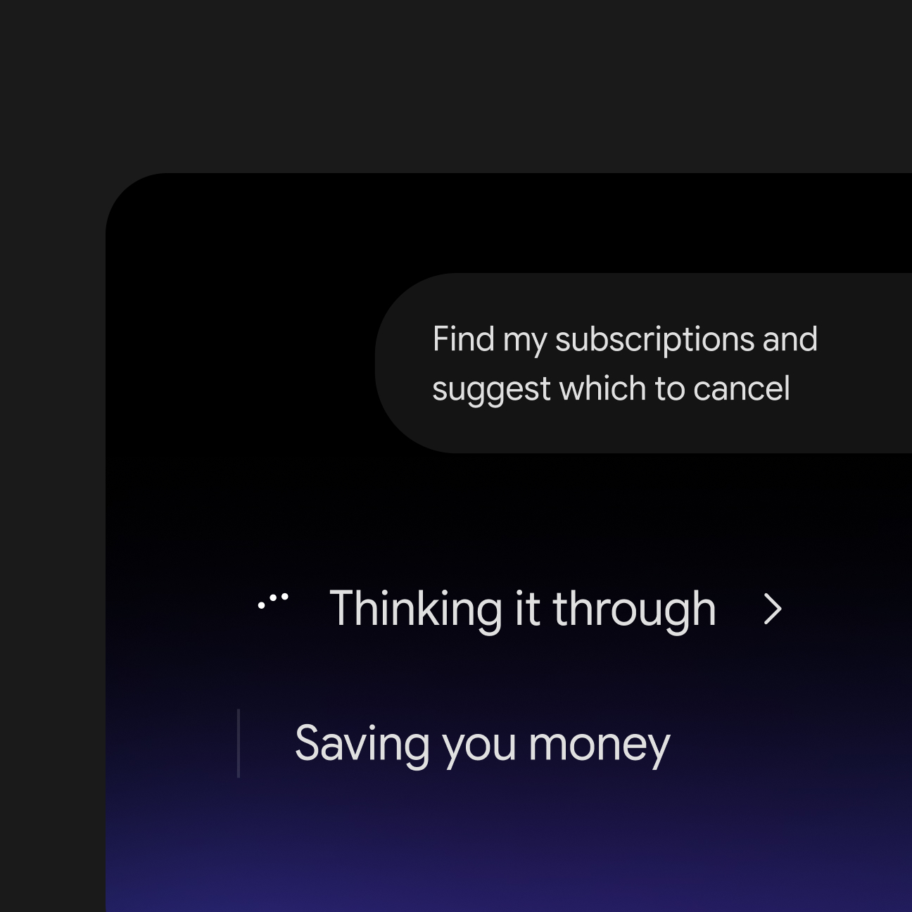

## Work for yourself, not by yourself.

From getting started, to getting it done. Give Gemini something you want to accomplish and have it work alongside you.

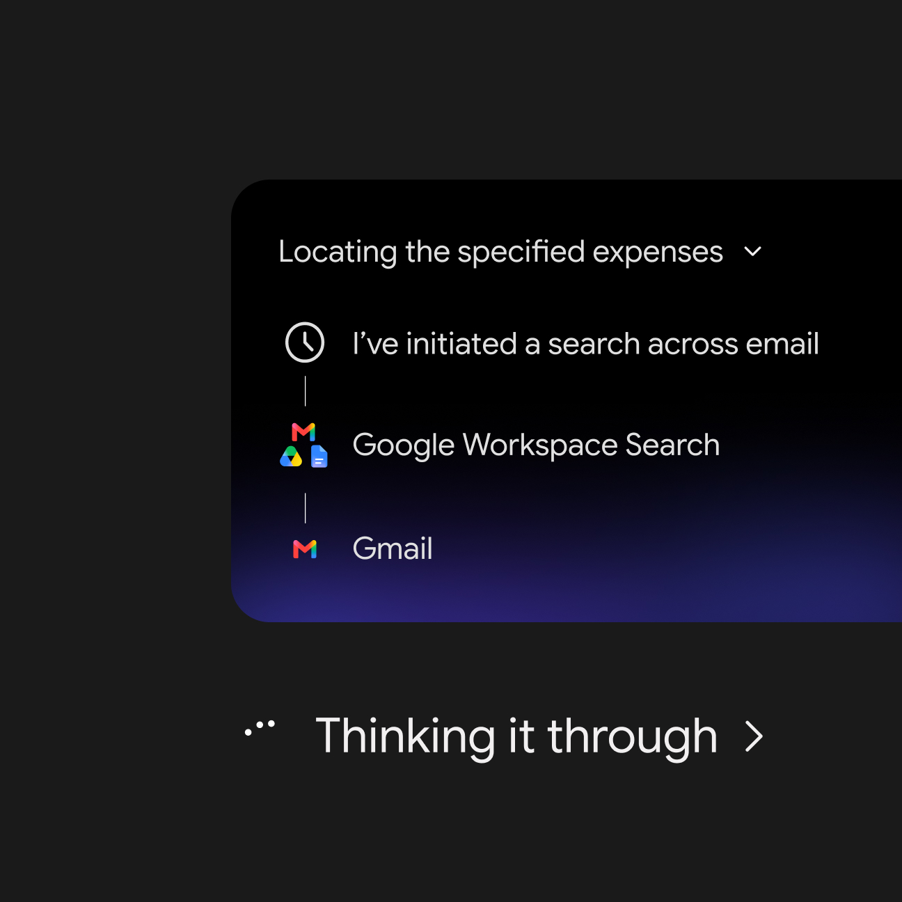

## Consider it created.

Go from first thought to finished deck, doc, spreadsheet, and more. Gemini can help you create, edit, and refine all your files right within your conversation.

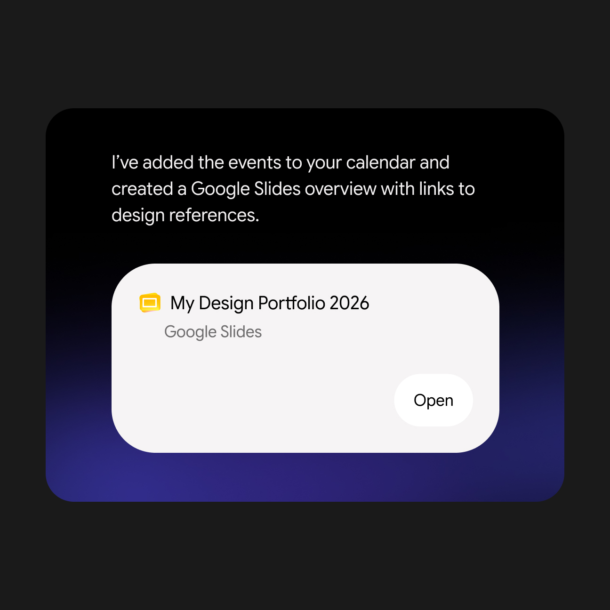

## Put Gemini to work.

Find what’s missing in automating your workflow. Let Gemini help you from getting started, to getting it done under your direction.

- [Try Tasks in Gemini](https://gemini.google.com/app/download/mobile?android-min-version=301356232&ios-min-version=322.0&is_sa=1&pt=9008&mt=8&target=agent&&&&campaign_id=gemini_tasks_webpage&ct=gemini_tasks_webpage&icid=microsite_gemini_productivity_page&redirect=home)

## Your most complex to-dos, **done.**

Get help with the things that normally take time, tabs, and a whole lot of back-and-forth. With your guidance, Gemini can take it from here.

Tasks

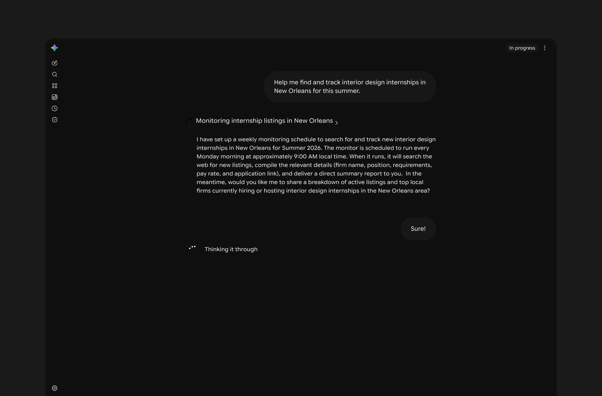

Help me find and track interior design internships in New Orleans for this summer.

Schedules

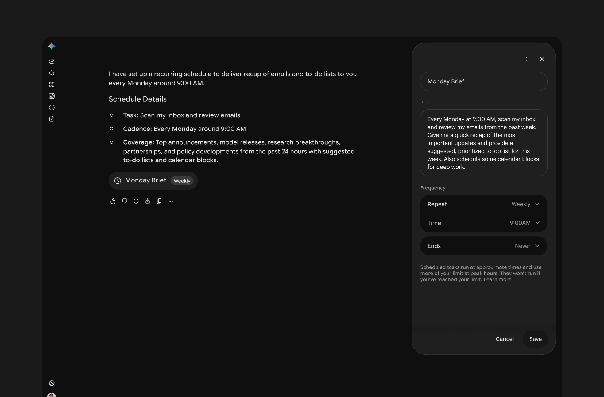

Every Monday at 9:00 AM, scan my inbox and review my emails from the past week. Give me a quick recap of the most important updates and provide a suggested, prioritized to-do list for this week. Also schedule some calendar blocks for deep work.

## Frequently asked questions

### Where can I get Tasks in Gemini, and when is it coming to me?

Tasks in Gemini are now accessible directly from the main Gemini chat. Simply flip the toggle from “Chat” to “Tasks” and hand your busywork off to Gemini.

Whether you are scheduling a daily morning briefing across your emails and calendar, creating an itinerary for an upcoming trip, or automating repetitive research, Tasks in Gemini handle the execution from start to finish and notify you the moment your results are ready.

Tasks in Gemini are available free of charge for 18+ users in the United States, Canada, Australia, India, Japan, and Korea, and for Pro/Ultra users in select countries. Learn more about Tasks in Gemini’s availability [here](https://support.google.com/gemini/answer/17094507).

### What apps can Tasks in Gemini work with?

Tasks in Gemini works across the apps you already know and love. Gemini can connect natively with your favorite Google apps like Gmail, Calendar, Drive, Docs, Sheets, Slides, YouTube, and Google Maps, and also has 50+ third-party apps like OpenTable and Instacart that users can link. These connections are turned off by default, just head to your settings, or the customize page in Gemini to turn them on. Once activated, Tasks in Gemini can help you take action across your entire digital workspace.

### What are “Tasks, Skills, and Schedules”?

Tasks, Skills, and Schedules work together to unlock Tasks in Gemini's full potential. With Tasks, you can connect Gemini to Google Workspace including Gmail, Calendar, Docs, Sheets, and Slides. As you build Skills, you define exactly how you want Tasks in Gemini to take actions, tailoring your experience and saving you from repetitive prompting on your most repeated needs. Finally, Schedules allow you to automate your workload on your own terms by setting up time-based or conditional triggers to execute tasks exactly when you need them.

### Is Tasks in Gemini reading my emails 24/7?

No. Although Tasks in Gemini run in the background, Gemini does not read your emails indiscriminately. It works under your direction to help you with email management.

### How does Tasks in Gemini differ from a traditional chatbot?

While standard chatbots wait for a prompt, Tasks in Gemini can take proactive action on your behalf, under your direction. Tasks enable Gemini to support users in completing multi-step tasks across your applications, making it a true AI agent rather than just a conversational tool.

### Can Tasks in Gemini help organize my crowded inbox?

Absolutely. Gemini connects seamlessly to your other Google apps like Gmail, Drive, Calendar, and Sheets. You can instruct it to draft replies, send emails, sort incoming messages based on priority, extract action items from long threads, or even forward Gemini your emails directly to kick off a new Task.

### Do I need coding skills to automate my tasks?

Not at all. You can prompt Tasks in Gemini using regular conversational language. Whether you're setting up complex, multi-app schedules or just using it to help manage your daily tasks, no technical expertise is required.

## Create once, use **endlessly.**

## Creating a skill is easy.

Turn anything you do more than once into a reusable skill. Gemini can automatically trigger the right workflow based on your ask.

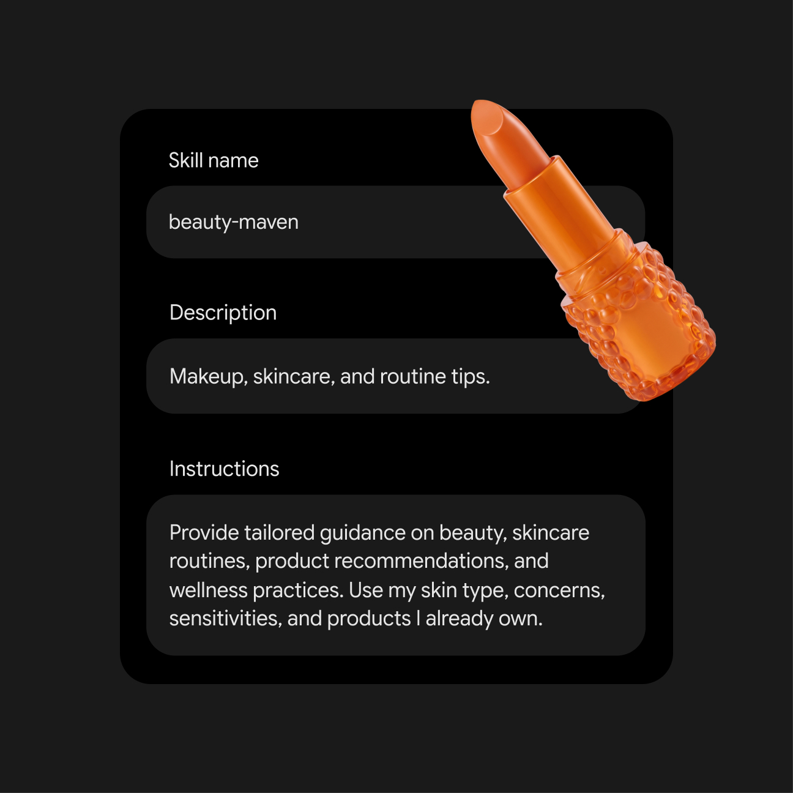

## Stack your skills.

You can combine multiple Gemini skills in a single prompt (for example, layering `@match-my-writing-style` and `@prep-for-meetings`) to complete complex, multi-step workflow automations seamlessly.

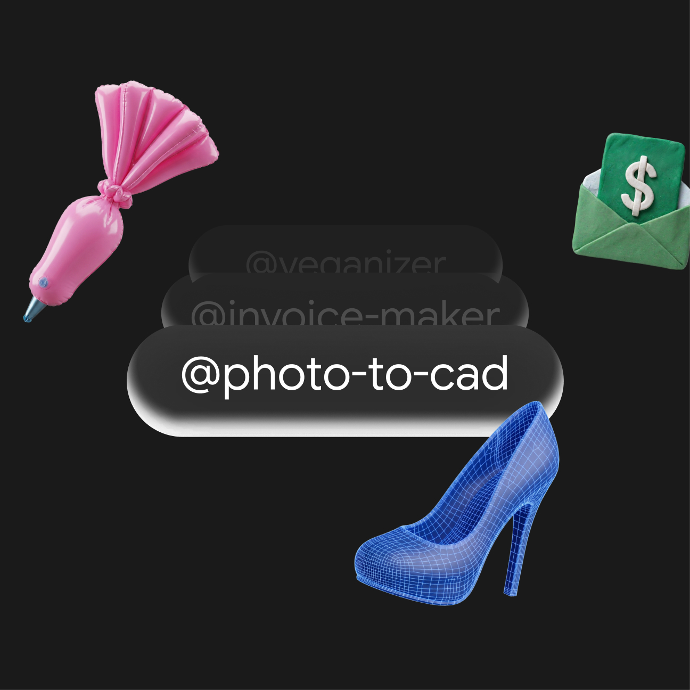

## Give more context.

Upload source files or connect to Google Drive to add more context to your custom skill instructions that Gemini can reference each time you use the skill.

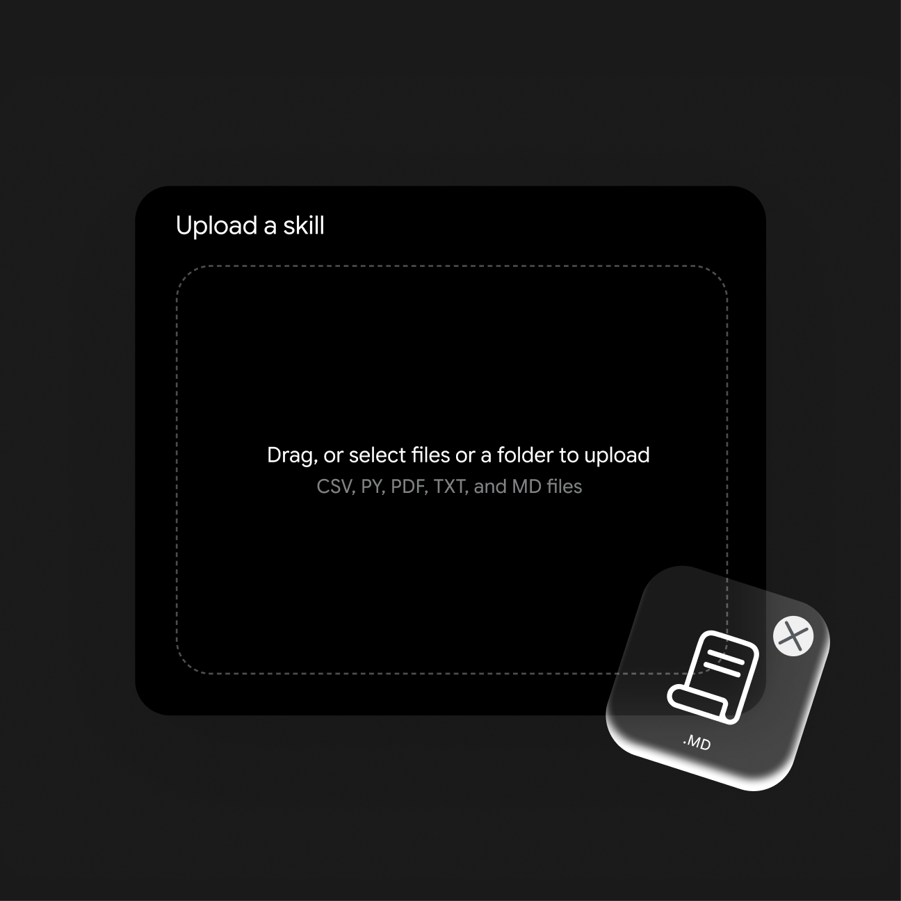

## **@Skills** shop

Teach Gemini new tricks. Choose from a selection of premade options right within Gemini or click to download an .MD file and import a new one to get started with skills today.

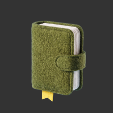

### @prep-for-meetings

Create a detailed and personalized brief using key context from your Workspace apps.

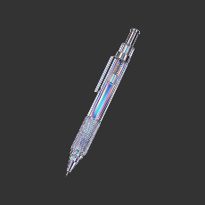

### @match-my-writing-style

Ask Gemini to remember your writing style and automate your drafting process.

### @invoice-maker

Draft an invoice for your business.

### @beauty-maven

Let Gemini help you plan your make-up looks.

### @photo-to-cad

Generate 3D CAD files from 2D photos.

### @veganizer

Turn any recipe into a vegan delicacy.

## Choose from **ready-to-use skills.**

Not sure where to start? Choose from premade skills right within Gemini or have it automatically trigger the right workflow based on the context of your project.

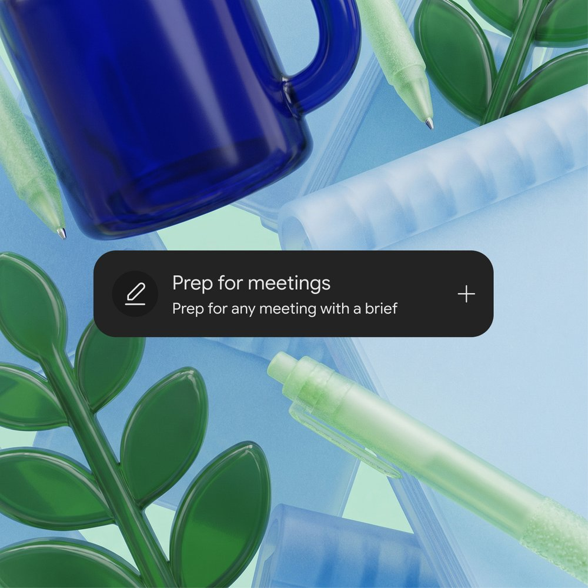

### Ace the agenda.

Get ready for your next call using the premade `@prep-for-meetings` skill. Use Gemini skills to create a detailed and personalized brief using key context from your Workspace apps including Google Calendar.

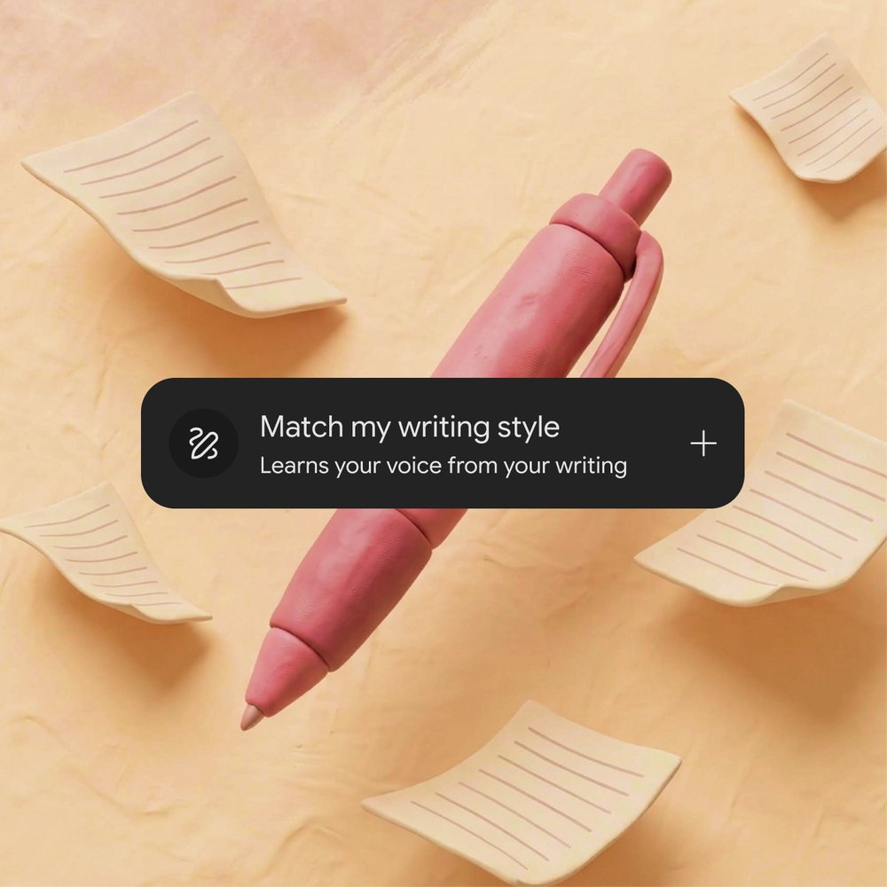

### Own your tone.

Use the premade `@match-my-writing-style` skill to help you write faster while maintaining your unique voice and tone. Gemini skills learn from your real writing across Workspace apps to create a custom voice card.

## Frequently asked questions

### When should I use Gems vs skills?

Gems and skills are used for similar purposes to customize your Gemini experience for things you do time and again. Later this year, we’re transitioning from Gems to skills to give you an even better, more flexible way to customize Gemini. Skills will let you do more, like using them right in your current chat without having to switch tabs or stacking multiple skills together, to create even more customized workflows. [Learn more about the Gems to skills migration](https://support.google.com/gemini?p=gems_to_skills).

### Will Gems migrate to skills?

As we bring more functionality to skills, we will remove support for Gems starting in November for individuals with personal accounts, March 2027 for Workspace business, enterprise, and nonprofit customers, and June 2027 for Workspace education customers. To make this transition seamless, we will automatically migrate your Gems into skills when Gems go away. You can learn more about how to transition your Gems into skills by visiting our [help center](https://support.google.com/gemini?p=gems_to_skills).

### How do I create a new skill?

You can create a skill in two easy ways: simply ask Gemini in regular chat (e.g., "Create a skill that formats my weekly status reports"), or build, upload, or customize skills directly in the skills Manager in settings.

### Can I bring skills I made in other platforms to use in chat?

Yes, you can upload skill.md files directly to Gemini to instantly import the skill. To upload, go to Settings > skills > Upload.

## Gemini can now plug in to your favorite apps.

Bring your go-to apps into the conversation and get more done in one place. Connected Apps in Gemini let you access and take action across the apps and services you use every day.

## Check it off.

From ordering groceries to making a reservation, take care of everyday tasks in Gemini with the apps you know and love.

- 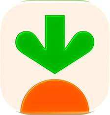
- 
- 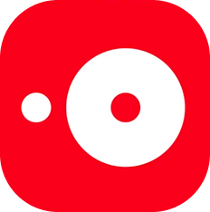
- 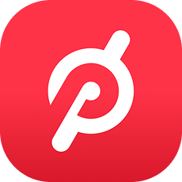

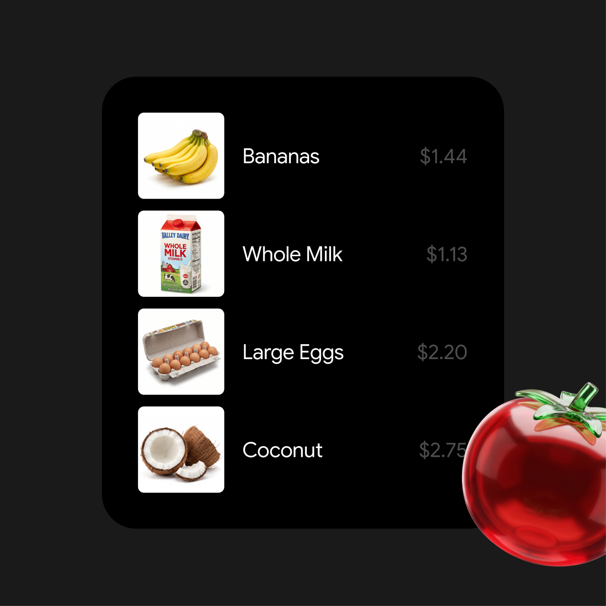

## Get down to business.

Tap into the tools that run your side hustles right within Gemini to keep customer communication, finances, sales, and more running smoothly.

- 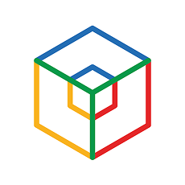
- 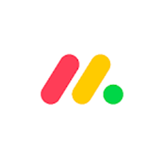
- 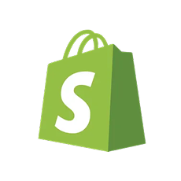
- 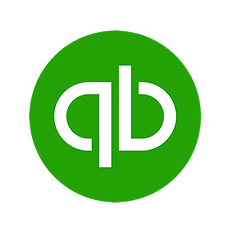

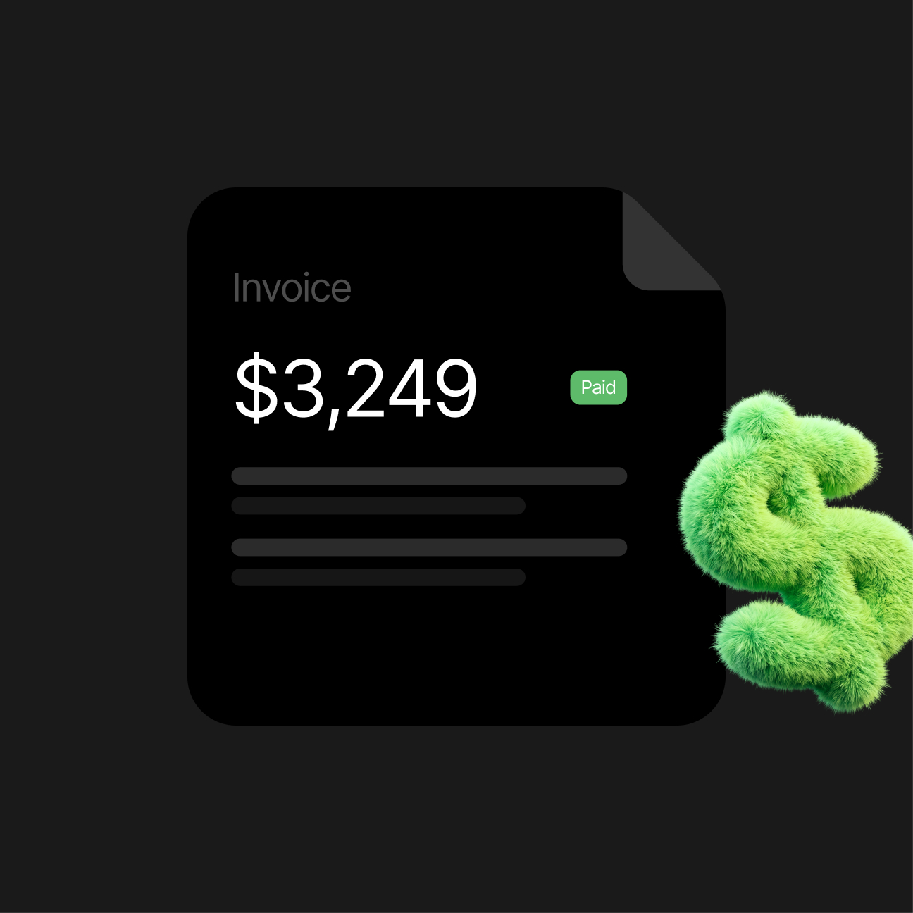

## Go with the creative flow.

Bring your creative tools into Gemini to help turn ideas from first thought to finished work in a single prompt.

- 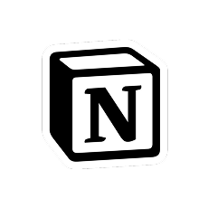
- 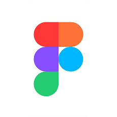
- 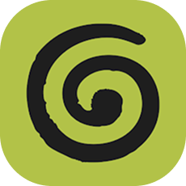
- 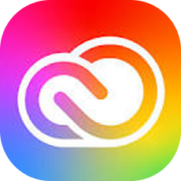

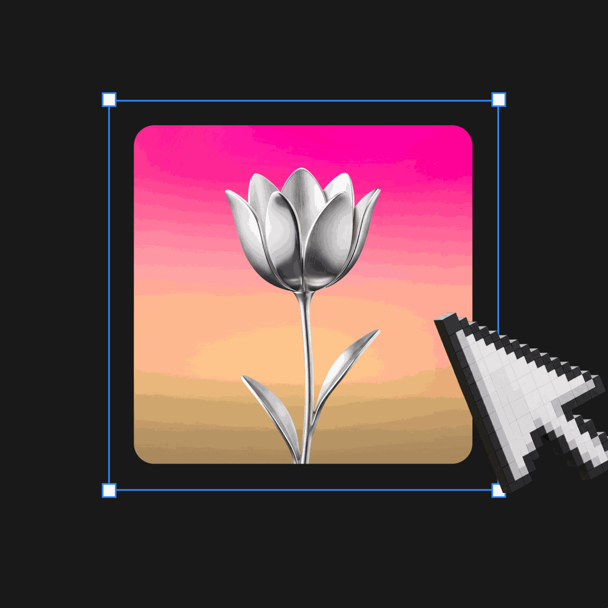

## All **together now.**

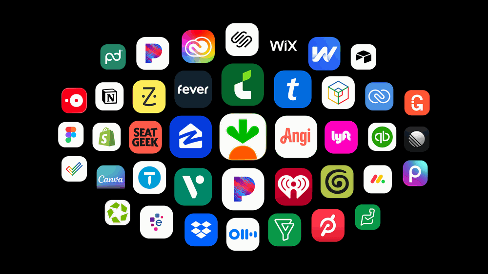

## Frequently asked questions

### How do I use and manage Connected Apps in Gemini?

Gemini can use Connected Apps and other services to give you tailored help, find info for you, and help you get more done. With your permission, Gemini can also help you take action, like editing and managing your content across other services. You can connect or disconnect apps in your Connected Apps settings at any time. [Learn how to connect or disconnect apps in Gemini](https://support.google.com/gemini/answer/13695044#turn_on_off).

### How do I use a specific Connected App in Gemini?

Just mention the specific service by name or use an @ mention. For example, try @Dropbox Find the latest design mockup in my "Project Summer" folder or Reserve a table on OpenTable. If you have already connected the app or service, Gemini can use it to help complete your request.

### Who can use Connected Apps and where are they available?

The availability of Connected Apps varies by location, language, device, and more. [Learn more about the availability and requirements of Connected Apps in Gemini](https://support.google.com/gemini/table/17434654).

Check responses for accuracy. Google Workspace connection, subscription, and initial setup may be required for certain features. Feature availability, platform capabilities, and language support may vary by region and tier. Available to users 18+ (or local age requirements).
