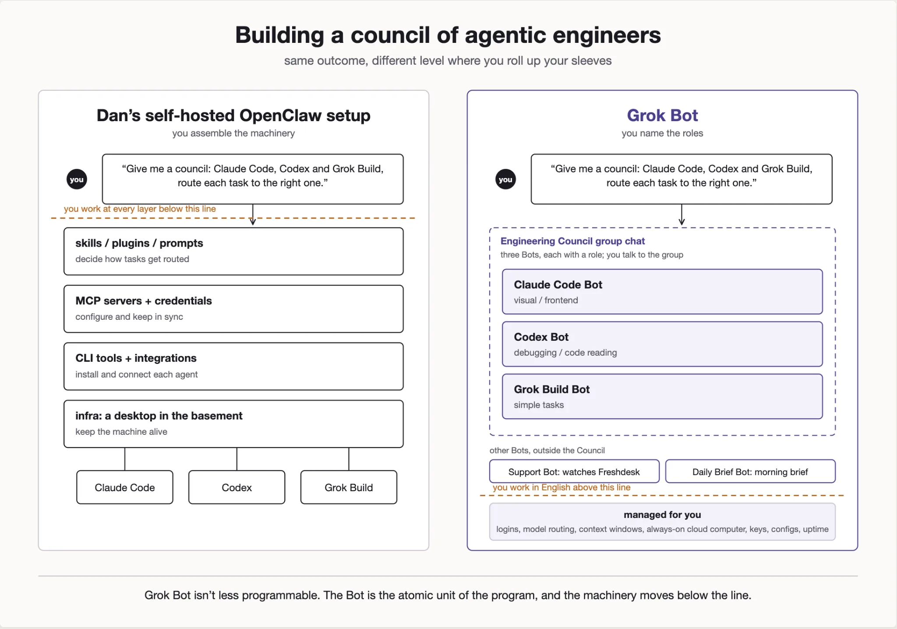



**收录说明**：直接下载；链接中的 utm 跟踪参数已去掉。作者署名取自页面的作者链接。上一轮收集未检索到这篇，2026-11-28 补收。作者使用 Cursor Pro+ 账号，文中未说明与厂商的关系。去掉了文中一块「Your sponsor ad here」的广告位。原文全文存于本目录的 original.md，网站上不显示，已翻译。

**内容摘要**：作者用 Cursor Pro+ 账号使用 Grok Bot 约五天，把它比作开箱即用的 MacBook，而 OpenClaw 像 Linux：后者更自由但配置更多。他认为 Bot 本身是编程的基本单位，可给 Bot 分配角色、接不同工具并组成群聊，例如一个把任务按类型转给 Claude Code、Codex、Grok Build CLI 的工程师 Bot。连接器用登录即可接入，支持同一服务多个账号；Freshdesk 并非原生连接器，是在虚拟浏览器里登录后让 Bot 每 15 分钟检查新工单。Bot 运行在持久的云端电脑上，Update 重建电脑并保留持久状态，Reset 回到上次同步的状态。代价是没有模型选择器、看不到路由、对上下文与额度消耗的控制更少；作者的结论是它适合软件工程周边的杂务，不会很快写出你大部分的 PR。

**保留理由**：较早的一手使用体验，并与 OpenClaw 做了对比，提供了 Bot 角色分工、多账号连接和虚拟浏览器的实际用法。

---

你第一次打开 [Grok Bot 的插件目录](https://cursor.com/help/grok-bot/connect-plugins)。你搜索 X，找到插件并点击它。本地浏览器中打开一个登录页面。你登录，就连上了。

你不需要进入系统的代码。你不需要安装 MCP 服务器 JSON，也不需要粘贴 API 凭据。**你像登录任何网站或应用那样登录，Grok Bot 就准备好了。**我让它审阅我的 X 帖子和我感兴趣的东西，然后每天给我一份与我相关的新闻和故事的简报。

我还通过工作账户把它连到 Freshdesk，建立了一个支持 Bot，每十五分钟检查一次新开的支持工单。要复刻一个真实的工作流——一个我曾投入时间和注意力的工作流——它只需要我在浏览器里登录。

**这种设置的简便性才是这里真正新颖的地方。**Grok Bot 把智能体配置变成了点几下鼠标加一次登录。

**Grok Bot 用起来像开箱一台新的 MacBook。**你打开它、开机，就拥有了工作所需的一切。**像 OpenClaw 这样的系统则像 Linux**：它们给你更多选择、更多自由，让你围绕自己想做的事定制系统，但这种灵活性伴随更多复杂性和更多设置开销。

**OpenClaw 2.0** [**本周发布**](https://openclaw.ai/blog/openclaw-2-accidentally)**，大幅缩小了这一差距。**它的快速开始（Quick Start）可以复用现有的 Claude Code 或 Codex 登录，其浏览器应用把大量设置、插件管理和自动化搬进了图形界面或对话界面。**但底层的区别仍然存在：OpenClaw 给你一个用户自有的网关（Gateway），由你选择如何运行、在哪里运行，而 Grok Bot 把计算机作为产品的一部分提供并运营。**换句话说，Grok Bot 是一台托管的智能体计算机，OpenClaw 是一个用户自有的智能体平台。

## **Bot 是原子单位**

但 Mac 与 Linux 的类比只能说明一部分问题。

**Grok Bot 并不比 OpenClaw 更难编程，只是编程的抽象层级不同。**用 OpenClaw，定制意味着更靠近代码、配置、工具、技能、插件和基础设施。**在 Grok Bot 中，Bot 本身成为程序的原子单位**。你给 Bot 分配专门的角色，把它们接到不同的工具上，再把它们组合成一个更大的系统，Grok Bot 称之为「群聊」。

自诞生以来，编程一直在向更高的抽象层级演进。我们从机器码和打孔卡，走到汇编，再走到今天我们认为的 C 这类低级语言，然后是 Python 这类高级语言。在演进的每一步，程序员都能表达更多意图，同时把更多细节交给下层。Grok Bot 把这一轨迹又向前推进一步：**接口是英语，被编程的东西不再是函数或服务，而是一个「Bot」。**

走向更高抽象层级的价值在于，它让编程计算机的能力触达那些可能永远不会写代码、但能用相对精确的英语清楚表达自己想要什么的人。**所需的技能从语法和实现，转向精确地说明意图。**

昨天我建了一个 Claude Bot，让它在 Grok Bot 的虚拟计算机里安装并登录 Claude Code CLI。这让我想，这种模式能走多远。我可以接上 Codex 和其他智能体 CLI，再把它们组装成 **Grok Bot 内部的一个智能体工程师委员会。**OpenClaw 也能支持类似配置，而且 OpenClaw 2 现在自带 Codex 运行时，并为其他编码智能体框架提供受支持的接入路径，所以这不再需要你手工接线。区别在于这些部件如何呈现。**Grok Bot 把智能体呈现为一等的、人类可读的积木**，而 OpenClaw 暴露更多机械细节。

这是我对 Grok Bot 与其他智能体平台关键差异的初步印象。过去大约五天里，我用一个 Cursor Pro+ 账户使用它。

## **Grok Bot 港口巡游**

**在我看来，拟人化是 Grok Bot 的关键差异点之一**，也是它用起来如此愉快的原因之一。每个 Bot 可以有自己的名字、角色、身份和描述。这是给 Grok Bot 这整道菜加点人性化装饰，但它不只是装饰。**它帮助在系统内建立认知上的区分，让你更容易组织工作。**

我的智能体工程师 Bot 就是它在实践中的样子。我没有把它绑到单一模型或工具上，而是让它接入多个智能体工程系统，并为给定任务该路由到哪一个定义了指引。我的路由规则把视觉、设计和前端工作指向 Claude Code，把调试和细致的代码阅读指向 Codex，把更简单的任务交给 Grok Build CLI。

当我的 Grok Bot 生态中任何地方出现与编码相关的事情时，我不必停下来决定把它发给哪个 CLI。**我把它委派给智能体工程师，它根据任务和我给的指引选择工具。**拟人化的角色给了我一个可用的心智模型。我会想谁应该主导这项工作，依据是我知道他们有哪些技能，就像和人类团队共事时那样。

Grok Bot 让人觉得像人的地方，与其说是它的语气（它听起来仍然像一个大语言模型），不如说是**交互的连续性和简单性。**我用 Claude Code 或 Codex 时，仍然会经常考虑上下文窗口管理：还剩多少上下文，对话何时需要压缩，何时应该开一个新线程。这些问题在 Grok Bot 内部可能仍然存在，但它们没有作为界面的一部分呈现出来。**我可以把注意力放在与 Bot 的自然语言对话层面**，而不是管理底层机制和大语言模型的限制。

Grok Bot 最有用的连接器功能之一是**支持同一服务的多个账户**。我同时连接了个人和工作的 Google 日历账户。作为一个有全职工作和两个年幼孩子的忙碌的人，我的一天不会整齐地分成工作和个人日历事件。**Grok Bot 给我一整天的单一视图**，而不是让我必须访问两个不同的界面才能看到我安排了什么。有一点需要直说：我创建的每个 Bot 都共用同一台计算机、文件、浏览器会话和登录。不同的 Bot 是组织边界，不是安全边界。

这指向 Grok Bot 另一个我很喜欢的细微 UX 决定：**系统围绕使用它的个人设计，而不是要求个人去适应系统。**

Grok Bot 中的一切都旨在让你在你已经生活的工具和场景中连接自己的数字生活，而不是不得不重新学习一整套新生态。我有一个 Gmail 账户已经 20 年，也许更久，Grok Bot 能点几下就连接到那个上下文，这让人愉快。

**虚拟浏览器**还让 Grok Bot 超出了它的插件目录。Freshdesk 不是我安装的原生连接器。我在虚拟浏览器中打开它，从本地机器的 1Password 转移登录信息，并在那里完成认证。会话一旦存在，支持 Bot 就能每十五分钟检查一次 Freshdesk，确保我不漏掉新工单。**实际上，一个普通网站变成了可自动化的浏览器工作流，然后变成了一个重复运行的工作流。**值得指出的是，这不是连接器或 API 意义上的集成：xAI 自己警告说浏览器工作流可能遇到界面变化、会话过期和 CAPTCHA，并**建议在有连接器时使用连接器。**在有智能体之前的世界里，这类集成要花几周才能建好。

另外，虚拟浏览器的一大优点是它运行在云端一台持久的计算机上。

## **Grok Bot 的常开计算机**

[在 X 上查看帖子 ↗](https://x.com/RhysSullivan/status/2093082308073185516)

给智能体一台自己的计算机不是新想法。我在地下室的台式机上运行 OpenClaw，所以它也有一台持久的机器。区别在于，让那台机器活着是我的责任。我家停电时（夏天雷暴时经常发生），台式机关机，OpenClaw 就一直离线，直到我本人到场重新开机。**OpenClaw 也可以跑在云端，OpenClaw 2.0 甚至通过 Hostinger 提供一键托管部署。**但除非我选择那样的托管选项，否则选择和运维主机、保持更新、保持可用仍然是我的责任。

**Grok Bot 把我这种家庭实验室的安排变成了托管产品。**它的计算机由别人为我托管和维护，所以我不必管理硬件、供电、远程访问或恢复。优势不只是智能体有一台计算机；我的 OpenClaw 也有一台计算机。优势在于我不必运维和保养它所依赖的那台计算机。

这种托管带来的持久性也体现在**我在设备之间切换的顺畅程度**上。我可以在 MacBook 上与 Grok Bot 交互，在 iPhone 上接着同一个对话，发现同样的工作还在等我，就像从未离开。切换设备时，我不必建立远程连接或重建 Bot 的环境。

一台永不关机的计算机也有缺点。**状态会累积，有时你想要一个干净的开始。**Grok Bot 为此提供两个杠杆。*Update* 重建计算机，同时保留其持久状态；*Reset* 把它恢复到上次同步的持久状态，这可能意味着丢失尚未同步的近期工作。

但便利方面的每一项好处也都伴随着代价和取舍。

## **取舍：控制与认知负担**

Grok Bot 的抽象和便利是否有帮助，取决于任务。如果我做的是深度实现工作——比如构建新东西、推敲代码、检查程序的逻辑——那么把机械细节从视野中移走未必有帮助。对这类用例来说，深入技术细节*就是*工作本身。

**Grok Bot 在软件工程***周边***的工作中表现得更明显**：产品管理、设计、销售产品、内部沟通。在这些情况下，**我更关心定义结果并委派工作**，而不是盯着每一个实现决定，只要工作完成时我能清楚地验证结果。在深度技术工作中可能显得受限的那种抽象，当底层机械不是我需要关注的对象时，就变得解放。

没有模型选择器很方便，直到任务不需要前沿水平的智能。**有时我更愿意为简单工作刻意选一个更小、更快的模型**，把最强的模型留给需要更深推理的任务。我个人喜欢高效利用资源这个想法，即使我并不为此额外付费。**Grok Bot 在幕后做路由决定，所以我看不到也控制不了它们。**同一个设计在去掉一项配置选择的同时，也去掉了一种平衡能力、速度和用量的有用手段。**Grok Bot 没有给我这个杠杆。**

这种控制的缺失超出了模型选择。在 Claude Code 或 Codex 这类工具中，我可以开一个新线程、压缩对话、管理我向前携带多少上下文，并对我如何使用额度做出有意识的选择。这些杠杆带来额外的认知开销，但也给了我控制上下文和用量的方式。Grok Bot 把这些决定藏了起来。**体验更简单，但我影响自己多快消耗可用容量的方式更少。**还有一个风险：做任务时心智在场感会减弱，因为完成任务对我的要求没那么多。

另外，拟人化在一个层面澄清了任务边界，在另一个层面又模糊了它们。给每个 Bot 一份工作和一个角色，帮助我把大类工作分开：支持归支持 Bot，编码归智能体工程师。但在单个 Bot 内部，不相关的任务会在同一个持续对话中继续。**随着时间推移，会越来越难判断哪些假设、指令和上下文仍属于当前任务。**Bot 本身是一个清晰的边界；它内部的一个个任务不是。

## **我的结论**

写这篇文章时，我用 Grok Bot 快一周了。我每天都用它，但它不是我工作中或工作之外的主要智能体界面。我发现它在我工作和个人项目技术层面的***周边***相当有用。**比如行政事务、总结、搜索新闻、项目管理和任务管理。**所有那些可能妨碍更深技术工作的浅层工作。

如果你是工程师，我认为 Grok Bot 可以作为**某种「数字幕僚长」**对你有用，它不需要任何培训或太多设置就能在工作中见效。但我也怀疑 Grok Bot 在短期内会撰写你大部分 PR。
