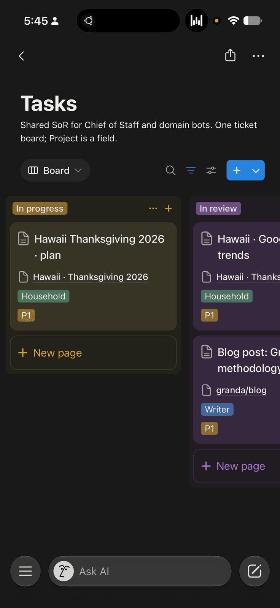
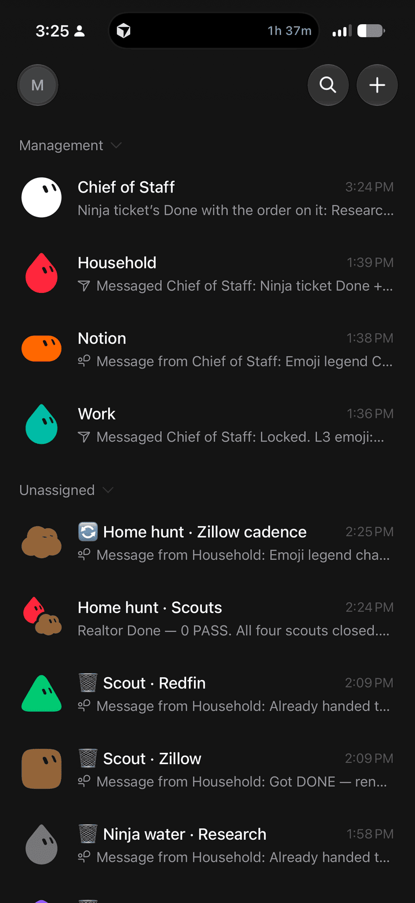



**收录说明**：直接下载；文中的 Mermaid 流程图以源码形式保留。作者署名依据文中自称「Matthew」与站点域名整理。原文全文存于本目录的 original.md，网站上不显示，已翻译。

**内容摘要**：作者介绍自己管理一组 Grok Bot 的运营方式 BotOps，目的是不被各个 Bot 的消息淹没。规则有四条：只通过一个「Chief of Staff」Bot 交流；Notion 是工作的唯一记录，聊天里只传工单链接；临时 Bot 用表情符号标注、用完即删；没有发现就不通知。他把 Bot 分为三层：L1 Chief of Staff 只负责接收、建工单和分派，不浏览网页也不做具体工作；L2 按领域（家务、工作、写作、Notion 等）负责并派生 L3；L3 是一次性的临时 Bot 和定时任务执行者，负责浏览、调研、启动 Cursor 云端智能体。多个 L3 的任务一律放进最多六个成员的频道协作。

**保留理由**：展示了重度用户如何在 Grok Bot 的多 Bot 机制上自建层级和通知规则，可作为「多智能体由一个人管理」这一用法的具体案例。

---

2026-09-06 · 阅读时长 9 分钟

[Claude Code On-The-Go](https://granda.org/en/2026/01/02/claude-code-on-the-go/) 是六个来自 iPhone 的智能体——启动一个任务，把手机放进口袋，有事需要我时收到提醒。异步循环仍然是重点。围绕它的一套技术栈发展成了一支 Grok Bot 队伍。

我只与一个 Grok Bot 对话。

队伍中的其余成员——家务、工作、写作、研究，以及浏览网站或启动 Cursor 云端智能体的一次性临时 Bot——不会收到我的私信。它们收到工单。有事需要决策时我会收到一个链接，还有一个我能真正扫一眼的侧边栏。

这就是 BotOps：我如何管理这支队伍。这不是产品发布，也不是架构导览。只是让我不至于淹没在聊天中的运营模式。

如果你想要那项可复用的技能，它在公开的 [BotOps](https://github.com/granda/botops) 仓库里。

```
%%{init: {"flowchart": {"subGraphTitleMargin": {"top": 3, "bottom": 10}}} }%%
flowchart TB
    layMe["Matthew"] -->|"Talks only here"| layCoS["L1 · Chief of Staff"]
    layCoS --> layL2
    subgraph layL2["Domain Owners"]
        direction LR
        layWriter["Writer"] --- layHouse["Household"] --- layWork["Work"] --- layNotion["Notion"]
    end
    layL2 --> layL3
    subgraph layL3["L3 agents"]
        direction LR
        layTemps["one-off / temps"] --- layCadence["cadence runners"] --- laySwarms["swarms · multi-L3"]
    end
    style layL2 fill:transparent,stroke:#888
    style layL3 fill:transparent,stroke:#888
```

*任何 L2 都可以派生任何类型的 L3。*

## 为什么采用这种形态

智能体聊天无法扩展。如果每个工作者都能 ping 我，我就得住在侧边栏里。如果工作只存在于线程中，下一次摘要就会把它吃掉。如果每个名字看起来都一样，我就分不清一个仍在运行的节奏和一个已经死掉的侦察 Bot。

由此产生四条约束：

1. **一个界面。** 我只与 Chief of Staff 对话。除非我另有选择，其他人都不会出现在我的私信中。
2. **Notion 是记录来源。** 项目和任务承载工作。聊天只递一个工单 URL，而不是一篇长文。
3. **工作者是一次性的，并且有标注。** 临时 Bot 生成时带一个我能从侧边栏读到的表情符号。当它们完成或死掉时，我删除它们。
4. **默认安静。** 没有发现，就不 ping。蜂群噪音留在蜂群中。

## 四个层级

| 层级 | 谁 | 职责 |
| --- | --- | --- |
| 我 | 操作者（Operator） | 与 Chief of Staff 对话。审核工单。删除完成的临时 Bot。 |
| L1 | Chief of Staff | 接收。工单。分配一个 L2。呈现链接。 |
| L2 | Household、Work、Notion、Writer、…… | 拥有一个领域。派生 L3。开启蜂群。根据交回内容更新 Notion。 |
| L3 | 一次性临时 Bot + 节奏执行器（cadence runners） | 完成工作。浏览、调研、启动 Cursor 智能体、触发的例程。 |

除非我选择，否则我不会给 L2 或 L3 发消息。这套层级的意义在于，我通常不必这么做。

### L1 — Chief of Staff

Chief of Staff 是我唯一当作同事对待的 bot。接收落在这里。它会确保存在一个 Project 和一个 Task，分配一个 Owner L2，私信该 L2，之后把工单链接丢给我。

CoS **不**浏览、不操作桌面、不启动 Cursor 云端智能体、不派生 L3，也不拥有例程。如果它开始做个人贡献者（IC）的工作，聊天就不再决策密集，我又回到了读日志的状态。

### L2 — 领域所有者

Household、Work、Notion、Writer，以及任何我已批准的长期 L2。每个拥有一个领域。它们派生 L3（包括节奏执行器），当一项工作需要不止一个 L3 时开启 CreateChannel 蜂群，安静地待在那个蜂群里，并根据交回内容管理 Notion。

当我应该看一下时，它们会私信 CoS。它们**不**与我说话，不运行 Cursor 云端智能体，也不在自己的聊天中持有常设例程。只有在我说同意之后，才会存在一个新的长期 L2。

### L3 — 临时 Bot 与节奏执行器

这是个人贡献者层。一次性临时 Bot 和节奏执行器会浏览、使用桌面、调研、创建 Tasks 行、派生更多 L3、启动并监视 Cursor 云端智能体、对重叠的蜂群工作去重，并拥有每一个重复性例程。

它们**不**给我发消息。它们**不**创建长期 L2。

如果是重复性的，它就是 L3 节奏执行器。如果它需要浏览器、桌面或 Cursor 云端智能体，它就是 L3。这种划分正是拥有层级的全部意义。

## Notion 是记录来源

一切重要的内容都存在于 Projects 和 Tasks 上。工作通过工单 URL 交接，而不是粘贴最近四十条消息。

除非确实有变化，状态只朝一个方向移动：

**待办（Backlog）→ 就绪（Ready）→ 进行中（In progress）→ 等待 / 阻塞（Waiting / Blocked）→ 审核中（In review）→ 完成 / 已取消（Done / Cancelled）**

等待意味着这个技术栈之外的某个人。阻塞意味着我——而阻塞需要一个阻塞原因。我不是一个神秘的队列。

进入**审核中**的视觉工作需要在工单上附上可滚动的图片。如果我必须从文字描述中重建 bot 看到的内容，那么交回就失败了。

我审核 Notion。我不从聊天中重建工作。



## 顺利路径

一次性工作是一条直线：

**我 → CoS → L2 → L3(s) → 交回 L3 → L2 → CoS → 我拿到工单链接。**

我实际在跑的例子是 Home hunt（找房）。我告诉 CoS 持续关注房源。CoS 建立一个 Task，分配给 Household。Household 开启一个 CreateChannel 蜂群，并行放出侦察 Bot——Zillow、Redfin，以及其他任何在用的房源来源。每个 L3 翻查房源照片，判断厨房和浴室是否符合必须满足的条件。当一处房源值得一看时，L3 交回给 Household，Household 交给 CoS，CoS 把工单 URL 丢给我。我打开 Notion。除非我好奇，否则我不会去滚动工作者的对话记录。

它们不会分叉成不协调的私信。多 L3 的任务总是蜂群化（最多 6 个），它们认领工作，它们去重。除非我去看，否则我永远看不到那个频道。



```
flowchart LR
    hpMe["Matthew"] --> hpCoS["CoS"]
    hpCoS --> hpL2["L2"]
    hpL2 --> hpL3["L3(s)"]
    hpL3 --> hpL2b["L2"]
    hpL2b --> hpCoS2["CoS"]
    hpCoS2 --> hpMe2["Matthew gets ticket URL"]
```

```
flowchart TB
    hpMeM["Matthew"] --> hpCoSM["CoS"]
    hpCoSM --> hpL2M["L2"]
    hpL2M --> hpL3M["L3(s)"]
    hpL3M --> hpL2bM["L2"]
    hpL2bM --> hpCoS2M["CoS"]
    hpCoS2M --> hpMe2M["Matthew gets ticket URL"]
```

## 表情符号生命周期

长期的 L1 和 L2 名称保持朴素。只有 L3 会获得表情符号前缀。临时 Bot 生成时是 `🔄 <title>`。节奏执行器在处于待命状态的全过程中保持 🔄。L2 在每次状态变化时重命名临时 Bot——这样侧边栏才能保持为一份分诊列表，而不是谎言。

我对临时 Bot 的处理完全体现在前缀中：

- **🔄 工作（Working）** — 不要打扰
- **🔔 需要 Matthew（Needs Matthew）** — 打开工单，或回复 CoS
- **🗑 完成（Done）** — 丢进垃圾桶；可以安全删除
- **💀 死掉 / 失败（Dead / failed）** — 可以安全删除

```
stateDiagram-v2
    [*] --> Working: L2 spawns 🔄 title
    state "🔄 Working" as Working
    state "🔔 Needs Matthew" as NeedsMatthew
    state "🗑 Done — safe to delete" as Done
    state "💀 Dead/failed — safe to delete" as Dead
    Working --> NeedsMatthew: optional
    Working --> Done: finished
    Working --> Dead: failed
    NeedsMatthew --> Done: finished
    NeedsMatthew --> Dead: failed
    Done --> [*]
    Dead --> [*]
```

*仅限一次性 L3。长期 L1/L2 的名称保持朴素。L2 在每次状态变化时重命名。*

如果一个名字没有表情符号，它就是长期的，我不去动它。如果它是 🔄，我不去戳它。如果它是 🔔，那就是我的队列。🗑 和 💀 会被清扫。

我从侧边栏删除。L2 负责标记。这就是契约。

## 例程就是 L3 节奏执行器

所有重复性工作都由一个 L3 节奏执行器启动——不是 CoS，不是 L2。CoS 不应该在脑子里揣着一个 cron。L2 不应该把自己的聊天当作常设工作。

每次触发都会打开一个新的 Tasks 行，然后运行一次性生命周期。零发现保持安静。一个我应该看到的结果走 L2 → CoS → 工单链接。

```
flowchart TB
    cadArmed["🔄 Cadence runner · armed"]
    cadArmed -->|"09:00 and 18:00 PT"| cadFire["Each fire"]
    cadFire --> cadRow["New Notion Tasks row"]
    cadRow --> cadLife["One-shot lifecycle"]
    cadLife -->|zero findings| cadQuiet["Quiet — no ping"]
    cadLife -->|PASS| cadL2["L2"]
    cadL2 --> cadCoS["CoS"]
    cadCoS --> cadMe["Ticket link to Matthew"]
```

Home hunt 是我实际运行的节奏：名为 `🔄 Home hunt · Zillow cadence` 之类的 L3，在太平洋时间 9:00 和 18:00 待命。大多数触发都找不到值得一看的内容。那些保持沉默。当一处房源值得我花时间时，我收到的是一张工单，而不是页面上每张卡片的倾倒。

执行器在待命期间保持 🔄。该项目的蜂群频道在节奏存续期间一直保持开启。

## 蜂群频道

L2 打开频道。L2 和 L3 们待在里面。工作和交回都留在那里。CoS 不在房间里——它只向我呈现工单链接。当项目完成*并且*不再有节奏执行器时，CoS 为频道命名；bot 不能删除它。

```
%%{init: {"flowchart": {"subGraphTitleMargin": {"top": 3, "bottom": 10}}} }%%
flowchart TB
    swOpen["L2: CreateChannel"] --> swCh

    subgraph swCh["Home hunt swarm · max 6"]
        direction LR
        swL2["L2 sits quiet"]
        swA["🔄 Zillow"]
        swB["🔄 Redfin"]
        swC["🔄 other listings"]
        swL2 -.-> swA
        swA -.-> swB
        swB -.-> swC
    end

    swCh -->|"photos, kitchens, bathrooms stay in-channel"| swCoS["CoS"]
    swCoS -->|"ticket links only"| swMe["Matthew"]

    style swCh fill:transparent,stroke:#888
```

只要项目仍然开放，**或者**它的任何节奏仍在待命，就保留该频道。

同一件事的两种形态。

**一次性蜂群（one-shot swarm）**是 L2 加上为单个任务服务的一次性 L3 临时 Bot——例如三个房源网站侦察 Bot。成员完成时会变成 🗑 或 💀。只有当相关的节奏仍然存续时，频道才可能继续存在。

```
%%{init: {"flowchart": {"subGraphTitleMargin": {"top": 3, "bottom": 10}}} }%%
flowchart TB
    osL2["L2"] --> osOpen["CreateChannel"]
    osOpen --> osCh

    subgraph osCh["One-shot swarm · max 6"]
        direction LR
        osSit["L2 sits quiet"]
        osT1["🔄 Zillow"]
        osT2["🔄 Redfin"]
        osT3["🔄 other"]
        osSit -.-> osT1
        osT1 -.-> osT2
        osT2 -.-> osT3
    end

    osCh --> osTerm["Members go 🗑 or 💀"]

    style osCh fill:transparent,stroke:#888
```

**常设节奏蜂群（standing cadence swarm）**是 L2 加上待命的节奏执行器。执行器保持 🔄 并拥有 cron。只要该项目的任何节奏仍然存续，频道就保持开启——例如 Home hunt · Scouts 带有一个 Zillow 节奏。

```
%%{init: {"flowchart": {"subGraphTitleMargin": {"top": 3, "bottom": 10}}} }%%
flowchart TB
    stL2["L2"] --> stOpen["CreateChannel"]
    stOpen --> stCh

    subgraph stCh["Standing cadence swarm"]
        direction LR
        stSit["L2 sits quiet"]
        stRun["🔄 cadence runner"]
        stRun2["🔄 optional more"]
        stSit -.-> stRun
        stRun -.-> stRun2
    end

    stCh -->|"owns cron · stays 🔄 while armed"| stEx["Home hunt · Scouts<br/>Zillow cadence"]
    stEx --> stKeep["Channel kept while any cadence for the project is live"]

    style stCh fill:transparent,stroke:#888
```

## 默认安静

- 没有需要我决策的事情时，CoS 保持安静。
- L2 不与我说话。
- 蜂群噪音留在蜂群里。
- 零发现的节奏触发对我保持安静。
- CoS 是唯一界面。如果我想与 L2 或 L3 交谈，那是一种选择，而不是设计。

这避免的失败模式很明显：一个有用的 bot 每次呼吸都给我发消息。

## 我不妥协的规则

- **只有 L3** 启动 Cursor 云端智能体并拥有重复性例程。
- **多 L3 的任务总是蜂群化**，包含认领和去重。一个频道最多六个。
- **没有我的同意，不新增长期 L2。**
- **CoS 聊天保持决策密集。** 没有浏览日志，没有「这是我点了什么」，没有逐回合解说。接收、分配、工单链接。

我大多数日子实际做的事：与 CoS 对话，打开它呈现的工单，清扫 🗑 / 💀 名字。队伍完成其余的事。

如果你想读它、克隆它，或使用同样的运营模式，技能在 [BotOps](https://github.com/granda/botops) 里。
