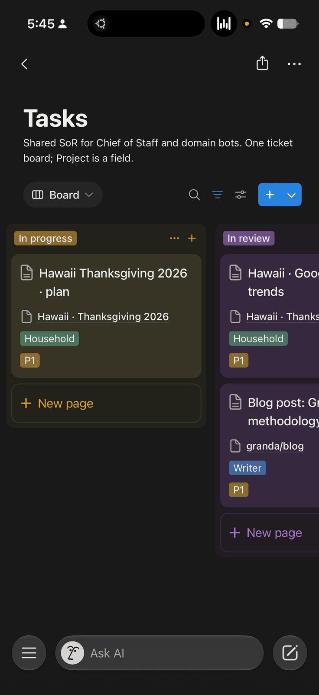
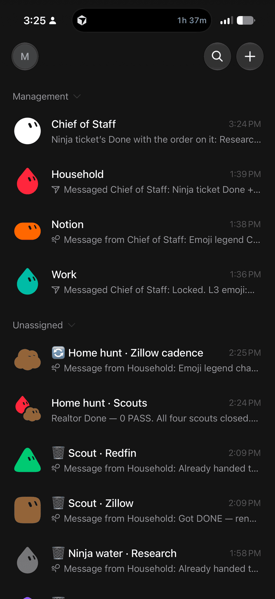

来源：https://granda.org/en/2026/09/06/how-i-run-grok-bot/
取文：2026-11-05，直接下载

2026-09-06 · 9 min read

[Claude Code On-The-Go](https://granda.org/en/2026/01/02/claude-code-on-the-go/) was six agents from an iPhone — kick off a task, pocket the phone, get a ping when something needs me. The async loop is still the point. The stack around it grew into a Grok Bot fleet.

I talk to one Grok Bot.

The rest of the fleet — household, work, writing, research, the one-shot temps that browse a site or launch a Cursor cloud agent — does not get my DMs. They get tickets. I get a link when something needs a decision, and a sidebar I can actually scan.

This is BotOps: how I run the fleet. Not a product announcement, and not an architecture tour. Just the operating model that keeps me from drowning in chat.

If you want the reusable skill, it is in the public [BotOps](https://github.com/granda/botops) repo.

```
%%{init: {"flowchart": {"subGraphTitleMargin": {"top": 3, "bottom": 10}}} }%%
flowchart TB
    layMe["Matthew"] -->|"Talks only here"| layCoS["L1 · Chief of Staff"]
    layCoS --> layL2
    subgraph layL2["Domain Owners"]
        direction LR
        layWriter["Writer"] --- layHouse["Household"] --- layWork["Work"] --- layNotion["Notion"]
    end
    layL2 --> layL3
    subgraph layL3["L3 agents"]
        direction LR
        layTemps["one-off / temps"] --- layCadence["cadence runners"] --- laySwarms["swarms · multi-L3"]
    end
    style layL2 fill:transparent,stroke:#888
    style layL3 fill:transparent,stroke:#888
```

*Any L2 can spawn any L3 kind.*

## Why this shape

Agent chats do not scale. If every worker can ping me, I live in the sidebar. If the work lives only in the thread, the next summary eats it. If every name looks the same, I cannot tell a live cadence from a dead scout.

Four constraints follow from that:

1. **One interface.** I talk to Chief of Staff. Everyone else stays off my DMs unless I choose otherwise.
2. **Notion is the source of record.** Projects and Tasks hold the work. Chat hands a ticket URL, not a novel.
3. **Workers are disposable and labeled.** Temps spawn with an emoji I can read from the sidebar. When they are done or dead, I delete them.
4. **Quiet is the default.** No findings, no ping. Swarm noise stays in the swarm.

## Four layers

| Layer | Who | Job |
| --- | --- | --- |
| Me | Operator | Talk to Chief of Staff. Review tickets. Delete finished temps. |
| L1 | Chief of Staff | Intake. Tickets. Assign an L2. Surface links. |
| L2 | Household, Work, Notion, Writer, … | Own a domain. Spawn L3s. Open swarms. Update Notion from handbacks. |
| L3 | One-shot temps + cadence runners | Do the work. Browse, research, launch Cursor agents, fire routines. |

I do not message L2 or L3 unless I choose to. The point of the stack is that I usually do not have to.

### L1 — Chief of Staff

Chief of Staff is the only bot I treat as a colleague. Intake lands here. It makes sure a Project and a Task exist, assigns an Owner L2, DMs that L2, and later drops me the ticket link.

CoS does **not** browse, drive a desktop, launch Cursor cloud agents, spawn L3s, or own routines. If it starts doing IC work, the chat stops being decision-dense and I am back to reading logs.

### L2 — domain owners

Household, Work, Notion, Writer, and whatever durable L2s I have approved. Each owns a domain. They spawn L3s (including cadence runners), open CreateChannel swarms when a job needs more than one L3, sit quietly in that swarm, and manage Notion from the handbacks.

They DM CoS when I should look. They do **not** talk to me, run Cursor cloud agents, or hold a standing routine on their own chat. A new durable L2 only exists after I say yes.

### L3 — temps and cadence runners

This is the IC layer. One-shot temps and cadence runners browse, use the desktop, research, create Tasks rows, spawn more L3s, launch and monitor Cursor cloud agents, dedupe overlapping swarm work, and own every recurring routine.

They do **not** message me. They do **not** create durable L2s.

If it is recurring, it is an L3 cadence runner. If it needs a browser, a desktop, or a Cursor cloud agent, it is L3. That split is the whole point of having layers.

## Notion is the source of record

Everything important lives on Projects and Tasks. Work is handed by ticket URL, not a paste of the last forty messages.

Status moves in one direction unless something actually changed:

**Backlog → Ready → In progress → Waiting / Blocked → In review → Done / Cancelled**

Waiting means someone outside this stack. Blocked means me — and Blocked requires a Block reason. I am not a mystery queue.

Visual work that lands in **In review** needs scrollable pictures attached to the ticket. If I have to reconstruct what the bot saw from prose, the handback failed.

I review Notion. I do not reconstruct jobs from chat.



## The happy path

One-shot work is a straight line:

**Me → CoS → L2 → L3(s) → handback L3 → L2 → CoS → I get the ticket link.**

The example I actually run is Home hunt. I tell CoS to keep watching listings. CoS files a Task, assigns Household. Household opens a CreateChannel swarm and fires scouts in parallel — Zillow, Redfin, whatever other listing source is in play. Each L3 digs through listing photos and judges whether the kitchens and bathrooms match the musts. When a listing is worth a look, L3 hands back to Household, Household to CoS, CoS drops me the ticket URL. I open Notion. I do not scroll a worker transcript unless I am curious.

They do not fork into uncoordinated DMs. Multi-L3 jobs always swarm (max 6), they claim work, they dedupe. I never see that channel unless I go looking.



```
flowchart LR
    hpMe["Matthew"] --> hpCoS["CoS"]
    hpCoS --> hpL2["L2"]
    hpL2 --> hpL3["L3(s)"]
    hpL3 --> hpL2b["L2"]
    hpL2b --> hpCoS2["CoS"]
    hpCoS2 --> hpMe2["Matthew gets ticket URL"]
```

```
flowchart TB
    hpMeM["Matthew"] --> hpCoSM["CoS"]
    hpCoSM --> hpL2M["L2"]
    hpL2M --> hpL3M["L3(s)"]
    hpL3M --> hpL2bM["L2"]
    hpL2bM --> hpCoS2M["CoS"]
    hpCoS2M --> hpMe2M["Matthew gets ticket URL"]
```

## Emoji lifecycle

Durable L1 and L2 names stay plain. Only L3s get an emoji prefix. Temps spawn as `🔄 <title>`. Cadence runners stay 🔄 the whole time they are armed. L2 renames the temp on every state change — that is how the sidebar stays a triage list instead of a lie.

What I do with a temp is entirely in the prefix:

- **🔄 Working** — leave it
- **🔔 Needs Matthew** — open the ticket, or reply to CoS
- **🗑 Done** — trash; safe to delete
- **💀 Dead / failed** — safe to delete

```
stateDiagram-v2
    [*] --> Working: L2 spawns 🔄 title
    state "🔄 Working" as Working
    state "🔔 Needs Matthew" as NeedsMatthew
    state "🗑 Done — safe to delete" as Done
    state "💀 Dead/failed — safe to delete" as Dead
    Working --> NeedsMatthew: optional
    Working --> Done: finished
    Working --> Dead: failed
    NeedsMatthew --> Done: finished
    NeedsMatthew --> Dead: failed
    Done --> [*]
    Dead --> [*]
```

*Throwaway L3 only. Durable L1/L2 names stay plain. L2 renames on every state change.*

If a name has no emoji, it is durable and I leave it alone. If it is 🔄, I do not poke it. If it is 🔔, that is my queue. 🗑 and 💀 get swept.

I delete from the sidebar. L2 marks. That is the contract.

## Routines are L3 cadence runners

All recurring work is kicked off by an L3 cadence runner — not CoS, not L2. CoS should not be holding a cron in its head. L2 should not be using its own chat as a standing job.

Each fire opens a new Tasks row, then runs the one-shot lifecycle. Zero findings stay quiet. A pass that I should see goes L2 → CoS → ticket link.

```
flowchart TB
    cadArmed["🔄 Cadence runner · armed"]
    cadArmed -->|"09:00 and 18:00 PT"| cadFire["Each fire"]
    cadFire --> cadRow["New Notion Tasks row"]
    cadRow --> cadLife["One-shot lifecycle"]
    cadLife -->|zero findings| cadQuiet["Quiet — no ping"]
    cadLife -->|PASS| cadL2["L2"]
    cadL2 --> cadCoS["CoS"]
    cadCoS --> cadMe["Ticket link to Matthew"]
```

Home hunt is the cadence I actually run: L3s named something like `🔄 Home hunt · Zillow cadence`, armed for 9:00 and 18:00 PT. Most fires find nothing worth a look. Those stay silent. When a listing is worth my time, I get a ticket, not a dump of every card on the page.

The runner stays 🔄 while it is armed. The swarm channel for that project stays up for as long as the cadence is live.

## Swarm channels

L2 opens the channel. L2 and the L3s sit in it. Work and handbacks stay there. CoS is not in the room — it only surfaces ticket links to me. When the project is finished *and* no cadence runners remain, CoS names the channel; bots cannot delete it.

```
%%{init: {"flowchart": {"subGraphTitleMargin": {"top": 3, "bottom": 10}}} }%%
flowchart TB
    swOpen["L2: CreateChannel"] --> swCh

    subgraph swCh["Home hunt swarm · max 6"]
        direction LR
        swL2["L2 sits quiet"]
        swA["🔄 Zillow"]
        swB["🔄 Redfin"]
        swC["🔄 other listings"]
        swL2 -.-> swA
        swA -.-> swB
        swB -.-> swC
    end

    swCh -->|"photos, kitchens, bathrooms stay in-channel"| swCoS["CoS"]
    swCoS -->|"ticket links only"| swMe["Matthew"]

    style swCh fill:transparent,stroke:#888
```

Keep the channel while the project is open **or** any cadence for it is still armed.

Two shapes of the same thing.

A **one-shot swarm** is L2 plus disposable L3 temps for a single job — three listing-site scouts, for example. Members go 🗑 or 💀 when they finish. The channel may linger only if a related cadence is still live.

```
%%{init: {"flowchart": {"subGraphTitleMargin": {"top": 3, "bottom": 10}}} }%%
flowchart TB
    osL2["L2"] --> osOpen["CreateChannel"]
    osOpen --> osCh

    subgraph osCh["One-shot swarm · max 6"]
        direction LR
        osSit["L2 sits quiet"]
        osT1["🔄 Zillow"]
        osT2["🔄 Redfin"]
        osT3["🔄 other"]
        osSit -.-> osT1
        osT1 -.-> osT2
        osT2 -.-> osT3
    end

    osCh --> osTerm["Members go 🗑 or 💀"]

    style osCh fill:transparent,stroke:#888
```

A **standing cadence swarm** is L2 plus armed cadence runner(s). The runners stay 🔄 and own the cron. The channel stays up while any cadence for that project is live — Home hunt · Scouts with a Zillow cadence, for example.

```
%%{init: {"flowchart": {"subGraphTitleMargin": {"top": 3, "bottom": 10}}} }%%
flowchart TB
    stL2["L2"] --> stOpen["CreateChannel"]
    stOpen --> stCh

    subgraph stCh["Standing cadence swarm"]
        direction LR
        stSit["L2 sits quiet"]
        stRun["🔄 cadence runner"]
        stRun2["🔄 optional more"]
        stSit -.-> stRun
        stRun -.-> stRun2
    end

    stCh -->|"owns cron · stays 🔄 while armed"| stEx["Home hunt · Scouts<br/>Zillow cadence"]
    stEx --> stKeep["Channel kept while any cadence for the project is live"]

    style stCh fill:transparent,stroke:#888
```

## Quiet by default

- CoS is quiet when there is nothing for me to decide.
- L2 does not talk to me.
- Swarm noise stays in the swarm.
- Cadence fires with zero findings stay quiet toward me.
- CoS is the sole interface. If I want to talk to an L2 or L3, that is a choice, not the design.

The failure mode this prevents is obvious: a useful bot that texts me every time it breathes.

## Rules I do not bend

- **Only L3** launches Cursor cloud agents and owns recurring routines.
- **Multi-L3 jobs always swarm**, with claim and dedupe. Max six in a channel.
- **No new durable L2** until I say yes.
- **CoS chat stays decision-dense.** No browse logs, no “here’s what I clicked,” no play-by-play. Intake, assignment, ticket link.

What I actually do, most days: talk to CoS, open the tickets it surfaces, and sweep 🗑 / 💀 names. The fleet does the rest.

The skill is in [BotOps](https://github.com/granda/botops) if you want to read it, clone it, or use the same operating model.
