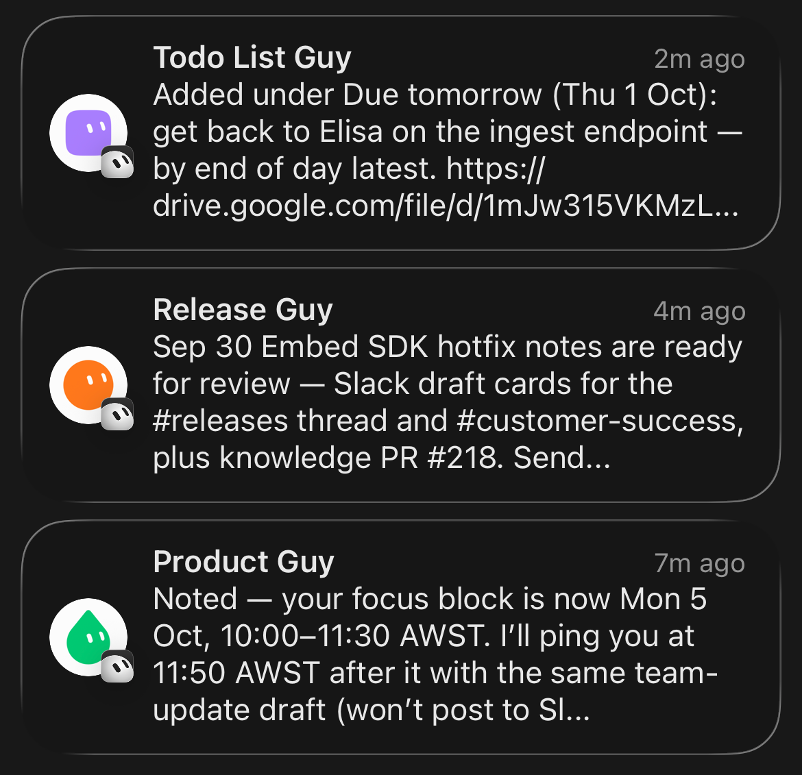
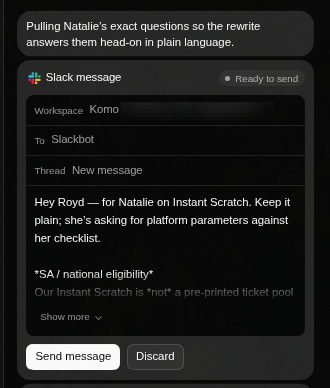
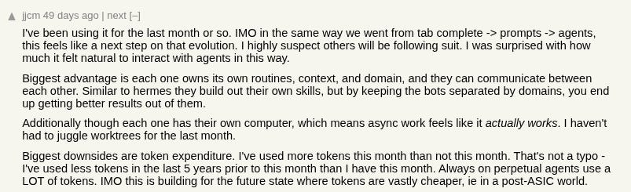
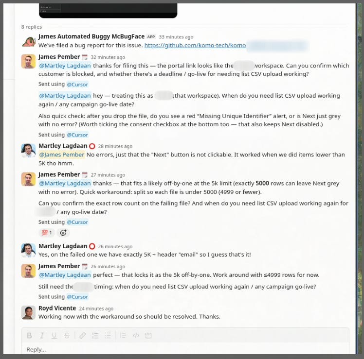
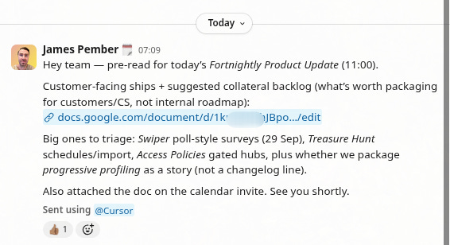
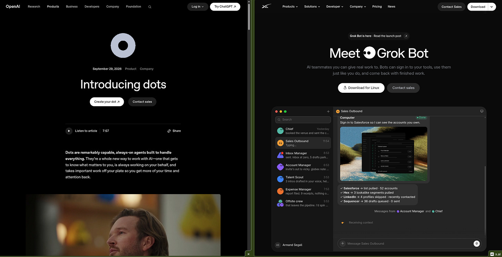



**收录说明**：直接下载；去掉了文末的订阅提示和链接卡片。原文全文存于本目录的 original.md，网站上不显示，已翻译。

**内容摘要**：作者用了约一周 Grok Bot，认为它是很好的产品：他的每个 Bot 各有明确的任务范围、所需的技能和工具，并能自己创建和更新例行任务；Gmail、日历、Drive、Slack 和 GitHub 的原生连接器覆盖了他约 80% 的工作场景。他举了两个例子：Bot 开始在 Slack 中替他做产品问题和 bug 的第一线分流，以及为双周的产品营销例会自动准备材料。作者认为这些用法早就可能，但第一次真正好用；同时也不清楚这类产品的护城河在哪里，文中提到 OpenAI 刚发布 Dots、xAI 刚推出 Team Bots。

**保留理由**：一位产品负责人的一手使用记录，给出了 Bot 分工、例行任务和连接器在实际工作中的具体用法。

---

[James Pember](https://substack.com/@jamespember)

2026 年 10 月 4 日

过去一周左右，我一直在试用 [Grok Bot](https://x.ai/news/introducing-grok-bot)。我得说，它真的是个好产品。我们的工程团队此前已经迁回 Cursor（主要是因为 [Projects](https://www.linkedin.com/feed/update/urn:li:ugcPost:7503998931907969024?commentUrn=urn%3Ali%3Acomment%3A%28ugcPost%3A7503998931907969024%2C7509242007639314432%29&dashCommentUrn=urn%3Ali%3Afsd_comment%3A%287509242007639314432%2Curn%3Ali%3AugcPost%3A7503998931907969024%29) 和 Cloud Agents），而考虑到 Grok Bot 能与 Cursor 和 Cloud Agents 无缝集成，试一试似乎是理所当然的事。我的团队里有一套机器人（bots），虽然这个概念早期的版本让人觉得尴尬（「我用智能体替换了整个市场团队！」），但我确实认为，一支由智能体助手组成的团队这个想法现在开始相当好地运转起来了。

我的这些机器人（或者「伙计们」）各有明确限定范围的任务，可以使用完成这些任务所需的技能和工具，并且能够创建（和更新）自己的「例程」（routines，即自动化），与我的工作中的日程和触发器相关联。它们可以监视我的日历、等待 Slack 中特定类型的回复，或者只是按定时计划运行（「每天早上」「每天 4 次」等）。

我团队里的几个「伙计」

我的工作中最重要的那些界面都有顺滑的原生连接器（native connectors）——> Gmail、Calendar、Drive、Slack 和 GitHub。这五个工具合计约占我每天全天候花费时间（也是工作）所在的 80%。除此之外，Grok Bot 的智能体拥有任何智能体都有的全部功能——> 工具调用、计算机使用、MCP、网页搜索等。

Grok Bot 中原生 Slack 连接器的一个示例

AI 产品炒作周期有趣的地方在于，那些最硬核、被 AI 灌满的 tokenmaxxer 构建的每一个新工具，都会在 3-6 个月后不可避免地作为开箱即用的产品发布。Grok Bot 当然「只是」OpenClaw，但以漂亮的消费级应用包装产品化了。它感觉不太像开发者工具，而更像一个*真正的*产品——对许多 AI 工具链产品来说，这可不容易做到。

早在 2026 年 5 月，我在一篇题为[《Unblocked》](https://jamespember.substack.com/p/unblocked)的文章中写过以下内容，讲的是我使用智能体的经历，以及当时仍然存在的用户体验怪癖。我愿意认为，Grok Bot 朝着让「普通人」以更易用的方式使用智能体迈出了一步。没有 CLI，没有 markdown 文件。你只需*说出*你想要什么，你的 bot 就会尝试*自我配置*来实现它。

> 「现在，每当我遇到重复出现的任务、阻碍或问题时，我都会试着问自己：这只是个[技能问题（skill issue）](https://jamespember.substack.com/p/its-a-skill-issue)吗？一些定制代码加一套指令能解决它吗？话虽如此，这里仍有巨大的用户体验问题要解决。编排、护栏、工具定义、调度/调用等等。对许多业务用户来说，使用智能体和技能仍然是一个相当大的技术跨越。很多人都在试图解决这个问题（参见：Claude Cowork 等），我认为我们最终会逐步定位到一些非常好的用户体验模式，但我们现在还没到那一步。」

我认为这是 Hacker News 上的一条好评，它概括了 Grok Bot（以及类似平台）的部分价值主张。正如这位用户所说，以这种方式使用 AI「感觉」自然得多。

[链接](https://news.ycombinator.com/item?id=49263241)

正如我之前写过的，AI 工具这件事很奇妙，因为有时我们会看到能力上出现巨大的阶跃变化，随后是很长的停滞期，一切都固化下来。倒不是说情况变糟了，只是你习惯了一套工具及其可能的能力。我觉得[过去一周左右因 Grok Bot 而发生的工作流变化，比过去 6 个月（那段时间我大多直接使用编码智能体）还要多](https://www.linkedin.com/posts/jamespember_conscious-of-linkedin-hyperbole-but-activity-7511610774365216768-vGSW&rcm=ACoAAAmlHW0BLq9rIQIbZooU2CqQx0SvyBj-HFY)。

> 「在我看来，从一线实践的角度看，「实用的」AI 进步并非纯粹线性。我们会摸索出一堆使用这些工具更快构建产品的技巧和战术，取得一堆感觉像是「突破」的进展，然后又会在一段时间里陷入平台期。我在软件行业交谈过的几乎每个人都经历过这种情况。有些日子和星期感觉像生活在未来，也有些时候一切又感觉有点「平淡」。这让我有点想起那句（也许是误归属的？）列宁名言：「有时几十年什么都没发生；有时几周里发生了几十年。」」——[《Tipping Points》](https://jamespember.substack.com/p/tipping-points)（我）

以下是我这周使用 Grok Bot 的两次体验，它们有点让我大开眼界。

首先，我的 Grok Bot 已经开始在 Slack 中*替*我分流产品问题和 bug，完全不需要我（或我的团队）参与。一个聪明的智能体作为「生产力第一道防线」非常合理，能卸下我和团队其他人大量「上下文切换」的负担。在这个例子里，AI 成功帮助我的团队找到了一个即时变通方案。这类事情每天都在发生。这种无脑的 Slack 杂活往往构成某人的全职工作，阻碍他们在自己的角色中[更高产](https://jamespember.substack.com/p/prolific-productive)。

这个 bot 很擅长把事往前推。这些正是我们团队通常会问的同类问题。

其次，像大多数人一样，我的日历里有多个团队的一堆重复会议。其中之一是每两周一次的产品营销同步会，我会带团队过一遍所有最新更新、功能和 bug 修复。以前准备这个要花我一段时间——> 我得翻发布说明、GitHub 和 Slack，把所有内容汇编成一份文档。现在我的 Grok Bot 会完成所有这些准备工作，并提前作为打包好的预读材料发给团队。

这些用例其实*一直*都是可能的。我们从 2022 年 11 月起就一直在谈论这个「大脑」的想法，但我必须说，直到现在我才看到它运转得*这么好*。我不知道这是因为模型、运行框架（harness），还是仅仅因为接入现有上下文系统的集成质量，但不管是什么，它起作用了。

话虽如此，这里护城河在哪里仍然*非常*不清楚。就在我写这篇文章时，我看到 OpenAI 发布了 [Dots](https://openai.com/index/introducing-dots/)，基本上是他们自己版本的 Grok Bot，而 Meta 的 Muse 似乎也吸引了很多关注。我确信 Anthropic 很快也会发布类似的东西（如果他们还没发布的话，要跟上 AI 领域所有产品发布*很难*……）。

> 「人们往往会爱上伟大的运动，但最终结婚的是伟大的产品。」——M.G Siegler[《The Swiss Assistant》](https://spyglass.org/the-swiss-assistant/)

这个领域的产品趋同太严重了！

就在昨天，我看到 xAI 团队推出了 [Grok Bot Teams](https://x.ai/news/team-bots)。我确实认为这（面向组织的多人 AI）是拼图的下一个重要部分，而我认为它在功能上仍未解决。还没有人*真正*搞清楚如何做出为团队而非个人工作的智能体。如果有人解决了这个问题，我感觉他们将在推动智能体获得更多企业采用方面走得很远。唯一的问题是，他们的竞争对手只会在他们身后几周……

延伸阅读：

1. [《Apps, agents and aggregation》](https://stratechery.com/2026/apps-agents-and-aggregation/) - Ben Thompson
2. [《Can Someone Finally Architect Personal Assistant AI?》](https://spyglass.org/the-swiss-assistant/) - M.G. Siegler
