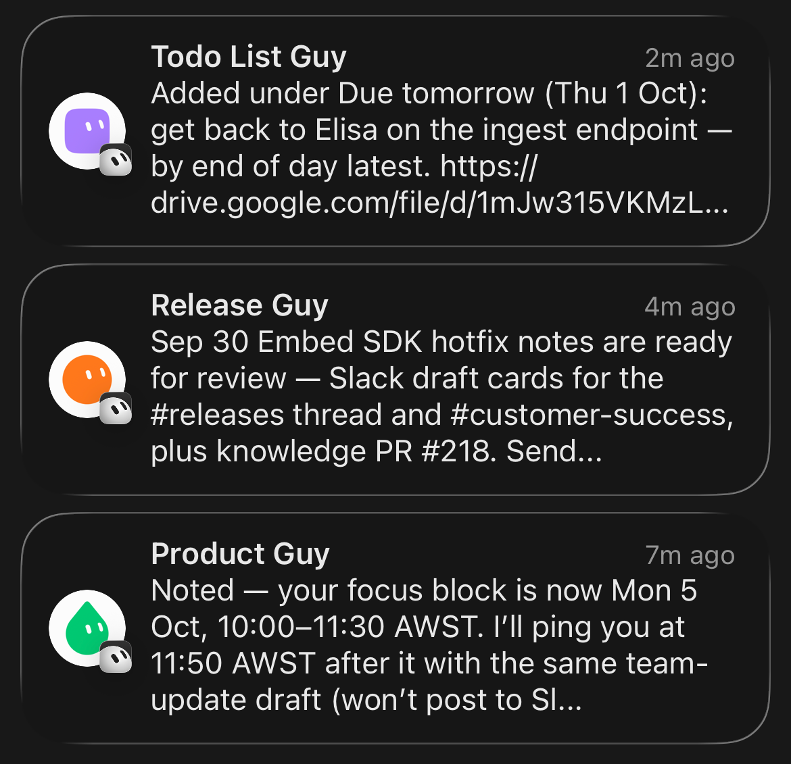
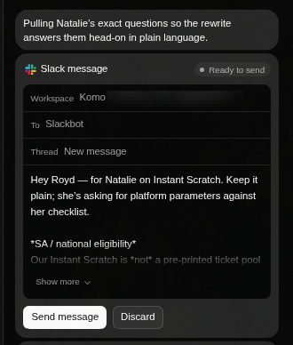
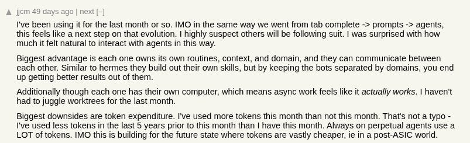
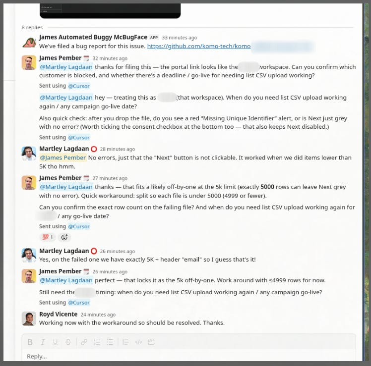
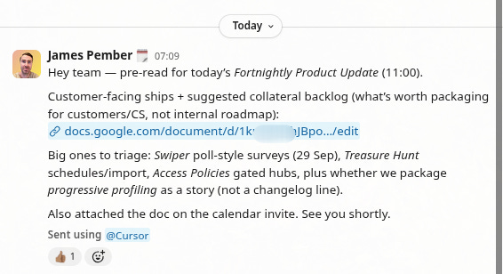
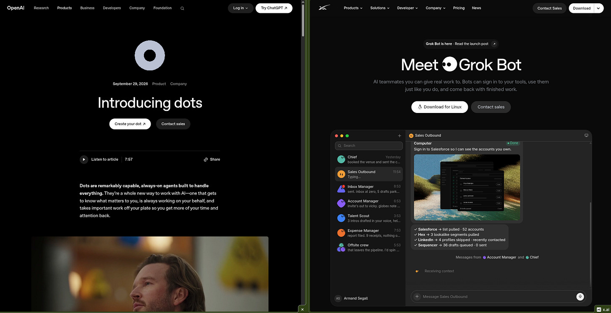

来源：https://jamespember.substack.com/p/grok-bot-is-really-good
取文：2026-11-05，直接下载

[James Pember](https://substack.com/@jamespember)

Oct 04, 2026

I’ve been trying out [Grok Bot](https://x.ai/news/introducing-grok-bot) for the past week or so. I have to say, it’s a really good product. Our engineering team had already moved back to Cursor (mostly due to [Projects](https://www.linkedin.com/feed/update/urn:li:ugcPost:7503998931907969024?commentUrn=urn%3Ali%3Acomment%3A%28ugcPost%3A7503998931907969024%2C7509242007639314432%29&dashCommentUrn=urn%3Ali%3Afsd_comment%3A%287509242007639314432%2Curn%3Ali%3AugcPost%3A7503998931907969024%29) and Cloud Agents), and given Grok Bot seamlessly integrates with Cursor and Cloud Agents, it felt like a no-brainer to give it a shot. I’ve got a suite of bots on my team, and whilst early iterations of this concept felt cringe (“*I replaced my entire marketing team with agents!*”), I do actually think the idea of a team of agentic assistants is now starting to work fairly well.

My bots (or “guys”) have specifically scoped tasks, have access to skills and tools that they need for those tasks, and are able to create (and update) their own “routines” (i.e. automations) relating to the schedules and triggers in my work. They can watch my calendar, wait for specific types of responses in Slack or just run on a timed schedule (“every morning”, “4 times a day” etc).

A few of the “guys” in my team

There are slick native connectors for the most important surfaces in my work—> Gmail, Calendar, Drive, Slack and GitHub. Those five tools comprise ~80% of where I spend my time (and do my work), all day, every day. Beyond that, Grok Bot agents have all the same functionality that any agent does —> tool calling, computer use, MCP, web search etc.

An example of of the native Slack connectors in Grok Bot

What’s interesting about the AI product hype cycle is that, every new tool that the most hardcore AI-pilled tokenmaxxers build, is inevitably shipped as a turnkey product 3-6 months later. Grok Bot is of course “just” OpenClaw, but productised in a nice consumer app packaging. It feels less like a developer tool, and more like an *actual* product, which is more than you can say for a lot of the AI tool chain.

Back in May of 2026 , I wrote the following, in a piece called “[Unblocked](https://jamespember.substack.com/p/unblocked)”, about my experience with agents, and the UX quirks that still existed at that point in time. I’d like to think Grok Bot is a step towards a more more accessible way for “normal” people to use agents. There’s no CLI, there’s no markdown files. You just *ask* for what you want and your bot tries to *configure itself* to make it happen.

> “*Right now, whenever I run into recurring tasks, blockers or problems, I try and ask myself: is this just a [skill issue](https://jamespember.substack.com/p/its-a-skill-issue)? Could some custom code and a set of instructions solve for this? All of this said, there are still tremendous UX problems to solve here. Orchestration, guardrails, tool definition, scheduling/invocation etc. Using agents and skills is still a fairly big technical leap for a lot of business users. Many are trying to solve this problem (see: Claude Cowork etc), and I think we will ultimately triangulate on some very good UX patterns, but we aren’t there quite yet.*”

I thought this was a good comment from Hacker News, summarising some of the value proposition of Grok Bot (and similar platforms like it). As the user says, it “feels” a lot more natural to use AI in this way.

[Link](https://news.ycombinator.com/item?id=49263241)

As I’ve written about before, the AI tool stuff is curious because, there are times when it feels like we see massive step changes in capability, followed by quite long lull periods where things ossify. Not to say things are bad, it’s just you get used to a set of tools and the capabilities that are possible. [I feel my workflow has changed more in the past week or so with Grok Bot than it has in the past 6 months](https://www.linkedin.com/posts/jamespember_conscious-of-linkedin-hyperbole-but-activity-7511610774365216768-vGSW&rcm=ACoAAAmlHW0BLq9rIQIbZooU2CqQx0SvyBj-HFY), where I’ve mostly been using coding agents directly.

> *It seems to me, from in the trenches, that “practical” AI progress isn’t purely linear. We figure out a bunch of techniques and tactics for using these tools to build product faster, make a bunch of progress that feels like a “break through”, and then we hit plateaus again for a while. Almost everyone I speak to in software has experienced this. There are days and weeks that feel like living in the future, and times where it all feels kinda “meh” again. Kinda reminds me of that (perhaps mis-attributed?) Lenin quote, “there are decades where nothing happens; and there are weeks where decades happen.” -* [Tipping Points](https://jamespember.substack.com/p/tipping-points) (me)

Here are two experiences I had with Grok Bot this week that kinda blew my mind.

Firstly, my Grok Bot has begun triaging product issues and bugs in Slack *for* me, without me (or my team) being involved at all. A smart agent as a “first line of productivity defense” makes so much sense and takes so much “context-switching” burden off me and the rest of our team. In this case, the AI managed to help my team to find an instant workaround. This sort of thing happens all day, every day. This is the sort of mindless-Slack-busywork that often comprises someones full time job, holding them back from being more [prolific](https://jamespember.substack.com/p/prolific-productive) in their own role.

The bot is pretty good at moving the ball forward. These are the same types of questions our team would typically ask.

Secondly, like most people, I have a bunch of recurring meetings in my calendar across multiple teams. One of these is a fortnightly product marketing sync where I walk the team through all the latest updates, features and bug fixes. Prepping for this used to take me a while —> I’d have to dig through release notes, GitHub and Slack to compile it all into a doc. Now my Grok Bot does all this prep and sends it all out as a packaged pre-read for the team ahead of time.

Now, these use cases have *always* been possible. We’ve been talking about this “brain” idea since November of 2022, but I must say that I’ve not seen it work *this well* until now. I don’t know whether that’s the models, the harness or just the quality of the integrations into existing systems of context, but whatever it is, it’s working.

That said, it’s still *highly* unclear where the moats are here. Just as I was writing this article, I saw OpenAI launched “[Dots](https://openai.com/index/introducing-dots/)”, essentially their own version of Grok Bot and Meta’s Muse seems to be capturing a lot of attention too. I’m sure Anthropic will launch something similar soon (if they haven’t already, it’s *hard* to keep up with all the product launches in AI…).

> “*People tend to fall in love with great movements but end up marrying great products.*” - M.G Siegler “[The Swiss Assistant](https://spyglass.org/the-swiss-assistant/)”

There is so much product convergence in this space!

Just yesterday, I saw the xAI team launched [Grok Bot Teams](https://x.ai/news/team-bots). I do think this (multi-player AI for organisations) is the next big piece of the puzzle, that I’d argue is still functionally unsolved. No one has *really* figured out how to figure out agents that work for a team, not just an individual. If someone solves this problem, I sense they’ll go a long way to bringing more more enterprise adoption to agents. The only problem is, their competitors will be just a few weeks behind them…

Further reading:

1. “[Apps, agents and aggregation](https://stratechery.com/2026/apps-agents-and-aggregation/)” - Ben Thompson
2. “[Can Someone Finally Architect Personal Assistant AI?](https://spyglass.org/the-swiss-assistant/)” - M.G. Siegler
