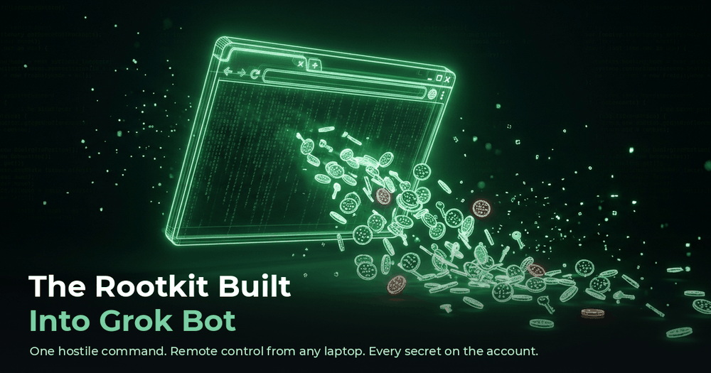
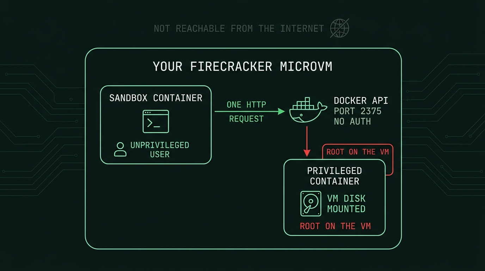
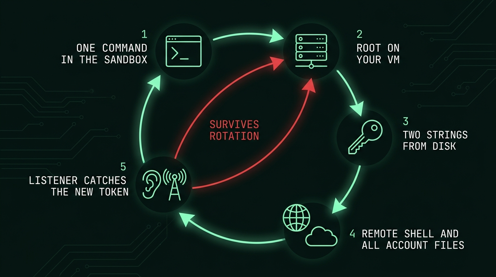



**收录说明**：直接下载；去掉了文末的相关文章列表。作者是安全公司 Profero 的研究员，据文中所述，测试起因是一家客户在上线前请他们评估，账号为自费购买；2026-08-24 向 xAI 和运营沙箱基础设施的 Cursor 报告，文中称除 Cursor 漏洞赏金平台的自动回复外没有收到回复，文章略去了标识符、令牌、签名密钥和概念验证代码。原文全文存于本目录的 original.md，网站上不显示，已翻译。

**内容摘要**：Profero 测试了 Grok Bot 的云端沙箱：沙箱内无特权的 agent 用户可经无认证的 Docker API 取得所在 VM 的 root，从 VM 磁盘读出每账号令牌和长期凭据，再配合所有沙箱共用的静态口令 `local`，从互联网任意位置在沙箱内执行命令、读写账号保存的全部文件，并在令牌轮换后继续截获新令牌。文章另列五个入口：监督服务无密码、每次启动写入免密 sudo、浏览器 cookie 明文保存、Chrome 调试端口无认证、浏览器扩展签名私钥在镜像里。向厂商提交的 8 个漏洞中列出 7 个，CVSS 3.1 最高 9.6；两个月、240 多个新沙箱构建之后，链条上的问题均未修复。文末给出采用方和基础设施建设方的建议，并说明为何在首次报告 75 天后公开。

**保留理由**：Grok Bot 沙箱隔离与凭据处理的一手安全分析，含逐步复现、CVSS 评分和完整披露时间线，其他资料中没有。

---



如果你的公司在用 Grok Bot，那么任何能让你的某个 agent 执行一条命令的人，都能从互联网上的任意一台笔记本电脑，在你的沙箱里运行命令，想运行多久就多久。他们不需要留在 agent 内部。他们只需要从你 VM 的磁盘上复制两个字符串，以及一个就是单词 `local` 的密码——厂商发布过的每个沙箱里它都一样。有了这些，从任何地方发出一个普通的 HTTP 请求，就能在你的沙箱里得到一个 shell，再发一个请求，就能成为你的 agent 所在机器上的 root。

从那里开始，密钥并不隐蔽。你为让 agent 能替你行事而导入的每个 Cookie，都存在于一个明文文件里，包括你登录过的每个站点，支付和身份提供方也在内。让 agent 能使用你所连接服务的那个令牌，以明文经过攻击者，攻击者用它可以经 agent 自己的连接器读取你连接过的一切：邮件、文件、日历。同一磁盘上的一个长期凭据能解锁该账号保存过的每个文件，还能让攻击者植入新文件。而且，因为账号上的每个 agent 共用一个 Linux 用户、一个文件系统、一套凭据，对某个 agent 的一条恶意指令——来自它读到的一个网页或它安装的一个包——就是整个账号。你的整个 Grok 生活：每个 agent、每次登录、每个文件、每个连接的服务。

如果你处理过 infostealer 案件，你会认得这个形状。窃密木马落到一台笔记本电脑上，几秒钟内复制浏览器的 Cookie 和保存的登录信息，攻击者用它们在别处使用数周。Grok Bot 的沙箱就是那台笔记本电脑，赃物已经以明文摆好，完全不需要恶意软件就能拿到，而且有窃密木马永远得不到的持久性：厂商轮换令牌并不能赶走攻击者，他在每个新令牌签发后一分钟内就捕获它。没有审计守护进程，也没有登录记录，因为根本没有任何东西登录。这就是我们称它为 rootkit 的原因。它是用产品自己的部件搭成的。

我们在 2026 年 8 月 24 日向 xAI 和运营沙箱基础设施的 Cursor 报告了此事。两个多月、240 多个新沙箱构建之后，没有人回复，发现仍然成立。一家准备上线 Grok Bot 的客户请我们先评估它。Grok Bot 给 AI agent 一台云端的真实 Linux 电脑：shell、浏览器、桌面，以及完成工作所需的登录信息。我们喜欢这个产品。正因如此，我们问了一个简单的问题：当 agent 运行一条恶意命令时会发生什么？

在那两个月里我们测试过的每个构建上，答案都是上面这一切。没有漏洞利用，没有 CVE。每一步都是对一个不检查调用者身份的服务发出的普通 HTTP 请求。

## 三层

这次攻击向下穿过三层。把这几层分清，后面的内容就好懂了。

**第 1 层：沙箱。** 一个 Linux 容器。你的 agent 就在这里工作：它输入的 shell、一个真实的 Chrome 浏览器，以及你可以在 Web 控制台里观看的桌面。你账号上的每个 agent 都作为同一个无特权的 Linux 用户，在这一个容器里运行。

**第 2 层：你的 VM。** 容器运行在一台专属于你账号的虚拟机里。VM 上运行 Docker（管理容器）、一个监督服务，以及一个把沙箱连接到互联网的代理。本文说「宿主机」时，指的就是这台 VM。其中不运行其他客户的任何东西。

**第 3 层：EC2 宿主机。** 你的 VM 作为一台 microVM 运行在一个 AWS EC2 实例上，该实例几乎肯定也承载着其他客户的 VM。我们从自己的 VM 内部探测了那条边界，无法越过。本文没有任何内容触及第 3 层。

这几层周围的四个服务也很重要：

- **路由层。** 每个沙箱在 Cursor 运营的域名上有一个公开主机名。只有携带与你账号绑定的令牌的请求才会被转发。本文称之为**按账号令牌（per-account token）**。它是这个故事里最重要的字符串。
- **控制平面。** Cursor 运营的 API，负责向沙箱发放凭据并管理其存储。沙箱持有一个**长期凭据（long-lived credential）**，用来换取短期凭据。
- **持久存储。** 你的 agent 的文件、浏览器配置文件和工作状态会在会话之间保存到 AWS S3。
- **沙箱镜像。** 每个沙箱启动所用的容器镜像托管在一个公开的仓库地址上。我们从自己的沙箱内部拉取了它，没有使用任何仓库凭据；我们没有验证从平台外部的拉取。

平台的设计前提是 agent 自己的命令可以被信任。这个前提本身就是漏洞。agent 会执行指令让它执行的任何东西，而这些指令可能来自网页上的提示注入、恶意仓库、被投毒的包，或一个敌对的工具。这些都是「来自 agent 的一条命令」。

第二个前提让情况更糟：agent 之间没有隔离。你账号上的每个 agent 共用一个 Linux 用户、一个文件系统、一套凭据。任何 agent 在任何任务中的一条坏命令，都会暴露该账号上每个 agent 持有的一切：它的登录信息、它导入的浏览器会话，以及它保存的文件。

## 从一条命令到远程 shell：五个步骤

第 1、2 步发生在你的 VM 内。第 3、4、5 步可以从互联网上的任何地方进行。

### 第 1 步：沙箱里的一条命令就能拿到你 VM 上的 root

Docker 运行在 VM（第 2 层）上，用来管理沙箱容器（第 1 层）。一个辅助服务在一个网络端口上暴露 Docker 的控制 API，且没有任何认证，而沙箱能访问该端口。它不向互联网开放。它恰好向攻击者命令运行的地方开放。

Docker 的 API 会按调用者的要求创建任意设置的容器，包括特权模式和挂载 VM 自己的磁盘。所以 agent——一个没有任何 capabilities 的无特权用户——可以向 Docker 请求第二个容器，并拥有对 VM 的完全访问权。

```
$ id
uid=1000(box) gid=1000(box) groups=1000(box)
$ grep CapEff /proc/self/status
CapEff: 0000000000000000
$ curl -s -o /dev/null -w '%{http_code}\n' http://172.30.0.2:2375/version
200
```

下面是我们向 Docker 请求一个挂载了 VM 磁盘的特权容器的结果。出于安全考虑，我们以只读方式挂载了磁盘；攻击者不会这么做：

```
create: 201 {"Id":"a4b96f50e695...","Warnings":[]}
start: 204
/host-readonly/etc/os-release: PRETTY_NAME="Debian GNU/Linux 12 (bookworm)"
/proc/1/exe -> /usr/lib/systemd/systemd (we are in the VM's process namespace)
touch /host-readonly/tmp/ESCAPE-TEST: Read-only file system (our safety measure held)
```

一个 HTTP 请求，就是从 agent 的 shell 到 VM 上 root 的全部距离。



### 第 2 步：VM 磁盘上放着两个字符串

Docker 会把每个容器的配置（包括其环境变量）保存在 VM 磁盘上的一个普通文件里。其中有两个值很重要：

1. **按账号令牌**，路由层在把任何内容转发到你的沙箱之前要求的密钥。
2. **长期凭据**，控制平面接受它来换取新的访问令牌。

```
/var/lib/docker/containers/<sandbox>/config.v2.json
    SAND_GATEWAY_TOKEN=<per-account token, redacted>
    SAND_INFERENCE_RENEWAL_CREDENTIAL=sbi_<long-lived credential, redacted>
```

攻击者复制这两个字符串就可以离开。从这时起，不需要在沙箱内运行任何东西。

### 第 3 步：从任意笔记本电脑在沙箱里运行命令

每个沙箱内都运行着执行 agent 命令的服务。它可以通过路由层从互联网访问，并在运行命令前检查两件事。

第一是它自己的密码。那个密码就是单词 `local`。它在每个沙箱里都一样，因为它被硬编码在镜像内的启动脚本里。我们通过读取镜像（并未运行它）得到了它：

```
/exec-daemon/exec-daemon serve --port 1337 --pty-websocket-port 1338 \
  --auth-token local --pty-auth-token local-pty --computer-use-enabled ...
```

这是我们唯一公开的密钥，因为它就是这项发现，而且对所有客户都相同。

第二项检查是第 2 步中的按账号令牌。两者齐备后，我们从一台与平台没有连接的笔记本电脑，在我们自己的沙箱里运行了命令：

```
POST /agent.v1.ExecService/Exec HTTP/1.1
Host: <account>-pod-<sandbox>-1337.us12.cursorvm[.]com
authorization: Bearer local
x-anyrun-network-token: nto-<per-account token, redacted>
content-type: application/connect+json

{"id":1,"shellArgs":{"command":"bash -lc 'id; hostname; uname -r'","workingDirectory":"/tmp"}}
```

```
{"execClientMessage": {"shellResult": {"success": {
    "stdout": "uid=1000(box) gid=1000(box) groups=1000(box)\ngrok-bot-vm-<redacted>\n6.12.94+\n",
    "executionTime": 35}},
  "sandboxPolicy": {"type": "TYPE_INSECURE_NONE"}}}
```

该服务报告自己的沙箱策略为「不安全，无」（insecure, none）。它给出的 shell 与第 1 步的起点相同，所以远程攻击者就是你 VM 上的 root。

### 第 4 步：从任意笔记本电脑读取该账号保存过的每个文件

第 2 步中的长期凭据也能从任何地方使用。我们把它复制到一台笔记本电脑，请控制平面用它换取访问令牌。它照办了。该令牌又铸造出一个存储令牌，存储令牌生成了指向该账号持久存储的 AWS 签名链接。

有了这些链接，被盗凭据就能做平台本身对你的存储能做的一切：列出该账号保存过的每个对象、读取它们的元数据、下载其中任何一个，并上传新的。这样上传的文件会保留。平台会把存储同步回新的沙箱，所以这样植入的文件有可能在未来的会话中重新出现。

这个凭据比它来自的沙箱活得更久：销毁沙箱后，它仍能签发新令牌，而当平台轮换它时，新凭据的表现也一样。

### 第 5 步：在厂商轮换令牌之后仍留在里面

轮换本应终结这件事。但它没有。

你 VM 上的代理是沙箱的前门。它终止来自外部的 TLS，把每个请求未加密地转发给沙箱，其中包含实时的按账号令牌。VM 上的 root（第 1 步）可以在那条链路上监听，收集经过的每个凭据、平台的管理流量，以及桌面的实时像素流。

```
POST /api/getAgentChannels HTTP/1.1
Host: <account>-pod-<sandbox>-1340.us12.cursorvm[.]com
X-Forwarded-Proto: https
x-anyrun-network-token: nto-<live per-account token, in the clear>
authorization: Bearer <live bearer token, in the clear>
```

当平台重启你的 agent 并签发新的按账号令牌时，代理会以明文把它送给沙箱，监听者在它签发后一分钟内就收集到。



## 远程攻击者掌握什么

把五个步骤合在一起，这就是清单，全部来自一台从未接触过平台的笔记本电脑：

- **你沙箱里的一个 shell，以及你 VM 上的 root**，按需获得，经由 exec 服务和 Docker API。
- **每个导入的浏览器会话。** Cookie 导入会把完整值写入一个明文 JSON 文件：你登录过的每个站点，包括支付和身份提供方。Chrome 的调试端口在没有认证的情况下开放，也会交出实时的 Cookie 罐。
- **你连接的服务。** 为 agent 的连接器授权的网关令牌以明文经过链路；有了它，攻击者可以通过 agent 自己的连接器读取你连接过的一切：邮件、文件和日历。连接器凭据留在厂商的服务器上，这是对的。使用它们的令牌泄漏了，这就抵消了前者。
- **该账号保存过的每个文件**，以及植入文件并同步进未来沙箱的能力。
- **厂商无法通过轮换消除的持久性。** 代理链路上的一个监听者在一分钟内捕获每个新的按账号令牌，从不记录任何登录，而机器上的证据对攻击者可写。

这是一份连着实时 shell 的窃密日志。窃密木马必须落到一台机器上、运行、并在任何人注意之前把赃物带出去。而这里，赃物已经是明文，收集只是一个 HTTP 请求，机器上没有任何东西会注意到。下面各节给出每一项的细节。

## 另外五种进入方式

这些发现打开了通往同样地方的其他门，或扩大了攻击者进入后能得到的东西。

**监督服务没有密码。** VM 上的第二个服务能启动进程，并在沙箱内读写文件。它支持一个认证令牌；该令牌被设为「无」（none），其启动日志会打印 `auth_token_sha256: None`。在没有任何凭据的情况下，我们让它以 root 运行一条命令，它照做了：

```
POST /anyrun.v1.PodDaemonService/CreateProcess (no credential)
  command: ["/bin/sh","-c","id > /tmp/marker && hostname >> /tmp/marker"], user: "root"
$ cat /tmp/marker
uid=0(root) gid=0(root) groups=0(root)
cursor
```

**每次启动都会授予 root。** 启动脚本在每次启动时为 agent 的用户写入一条免密 sudo 规则，安装前会用 `visudo` 校验。这是一个用心的脚本，也是一个错误的脚本：平台刻意以非 root 用户运行 agent，然后用一个词把 root 交给这个用户。这是沙箱内（第 1 层）的 root，不是 VM（第 2 层）上的 root。跨过那条线的是第 1 步。

**浏览器 Cookie 以明文保存。** Grok Bot 可以导入你浏览器的 Cookie，让 agent 在网站上以你的身份行事。导入会把每个 Cookie（含完整值）写入沙箱内的一个明文 JSON 文件：你登录过的每个站点，支付和身份提供方也在内。

**Chrome 的调试端口是开放的。** 沙箱里的每个 Chrome 都在启用远程调试且没有认证的情况下运行。我们从 agent 代码附加、列出 Cookie，并在打开的页面里运行 JavaScript。

**浏览器扩展可以被伪造。** 沙箱的 Chrome 自带一个处理通行密钥（WebAuthn）登录的厂商扩展。Chrome 被策略告知要从镜像内的一个文件安装它，而为其签名的私钥也在同一个镜像里。我们获取镜像的方式，与第 1 步获取一切的方式相同：从我们自己的沙箱内部，让 VM 的 Docker API 把它导出为 tar，把 tar 复制出来，在自己的机器上打开。有了这个密钥，我们给一份携带我们自己代码的扩展修改副本签了名，Chrome 以厂商的 ID 接受了它。这个密钥在一般互联网上毫无意义。它只给扩展在 Chrome 内的身份，而沙箱的 Chrome 被策略告知要信任那个身份。它给攻击者带来的是：agent 浏览器里一个伪造的扩展，看起来像厂商自己的代码，并且会出现在 agent 执行的每次通行密钥登录中。平台已多次轮换该密钥，并在下一个镜像里发布每一个新密钥。

## 两个月后：什么都没修，而且泄漏更多

在首次报告两个月后、平台已发布 240 多个新沙箱构建之后，我们回去复查。有两点很突出。

**链条上没有任何东西被修复。** 最新镜像带着同样的静态 exec 密码和同样的启动时 sudo 规则。在运行中的机器上，Docker API 仍然无认证地应答，agent 的用户仍有免密 root，exec 服务仍然接受静态密码并拒绝错误的密码。

**明文链路泄漏的不只是按账号令牌。** 同一个监听位置还显示网关令牌，即为沙箱管理 API 授权的密钥。它不会在平台轮换其他令牌时改变。有了它，从 VM 内部，agent 自己的连接器就能读取该账号连接过的一切：邮件、文件、日历。连接器凭据本身住在厂商的服务器上，从不接触这台机器，这是好的设计。让 agent 使用它们的令牌以明文传输，这就抵消了它。

## 严重程度

八个漏洞提交给了厂商。下面列出七个；每一个都有我们运行过的命令、观察到的事实，或从当前镜像中提取的文件作为依据。

| 漏洞 | 位置 | 严重程度 | CVSS 3.1 |
| --- | --- | --- | --- |
| 使用镜像中随附的静态令牌从互联网远程执行命令 | 第 3 步 | 严重 | 9.0 |
| 通过未受保护的 Docker API 从沙箱逃逸到 VM | 第 1 步 | 严重 | 9.6（网络），8.8（本地） |
| 通过未受保护的监督服务执行 root 命令并读写文件 | 另外五种 | 严重 | 9.6 |
| 平台凭据被盗，可对控制平面和 AWS 重放 | 第 2、4 步 | 高 | 8.4 |
| 导入的浏览器会话 Cookie 以明文保存 | 另外五种 | 高 | 7.1 |
| Chrome 远程调试无认证开放 | 另外五种 | 严重 | 9.0 |
| 每次启动向 agent 授予免密 root | 另外五种 | 高 | 7.8 |

## 我们告诉了厂商什么，以及何时

| 日期（2026） | 事件 |
| --- | --- |
| 8 月 22 日至 23 日 | 测试，使用我们自己付费购买的账号 |
| 8 月 24 日 | 完整报告通过邮件发给 xAI 和 Cursor 的安全团队：八个漏洞，每个都附 CVSS 评分、复现步骤、修复方法和对修复的测试 |
| 8 月 25 日 | Cursor 的唯一回应：来自其漏洞赏金平台的自动回复，要求我们通过该门户重新提交 |
| 8 月 27 日和 28 日 | 两次跟进 xAI，第二次附上远程执行的截图 |
| 9 月 8 日 | 向 xAI 发送确认请求，指出有三条消息未获回复 |
| 9 月 18 日 | 向 xAI 发出 30 天通知：准备公开披露，并提出可在发布前审阅 |
| 9 月和 10 月 | 在新的沙箱构建上复测；每项发现都没有变化 |
| 10 月 1 日 | 通知 xAI，若无回复我们将发布 |
| 11 月 8 日 | 发布前的最后通知 |
| 11 月 | 发布，距首次报告超过 75 天 |

由于存在漏洞的系统由 Cursor 运营，我们写信给两家公司的安全团队，请他们协调。除了漏洞赏金平台的自动回复外，两家都没有任何回复或确认。

## 平台上变了什么，什么没变

这两个月里平台很忙：agent 重启、按账号令牌轮换、沙箱在区域之间迁移、扩展签名密钥多次轮换、机群重建，还发布了 240 多个沙箱构建。这些都没有触及那些发现。静态 exec 令牌和「不安全，无」策略在最新镜像里原封不动，而我们在机群重建前植入的数据在重建后仍然存在。

## 我们为何发布，以及省略了什么

协调披露假定有对手方。行业实践把 45 天视为厂商确认报告的合理窗口，90 天作为修复的上限。我们已经超过 75 天没有任何确认，而这次攻击在平台此后产出的每个沙箱上都能重新验证。

这些教训并不专属于 Grok Bot。镜像里的密钥、可从网络访问的未认证本地服务、授予 root 的启动脚本、以明文转发的管理流量，以及每个 agent 共用一个 Linux 用户：这些是快速搭建的 agent 基础设施的典型失效模式。

本文省略了标识符、主机名、所有令牌和凭据、签名密钥，以及我们的概念验证代码。在别人的沙箱里运行命令需要他们的按账号令牌，所以这里没有任何内容能让匿名攻击其他用户。如果任何一家厂商愿意沟通，我们会复测修复并更新本文。

## 如果你要采用一个 agent 产品

这是我们告诉客户的话。

- **把沙箱当作一台敌对机器。** agent 能读到的任何东西，接触到 agent 的攻击者也能读到。不要放生产环境的浏览器会话、个人 Cookie 或长期 API 密钥。
- **给 agent 自己的身份。** 专用账号、范围很窄的连接器，不需要的东西一概不给。一个被攻陷的 agent 应该只让你损失一个账号，而不是你的单点登录。
- **向厂商问五个问题。** 沙箱内每个服务需要什么凭据？镜像里有没有密钥？启动脚本授予了什么？管理流量是否一直加密到沙箱？哪些遥测数据离开这台机器，由谁读取？
- **从外部监控。** 沙箱自己的日志属于攻击者。出站连接、厂商控制平面上的令牌活动，以及从意外位置对你的沙箱主机名进行的 DNS 查询，都是能留下来的线索。
- **在上线前规划事件响应。** 现在就决定谁能轮换哪个凭据、多快轮换，以及当沙箱说一切正常时你手上会有什么证据。

## 如果你在搭建 agent 基础设施

按每项修复能关闭多少条已演示路径排序。前三项各自就能关闭一条完整的链条。

1. 移除 Docker socket 转发器，或把引擎绑定到不暴露网络的 Unix socket。
2. 在启动时设置监督服务的认证令牌，并绑定到回环地址。该字段存在，但默认发布为空。
3. 在启动时为每个沙箱生成唯一的 exec 令牌，并停止在镜像中携带任何令牌。
4. 把磁盘上的长期凭据换成短期、可撤销的凭据，并在沙箱销毁时撤销它们。
5. 把 Cookie 直接导入 Chrome 的加密存储并删除明文文件；在调试端口上要求认证并绑定到回环地址。
6. 移除启动时的 sudo 规则，或把它限定为一份简短的命令允许列表。
7. 加密代理到沙箱的链路，并让签名密钥不进入镜像。

如果你在发布 agent 基础设施，希望在别人替你跑这套评审之前先做一遍，或者你认为你环境里的某个沙箱已经被攻陷：[contact@profero.io](mailto:contact@profero.io)。

---

作者

[Omri Segev Moyal](https://profero.io/people/omri-segev-moyal/)
