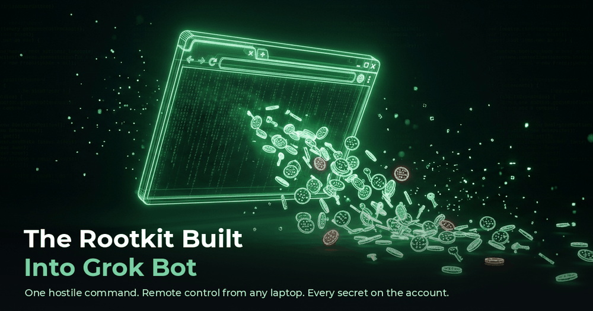
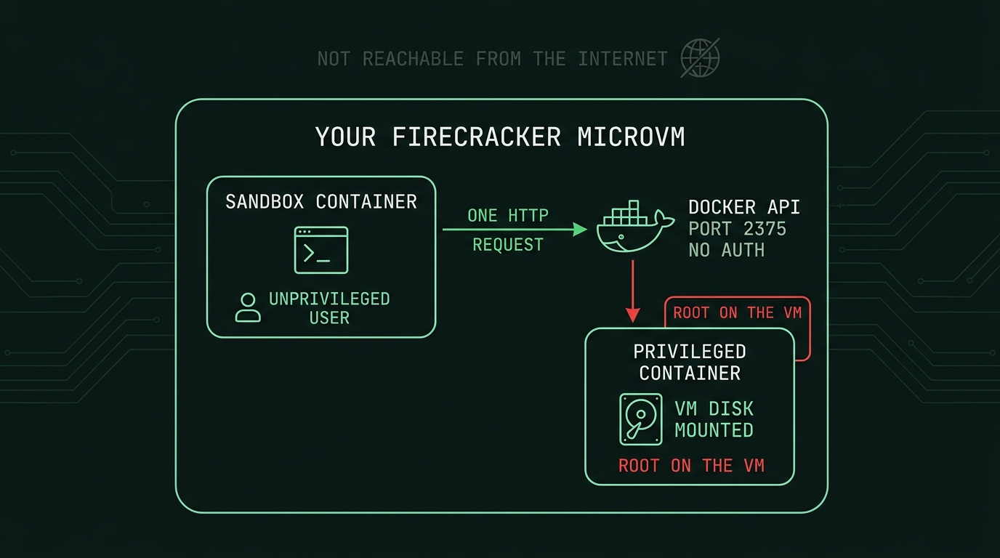
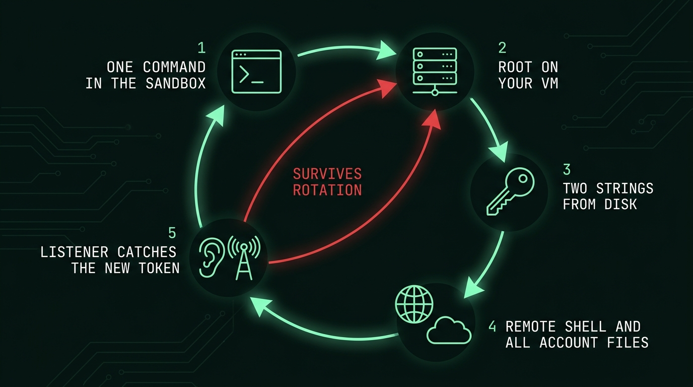

来源：https://profero.io/blog/the-rootkit-built-into-grok-bot
取文：2026-11-28，直接下载



If your company runs Grok Bot, anyone who gets one command into one of your agents can run commands in your sandbox from any laptop on the internet, for as long as they like. They do not need to stay inside the agent. They need two strings copied off your VM’s disk and a password that is the word `local`, the same in every sandbox the vendor has ever shipped. With those, a plain HTTP request from anywhere lands a shell in your sandbox, and one more request makes it root on the machine your agents live on.

From there the secrets are not hidden. Every cookie you imported so the agent could act as you sits in a plaintext file, every site you signed into, payment and identity providers included. The token that lets the agent use your connected services passes the attacker in the clear, and with it the attacker reads whatever you connected through the agent’s own connectors: mail, files, calendar. A long-lived credential on the same disk unlocks every file the account ever saved and lets the attacker plant new ones. And because every agent on the account shares one Linux user, one filesystem and one set of credentials, one bad instruction to one agent, from a web page it reads or a package it installs, is the whole account. Your entire Grok life: every agent, every login, every file, every connected service.

If you have handled an infostealer case you know this shape. A stealer lands on a laptop, copies the browser’s cookies and saved logins in seconds, and the attacker uses them from somewhere else for weeks. Grok Bot’s sandbox is that laptop, with the loot already laid out in plaintext, reachable with no malware at all, and with a persistence a stealer never gets: the vendor’s token rotations do not remove the attacker, who catches each new token within a minute of its issue. There is no audit daemon and no login record, because nothing ever logs in. That is why we call it a rootkit. It is built from the product’s own parts.

We reported this to xAI and to Cursor, which operates the sandbox infrastructure, on August 24, 2026. More than two months and more than 240 new sandbox builds later, nobody has replied and the findings still hold. A customer preparing to roll out Grok Bot asked us to assess it first. Grok Bot gives an AI agent a real Linux computer in the cloud: a shell, a browser, a desktop, and the logins it needs to do a job. We like the product. That is exactly why we asked a simple question: what happens when the agent runs one hostile command?

On every build we tested across those two months, the answer is everything above. No exploit, no CVE. Every step is an ordinary HTTP request to a service that does not check who is calling.

## The three layers

This attack walks down through three layers. Keep them straight and the rest of the post is easy.

**Layer 1: the sandbox.** A Linux container. This is where your agent works: the shell it types into, a real Chrome browser, and a desktop you can watch in the web console. Every agent on your account runs as the same unprivileged Linux user inside this one container.

**Layer 2: your VM.** The container runs inside a virtual machine dedicated to your account. The VM runs Docker (which manages the container), a supervisor service, and a proxy that connects the sandbox to the internet. When this post says “the host”, it means this VM. Nothing from another customer runs in it.

**Layer 3: the EC2 host.** Your VM runs as a microVM on an AWS EC2 instance that almost certainly carries other customers’ VMs too. We probed that boundary from inside our VM and could not cross it. Nothing in this post reaches layer 3.

Four services around the layers also matter:

- **The routing layer.** Each sandbox gets a public hostname on a Cursor-operated domain. Requests are forwarded only if they carry a token tied to your account. This post calls it the **per-account token**. It is the most important string in the story.
- **The control plane.** Cursor-operated APIs that issue the sandbox its credentials and manage its storage. The sandbox holds a **long-lived credential** it trades for short-lived ones.
- **The persistent store.** Your agent’s files, browser profiles and working state are saved to AWS S3 between sessions.
- **The sandbox image.** The container image every sandbox boots from is hosted on a public registry address. We pulled it from inside our own sandbox without any registry credentials; we did not verify a pull from outside the platform.

The platform’s design premise is that the agent’s own commands can be trusted. That premise is the vulnerability. An agent runs whatever its instructions tell it to, and those instructions can come from a prompt injection on a web page, a malicious repository, a poisoned package, or a hostile tool. Each of those is “one command from the agent.”

The premise is made worse by a second one: there is no isolation between agents. Every agent on your account shares one Linux user, one filesystem, and one set of credentials. One bad command in any agent, on any task, exposes everything every agent on the account holds: its logins, its imported browser sessions, and its saved files.

## From one command to a remote shell: five steps

Steps 1 and 2 happen inside your VM. Steps 3, 4 and 5 happen from anywhere on the internet.

### Step 1: one command in the sandbox gives root on your VM

Docker runs on the VM (layer 2) to manage the sandbox container (layer 1). A helper service exposes Docker’s control API on a network port with no authentication, and the sandbox can reach that port. It is not open to the internet. It is open to exactly the place an attacker’s command runs.

Docker’s API creates containers with any settings the caller asks for, including privileged mode and a mount of the VM’s own disk. So the agent, an unprivileged user with no capabilities, can ask Docker for a second container with full access to the VM.

```
$ id
uid=1000(box) gid=1000(box) groups=1000(box)
$ grep CapEff /proc/self/status
CapEff: 0000000000000000
$ curl -s -o /dev/null -w '%{http_code}\n' http://172.30.0.2:2375/version
200
```

The result of asking Docker for a privileged container with the VM’s disk attached. We mounted the disk read-only as a safety measure; an attacker would not:

```
create: 201 {"Id":"a4b96f50e695...","Warnings":[]}
start: 204
/host-readonly/etc/os-release: PRETTY_NAME="Debian GNU/Linux 12 (bookworm)"
/proc/1/exe -> /usr/lib/systemd/systemd (we are in the VM's process namespace)
touch /host-readonly/tmp/ESCAPE-TEST: Read-only file system (our safety measure held)
```

One HTTP request is the whole distance from the agent’s shell to root on the VM.



### Step 2: two strings sit on the VM’s disk

Docker stores each container’s configuration, including its environment variables, in a plain file on the VM’s disk. Two values in it matter:

1. The **per-account token**, the key the routing layer demands before forwarding anything to your sandbox.
2. The **long-lived credential**, which the control plane accepts in exchange for fresh access tokens.

```
/var/lib/docker/containers/<sandbox>/config.v2.json
    SAND_GATEWAY_TOKEN=<per-account token, redacted>
    SAND_INFERENCE_RENEWAL_CREDENTIAL=sbi_<long-lived credential, redacted>
```

An attacker copies these two strings out and leaves. From here on, nothing needs to run inside the sandbox.

### Step 3: from any laptop, run commands in the sandbox

Inside every sandbox runs the service that executes the agent’s commands. It is reachable from the internet through the routing layer, and it checks two things before running a command.

The first is its own password. That password is the word `local`. It is the same in every sandbox because it is hard-coded in the startup script inside the image. We read it from the image without running it:

```
/exec-daemon/exec-daemon serve --port 1337 --pty-websocket-port 1338 \
  --auth-token local --pty-auth-token local-pty --computer-use-enabled ...
```

This is the one secret we print, because it is the finding and it is identical for all customers.

The second check is the per-account token from step 2. With both, we ran commands in our own sandbox from a laptop with no connection to the platform:

```
POST /agent.v1.ExecService/Exec HTTP/1.1
Host: <account>-pod-<sandbox>-1337.us12.cursorvm[.]com
authorization: Bearer local
x-anyrun-network-token: nto-<per-account token, redacted>
content-type: application/connect+json

{"id":1,"shellArgs":{"command":"bash -lc 'id; hostname; uname -r'","workingDirectory":"/tmp"}}
```

```
{"execClientMessage": {"shellResult": {"success": {
    "stdout": "uid=1000(box) gid=1000(box) groups=1000(box)\ngrok-bot-vm-<redacted>\n6.12.94+\n",
    "executionTime": 35}},
  "sandboxPolicy": {"type": "TYPE_INSECURE_NONE"}}}
```

The service reports its own sandbox policy as “insecure, none”. The shell it hands out is the one step 1 started from, so a remote attacker is root on your VM.

### Step 4: from any laptop, read every file the account ever saved

The long-lived credential from step 2 also works from anywhere. We copied it to a laptop and asked the control plane to trade it for an access token. It did. That token minted a storage token, and the storage token produced AWS-signed links to the account’s persistent store.

With those links the stolen credential does everything the platform itself can do with your storage: list every object the account has ever saved, read their metadata, download any of them, and upload new ones. A file uploaded this way stays. The platform syncs storage back into new sandboxes, so a file planted this way is a candidate to reappear in a future session.

The credential outlives the sandbox it came from: destroy the sandbox and it keeps issuing fresh tokens, and when the platform rotates it, the new one behaves the same way.

### Step 5: staying in after the vendor rotates the token

Rotation should end this. It does not.

The proxy on your VM is the sandbox’s front door. It terminates TLS from the outside and forwards each request to the sandbox unencrypted, live per-account token included. Root on the VM (step 1) can listen on that link and collect every credential that passes, the platform’s management traffic, and the live pixel stream of the desktop.

```
POST /api/getAgentChannels HTTP/1.1
Host: <account>-pod-<sandbox>-1340.us12.cursorvm[.]com
X-Forwarded-Proto: https
x-anyrun-network-token: nto-<live per-account token, in the clear>
authorization: Bearer <live bearer token, in the clear>
```

When the platform restarts your agent and issues a new per-account token, the proxy delivers it to the sandbox in plaintext and the listener collects it, within a minute of its issue.



## What the remote attacker holds

Put the five steps together and this is the inventory, all of it from a laptop that has never touched the platform:

- **A shell in your sandbox and root on your VM**, on demand, through the exec service and the Docker API.
- **Every imported browser session.** The cookie import writes full values to a plaintext JSON file: every site you signed into, payment and identity providers included. Chrome’s debugging port, open with no authentication, hands over the live cookie jar as well.
- **Your connected services.** The gateway token that authorizes the agent’s connectors passes the plaintext link; with it an attacker reads whatever you connected, mail, files and calendar, through the agent’s own connectors. The connector credentials stay on the vendor’s servers, which is right. The token that uses them leaks, which undoes it.
- **Every file the account ever saved**, plus the ability to plant files that sync into future sandboxes.
- **Persistence the vendor cannot rotate away.** A listener on the proxy link catches each new per-account token within a minute, no login is ever recorded, and the evidence on the box is writable by the attacker.

This is a stealer log with a live shell attached. An infostealer has to land on a machine, run, and get its loot out before anyone notices. Here the loot is already in plaintext, collection is an HTTP request, and nothing on the box notices. The sections below give the detail on each item.

## Five more ways in

These findings open other doors to the same places, or widen what an attacker gets once inside.

**The supervisor service has no password.** A second service on the VM starts processes and reads and writes files inside the sandbox. It supports an authentication token; the token is set to “none”, and its startup log prints `auth_token_sha256: None`. With no credentials, we asked it to run a command as root, and it did:

```
POST /anyrun.v1.PodDaemonService/CreateProcess (no credential)
  command: ["/bin/sh","-c","id > /tmp/marker && hostname >> /tmp/marker"], user: "root"
$ cat /tmp/marker
uid=0(root) gid=0(root) groups=0(root)
cursor
```

**Root is granted at every boot.** The startup script writes a passwordless sudo rule for the agent’s user on every boot, validated with `visudo` before it is installed. It is a careful script and the wrong one: the platform deliberately runs the agent as a non-root user, then hands that user root with one word. This is root inside the sandbox (layer 1), not root on the VM (layer 2). Step 1 is what crosses that line.

**Browser cookies are saved in plaintext.** Grok Bot can import your browser’s cookies so the agent acts as you on websites. The import writes every cookie, full value included, to a plaintext JSON file inside the sandbox: every site you signed into, payment and identity providers included.

**Chrome’s debugging port is open.** Every Chrome in the sandbox runs with remote debugging enabled and no authentication. From agent code we attached, listed cookies, and ran JavaScript inside open pages.

**The browser extension can be forged.** The sandbox’s Chrome ships a vendor extension that handles passkey (WebAuthn) logins. Chrome is told by policy to install it from a file inside the image, and the private key that signs it is in the same image. We got the image the way step 1 gets everything: from inside our own sandbox we asked the VM’s Docker API to export it as a tar, copied the tar out, and opened it on our own machine. With the key, we signed a modified copy of the extension carrying our own code, and Chrome accepted it under the vendor’s ID. The key means nothing on the general internet. It only gives the extension its identity inside Chrome, and the sandbox’s Chrome is told by policy to trust that identity. What it buys an attacker is a forged extension in the agent’s browser that looks like the vendor’s own code and sits on every passkey login the agent performs. The platform has rotated the key repeatedly and shipped every new one in the next image.

## Two months later: nothing fixed, and more leaking

We went back two months after the first report, after the platform had shipped more than 240 new sandbox builds. Two things stand out.

**Nothing in the chain is fixed.** The newest image carries the same static exec password and the same boot-time sudo rule. On the live machine, the Docker API still answers without authentication, the agent’s user still has passwordless root, and the exec service still accepts the static password and rejects a wrong one.

**The plaintext link leaks more than the per-account token.** The same listener position also shows the gateway token, the secret that authorizes the sandbox’s management API. It does not change when the platform rotates the other tokens. With it, from inside the VM, the agent’s own connectors read whatever the account connected: mail, files, calendar. The connector credentials themselves live on the vendor’s servers and never touch the box, which is good design. The token that lets the agent use them travels in plaintext, which undoes it.

## Severity

Eight vulnerabilities went to the vendor. Seven are below; each is backed by a command we ran, a thing we observed, or a file extracted from the current image.

| Vulnerability | Where | Severity | CVSS 3.1 |
| --- | --- | --- | --- |
| Remote command execution from the internet using a static token shipped in the image | Step 3 | Critical | 9.0 |
| Escape from the sandbox to the VM through an unprotected Docker API | Step 1 | Critical | 9.6 network, 8.8 local |
| Root execution and file read/write through an unprotected supervisor service | Five more | Critical | 9.6 |
| Platform credential theft, replayable against the control plane and AWS | Steps 2, 4 | High | 8.4 |
| Imported browser session cookies saved in plaintext | Five more | High | 7.1 |
| Chrome remote debugging open with no authentication | Five more | Critical | 9.0 |
| Passwordless root granted to the agent at every boot | Five more | High | 7.8 |

## What we told the vendors, and when

| Date (2026) | Event |
| --- | --- |
| Aug 22 to 23 | Testing, on accounts we paid for ourselves |
| Aug 24 | Full report emailed to the xAI and Cursor security teams: eight vulnerabilities, each with a CVSS score, reproduction steps, a fix, and a test for the fix |
| Aug 25 | Cursor’s only response: an automated reply from its bug bounty platform asking us to resubmit through that portal |
| Aug 27 and 28 | Two follow-ups to xAI, the second with a screenshot of the remote execution |
| Sep 8 | Acknowledgment request to xAI, noting three unanswered messages |
| Sep 18 | 30-day notice to xAI: public disclosure in preparation, pre-publication review offered |
| Sep and Oct | Re-tests on new sandbox builds; every finding unchanged |
| Oct 1 | Notice to xAI that we will publish absent a reply |
| Nov 8 | Final notice before publication |
| Nov | Publication, more than 75 days after the first report |

Because the vulnerable systems are operated by Cursor, we wrote to both companies’ security teams and asked them to coordinate. Apart from the automated bug bounty reply, no reply or acknowledgment arrived from either.

## What changed on the platform, and what did not

The platform was busy during those two months: agents restarted, per-account tokens rotated, sandboxes moved between regions, the extension signing key rotated several times, the fleet rebuilt, and more than 240 sandbox builds shipped. None of it touched the findings. The static exec token and the “insecure, none” policy are unchanged in the newest image, and data we planted before the fleet rebuild survived it.

## Why we are publishing, and what we are leaving out

Coordinated disclosure assumes a counterparty. Industry practice treats 45 days as a reasonable window for a vendor to acknowledge a report, with 90 days as the upper bound for a fix. We are past 75 days with no acknowledgment, and the attack re-verifies on every sandbox the platform has produced since.

The lessons are not specific to Grok Bot. Secrets in images, unauthenticated local services reachable over the network, boot scripts that grant root, management traffic forwarded in plaintext, and one Linux user for every agent: these are the default failure modes of agent infrastructure built quickly.

This post leaves out identifiers, hostnames, every token and credential, the signing keys, and our proof-of-concept code. Running commands in someone else’s sandbox requires their per-account token, so nothing here enables anonymous attacks on other users. If either vendor engages, we will re-test the fixes and update this post.

## If you are adopting an agent product

This is what we told our customer.

- **Treat the sandbox as a hostile machine.** Anything the agent can read, an attacker who reaches the agent can read. No production browser sessions, personal cookies or long-lived API keys.
- **Give the agent its own identity.** Dedicated accounts, narrow connectors, nothing it does not need. A compromised agent should cost you one account, not your single sign-on.
- **Ask the vendor five questions.** What credential does each service inside the sandbox require? Are any secrets in the image? What does the boot script grant? Is management traffic encrypted all the way to the sandbox? What telemetry leaves the box, and who reads it?
- **Monitor from outside.** The sandbox’s own logs belong to the attacker. Outbound connections, token activity at the vendor’s control plane, and DNS lookups of your sandbox’s hostname from unexpected places survive.
- **Plan the incident before the rollout.** Decide now who can rotate which credential, how fast, and what evidence you will have when the sandbox says everything is fine.

## If you build agent infrastructure

Ordered by how many of the demonstrated paths each fix closes. The first three each close a complete chain on their own.

1. Remove the Docker socket forwarder, or bind the engine to a Unix socket with no network exposure.
2. Set the supervisor’s authentication token at boot and bind it to loopback. The field exists and ships empty.
3. Generate a unique exec token per sandbox at boot, and stop shipping any token in the image.
4. Replace long-lived credentials on disk with short-lived, revocable ones, and revoke them when the sandbox is destroyed.
5. Import cookies straight into Chrome’s encrypted store and delete the plaintext file; require authentication on the debugging port and bind it to loopback.
6. Remove the boot-time sudo rule, or scope it to a short allowlist of commands.
7. Encrypt the proxy-to-sandbox link, and keep signing keys out of the image.

If you ship agent infrastructure and want this review before someone else runs it for you, or you think a sandbox in your estate is already compromised: [contact@profero.io](mailto:contact@profero.io).

---

Written by

[Omri Segev Moyal](https://profero.io/people/omri-segev-moyal/)
