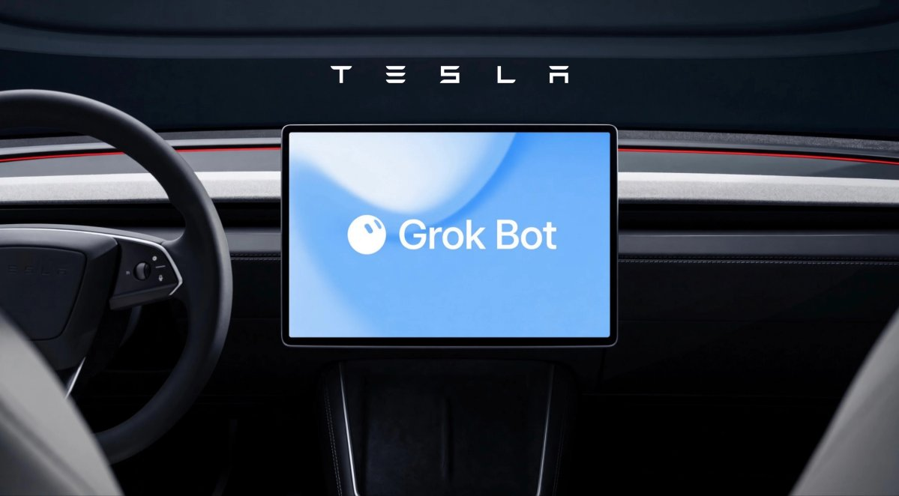



**收录说明**：直接下载；去掉了文末的订阅推广和站内推荐。Not a Tesla App 是关注特斯拉与 Musk 旗下公司的专门媒体。原文全文存于本目录的 original.md，网站上不显示，已翻译。

**内容摘要**：一位 X 用户称亚马逊在阻止 Grok Bot 下单，他的一个 Grok Bot 专门处理亚马逊退货；Musk 此前对屏蔽的回应是让用户的 Bot 去其他商店购买，这次回复「Maybe we should start a competitor to Amazon」。文章说明这并非正式宣布，Musk 没有给出任何计划；文中还提到上个月特斯拉在车辆中集成了 Grok Bot。

**保留理由**：记录了大型电商平台屏蔽个人智能体代购、以及厂商回应的一个具体事件，可用于分析智能体在第三方网站上执行任务时遇到的平台阻力。

---

## 在据报道亚马逊阻止 Grok Bot 下单之后，Elon Musk 提出要推出一个亚马逊竞品，但他没有分享任何具体计划。

@niccruzpatane / X

Nehal Malik

2026 年 10 月 15 日

Elon Musk 正在提出挑战亚马逊的想法。在一位 X 用户声称亚马逊正在阻止 Grok Bot 智能体下单后，Musk [回复](https://x.com/elonmusk/status/2110715556328579219?s=20)：「也许我们应该创办一个亚马逊的竞争对手。」

这不是正式宣布，Musk 也没有分享任何细节或具体计划。不过，它暗示了围绕 AI 智能体将如何替人们在网上购物这场争夺中的一个新战线。

## 亚马逊 vs. AI 购物 Bot

这场交流始于 [@thecsguy](https://x.com/thecsguy/status/2110693166059851836) 的一条帖子，该用户称自己的一个 Grok Bot 只处理他们的亚马逊退货。他们指出，Musk 早先对封锁的回应是让人们让 Bot 去其他商店购买，然后鼓励 Elon 考虑一个「X Shop」。

> 也许我们应该创办一个亚马逊的竞争对手 🤔 <https://t.co/OkjTB9jmGZ>
>
> — Elon Musk (@elonmusk) [2026 年 10 月 15 日](https://x.com/elonmusk/status/2110715556328579219?ref_src=twsrc%5Etfw)

Grok 的购物 Bot 旨在替用户寻找优惠并完成购买，这意味着购物者完全不需要访问零售商的网站。上个月 Tesla [将 Grok Bot 集成到其车辆中](https://www.notateslaapp.com/news/4724/tesla-adds-grok-bot-to-vehicles-for-hands-free-errands-and-tasks)，用户只需在早晨通勤时把下单委托给他们的智能体。这对想要控制人们在其平台上购物方式的零售商来说是个问题。据报道，亚马逊也屏蔽了 Meta 的 Muse AI 购物智能体，同时自己在构建 AI 购物工具。

## Musk 真的能与亚马逊较量吗？

从零开始创办一个亚马逊竞品绝非小事。亚马逊花了几十年构建其物流网络，从仓库到最后一英里配送，并已从一家在线店面演变为一家成熟的科技（[甚至汽车](https://www.notateslaapp.com/news/4348/amazons-zoox-unveils-new-robotaxi-design)）公司。竞争对手需要的不仅仅是一个聪明的 AI 界面。它还必须签约商家、建立可靠的履约和配送，并说服购物者改变习惯。

数字显示了亚马逊的规模。截至本文撰写时，亚马逊估值约为 2.73 万亿美元，几乎是 Tesla 1.42 万亿美元市值（market cap）的两倍。拥有 X 的 SpaceX 更接近，为 1.94 万亿美元。需要把 Tesla 和 SpaceX 合并计算，价值约 3.36 万亿美元，才能超过这家电商巨头。

Musk 有把随口发的帖子变成真实项目的过往记录，但这一次仍只是一个想法。就目前而言，依赖智能体购物的 Grok Bot 用户可能需要把目光投向亚马逊之外。Musk 是否会落实一个 X Shop 或其他店面，可能取决于有多少其他零售商决定屏蔽 AI 智能体。

## 不要错过任何报道
