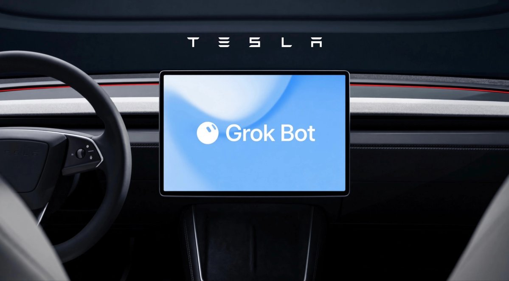

来源：https://www.notateslaapp.com/news/4834/musk-considers-creating-amazon-competitor
取文：2026-11-05，直接下载

## After Amazon reportedly blocked Grok Bot from placing orders, Elon Musk floated launching an Amazon competitor, though he shared no concrete plans.

@niccruzpatane / X

Nehal Malik

October 15, 2026

Elon Musk is floating the idea of taking on Amazon. After an X user claimed Amazon is blocking Grok Bot agents from placing orders, Musk [replied](https://x.com/elonmusk/status/2110715556328579219?s=20), “Maybe we should start a competitor to Amazon.”

It’s not a formal announcement, and Musk didn’t share any details or concrete plans. Still, it hints at a new front in the fight over how AI agents will shop for people online.

## Amazon vs. AI Shopping Bots

The exchange started with a post from [@thecsguy](https://x.com/thecsguy/status/2110693166059851836), who said one of their Grok Bots only handles their Amazon returns. They noted that Musk’s earlier answer to the block was for people to have their bots buy from other stores instead, then encouraged Elon to consider an “X Shop.”

> Maybe we should start a competitor to Amazon 🤔 <https://t.co/OkjTB9jmGZ>
>
> — Elon Musk (@elonmusk) [October 15, 2026](https://x.com/elonmusk/status/2110715556328579219?ref_src=twsrc%5Etfw)

Grok’s shopping bots are designed to search for deals and complete purchases on a user’s behalf, meaning shoppers wouldn’t need to visit a retailer’s website at all. With Tesla [integrating Grok Bot into its vehicles](https://www.notateslaapp.com/news/4724/tesla-adds-grok-bot-to-vehicles-for-hands-free-errands-and-tasks) last month, users can simply delegate placing orders to their agents while on their morning commute. That’s a problem for retailers that want to control how people shop on their platforms. Amazon has also reportedly blocked Meta’s Muse AI shopping agent, while building AI shopping tools of its own.

## Could Musk Really Take On Amazon?

Starting an Amazon competitor from scratch would be no small task. Amazon has spent decades building its logistics network, from warehouses to last-mile delivery, and it has evolved from an online storefront into a full-fledged tech ([and even automotive](https://www.notateslaapp.com/news/4348/amazons-zoox-unveils-new-robotaxi-design)) company. A rival would need more than just a smart AI interface. It would also have to sign up merchants, set up reliable fulfillment and delivery, and convince shoppers to change their habits.

The numbers show how big Amazon is. At the time of writing, Amazon is valued at about $2.73 trillion, nearly double Tesla’s $1.42 trillion market cap. SpaceX, which owns X, comes closer at $1.94 trillion. It would take a combined Tesla and SpaceX, worth roughly $3.36 trillion, to outvalue the e-commerce giant.

Musk has a history of turning offhand posts into real projects, but this one is still just an idea. For now, Grok Bot users who rely on agents for shopping may need to look beyond Amazon. Whether Musk follows through with an X Shop or another storefront could depend on how many other retailers decide to block AI agents.

## Never Miss a Story
